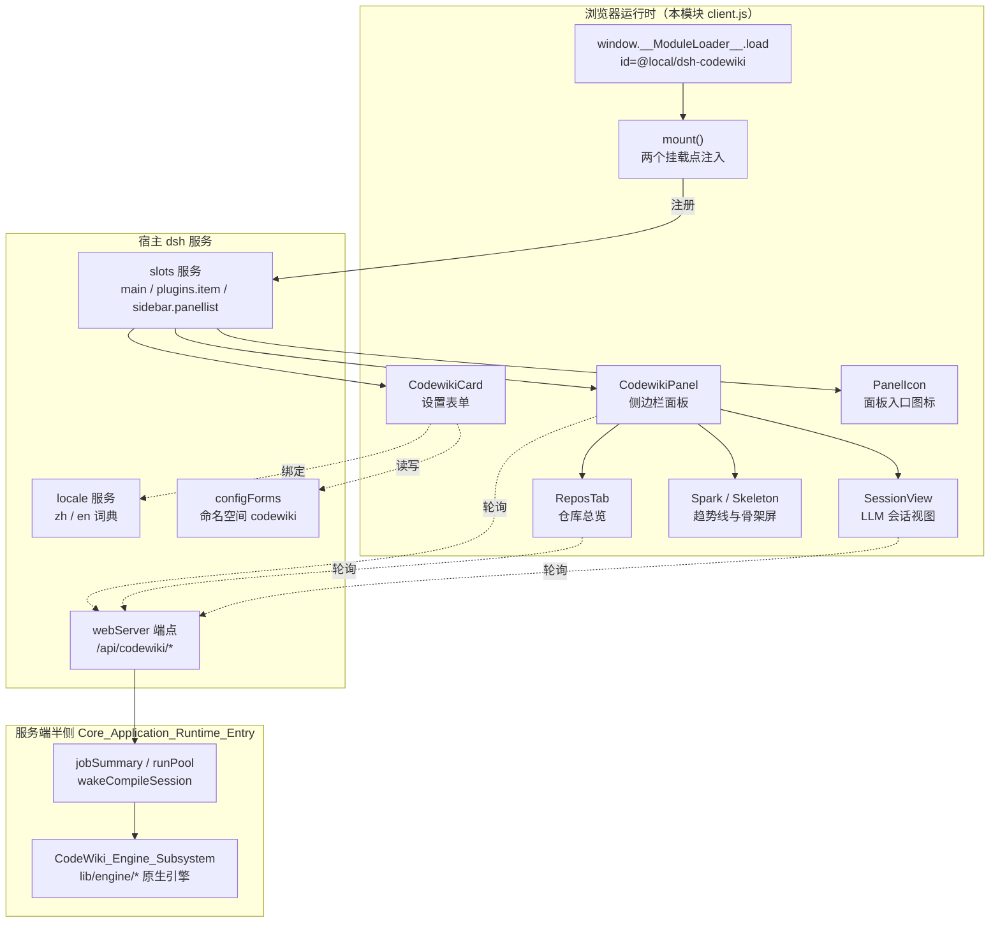
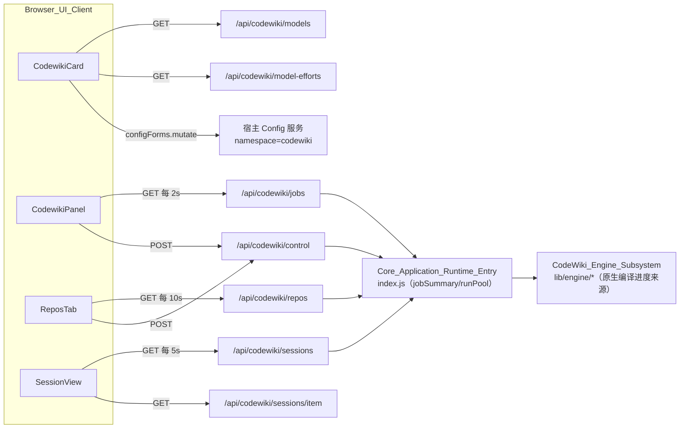
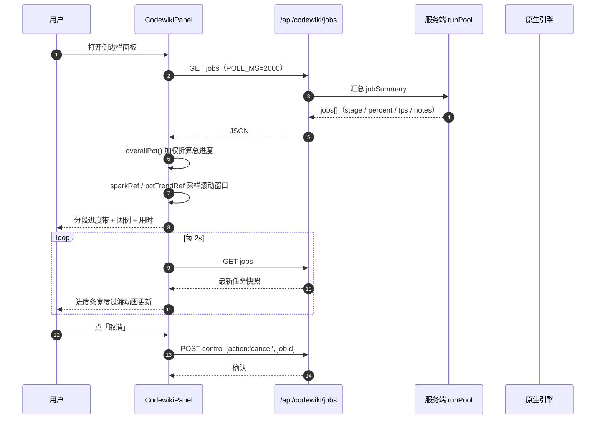
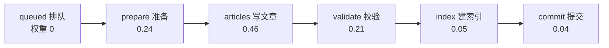
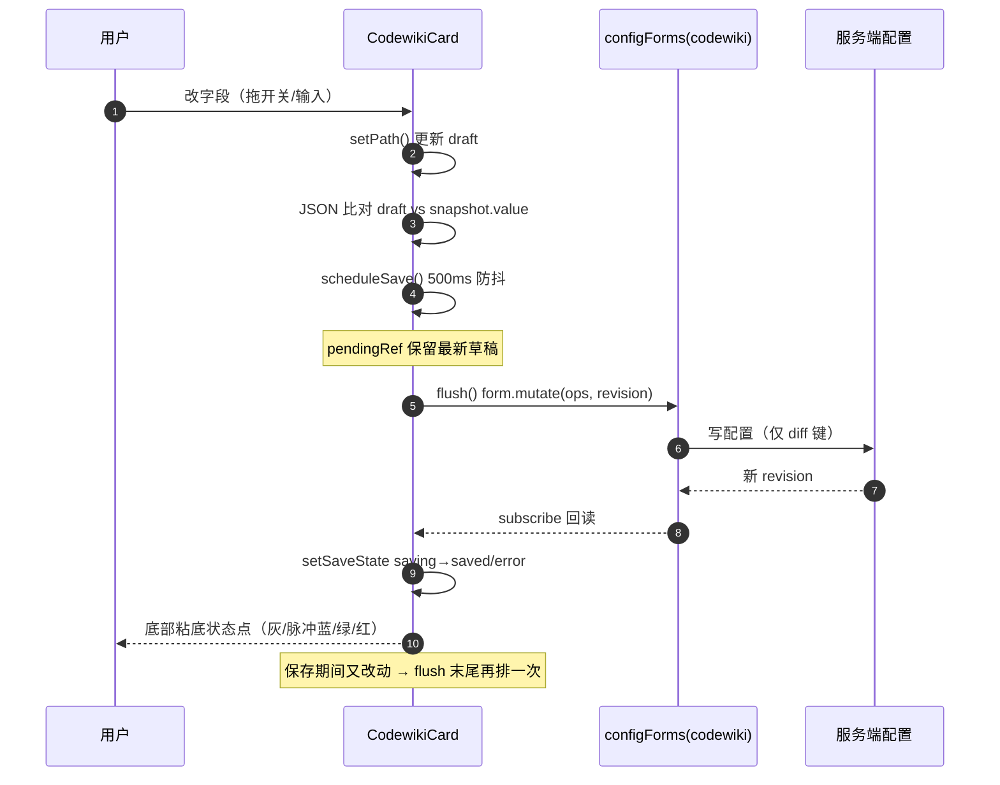
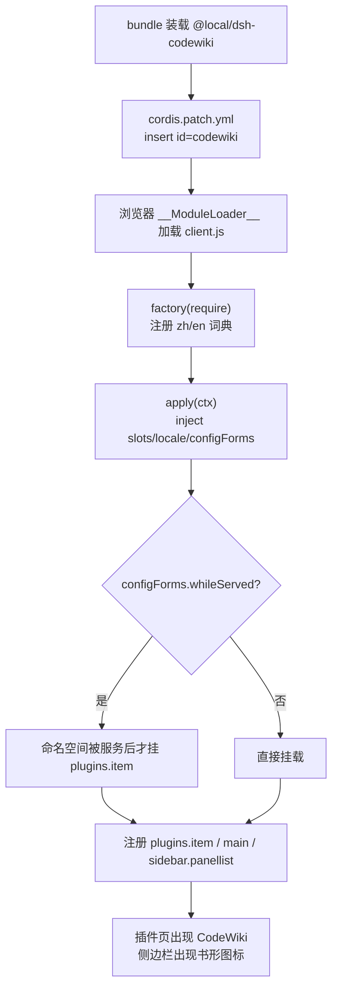

# Browser_UI_Client 浏览器客户端模块

## 简介

`Browser_UI_Client` 是 `dsh-codewiki` 插件的**浏览器半侧**（见 `client.js`，v0.4.1）。它在宿主 DeepSeek Harness（dsh）的浏览器运行时中加载，负责全部与用户交互的界面：插件设置表单、侧边栏编译任务进度面板、仓库总览与 LLM 请求会话视图。

该模块本身**不执行编译**，它只是宿主半侧（服务端）能力的「显示器 + 遥控器」：

- **读**：通过轮询 `GET /api/codewiki/*` 端点拿任务、仓库、会话、模型目录等实时数据。
- **写**：通过 `POST /api/codewiki/control`（仅回环）下发取消、编译、确认、刷新等控制动作。
- **配置**：经宿主 `configForms` 服务的 `codewiki` 命名空间热读写设置，无需重启。

两个挂载点（见 `client.js` 顶部注释）：

1. **「插件」页** `plugins.item`（`id = codewiki`）——设置卡片 `CodewikiCard`。
2. **侧边栏面板** `main` + `sidebar.panellist`（`key/id = codewiki`，`PANEL_ORDER = 52`）——任务进度与取消。

> 关键约束（来自代码头注释与 `package.json`）：注册 `id` 必须等于 `package.json` 的 `name`（`@local/dsh-codewiki`），`client-modules` 按 nearestPackage 的 name 校验注册者；profile patch 条目 `id = codewiki` 与设置命名空间一致。

---

## 架构总览

`apply(ctx)` 通过 `inject: ['slots', 'locale', 'configForms']` 声明对宿主三项服务的依赖。

---

## 模块组成与组件清单

| 组件 | 职责 |
|------|------|
| `mount` | 把 `CodewikiCard` 注入 `plugins.item`（`whileServed` 守卫），把 `CodewikiPanel` 注入 `main`、`PanelIcon` 注入 `sidebar.panellist` |
| `zh` / `en` | 中英双语词典（`t(key)` 的数据源）；值必须是字符串，函数会被回退成键名 |
| `CodewikiCard` | 设置页：运行开关、并发、原生引擎、增量策略、编译/大档模型三字段组、调度排除；带 500ms 自动保存 |
| `CodewikiPanel` | 侧边栏主面板：四个 Tab（总览/任务/会话/设置），2s 轮询任务，渲染分段进度带与图例 |
| `ReposTab` | 总览 Tab：五格统计、调度信息、按待办优先级排序的仓库清单、排除/确认/编译动作 |
| `SessionView` | 会话 Tab/弹层：并发池 LLM 请求列表（5s 轮询），点开看 prompt 与模型输出全文 |
| `PanelIcon` | 摊开的书 SVG 图标，作为侧边栏面板入口 |
| `Spark` | 纯 SVG mini 趋势线（tps 或总进度斜率） |
| `Skeleton` | 加载态三行呼吸条骨架屏 |
| `byUpdated` | 按 `updatedAt/createdAt` 倒序排序任务的比较器 |

---

## 依赖关系

- **宿主 UI 原语**：`@deepseek-ai/dsh-client-ui-primitives`（`Switch / Button / Input / Tag`）。
- **配置约定来源**：[Build,_Configuration___Environment_Setup](Build,_Configuration___Environment_Setup.md) —— `package.json` 的 `name=@local/dsh-codewiki` 与 `cordis.patch.yml` 的 `id: codewiki` 条目是本模块挂载注册的前置约定（配置项注释亦在该文件中）。
- **数据生产方**：[Core_Application_Runtime_Entry](Core_Application_Runtime_Entry.md) —— `index.js` 提供 `jobSummary`、`runPool`、`wakeCompileSession` 与全部 `/api/codewiki/*` webServer 端点。
- **进度语义来源**：[CodeWiki_Engine_Subsystem](CodeWiki_Engine_Subsystem.md) —— 面板显示的八段原生阶段（`env/graph/cluster/articles/proofread/validate/index/baseline/commit`）与质量门/落地结果由该子系统产出。

---

## 数据流：任务进度轮询

客户端侧的三个采样引用（`sparkRef` tps 窗口、`pctTrendRef` 总进度斜率窗口、`batchRateRef` 完成速率 EWMA）都是**纯客户端差分计算**，服务端只给原始快照。

---

## 进度模型

面板六步阶段（`ACTIVE_STAGES`）与总进度权重（`STAGE_WEIGHTS`）：

- **总进度**：`Σ 权重 × 阶段完成度`，进行中封顶 99%，`done/partial` 才到 100%。
- **完成度口径**：当前阶段优先用引擎自报的 `nativePercent`，否则回退到 `taskList` 完成率。
- **历史兼容**：`LEGACY_STAGE` 把退役阶段名（`plan→prepare`、`crosscut→articles`、`review→validate`）映射到现步骤，保证老任务步骤条不整条熄灭。
- **段宽语义**：进行中段宽 = 进度权重；终态段宽 = 该阶段真实耗时（`stageTimings`），一眼看出时间花在哪一步。

---

## 组件交互：设置自动保存

`SAVE_KEYS` 白名单决定哪些字段会被 diff 落盘；`validateDraft` 拦住越界并发（1–8）与请求上限（1–1000）。

---

## 挂载与注册流程

> 安装方式（A bundle 依赖 / B file:// 直挂）与 `id` 一致性要求详见 [Build,_Configuration___Environment_Setup](Build,_Configuration___Environment_Setup.md) 的 `cordis.patch.yml`。

---

## API 端点一览（本模块消费）

| 端点 | 方法 | 轮询周期 | 使用组件 | 用途 |
|------|------|----------|----------|------|
| `/api/codewiki/jobs` | GET | 2s | `CodewikiPanel` | 编译任务列表与进度 |
| `/api/codewiki/repos` | GET | 10s | `ReposTab` | 仓库状态总览 + 调度信息 |
| `/api/codewiki/sessions` | GET | 5s | `SessionView` | LLM 请求记录列表（可带 `jobId`） |
| `/api/codewiki/sessions/item` | GET | 按需 | `SessionView` | 单条 prompt/输出全文 |
| `/api/codewiki/models` | GET | 一次性 | `CodewikiCard` | 模型提供商/模型目录 |
| `/api/codewiki/model-efforts` | GET | 联动 | `CodewikiCard` | 某模型的思考程度档位 |
| `/api/codewiki/control` | POST | 按需 | `CodewikiPanel`/`ReposTab` | cancel / compile / confirm / refresh |

控制动作体：`{action:'cancel', jobId}`、`{action:'compile', cwd}`、`{action:'confirm', cwd}`、`{action:'refresh'}`。

---

## 设计要点

1. **纯展示层**：编译逻辑全在服务端，客户端只做快照渲染与动作转发；无编译状态本地缓存。
2. **防重叠轮询**：每个拉取函数都有 `inFlightRef`，服务卡顿导致上一轮未回包时跳过本轮。
3. **卸载安全**：所有轮询 effect 返回清理函数，`mountedRef`/`alive` 标志防止卸载后 `setState`。
4. **优雅降级**：模型目录拉不到时设置页退回「手填 provider/model id」形态，不阻断保存；请求思考档位不被模型支持时由 `llmChat` 兜底剥档重试。
5. **可解释的进度**：分段带（段宽=权重或耗时）+ 图例（色块绑定阶段）+ 活动流（状态点+阶段标签+正文）+ 引擎日志（最近 40 条），四级可解释性。
6. **中英文词典**：`zh()`/`en()` 两个工厂每次 `locale.register` 时调用；词典值必须是字符串。

---

## 相关模块

- [Build,_Configuration___Environment_Setup](Build,_Configuration___Environment_Setup.md) —— `package.json` 与 `cordis.patch.yml` 的注册约定。
- [Core_Application_Runtime_Entry](Core_Application_Runtime_Entry.md) —— 服务端半侧，提供全部 `/api/codewiki/*` 端点与 `runPool`/`jobSummary`。
- [CodeWiki_Engine_Subsystem](CodeWiki_Engine_Subsystem.md) —— 原生编译引擎，面板阶段/质量门/落地结果的真实来源。
- [Agentic_Article_Processing_Library](Agentic_Article_Processing_Library.md) —— 服务端文章写作子库（会话视图中 LLM 请求的生产方）。
