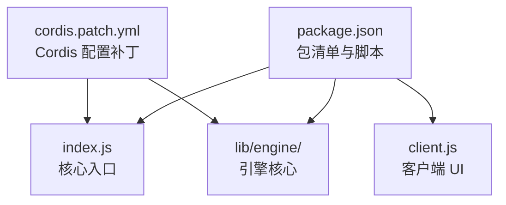

# 构建与依赖配置层

`Build___Dependency_Configuration_Layer` 是项目的构建与依赖配置中心，负责集中管理 Cordis 框架补丁定义与 npm 包清单。该层定义了项目的依赖声明、版本约束与 Cordis 扩展配置，是引擎运行时和客户端 UI 构建链路的前置基础。

## 核心职责

- **包清单管理**：通过 `package.json` 声明依赖版本、脚本命令与项目元信息。
- **Cordis 配置定制**：通过 `cordis.patch.yml` 对 Cordis 框架进行补丁式配置扩展。
- **构建入口对齐**：为 `index.js`、`client.js` 及 `lib/` 运行时提供一致的依赖与配置上下文。

## 架构关系

## 核心组件文档

- [package.json 包清单](Build___Dependency_Configuration_Layer/package_manifest.md)
- [cordis.patch.yml Cordis 配置补丁](Build___Dependency_Configuration_Layer/build_config.md)