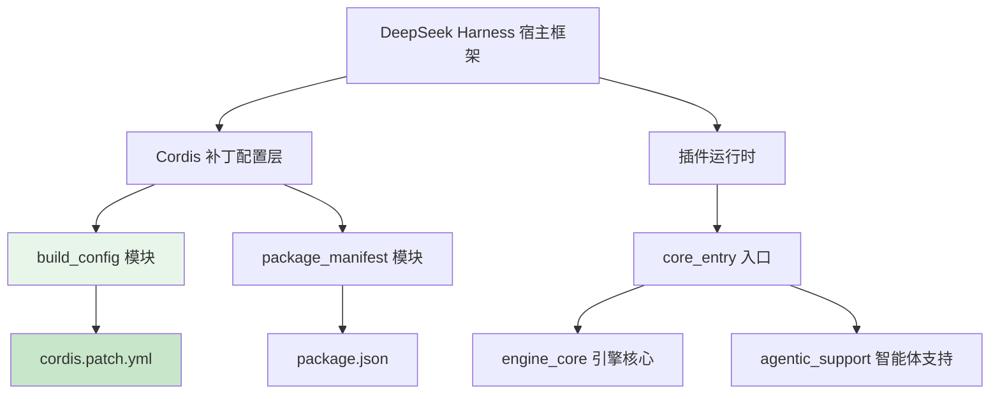
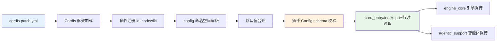
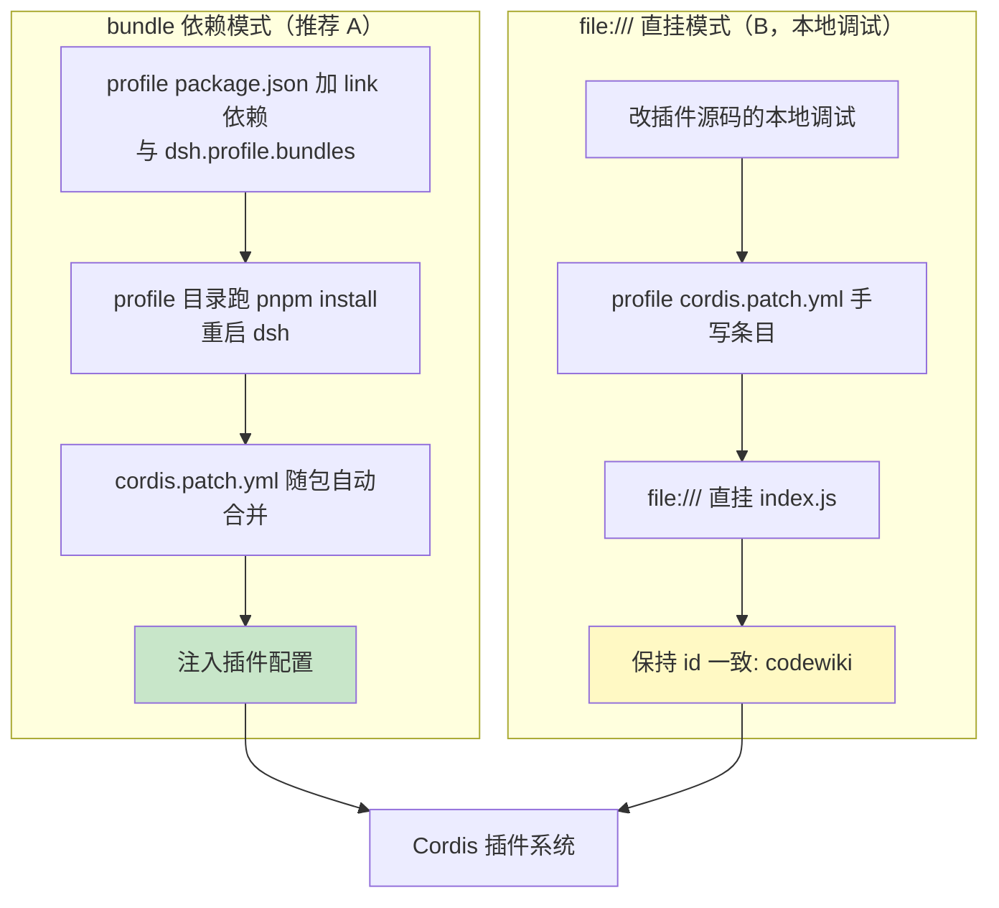
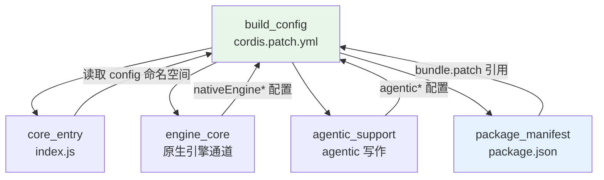

# 构建依赖配置层 — 构建配置（build_config）

## 概述

`build_config` 模块是构建依赖配置层（Build & Dependency Configuration Layer）的核心组成部分，负责管理插件的 Cordis 框架补丁配置。该模块通过 `cordis.patch.yml` 文件定义插件的挂载方式、配置命名空间及各项运行参数，是插件能够被 DeepSeek Harness 正确加载和运行的基础。

## 模块组成

| 文件路径 | 说明 |
|---------|------|
| `cordis.patch.yml` | Cordis 补丁配置文件，定义插件挂载点与配置项 |

## 架构位置



## 核心组件详解

### cordis.patch.yml

`cordis.patch.yml` 是插件的 Cordis 框架补丁配置文件，主要包含以下关键信息：

#### 1. 插件元数据

```yaml
- insert:
    - id: codewiki
      name: "@local/dsh-codewiki"
      config: {}
```

- **`id: codewiki`**：插件的唯一标识符，用于在 Cordis 框架中注册和引用
- **`name`**：插件入口。bundle 装法下为裸 npm 包名 `@local/dsh-codewiki`（client 半边的激活扫描只认裸包名行，不带 `/dsh` 子路径）；本地调试也可改用 `file:///<源码绝对路径>/index.js` 直挂（URL 中空格写 `%20`）
- **`config: {}`**：默认配置为空对象，所有配置项的默认值由插件内部的 Config schema 定义
- **覆盖语义**：要改配置时，在 profile 自己的 `cordis.patch.yml` 里写同 id 覆盖条目——同 id 覆盖是整对象替换，未写的键回落到 `index.js` 的 Config 默认值

#### 2. 配置项分类

配置项按功能可分为四大类：

| 类别 | 配置项 | 说明 |
|-----|--------|------|
| **二进制路径** | `binaryPath` | `cw` 可执行文件路径 |
| **编译模型** | `batchProvider`<br>`batchModel`<br>`batchReasoningEffort` | 编译使用的模型提供商、模型 ID、思考程度 |
| **并发控制** | `maxConcurrency`<br>`bigConcurrency`<br>`serialProjects` | 默认档并发、大档并发、单项目串行 |
| **写作模式** | `planMode`<br>`agenticArticles`<br>`agenticMaxSteps`<br>`symbolIncremental` | 模块划分方式、agentic 写作开关、步数上限、符号级增量 |
| **会话行为** | `articleLanguage`<br>`updateReminder`<br>`autoCommit` | 文章语言、维护提醒注入、自动提交 |
| **原生引擎** | `nativeEngine`<br>`nativeEnginePython`<br>`nativeEngineEntry`<br>`nativeEngineTimeoutMs` | 原生引擎开关、Python 解释器路径、入口脚本、超时时间 |

## 配置项详解

### 基础编译配置

| 配置项 | 类型 | 默认值 | 说明 |
|--------|------|--------|------|
| `binaryPath` | string | 空 | `cw` 可执行文件路径；留空时优先使用 PATH 中的 `cw`，找不到则使用插件自带 `bin/cw.exe` |
| `batchProvider` | string | `volces-ark` | 编译模型提供商，必须是模型设置中已注册的 provider；留空则提交失败 |
| `batchModel` | string | `glm-5.3-flash` | 编译模型 ID，默认 512k 上下文模型 |
| `batchReasoningEffort` | string | 空 | 思考程度档位，取值来自模型目录 `reasoning.efforts`；留空使用模型默认档 |

### 并发控制配置

| 配置项 | 类型 | 默认值 | 取值范围 | 说明 |
|--------|------|--------|---------|------|
| `maxConcurrency` | number | 2 | 1–8 | 默认档并发上限 |
| `bigConcurrency` | number | 0 | 1–8 | 大档并发上限；0 表示跟随默认档，与默认档各自独立限流、同时推进 |
| `serialProjects` | boolean | true | - | 单项目串行模式开启；同一时刻只推进一个仓库的编译任务，其余排队 |

### 写作模式配置

| 配置项 | 类型 | 默认值 | 说明 |
|--------|------|--------|------|
| `planMode` | string | `auto` | 模块划分模式：`auto`=AST 符号 + LLM 语义聚类；`dirs`=顶层目录分组（旧行为） |
| `agenticArticles` | boolean | true | 文章写作走 agentic 工具循环：模型自己 `read_code` / `edit_article`，不整包内联 |
| `agenticMaxSteps` | number | 30 | agentic 单篇步数上限，取值范围 1–100 |
| `symbolIncremental` | boolean | true | 增量按 AST 符号级判定：只重写接口真变了的模块，注释/空白改动跳过 |

### 会话行为配置

| 配置项 | 类型 | 默认值 | 说明 |
|--------|------|--------|------|
| `articleLanguage` | string | `zh` | 文章生成语言，默认中文 |
| `updateReminder` | boolean | true | 会话系统提示注入 wiki 维护提醒（仅当会话仓库存在 `.codewiki/` 时） |
| `autoCommit` | boolean | true | 编译完成后自动提交 wiki 产物 |

### 原生引擎通道配置

> **注意**：原生引擎通道在 0.15.0 引入，0.16.0 起默认开启，需要本机 Python 3.10+ 与闭合依赖环境。

| 配置项 | 类型 | 默认值 | 说明 |
|--------|------|--------|------|
| `nativeEngine` | boolean | true | `true`（默认）=编译交给上游 FSoft Python 引擎；`false`=走内置 Node 兼容通道 |
| `nativeEnginePython` | string | 空 | venv 解释器绝对路径；留空 → 环境变量 `DSH_CODEWIKI_PYTHON` → `'python'` |
| `nativeEngineEntry` | string | `lib/engine/python/entry.py` | 入口脚本路径，一般不用修改 |
| `nativeEngineTimeoutMs` | number | 2700000 | 单次引擎调用上限，默认 45 分钟 |

**关键设计原则**：
- 两条通道并存、互不回退
- 原生通道环境不闭合时以 `engine-deps` 明确失败
- 不会悄悄改用 Node 通道

## 配置数据流



## 挂载方式对比



## 与其他模块的关系



### 关联模块文档

- 核心入口逻辑：[core_entry.md](../core_entry.md)
- 引擎核心实现：[engine_core.md](../engine_core.md)
- 智能体支持：[agentic_support.md](../agentic_support.md)
- 包清单配置：[package_manifest.md](package_manifest.md)
- 验证工具：[fsoft_engine_tools.md](../Ecosystem_Tooling___Validation_Layer/fsoft_engine_tools.md)

## 最佳实践

### 1. 配置声明原则

```yaml
# 推荐：只声明需要修改的项，其余沿用默认
config:
  batchModel: glm-5.3-flash
  maxConcurrency: 4
  agenticArticles: true
```

```yaml
# 不推荐：重复声明所有默认值
config:
  batchProvider: volces-ark
  batchModel: glm-5.3-flash
  maxConcurrency: 2
  # ... 冗长的默认值列表
```

### 2. 原生引擎通道解释器指向

```yaml
config:
  # nativeEngine 自 0.16.0 起默认开启；通常只需显式指向 venv 解释器
  nativeEnginePython: /path/to/venv/bin/python
  # 其余配置保持默认
```

### 3. 模型切换

```yaml
config:
  batchProvider: volces-ark
  batchModel: glm-5.3-flash
  batchReasoningEffort: medium
```

## 版本历史

| 版本 | 变更说明 |
|------|---------|
| 0.13.0 | 吸入 AST 聚类 / agentic 写作 / 符号级增量三层能力 |
| 0.15.0 | 引入可选的原生引擎通道，默认关闭 |
| 0.16.0 | 原生引擎通道成为默认（`nativeEngine: true`） |

## 相关文件路径

| 文件 | 说明 |
|------|------|
| `cordis.patch.yml` | 本模块的核心配置文件 |
| `package.json` | 插件元数据与 bundle 配置，见 [package_manifest.md](package_manifest.md) |
| `tools/fsoft-engine/setup-env.sh` | 原生引擎环境安装脚本，见 [fsoft_engine_tools.md](../Ecosystem_Tooling___Validation_Layer/fsoft_engine_tools.md) |
