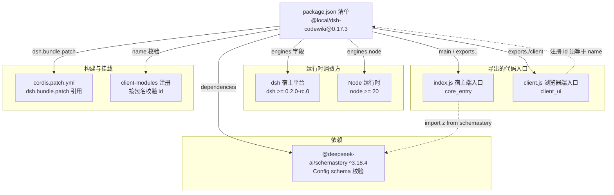
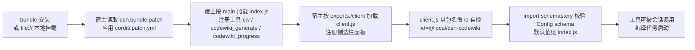
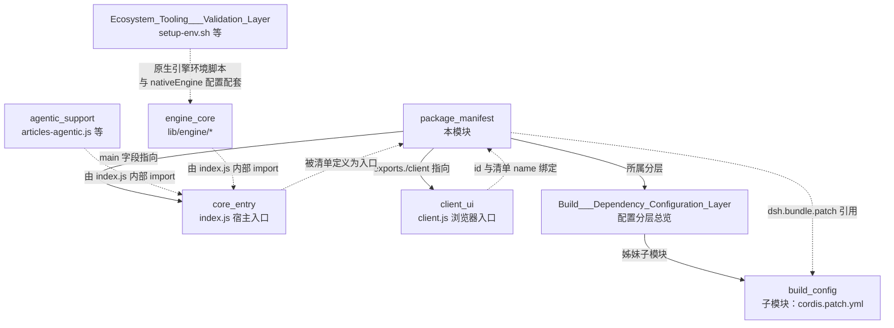

# package_manifest：插件包清单（package.json）

## 引言

`package_manifest` 是 dsh-codewiki 插件的 npm 包清单文件，位于仓库根目录 `package.json`。它是整个插件对外暴露的**唯一身份定义**：包名、版本、入口导出、运行时引擎要求、宿主平台要求、依赖关系以及 dsh 平台的客户端/打包元数据。

在依赖与配置分层（[Build___Dependency_Configuration_Layer](../Build___Dependency_Configuration_Layer.md)）中，本模块承担"**自描述清单**"职责：不包含任何运行逻辑，而是被 dsh 宿主、Node 运行时和打包流程消费。所有实际配置（默认值、开关项）由插件代码内的 Config schema 与 patch 文件承载，清单文件本身只声明"这是什么、跑在哪、导出什么"。

## 核心组件

### package.json::package.json

这是本模块唯一的核心组件——一个标准的 Node/npm `package.json`，但带有 dsh 平台专属的顶层 `dsh` 字段。

### 关键字段逐项解读

| 字段 | 值 | 作用说明 |
|---|---|---|
| `name` | `@local/dsh-codewiki` | 包名。`@local/` 作用域表明这是本地私有插件（不发布到 npm registry）。**客户端模块注册用它做校验**：`client.js` 中 `window.__ModuleLoader__.load({ id: '@local/dsh-codewiki', ... })` 的 id 必须与此一致（client-modules 按 nearestPackage 的 name 校验注册者） |
| `version` | `0.17.3` | 语义化版本。description 中记录了关键版本里程碑（0.16.0 默认切原生引擎、0.16.13 更换默认模型、0.16.0 phase 7 删除 Node 侧算法重写） |
| `description` | 长文本 | 插件的设计自述：声明默认通道为原生引擎（`nativeEngine: true`），Node 通道仅作最小兼容保留；默认模型 `volces-ark/glm-5.3-flash` 512k；零子代理、单项目串行 |
| `private` | `true` | 私有包，禁止误发布到 npm |
| `type` | `"module"` | 全仓库使用 ESM（`import`/`export`），无 CommonJS 回退 |
| `main` | `index.js` | 宿主端（Node 侧）入口。即 [core_entry](../core_entry.md) 所在的 index.js：导出插件 name、工具定义与 tick 循环 |
| `exports` | `{ ".": "./index.js", "./client": "./client.js" }` | 双入口契约：`.` 指向宿主端入口；`./client` 指向浏览器端入口（见 [client_ui](../client_ui.md)） |
| `license` | `MIT` | 许可证 |
| `engines.node` | `>=20` | Node 最低版本要求 |
| `engines.dsh` | `>=0.2.0-rc.0` | dsh 宿主平台最低版本要求 |
| `dependencies` | `@deepseek-ai/schemastery: ^3.18.4` | **唯一运行时 npm 依赖**：Config schema 校验库。index.js 中以 `import z from '@deepseek-ai/schemastery'` 使用，用来声明插件配置的默认值与类型 |
| `dsh.client.platform` | `web` | 声明客户端为 Web 平台（React 侧边栏面板） |
| `dsh.bundle.patch` | `./cordis.patch.yml` | 打包时应用的 cordis patch 文件路径，指向仓库根的 `cordis.patch.yml`（宿主挂载点与设置命名空间声明，详见 [Build___Dependency_Configuration_Layer](../Build___Dependency_Configuration_Layer.md)） |

## 架构图：清单在系统中的位置



**图 1：清单被各方消费的关系**——清单文件本身不含逻辑，它是宿主、打包器、客户端注册器和 Node 运行时共同读取的"契约中心"。

## 数据流：一个安装请求如何流经清单字段



**图 2：从安装到可用的字段消费链**——任何一环字段不一致（如 client.js 的 id 与 package.json 的 name 不符）都会导致注册校验失败。

## 与其他模块的关系



**图 3：模块依赖全景**——`package_manifest` 处于依赖配置分层的根位置，其导出字段是 [core_entry](../core_entry.md) 与 [client_ui](../client_ui.md) 的挂接点。

## 设计要点与约束

### 1. 双入口结构

`exports` 同时声明 `.` 与 `./client` 两个入口，这是 dsh 插件的标准形态：宿主端跑 Node 工具与 tick 循环（[core_entry](../core_entry.md)），浏览器端跑 React 侧边栏面板（[client_ui](../client_ui.md)）。两个入口共享同一个包名作为注册身份。

### 2. 唯一依赖的极简策略

运行时 npm 依赖只有 `@deepseek-ai/schemastery` 一个——插件的大部分能力（编译流水线、原生引擎驱动、agentic 文章写作）都在仓库内部实现，外部依赖被刻意压到最少。原生引擎的 Python 侧依赖**不走 npm**，而是由 [Ecosystem_Tooling___Validation_Layer](../Ecosystem_Tooling___Validation_Layer.md) 中的 `tools/fsoft-engine/setup-env.sh` 在仓库外的独立 venv 中按冻结清单（`--no-deps` 快照 + `pip check` 闭合验证）安装。

### 3. 版本演进记录在 description 中

description 字段承担了版本决策日志的角色，关键里程碑：

- **0.16.0**：默认通道切换为原生引擎（`nativeEngine: true`），Node 侧 FSoft 算法重写（symbols/cluster/graph-diff/incremental/update-planner）在 phase 7 退役删除；Node 通道（`nativeEngine: false`）降级为仅顶层目录分组 + 文件级 source_files 归因的兼容通道，不再加新特性。
- **0.16.13**：默认模型从 workbuddy/hy3 192k 切换为 `volces-ark/glm-5.3-flash` 512k——原因是 hy3 的窗口装不下本仓库的模块源码。
- **0.17.0**：零子代理、单项目串行的当前形态确立。
- **0.17.1**：原生通道引擎事件日志双通道（内存最近 40 条 + 仓库外 NDJSON，见 [core_entry](../core_entry.md)）；该增量落在插件代码内部，无清单字段层面的语义变化。
- **0.17.2**：清单字段层面无新的语义变化。
- **0.17.3**：当前补丁版本，清单字段层面无新的语义变化。

### 4. 原生引擎通道的版本语义

description 中明确"原生引擎需要本地 Python 3.10+ venv with closed deps"。这意味着：

- npm 包本身的版本（0.17.3）**不等于**原生 Python 引擎的版本；
- Python 引擎的版本/上游 commit 锁定由 [engine_core](../engine_core.md) 中的 `lib/engine/manifest.js`（`UPSTREAM_COMMIT` 常量与 `.codewiki/engine-lock.json` 落盘）管理——那是运行期的环境清单，与本文件的 npm 清单是两套独立机制；
- 环境搭建由 `tools/fsoft-engine/setup-env.sh` 完成（见 [fsoft_engine_tools](../Ecosystem_Tooling___Validation_Layer/fsoft_engine_tools.md)）。

### 5. dsh 专属字段

```json
"dsh": {
  "client": { "platform": "web" },
  "bundle": { "patch": "./cordis.patch.yml" }
}
```

- `dsh.client.platform: "web"`：告诉 dsh 客户端加载器这是 Web 平台客户端（React 面板）；
- `dsh.bundle.patch: "./cordis.patch.yml"`：bundle 打包时自动应用仓库根的 patch 文件，声明宿主挂载点 id（`codewiki`）与配置命名空间。补丁文件的完整配置项注释（`batchProvider`、`nativeEngine`、`agenticArticles` 等约 20 项）见 [Build___Dependency_Configuration_Layer](../Build___Dependency_Configuration_Layer.md) 与 [build_config](build_config.md)。

## 相关文件索引

| 文件 | 与本模块的关系 |
|---|---|
| `package.json` | 本模块本体（1.3 KB，清单唯一文件） |
| `cordis.patch.yml` | 经 `dsh.bundle.patch` 引用的宿主挂载/配置声明 |
| `index.js` | `main` 字段指向的宿主端入口（[core_entry](../core_entry.md)） |
| `client.js` | `exports./client` 指向的浏览器端入口（[client_ui](../client_ui.md)） |
| `tools/fsoft-engine/setup-env.sh` | 原生引擎 Python 环境搭建脚本，与 description 中声明的 nativeEngine 通道配套 |
| `.codewiki/engine-lock.json` | 运行期引擎环境指纹落盘（`lib/engine/manifest.js` 写入），与本 npm 清单互补 |

## 参考链接

- 配置分层总览：[Build___Dependency_Configuration_Layer](../Build___Dependency_Configuration_Layer.md)
- patch 挂载配置：[build_config](build_config.md)
- 宿主端入口：[core_entry](../core_entry.md)
- 浏览器端面板：[client_ui](../client_ui.md)
- 原生引擎环境与脚本：[Ecosystem_Tooling___Validation_Layer](../Ecosystem_Tooling___Validation_Layer.md) / [fsoft_engine_tools](../Ecosystem_Tooling___Validation_Layer/fsoft_engine_tools.md)
- 引擎环境指纹清单（运行期）：[engine_core](../engine_core.md)
