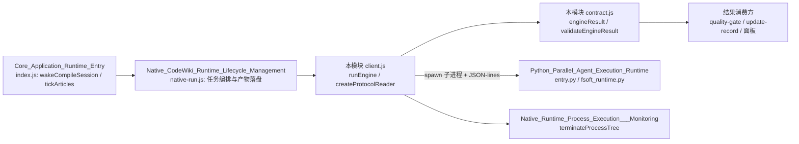
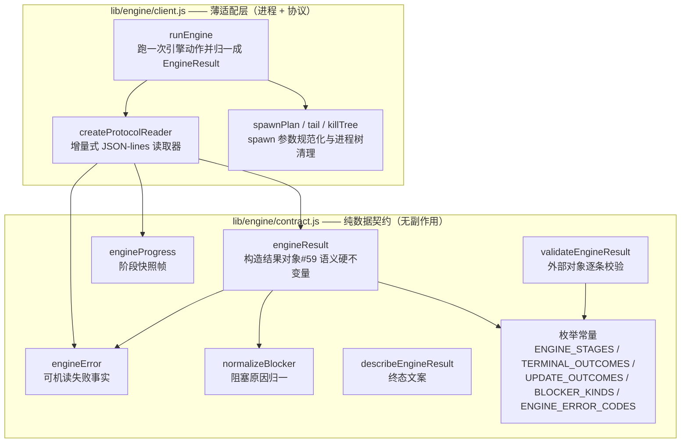
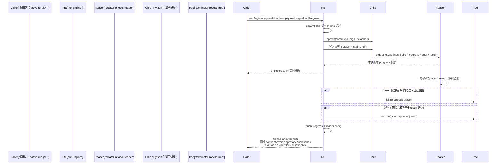

# 引擎公共 API 与结果校验（Core_Engine_Public_API___Result_Validation）

## 简介

本模块是 CodeWiki 引擎子系统中 **Node.js 与 Python 原生引擎之间唯一的跨语言边界**，由两个文件构成：

- `lib/engine/client.js` —— 进程与协议的**薄适配层**：负责起受管子进程、读写 JSON-lines 协议帧，并把引擎消息翻译成契约对象；超时 / 取消 / 崩溃 / 协议破坏时一律产出**可机读**的失败，而不是抛模糊异常。
- `lib/engine/contract.js` —— **版本化的纯数据契约**：定义一次 `generate` / `update` 运行的完整结果（`EngineResult`）、推进中的阶段快照（`EngineProgress`）与可机读失败事实（`EngineError`），并用构造时校验与反序列化校验双重钉死终态语义。

设计上故意把职责收得很窄：聚类、图 diff、文章写作是 Python 引擎的活；凭证与模型通道由 [LLM_Provider_Bridge_Integration](LLM_Provider_Bridge_Integration.md) 单独提供；产物落盘与模块映射在 `output.js` / `mapping.js`（见 [Wiki_Content_Health_Scanning___Plan_Application](Wiki_Content_Health_Scanning___Plan_Application.md)）。本模块**不做这些事**——只保证「引擎到底成功了没有」这一个问题有唯一、可校验的答案。

契约存在的根因（写在 `contract.js` 头部）：迁移后 Node 不再自己算依赖图，一切结论都来自 Python 引擎的一次返回。这条边界一旦含糊，下游每个消费方（任务终态判定、面板步骤条、cw 基线推进、自动提交、降级提醒）都会各自猜「成功了没有」——这正是 0.14.0 花一整轮修掉的缺陷类型（1 篇成功 + 19 篇失败也报 `done`）。

---

## 在子系统中的位置

- **上游调用方**：`runEngine` 由 [Native_CodeWiki_Runtime_Lifecycle_Management](Native_CodeWiki_Runtime_Lifecycle_Management.md) 中的任务编排层（`native-run.js`）调用，再往上是 [Core_Application_Runtime_Entry](../Core_Application_Runtime_Entry.md) 的运行入口。
- **下游被调方**：Python 引擎进程（详见 [Python_Parallel_Agent_Execution_Runtime](Python_Parallel_Agent_Execution_Runtime.md)）。
- **进程治理依赖**：`terminateProcessTree` 属于 [Native_Runtime_Process_Execution___Monitoring](Native_CodeWiki_Runtime_Lifecycle_Management/Native_Runtime_Process_Execution___Monitoring.md)。
- **结果消费方**：质量门（[Native_Output_Quality_Gating](Native_CodeWiki_Runtime_Lifecycle_Management/Native_Output_Quality_Gating.md)）、增量记录（[Shared_Infrastructure_Utilities](../Shared_Infrastructure_Utilities.md) 中的 `lib/update-record.js`）与浏览器面板（[Browser_UI_Client](../Browser_UI_Client.md)）。

---

## 组件结构

`contract.js` 是**纯函数模块**：不碰文件、不碰进程、不碰模型，因此其语义可以被单元测试（`test-engine-client.mjs` 等）逐字节钉死。`client.js` 是唯一触碰子进程与 stdout/stderr 的地方。

---

## 一、协议层（client.js）

### 1.1 版本化：两个版本号各管一件事

| 常量 | 值 | 管辖范围 |
| --- | --- | --- |
| `ENGINE_PROTOCOL_VERSION` | `1` | **行怎么长**：JSON-lines 消息帧的线格式 |
| `ENGINE_CONTRACT_VERSION` | `3`（0.17.38） | **结果字段**：`EngineResult` 的字段与枚举语义 |

协议版本独立于结果契约版本。阶段枚举（`ENGINE_STAGES`）是契约的一部分，新增阶段必须升契约版本——0.17.32 的「校对格子不亮」事故就是因为进度帧用了 `'proofread'` 而枚举表未登记，导致构造帧时抛错被调用方吞掉。0.17.38 把 `'proofread'` 补登并将契约升到 3。

### 1.2 六条协议不变量

对应测试 `test-engine-client.mjs` 的断言：

1. stdout **只**是 JSON-lines；任何非 JSON 行记 `not-json` 违规，但**不丢弃**已收结果。
2. 每条消息必须带匹配的 `requestId`；不匹配记 `unknown-request`，绝不参与本次结果。
3. 没有 `result` 消息 = 协议破坏，即使退出码是 0 也判失败。
4. 退出码只表达**进程层**结果；语义以 `result` 为准：退出码 0 + 语义 `failed` 是失败；语义 `done` + 退出码非 0 保留 `done` 并记 `nonzero-exit` 违规（让人去看 stderr）。
5. 取消后到达的 `result` 记 `late-result` 并丢弃——取消是终态，不能被迟到的成功洗白。
6. 重复 `result` 先到的赢（后到的是引擎 bug）。

### 1.3 createProtocolReader：纯逻辑增量读取器

`createProtocolReader({ requestId, maxLineBytes })` 不碰进程，可以被逐字节喂（模拟管道任意切分），返回一个读写器对象：

- `push(chunk)`：按字节缓冲，多字节 UTF-8 跨 chunk 不会被切坏；解析出的**新进度快照**数组供实时回调。
- `hasResult`：是否已收到本次 `requestId` 的 `result`——用于「结果已到但进程不退」的结果宽限判定。
- `markCancelled()`：声明进入取消态，此后到达的 `result` 一律记 `late-result`。
- `end()`：把残留在缓冲里的半行记为 `not-json` 违规后收尾，返回 `{ result, progress, errors, violations, cancelled, endedWithResult, ended }`。

**违规种类表**（`protocolViolations` 字段逐条携带，上限 500 字符）：

| kind | 触发条件 |
| --- | --- |
| `not-json` | 行不是合法 JSON（最常见：引擎日志误写到 stdout）；或 `end()` 时残留半行 |
| `bad-shape` | JSON 不是对象 / 未登记的消息类型 |
| `protocol-version` | hello 帧报的协议版本与本端不符 |
| `unknown-request` | 消息的 `requestId` 不匹配（缺失也算不匹配） |
| `line-too-long` | 单行超过 4MB（默认 `DEFAULT_MAX_LINE_BYTES`），防引擎失控吃内存 |
| `bad-result` | result 帧过 `engineResult()` 构造时抛错 |
| `late-result` | 取消后到达的 result |
| `duplicate-result` | 同一 requestId 的第二个 result |

### 1.4 runEngine：六事件竞争的运行治理

`runEngine(options)` 先校验 `requestId` 与 `action`（仅允许 `doctor` / `generate` / `update` / `cancel`），spawn 出子进程（POSIX 上 `detached` 独立进程组，Windows 走 `taskkill /T`），写入一行请求 JSON 后关闭 stdin，然后对以下六个 Promise 做 `Promise.race`：

| 竞态事件 | 来源 | 处置口径 |
| --- | --- | --- |
| `exited` | 子进程 `exit` | 检查是否收到 result；没有则判 `engine-crashed` 或 `engine-protocol` |
| `timeout` | `timeoutMs` 定时器（默认 600000ms） | 杀进程树；**已写文章 > 0 → `partial`，否则 `failed`** |
| `silence` | 静默检测定时器 | 口径同 timeout，但错误文案为「卡死」；默认静默阈值 10 分钟 |
| `abort` | `AbortSignal` | `markCancelled` + 杀树；终态恒为 `cancelled` |
| `spawn-error` | spawn 的 `error` 事件（ENOENT 等） | 直接 `fail(engine-missing)` |
| `result-grace` | result 到达后启动的 2s 宽限定时器 | 杀掉「发完 result 却卡住不退」的进程，**按已收到的 result 收尾** |

决策归一流程：

```mermaid
flowchart TD
    Start["Promise.race 首个事件"] --> Q1{"事件类型?"}
    Q1 -->|"spawn-error"| F1["fail(engine-missing)<br/>无法启动引擎"]
    Q1 -->|"timeout"| Q2{"已写文章 > 0?"}
    Q1 -->|"silence"| Q2
    Q2 -->|"是"| P1["outcome=partial<br/>保留 stage / writtenCount<br/>blocker kind=engine-timeout"]
    Q2 -->|"否"| F2["fail(engine-timeout)"]
    Q1 -->|"abort"| C1["markCancelled + killTree<br/>outcome=cancelled"]
    Q1 -->|"result-grace"| G1["按已收到的 result 收尾<br/>日志记 result-grace"]
    Q1 -->|"exit"| Q3{"是否收到 result?"}
    Q3 -->|"否#59 协议破坏"| Q4{"exitCode != 0?"}
    Q4 -->|"是"| F3["fail(engine-crashed)<br/>stderr 尾部进 message"]
    Q4 -->|"否"| F4["fail(engine-protocol)<br/>正常退出但缺 result"]
    Q3 -->|"是"| Q5{"未被主动终止且 exitCode != 0?"}
    Q5 -->|"是"| V["追加 nonzero-exit 违规<br/>语义仍以 result 为准"]
    Q5 -->|"否"| OK["finish(result)"]
    V --> OK
```

关键设计细节：

- **为什么需要静默检测**（0.16.9 真机事故）：默认超时 180 分钟兜「跑太久」，兜不住「已经卡死」。僵死引擎会占满调度闸门（`parallelLimit` 默认 1），其它仓库全部停摆。判据是「多久没收到任何协议帧」——Python 侧 `entry.py` 有 60s 心跳线程（`_HEARTBEAT_SEC`），正常引擎绝不静默这么久；默认阈值取 10 分钟（`Math.max(30_000, …)`），可用环境变量 `DSH_CODEWIKI_ENGINE_SILENCE_MS` 覆盖（测试用）。
- **为什么需要结果宽限**（`DEFAULT_RESULT_GRACE_MS = 2000`）：引擎发完 `result(done)` 后若卡在收尾（僵死线程、没关的 pipe），这轮**已确定成功**的编译过去会被静默/超时改判成卡死，按 partial 交付、基线不推进、下一轮重跑一遍。现在 result 一到就启动 2s 宽限，超时即杀，绝不把已确定的语义结果改判。
- **超时/静默的 partial 口径**：与 timeout 分支一致——有产物就 partial 交付（保住已写的文章与推进基线的可能），一篇没写才 failed。这是 0.16.1 起引入的「允许基线推进打破死循环」。
- **进度帧异常不吞**：`onProgress` 消费者抛出的异常会从 `data` 事件冒出来，由调用方 try/catch 收成 `engine-crashed`，绝不允许「某一帧悄悄丢了、任务照样报成功」。
- **stderr 尾部必须进 message**：崩溃现场只有引擎自己吐得出来（`DEFAULT_STDERR_TAIL = 4000` 字符截断），否则可机读失败会退化成需要人工翻日志的失败。

### 1.5 一次运行的完整时序

---

## 二、契约层（contract.js）

### 2.1 终态语义硬不变量

`engineResult()` 在**构造时**强制以下不变量（违反即抛错，不静默归一）；`validateEngineResult()` 在**反序列化边界**逐条复查同一组规则：

| outcome | 语义 | blockers | error |
| --- | --- | --- | --- |
| `done` | 完整成功 | **不许携带**（带了即自相矛盾） | 无 |
| `partial` | 部分完成 | **必须 ≥1 条**（否则等于伪装成功） | 可选 |
| `failed` | 失败 | 可选 | **必须携带** |
| `cancelled` | 用户取消 | 可带（说明已写成的部分） | 无 |

非法 `outcome`、未登记的 `stage`、未登记的 `updateOutcome` 同样构造即抛——「引擎升级后改名」必须响，而不是被当成「不认识 → 忽略」洗成增量成功。

### 2.2 枚举常量（契约的一部分）

| 常量 | 内容要点 |
| --- | --- |
| `ENGINE_STAGES` | 推进顺序即数组顺序：`env → graph → cluster → articles → proofread → validate → index → baseline → commit`。面板步骤条、`job.stage` 映射、取消检查点都按它对齐 |
| `TERMINAL_OUTCOMES` | `done / partial / failed / cancelled` |
| `UPDATE_OUTCOMES` | 引擎自报的增量结局：`incremental / no_change / full_fallback / detector_failure`；null 表示本轮非 update |
| `CONSUMING_UPDATE_OUTCOMES` | 仅 `incremental / no_change` 算「增量真的成立」——基线推进、变化视为已消化。`full_fallback` / `detector_failure` 意味着引擎没真做增量，哪怕产物完整基线也不能照推进 |
| `BLOCKER_KINDS` | `article-failed / article-missing / unmapped-change / unmapped-page / quality-gate / index-failed / baseline-failed / commit-failed / engine-error / cancelled / incremental-fallback / engine-timeout`。新增只许追加、不许改名 |
| `ENGINE_ERROR_CODES` | `engine-missing / engine-deps / engine-timeout / engine-cancelled / engine-crashed / engine-protocol / engine-model / engine-output / engine-unknown`。其中 `engine-timeout / engine-model / engine-unknown` 为可重试（`retryable: true`），其余一律视为确定性失败 |

### 2.3 normalizeBlocker

`normalizeBlocker(b)` 把引擎自报的阻塞原因归一进契约：未登记的 `kind` 静默降级为 `engine-error`（保留事实但不伪造语义）；`detail` 截断到 2000 字符；`target` / `source` 原样保留。`engine-timeout` 种类的登记是刻意的——「超时被救回成 partial」是最需要一眼认出、直接重跑的结局，此前未登记时它会被降级成泛泛的引擎错误，从终态与面板里消失。

### 2.4 EngineResult 字段总览

`engineResult()` 产出的完整形状（`engineProgress` / `engineError` 为其子结构）：

| 字段 | 说明 |
| --- | --- |
| `contractVersion` | 恒为 `ENGINE_CONTRACT_VERSION`（3） |
| `outcome` | 四态终态之一 |
| `stage` | 引擎侧最后到达的阶段；面板据此解释「停在哪一步」 |
| `blockers` | 归一后的阻塞原因列表（kind/detail/target/source） |
| `error` | `{ code, message, stage, retryable, rawCode? }`；`code` 决定重试语义，`message`（≤4000 字符）只给人看 |
| `writtenCount / failedCount / keptCount / removedCount / unmappedCount` | 计数，非有限正数一律按 0 解释 |
| `checks` | doctor 自检明细（仅 doctor 动作填充）：`{ name, ok, detail }`；**空数组 = 该动作没有自检**，不能读作「全部检查失败」 |
| `updateOutcome` | 增量结局（update 才有），基线推进的第二个证据源 |
| `usage` | token / 请求用量归一（`inputTokens / outputTokens / cachedTokens / requests`） |
| `engine` | 引擎自报的 `version / commit / python / deps{ok, summary}`，用于面板展示与回滚取证 |
| `artifacts` | 产物位置：`docsDir / rawTreeDir / updateRecord / rawTree / rawTreeFiles`（其中 `rawTree` 是消费前留下的整棵原始 docs 树快照） |
| `startedAt / finishedAt` | 引擎自报时间戳 |

`runEngine.finish()` 在契约对象之外再包一层**运行元数据**：`requestId / action / protocolViolations[] / exitCode / exitSignal / terminated / stderrTail / durationMs / startedAt / finishedAt`。

### 2.5 validateEngineResult 与 describeEngineResult

- `validateEngineResult(value)`：**不抛错**，返回 `{ ok, errors[] }`。所有来自磁盘反序列化、跨版本残留、旧 job 记录的结果对象都必须过它——反序列化边界上的对象必须被检查而不是被信任。检查项包括：契约版本、outcome 合法性、done/partial 与 blockers 的互斥/必含关系、计数非负、blocker.kind 已登记、failed 必须带 error、updateOutcome 已登记。
- `describeEngineResult(result)`：终态文案，与 `lib/update-record.js` 的 `describeOutcome` 同一口径（四态可一眼分清），供面板与任务摘要直接展示。

---

## 三、配置旋钮

| 旋钮 | 默认值 | 含义 |
| --- | --- | --- |
| `timeoutMs` | 600000ms | 整轮运行总超时 |
| `silenceMs`（`DSH_CODEWIKI_ENGINE_SILENCE_MS` 可覆盖） | 10 分钟（下限 30s） | 无任何协议帧即判卡死；必须显著大于 Python 侧 60s 心跳 |
| `resultGraceMs` | 2000ms | result 到达后等进程自行退出的宽限 |
| `maxLineBytes` | 4MB | 单行协议帧上限 |
| `graceMs` | 3000ms | 终止进程树时的强杀宽限 |
| `DEFAULT_STDERR_TAIL` | 4000 字符 | 收敛进结果的 stderr 尾部长度 |

环境准备（Python 解释器 / venv / 依赖锁定）由 [Build,_Configuration___Environment_Setup](../Build,_Configuration___Environment_Setup.md) 中的 `tools/fsoft-engine/setup-env.sh` 负责；环境不可信时本模块产出 `engine-missing` / `engine-deps` 类可机读失败。

---

## 四、设计要点小结

1. **语义以 `result` 帧为准，退出码只表达进程层**——这是整个模块最核心的一条判据。
2. **失败永远可机读**：`code` 决定重试语义，`message` 只给人看；未登记的 code 归入 `engine-unknown` 并保留原文。
3. **取消是终态**：迟到的 result 不能洗白，重复 result 先到的赢。
4. **有产物就 partial 交付**：超时与静默都按已写篇数决定口径，保住已写文章与基线推进的可能，打破「卡死占满调度闸门」的死循环。
5. **契约双重保证**：构造时抛错（`engineResult`）+ 反序列化逐条校验（`validateEngineResult`），枚举只追加不改义。
