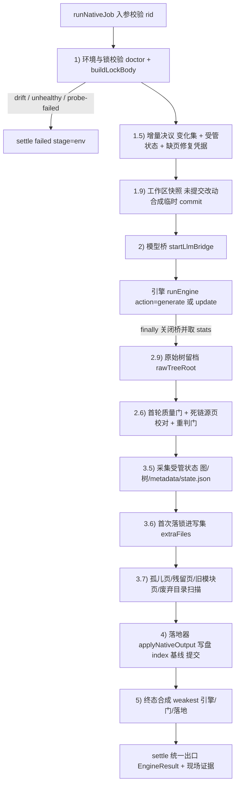
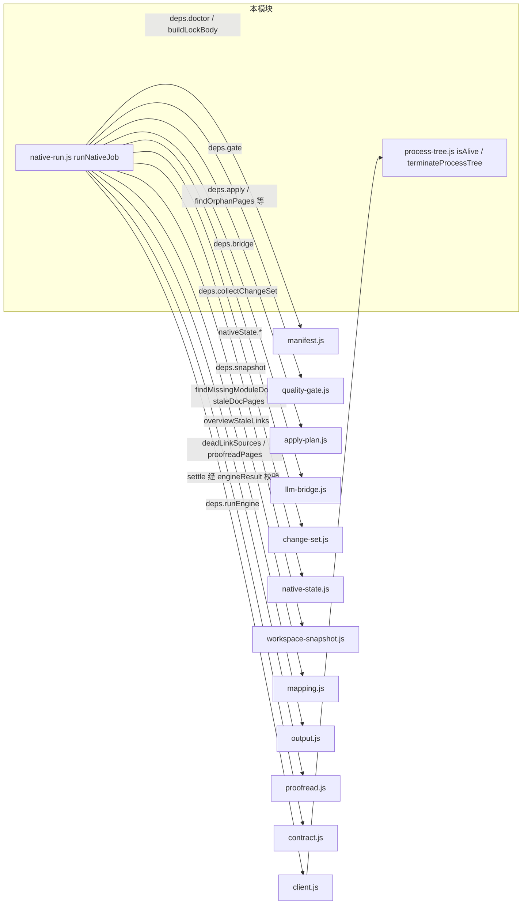
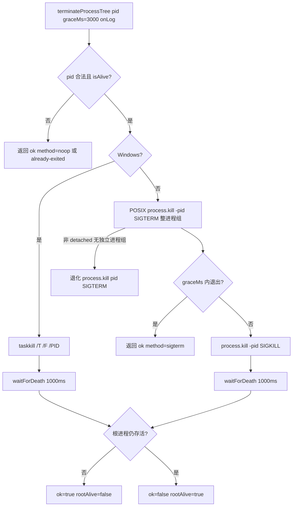
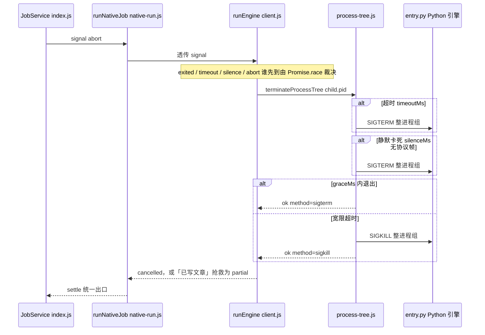

# 原生运行时进程执行与监控

本模块是 CodeWiki 原生运行时生命周期管理的「生产通道编排 + 进程树监控」层，由两个文件构成：

| 文件 | 核心职责 |
| --- | --- |
| `lib/engine/native-run.js` | `runNativeJob`：把一次原生编译的**裁决链**固定成一条直线——每一步的结论都不能被下一步洗白；`noop` 作为进度/日志回调的缺省空实现 |
| `lib/engine/process-tree.js` | `isAlive`：pid 存活探测；`terminateProcessTree`：跨平台地整棵终止受管子进程树（Windows `taskkill /T /F`，POSIX 进程组 SIGTERM→SIGKILL） |

它对上承接 [Core_Application_Runtime_Entry](../../Core_Application_Runtime_Entry.md) 的 JobService 调度（`index.js` 的 `wakeCompileSession` / `tick*`），对下驱动 [Python_Parallel_Agent_Execution_Runtime](../Python_Parallel_Agent_Execution_Runtime.md)（`lib/engine/python/entry.py`），横向调用生命周期内治理家族的其余兄弟模块。

---

## 1. 模块定位

### 1.1 为什么单独一层

`native-run.js` 文件头注释明确了拆分动机：JobService（`index.js`）已有 4800+ 行，若把 doctor / 锁校验 / 模型桥 / runEngine / 质量门 / 落地全塞进 tick 循环里，「终态到底由谁裁决」会再次含糊——而 0.14.0 花一整轮修掉的缺陷正是这一类（引擎说 done 就 done，产物没入库也报完成）。因此本模块只做一件事：

> 把一次编译的裁决链固定为直线：**env(doctor + engine-lock) → 增量决议 → 快照 → 模型桥 → 引擎(full|update) → 留档 → 校对 → 质量门 → 受管状态采集 → 首次落锁 → 孤儿扫描 → 落地器 → 终态合成**。

`process-tree.js` 同样是刻意保持小而可测的一层：FSoft 的 Python 进程自己还会派生子进程（flake8、find，以及某些后端会 fork claude/codex），只 kill 直接子进程的 pid 会让孙进程变孤儿继续烧 token。任何取消语义的 bug 都应在这里暴露，而不是散落在业务代码里。

### 1.2 硬不变量

裁决链上叠加了五条不可协商的不变量（与 `contract.js` / `quality-gate.js` / `apply-plan.js` 的不变量互相印证）：

1. **锁不一致 / 依赖不闭合 → 直接 failed，不跑引擎**：跑出来的产物不可信，「先跑再发现环境漂了」只会让用户看到一堆无意义的失败文章。
2. **引擎 done 不能替代质量门**：gate 说 partial，终态就是 partial。
3. **落地器（apply）说 partial/failed，终态不许是 done**：产物没入库就是没交付。
4. **failed / cancelled / partial 一律不推进基线**：未完整消化的变化必须留到下一轮；已写出的合格文章可以保留，但不能据此把整批变化记为已消费。
5. **取消是终态**：取消后不再 gate/apply，也不覆盖已写好的终态（但「取消来晚了、落地事务已跑完」时按真实结果收尾）。

---

## 2. 架构总览

### 2.1 裁决链数据流



### 2.2 依赖关系（全部依赖注入）

`runNativeJob` 的所有外部协作都通过 `deps` 注入，真实实现直接取自同层模块、测试可替换成假实现：



各被依赖模块的详细文档见：

- 契约校验与进程适配层（`contract.js` / `client.js`）：[Core_Engine_Public_API___Result_Validation](../Core_Engine_Public_API___Result_Validation.md)
- 环境锁与受管状态（`manifest.js` / `native-state.js`）：[Native_Runtime_State___Concurrency_Governance](Native_Runtime_State___Concurrency_Governance.md)
- 质量门（`quality-gate.js`）：[Native_Output_Quality_Gating](Native_Output_Quality_Gating.md)
- 落地与内容健康扫描（`apply-plan.js` / `mapping.js` / `output.js` / `proofread.js`）：[Wiki_Content_Health_Scanning___Plan_Application](../Wiki_Content_Health_Scanning___Plan_Application.md)
- 模型桥（`llm-bridge.js`）：[LLM_Provider_Bridge_Integration](../LLM_Provider_Bridge_Integration.md)
- 工作区快照（`workspace-snapshot.js`）：[Workspace_Snapshot_Management](Workspace_Snapshot_Management.md)
- 变化集采集（`change-set.js`）：[Agentic_Article_Processing_Library](../../Agentic_Article_Processing_Library.md)
- 被驱动的 Python 运行时（`python/entry.py`）：[Python_Parallel_Agent_Execution_Runtime](../Python_Parallel_Agent_Execution_Runtime.md)

---

## 3. `native-run.js`：一次编译的完整裁决编排

### 3.1 关键常量

| 导出 | 值 | 设计理由 |
| --- | --- | --- |
| `DEFAULT_ENGINE_ENTRY` | `<here>/python/entry.py` | Python 引擎入口绝对路径，由 `import.meta.url` 定位，不依赖调用方 cwd |
| `DEFAULT_ENGINE_TIMEOUT_MS` | `180 * 60 * 1000`（3 小时） | 真机唯一一次跑满的编译实测 ≈ **174 分钟**（articles 66min + crosscut 10min + review 68.9min + queued 29.2min）；45 分钟预算会在写作阶段开头就被砍掉。超时只是上限，到点后由 client.js 的 partial 抢救路径回收已写出文章 |
| `DEFAULT_UPDATE_OPTIONS` | `{ rung: '3' }` | 显式要求组件级方法档（图 diff 决定哪些模块重写）。不留空是因为「默认」是引擎内部实现细节，上游改默认值会让增量语义静默漂移；显式给出后测试的 fake engine 能断言「调用方确实要求了组件级增量」 |

另外 `noop()` 是 `onProgress` / `onLog` 的缺省回调——不传时编译照常跑，只是没有进度帧与日志输出。

### 3.2 统一出口 `settle(patch)`

所有分支（取消、环境失败、引擎失败、成功落地）都必须经过 `settle`，它做三件事：

1. **经 `engineResult(base)` 归一化校验**：`done` 不许带 blockers、`partial` 必须带 blockers、`failed` 必须有 error——构造不合法会直接抛错（那是接线 bug，必须响）。
2. **三个基线事实分开记**，不互相冒充：
   - `baselineEligible`：质量门许可（「这一轮的变化都消化完了，可以推进」）；
   - `baselineAdvanced`：落地器事实（`cw meta update` 真的成功）；
   - `canAdvanceBaseline`：兼容字段，语义取落地事实，供老调用方（JobService 的 judged）使用。
3. **携带现场证据**：`incremental`（决议/变化集/水合/受管状态）、`gate`、`apply`、`engineLock`、`artifacts`、`notes`——失败时也能看出「这一轮本来打算增量、卡在哪一步」。

### 3.3 终态强弱裁决

```javascript
const RANK = { cancelled: 0, failed: 1, partial: 2, done: 3 }
const weakest = (a, b) => (RANK[a] <= RANK[b] ? a : b)
```

最终 `finalOutcome = weakest(weakest(engineOutcome, gateOutcome), applyOutcome)`——合成终态只能取最弱的一环，绝不允许被后续步骤提升。附加规则：

- 引擎自报 partial 时，`advanceBaseline` 被显式否决（质量门只看产物质量，不知道引擎有一批叶子失败了）；
- 受管状态不完整（`stateIncomplete`）时额外一票否决基线，并补一条 `quality-gate` blocker；
- 想要增量却没走成（缺图/缺树/版本不符/基线不可达，或引擎自报 `full_fallback`/`detector_failure`）**且产物已不完整**时，补 `incremental-fallback` blocker；产物完整（gate/apply 都 done）时只进 notes——那种情况全量重建确实覆盖了全部源码，强行降 partial 会让仓库永远绿不了；
- 三者都说 done 却还有 blockers → 宁可降级为 partial 也不掩盖；终态为 partial 却没有 blockers → 补一条解释性 blocker。

### 3.4 增量决议（阶段 1.5）

「这一轮是全量还是增量」由**证据**决定，而不是调用方的 `kind` 字面量。决议回答三个问题：

1. **变化是什么**：四路（committed/staged/unstaged/untracked）+ 上轮未消费携带（`nativeState.mergeUnconsumed`）；
2. **能不能增量**：受管状态齐全（图/模块树/metadata/文章）、版本兼容、基线可达、调用方给了独立 `docsDir`（水合进仓库里的 `.codewiki/` 会污染用户库）；任一不成立 → 显式 `full` 并记 `fallbackReason`；
3. **消费成立吗**：只有引擎真做了组件级增量（`updateOutcome=incremental`）或图 diff 为空（`no_change`）且 gate/apply 全 done，才推进基线。

两个特判值得注意：

- **`rung=0` 是用户显式选的旧档**（按文件失效全量重写），与 fallback 区分开，不挂 `incremental-fallback` blocker；
- **缺页/陈链修复凭据（`missingRepair`）**：水合后若模块树有从未写过页面的模块、或 overview 链接指向已消失页，转全量修复；同一棵树、同一批缺口、上一轮已修过仍补不上时，本轮跳过重复全量（仍如实计入终态 partial，强制重试需 `scope=full`）。

「变化集为空」**不是**跳过引擎的理由——FSoft 的「有没有变」由图 diff 判定，重命名/跨文件重构能让路径集非空而图不变，反之亦然。

### 3.5 工作区快照（阶段 1.9）

FSoft 只从 `<old_commit>..<new_commit>` 取 diff，读的却是工作区文件——于是「文章反映了工作区、账却指向 HEAD」，下一轮拿 HEAD 当 old_commit 就会把未提交改动当成已消化。`runNativeJob` 在引擎启动前调用 `createWorkspaceSnapshot`（见 [Workspace_Snapshot_Management](Workspace_Snapshot_Management.md)）合成一棵含全部未提交改动的临时 commit（不挂 ref），本轮 `consumedCommit` 指向它。造不出快照不算失败，退回用 HEAD 记账并记 note——快照是对齐精度的改进，不是编译成立的前提。

### 3.6 引擎执行与模型桥（阶段 2）

- `action` 二选一：`update`（读 docsDir 里水合的旧图/旧树做图 diff）或 `generate`（从零建图）。**两者不能互换**——增量动作在空 docsDir 上会走 missing_page 全量重建（比 generate 还慢），全量动作在带旧状态的 docsDir 上会覆盖旧图却按全量记账。
- 模型桥先于引擎建立、在 `finally` 中关闭（先关桥会让还在读流的引擎拿到 502）；关闭前取 `bridge.stats()`——`emptyResponses`（上游 200 却无正文、无工具调用）是「假 done」的来源之一，作为独立可观测证据进 notes。
- 引擎进度帧直接透出（契约阶段名），不吞异常：传了契约外的阶段名是编程错误，必须当场响（0.17.32 的「校对格子永不亮」就是被 catch 吞掉的实例）。

### 3.7 校对、质量门与落地（阶段 2.6 → 4）

- **校对只针对门报出的死链源页**：门没报错就不烧模型预算逐页复查；改写后重新判一次门，改不掉照旧判 partial——修正文而不是放宽判据。
- **受管状态采集点在 gate 之后、apply 之前**：放进 apply 的 `extraFiles`，与文章共享同一 pre-image——索引/基线失败时一起回滚，提交时一起进同一个 commit。
- **无变化轮（`idleRound`）不重写受管状态、不碰基线/提交**：判据为 `updateOutcome=no_change` 且有效变化集空且无跨轮未消费路径三者同时成立。
- **首次落锁也进写集**：doctor 阶段绝不写 `.codewiki/engine-lock.json`（`.codewiki/` 早于 `cw init` 存在会被落地器判成半截库），只在真正要落地的这一轮随产物同事务写入。
- **孤儿/残留/旧模块/废弃目录四类清理都走 `deleteFiles`**：不能在编排层直接 `rm`——索引/基线失败时要能一起回滚，提交时才会把删除记进同一个 commit。

### 3.8 取消检查点

`signal?.aborted` 在五个位置被检查：提交前、环境校验后、引擎返回后、质量门后、落地收尾前。收尾阶段的规则最微妙：落地器不接 signal，走到那里说明落地事务已跑完——此时若产物真落地了，按真实结果收尾、只把「取消来晚了」记进 notes（曾无条件报 cancelled，导致已提交、已推进基线的一轮在终态里变成「产物未落地」，下一轮从旧基线重新消费已消化的变化）。

---

## 4. `process-tree.js`：进程树监控与终止

### 4.1 `isAlive(pid)`

```javascript
export function isAlive(pid) {
  if (!Number.isInteger(pid) || pid <= 0) return false
  try {
    process.kill(pid, 0)   // 不发送信号，只做存在性探测
    return true
  } catch (err) {
    return err?.code === 'EPERM'
  }
}
```

- 不抛错 → 活着（**僵尸进程也返回 true**，仍需视为占用）；
- `ESRCH` → 已退出；
- `EPERM` → 存在但无权限（仍算活着）。

### 4.2 `terminateProcessTree(pid, options)`



平台策略：

| 平台 | 手段 | 说明 |
| --- | --- | --- |
| Windows | `taskkill /T /F /PID <pid>` | `/T` 递归整棵树、`/F` 强制；不加 `/F` 时 GUI/无控制台进程常常收不到信号 |
| POSIX | `process.kill(-pid, 'SIGTERM')` → 宽限 → `SIGKILL` | 负 pid 表示整个进程组（子进程须以 `detached: true` 启动）；打不到进程组时退化成只打自己 |

返回 `{ ok, rootAlive, method }`，`method` 取值 `noop` / `already-exited` / `taskkill` / `sigterm` / `sigkill`。**`ok=false` 要求调用方据此报错，而不是假装取消成功。**

### 4.3 调用关系：谁在用进程树终止

`runNativeJob` 本身不直接调用 `terminateProcessTree`——它把 `signal` 透传给 `runEngine`（`client.js`）。`client.js` 在三条竞态分支上触发整树终止（`killTree`）：



两条兜底监控都由 `client.js` 实现、靠本模块落锤：

- **超时兜底**：`timeoutMs`（缺省 `DEFAULT_ENGINE_TIMEOUT_MS` = 180 分钟）只兜「跑太久」；超时后按已写篇数决定口径——有产物判 `partial`（保住文章与基线推进可能，blocker kind = `engine-timeout`），无产物判 `failed`。
- **静默兜底**：`silenceMs`（缺省 10 分钟，显著大于 entry.py 的 60s 心跳）兜「已经卡死」。真机事故 job-mvubmj6v-1 中引擎 CPU 52 分钟只涨 14 秒、产物恒为 3 篇，job 却挂着「写文章中 54%」；静默超限后同样按已写篇数抢救。

---

## 5. 配套构建与配置事实

- `package.json`（版本 0.17.47）：自 0.16.0 起默认通道就是原生引擎（`nativeEngine: true`），以子进程方式驱动上游 FSoft-AI4Code/CodeWiki Python 引擎，要求本地 Python 3.10+ venv 且依赖闭合；Node 侧旧通道仅作兼容保留。本模块正是该默认通道的编排层。
- 环境准备脚本 `tools/fsoft-engine/setup-env.sh`：负责搭建上述 venv 与依赖闭合，与 `native-run.js` 第 1 阶段的 `doctor` / `pip check` 校验互为表里——脚本没做好的事，编译会在 env 阶段如实 failed，不会降级跑旧实现。

---

## 6. 小结

本模块的两条主线可以一句话概括：

1. **`native-run.js` 是裁决者**：它不信任任何单点结论，把编译切成环境 → 增量决议 → 快照 → 引擎 → 校对 → 质量门 → 落地的直线，用「最弱一环」合成终态，让「引擎 done 但产物没入库」「基线悄悄前移、变化悄悄丢」这两类历史缺陷在结构上不可能复发。
2. **`process-tree.js` 是终结者**：它把「取消=整棵进程树消失」这一件小事做到跨平台可靠，向上只暴露 `ok / rootAlive / method` 三个机读事实，让 client.js 的超时/静默/取消三条兜底分支有一致的落锤点。

生命周期治理家族的其余页面：[Native_Runtime_State___Concurrency_Governance](Native_Runtime_State___Concurrency_Governance.md)（环境锁与受管状态）、[Native_Output_Quality_Gating](Native_Output_Quality_Gating.md)（产物质量门）、[Workspace_Snapshot_Management](Workspace_Snapshot_Management.md)（工作区快照），以及家族总览 [Native_CodeWiki_Runtime_Lifecycle_Management](../Native_CodeWiki_Runtime_Lifecycle_Management.md)。
