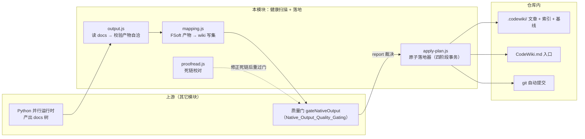
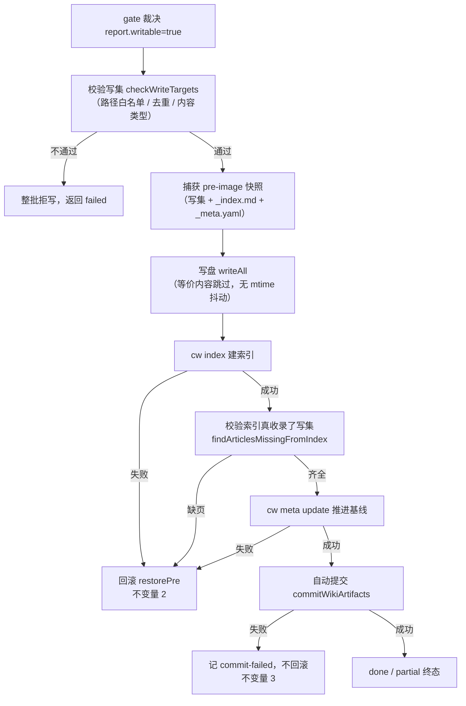
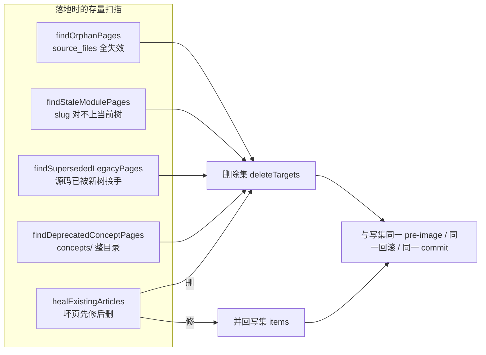
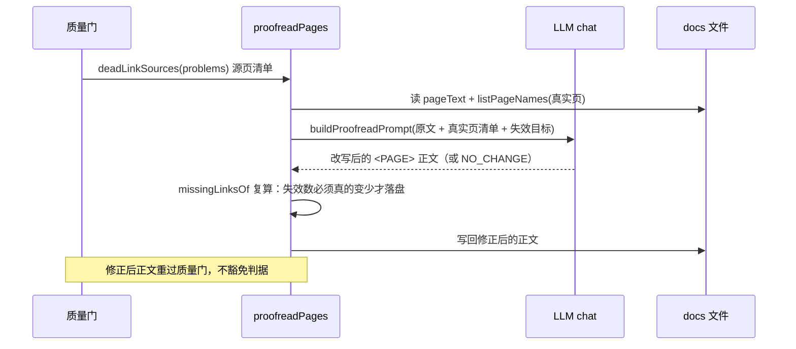

# Wiki 内容健康扫描与计划落地（Wiki_Content_Health_Scanning___Plan_Application）

> 本页是 CodeWiki 引擎子系统中「**内容健康扫描 + 原生产物落地**」这条流水线的总览。它负责把上游引擎（FSoft/Python 并行运行时）产出的 docs 树，经过校验、映射、扫描，最终**原子地**写入仓库内 `.codewiki/` 与根 `CodeWiki.md`，并推进编译基线、自动入库。

## 1. 模块定位与职责

`Wiki_Content_Health_Scanning___Plan_Application` 是原生编译通道（阶段 2 / 阶段 3）中**裁决之后、产物真正进仓库之前**的关键一层。它回答两个问题：

1. **产物健康吗？** —— 读 docs 树、映射成 wiki 写集、校验自洽性、扫描存量坏页/孤儿页/残留页。
2. **能安全地落地吗？** —— 把「这批页可以入库」的裁决，通过「写盘 → cw index → cw meta update → 自动提交」四步真正变成仓库里的事实，且任一步失败都能**回滚**。

设计上最重要的一条教训（文件头注释明确写道）：**「写成几篇」不等于「成立」**。0.14.0 出现过「1 篇成功 + 19 篇失败却报 done」，因此本模块把「裁决」和「入库」拆成两层，中间每一步都各自判成败。

## 2. 核心组成一览

本模块由 5 个文件、约 18 个核心组件构成，可分为三组职责：

| 分组 | 文件 | 代表组件 | 一句话职责 | 详细文档 |
|------|------|----------|-----------|----------|
| **落地器（事务核心）** | `lib/engine/apply-plan.js` | `applyNativeOutput`、`findOrphanPages`、`findStaleModulePages`、`findSupersededLegacyPages`、`findDeprecatedConceptPages`、`defaultRunCw` | 原子地写盘 + 索引 + 基线 + 提交，失败回滚，扫描存量残骸 | [native_apply 详情](Wiki_Content_Health_Scanning___Plan_Application/Wiki_Content_Health_Scanning___Plan_Application_native_apply.md) |
| **产物读取与格式映射** | `lib/engine/output.js`、`lib/engine/mapping.js` | `add`（`validateOutput`/`collectOutput`/`buildWritePlan`）、`findMissingModuleDocs`（`mapFsoftOutput`/`moduleSlug`/`moduleDocRelPath`） | 读 docs 目录成结构化事实并校验自洽；FSoft docs 树 → `.codewiki/` 写集的唯一翻译层 | [mapping_output 详情](Wiki_Content_Health_Scanning___Plan_Application/Wiki_Content_Health_Scanning___Plan_Application_mapping_output.md) |
| **死链校对与链接规则** | `lib/engine/proofread.js`、`lib/engine/wiki-links.js` | `proofreadPages`、`deadLinkSources`、`isExternalTarget`、`scanPageLinks` | 用 LLM 把指向「不存在页面」的跨页链接当场改掉；一处正则三处共用的链接扫描器 | [proofread_links 详情](Wiki_Content_Health_Scanning___Plan_Application/Wiki_Content_Health_Scanning___Plan_Application_proofread_links.md) |

> 三个子模块页分别详述落地事务、映射/校验、校对/链接三组职责；本页聚焦架构总览与跨组关系。

## 3. 落地器的三条硬不变量

`apply-plan.js` 文件头声明了本模块唯一的验收标准——三条硬不变量：

1. **写集封闭**：只允许写 `.codewiki/` 子树与仓库根 `CodeWiki.md`。绝对路径、盘符、`..` 上跳、白名单外路径一律**整批拒写**（不是跳过该条，因为写集不完整时部分写入等于制造没人在意的半成品）。
2. **索引/基线失败即回滚**：文章写盘后，若 `cw index` 或 `cw meta update` 失败，磁盘必须回到应用前的样子（旧内容写回、新建文件删掉、`_index.md` 与 `_meta.yaml` 恢复 pre-image）。
3. **提交失败不回滚**：自动提交是最后一步，失败时文章本身是好的、有用的，只记 `commit-failed` 阻塞并如实返回，**绝不**删掉有价值的文章。

## 4. 落地器的四种轮次生命周期

`applyNativeOutput` 把「这一轮到底要不要动」收成一个四值枚举，避免过去三个布尔（noChanges / deleteOnly / normalizeOnly）散在五处导致的非法组合：

| 轮次 | 触发条件 | 行为 | 推进基线？ |
|------|----------|------|-----------|
| `normal` | 有源码变化 | 写文章、写状态、建索引、推进基线、提交 | ✅ |
| `normalize` | 无变化，但存量落地页与当前渲染规则不一致 | 重写这些页（页名别名/链接改写改进后旧页是错的），不推进基线 | ❌ |
| `delete-only` | 无变化，但有孤儿/残留页要清 | 只删 + 索引，不写文章 | ❌ |
| `idle` | 无变化也无事可做 | 整轮短路 | ❌ |

> **为什么「无变化」仍要做事**：源码没变 ≠ 库是干净的。残留页（残骸）、待规范化页只能由落地器来清，因为它们要能回滚、要与索引同事务、要进同一个 commit。

## 5. 存量健康扫描：三类旧页的识别

落地器不仅写新页，还负责**清库**——把历史重构留下的残骸扫出来并进删除集。判据刻意保守（宁可漏删不可误删），且都在 `apply-plan.js`：

| 扫描函数 | 判据 | 典型场景 |
|----------|------|----------|
| `findOrphanPages` | `source_files` 全部指向已不存在的文件 | 模块被删，页却永久留在 `_index.md` 上 |
| `findStaleModulePages` | `modules/` 下页名对不上当前模块树 slug | 聚类重构后被抛弃的旧模块页 |
| `findSupersededLegacyPages` | 页名不在树里 + 无 `fsoft_page` + 至少一个 source_file 已被当前树模块认领 | 「描述性 title、平铺在 modules/ 根下」那批最宽的旧页 |
| `findDeprecatedConceptPages` | `concepts/` 目录整体下线 | Node 通道遗留的、与模块页重复的概念页 |
| `healExistingArticles` | 存量坏页「先修再删」 | 缺 frontmatter / 未闭合 / type 错位 → 修；正文是模型输出泄漏 → 删 |

## 6. 产物映射（mapping.js）的四条硬规则

`mapFsoftOutput` 是「格式翻译」的唯一一处，边界刻意窄到能被完整读一遍：

1. **不臆造 `source_files`** —— 只来自组件→文件证据（`componentFiles` / `module_tree.components`），拿不到就空数组 + warning。
2. **不静默丢弃** —— 任何没映射的页进 `unmapped`，带机读原因。
3. **不覆盖** —— slug 冲突（`A_B` 与 `A-B` 都 → `a-b`）时两页都进 unmapped，不许后到的赢。
4. **不改技术内容** —— 只搬路径与类型，正文一字不动。

`findMissingModuleDocs` 则检查「模块树里有、但引擎没产出页」的模块，用于增量轮决议判断是否需要修复性全量。

## 7. 死链校对（proofread.js + wiki-links.js）

模型写作时会照着旧版聚类的记忆**编造页面名**，质量门如实判 `dead-link`，仓库每轮都停在「部分完成」。`proofreadPages` 的立场很清楚：**修的是正文，不是判据**——校对后的正文仍要重新过质量门，改不掉就照旧判 partial。

- `deadLinkSources`：从门的 defects/problems 里挑出「正文链到不存在页」的源页（同时认 `output.js` 的 `dead-link` 与契约层改名后的 `article-contract/issue=dead-link`）。
- `wiki-links.js` 提供 `scanPageLinks` 与 `isExternalTarget`：**一处正则、三处消费方共用**（article-contract / proofread / quality-gate），避免各自抄写正则导致判据分叉。

## 8. 依赖注入与边界

`apply-plan.js` **不 import `index.js`**（插件主入口）——加载它会连带拉起宿主服务与 webServer，让单测变成「为了测一个写盘函数启动整个插件」。因此 `runCw` / `commit` / `normalizeIndexLinks` 全部可由调用方注入；但「可注入」不等于「默认什么都不做」：默认必须自带同语义的 `defaultRunCw` 与 `commitWikiArtifacts`，安全边界逐条对齐 `index.js` 的 autoCommitWiki（只 add wiki 两个路径、不 amend 不 push、合并冲突与无 HEAD 一律拒绝）。

## 9. 与其它模块的关系

- **上游质量门**：[Native_Output_Quality_Gating](Native_CodeWiki_Runtime_Lifecycle_Management/Native_Output_Quality_Gating.md)（`gateNativeOutput`）产出 `report`（writable / outcome / rendered / canAdvanceBaseline），是本落地器的直接输入。
- **契约与终态词表**：[Core_Engine_Public_API___Result_Validation](Core_Engine_Public_API___Result_Validation.md)（`contract.js` 的 `BLOCKER_KINDS`）定义落地问题 → 阻塞类型的映射（`toApplyBlockers`）。
- **运行时生命周期**：[Native_CodeWiki_Runtime_Lifecycle_Management](Native_CodeWiki_Runtime_Lifecycle_Management.md) 提供 manifest / 状态目录裁剪（`pruneRoots`）与进程监控。
- **并行执行运行时**：[Python_Parallel_Agent_Execution_Runtime](Python_Parallel_Agent_Execution_Runtime.md) 是产出 docs 树的上游引擎。
- **git 路径工具**：`lib/git-paths.js`（`decodeGitPaths` / `withQuotepathOff` / `toPosix`）支撑中文页名与 quotepath 解码，见 [Shared_Infrastructure_Utilities](../Shared_Infrastructure_Utilities.md)。
