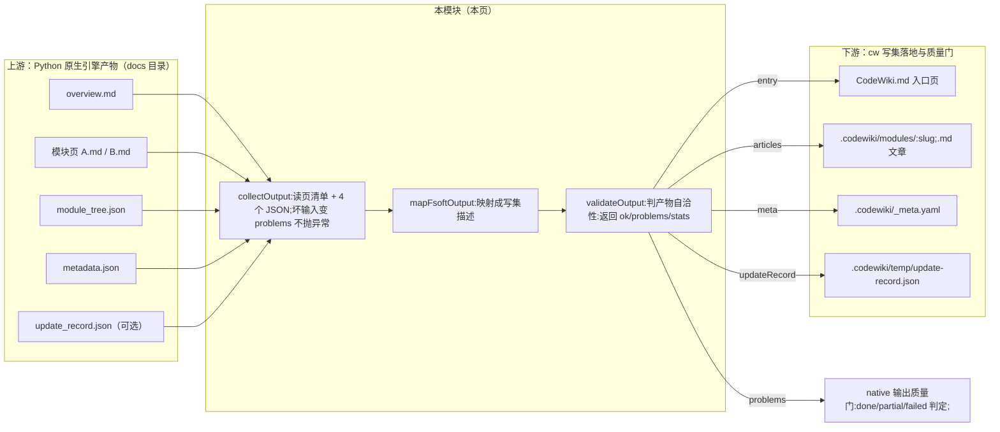
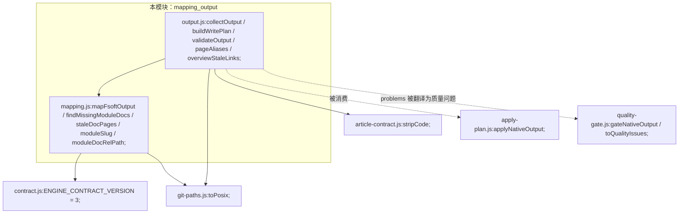
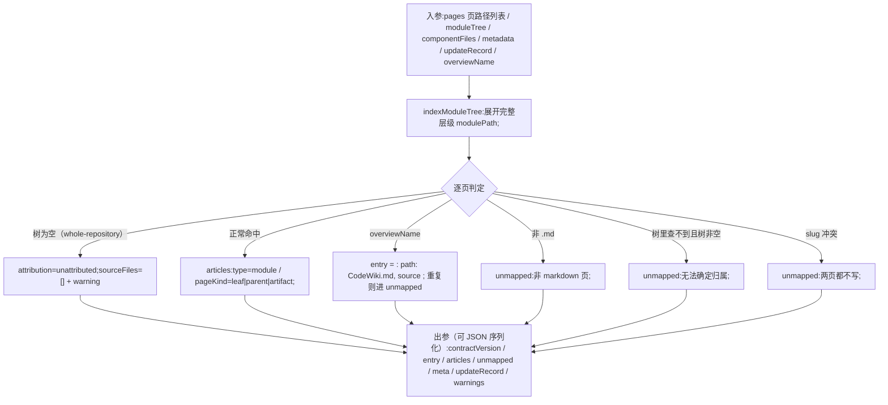
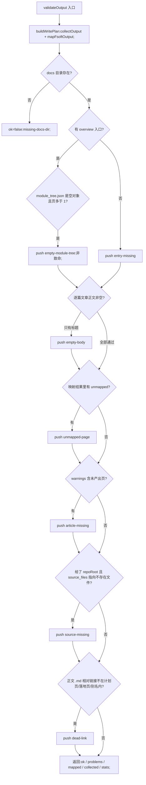

# 产物映射与输出校验（mapping & output）

## 简介

本模块是 [CodeWiki 引擎子系统](../../CodeWiki_Engine_Subsystem.md) 中「FSoft 原生引擎产物 → 本仓库 cw 写集」的**格式翻译与自洽校验层**，由两个文件构成：

| 文件 | 角色 | 阶段 |
| --- | --- | --- |
| `lib/engine/mapping.js` | 纯函数映射：把 docs 树（`overview.md` + 模块页 + `module_tree.json` + `metadata.json` + `update_record.json`）翻译成 cw 的写集描述（`CodeWiki.md` 入口 + `.codewiki/modules/*.md` + `_meta.yaml` + `temp/update-record.json`） | 阶段 0（规则已冻结） |
| `lib/engine/output.js` | 磁盘读取（`collectOutput`）、写集计划构建（`buildWritePlan`）、产物自洽校验（`validateOutput`） | 阶段 2 |

它是整个迁移管线里**唯一一处「格式翻译」**。上游 Python 引擎产出的是一棵 docs 树，本仓库要的是仓库内 `.codewiki/` 的五类文章加顶层 `CodeWiki.md` 入口——两边不是同一个数据模型。本模块的边界刻意收窄：**只搬路径与类型，正文一字不动**；只判「产物自身是否自洽」，不做重新聚类、不做图 diff、不改写文章。

上游产物一旦被映射成可机读的 `problems` 列表，下游（[native apply 子模块](Wiki_Content_Health_Scanning___Plan_Application_native_apply.md) 与 [native 输出质量门](../Native_CodeWiki_Runtime_Lifecycle_Management/Native_Output_Quality_Gating.md)）据此判定本轮是 `done`、`partial` 还是 `failed`。

## 架构与上下文



### 模块依赖关系



- [核心引擎公共 API 与结果校验](../Core_Engine_Public_API___Result_Validation.md)：`mapFsoftOutput` 的返回值带 `contractVersion`，与跨进程契约同版本号（当前为 3）。
- [共享基础设施与工具](../../Shared_Infrastructure_Utilities.md)：`git-paths.js` 的 `toPosix` 统一路径口径，`article-contract.js` 的 `stripCode` 用于避免把代码示例里的链接误判为死链。
- 上游调用方（`applyNativeOutput`）属于 [native apply 子模块](Wiki_Content_Health_Scanning___Plan_Application_native_apply.md)，本页不展开。

## 核心概念：产物模型对照表

| FSoft 产物 | cw 目标 | 说明 |
| --- | --- | --- |
| `overview.md` | `CodeWiki.md`（`WIKI_ENTRY`） | 入口页，不是「文章」；入口只允许一个，重复出现的同名页进 `unmapped` |
| 模块页 `{Name}.md` | `.codewiki/modules/<slug>.md`（`WIKI_MODULES_REL`） | `type='module'`；`pageKind` 三态：`leaf` / `parent`（有 children）/ `artifact` |
| `module_tree.json` | 只作 `source_files` 的证据来源，**不落盘** | `.codewiki` 无此类型 |
| `metadata.json` | `.codewiki/_meta.yaml`（`WIKI_META_REL`）的 `last_compiled_commit` / `layout` / `language` | 从 `generation_info` 取值 |
| `update_record.json` | `.codewiki/temp/update-record.json`（`WIKI_UPDATE_RECORD_REL`） | 原样搬运，标记 `source: 'incremental'` |
| `module_tree.json` 为空对象 `{}` | 页照常写入，但 `attribution='unattributed'` | whole-repository 模式（上游 `documentation_generator.py` 原文 "stays {}"）的正常产物，**不臆造归属** |

**命名规范化**：`moduleSlug(name)` 把模块名折叠成 kebab-case（非 `[A-Za-z0-9]` 一律替换为 `-`、去首尾 `-`、转小写），与 cw 现有文章命名（`core-application.md`）一致。`moduleDocRelPath(modulePath, layout)` 与上游 `doc_layout.module_doc_relpath()` 同口径：`hierarchical`（默认）落在 `<父路径...>/<模块名>.md`，`flat` 落在根部。

## 四条硬规则（迁移安全边界）

`mapping.js` 头部以注释形式冻结了四条规则，本模块全部行为都围绕它们展开：

1. **不臆造 source_files**。`source_files` 只能来自真实组件→文件证据（`componentFiles` / `module_tree.components`）。组件 id 形如 `src/a.py::Class.method`，取 `::` 前的文件部分；无 `::` 且无映射证据的组件直接跳过。拿不到就是空数组 + warning——0.14.0 的增量闸门正是靠 `source_files` 判定归属，编造它会让未消化的变化被静默基线化。
2. **不静默丢弃**。任何没被映射的页都进 `unmapped`，带可机读 `reason`，由上层决定 partial。滑掉的页等于 wiki 少一篇而没人知道。
3. **不覆盖**。slug 冲突（`A_B` 与 `A-B` 都 → `a-b`）时两页都进 `unmapped`，并把已入写集的冲突页撤回——**不许后到的赢**，静默覆盖会丢内容且无法回溯。
4. **不改技术内容**。只搬路径与类型，正文一字不动；规范化（链接重写）在引擎侧完成。

## 数据流：mapFsoftOutput 的进出



**树完整性反向检查**：映射完成后还会扫一遍 `moduleTree`——树里有、但引擎没产出页的模块进 `warnings`（`模块树含 X，但未产出 X.md`），由 `validateOutput` 升级为 `article-missing`。注意 `modulePath` 记录的是**完整层级（含自己）**而非只有名字：上游对 hierarchical 布局取 `path[:-1]` 作目录、`path[-1]` 作文件名；只记名字会让「同一模块从上层搬到更深一层」看起来「页已存在」，从而把真实缺页漏掉（真机 `dsh-git-worktree` 曾栽在这里）。

## 处理流程：validateOutput 校验管线

`validateOutput({docsDir, repoRoot, componentFiles, overviewName})` 是本模块对外的主入口，**只判「产物自身是否自洽」，不抛异常、不修任何东西**。判定顺序即下图：



### 问题类别（OUTPUT_PROBLEM_KINDS）

类别枚举**稳定、可机读**，上层按 `kind` 分派（不靠 message 文本匹配）；`validateOutput` 内 `push()` 遇到未登记类别会直接抛错。

| kind | 含义 | 来源 |
| --- | --- | --- |
| `missing-docs-dir` | 引擎没产出 docs 目录 | `collectOutput` |
| `missing-metadata` | 缺 `metadata.json`（无法确定 commit/layout） | `collectOutput` |
| `missing-module-tree` | 缺 `module_tree.json`（无法确定归属与 source_files） | `collectOutput` |
| `empty-module-tree` | `module_tree.json` 是 `{}`：归属证据整体缺失 | `validateOutput` |
| `bad-json` | JSON 存在但不可解析（**存在即必报**，不因「文件可选」而吞掉） | `readJsonIfExists` |
| `entry-missing` | 没有 `overview.md`，即没有 `CodeWiki.md` 入口 | `validateOutput` |
| `empty-body` | 页面除标题外没有正文 | `bodyLength` |
| `article-missing` | 模块树里有模块，但没有对应页 | `validateOutput`（由 mapping 的 warning 升级） |
| `unmapped-page` | 页在 docs 里，但映射不到 wiki 的任何位置 | `mapped.unmapped` |
| `source-missing` | `source_files` 指向的文件在仓库里不存在（需给 `repoRoot`） | `validateOutput` |
| `dead-link` | 正文相对链接指向计划外的文件 | `validateOutput` |

### 死链判定的精确规则（本模块最易误报处）

- **只查 `.md` 相对链接**：外链（`http:` / `mailto:` / `data:`）、纯锚点、指向仓库源文件的 `../src/x.py` 都跳过——后者交给下游目标格式闸门（阶段 3）。
- **先 `stripCode` 再抽链接**：代码示例 `` `[文字](x.md)` `` 不是引用（真机 `job-mw32wsci-h` 曾因此把整轮从 `done` 误判成 `partial`）。
- **计划页 vs 落地页双口径**：正文可能写引擎原始页名（渲染期被重写成落地名），也可能已直接写成 slug 落地名——两种都合法，都判一次。只认「本次真的会落地」的页；曾经额外认 `collected.pages`，导致「页在产物里但没被映射进落地方案」被当成命中放过，放过的正是真死链。
- **页名别名解析（`pageAliases`）**：三条固定命名约定——① 带扩展名页名 `X.ts.md` ↔ 正文写 `X.md`；② 子模块页 `<dir>/<dir>_Y.md` ↔ `<dir>/Y.md`；③ kebab-case 落地名 `llama-and-llm-management.md` ↔ 正文写下划线原名。**只在唯一命中时给别名**：同目录同时存在 `X.ts.md` 与 `X.js.md` 时无法判定，猜一个比报死链更糟；名字只是相近不构成别名。
- **根页别名豁免**：上游入口页叫 `README.md` / `overview.md`，本仓库叫 `CodeWiki.md`。只豁免**根目录下**这两个名字（真机 `job-mvzbcw87-0` 的 `testing_fixtures.md` 引用同属父模块的 `./README.md` 曾被误判）；子目录里的 `sub/README.md` 仍按真实目标校验。

## 增量轮与修复性全量专用函数

| 函数 | 用途 |
| --- | --- |
| `findMissingModuleDocs({pages, moduleTree, overviewName})` | 增量轮决议：树里哪些模块还没页。判定口径与上游 `find_doc()` 一致——先看层级路径、再看根部同名文件；但**不接受其它目录下的同名页**：那是模块搬家后遗留的旧页，算缺页才是修复性全量要处理的事，放宽它等于把 partial 伪装成 done |
| `staleDocPages({pages, moduleTree, overviewName})` | 产物目录里不属于当前模块树的页（模块改名/聚类重建后的旧页）。修复性全量必须先清掉它们：否则引擎写完全部新页，旧页仍在 `docsDir` 里被映射成 `unmapped-page`，质量门每轮照样判 partial（即「缺页修好了但还是 partial」）。**树为空（whole-repository 模式）时返回 `[]`**——没有权威模块名，不能凭名字删页 |
| `overviewStaleLinks({overviewText, pages, moduleTree})` | overview 正文指向 docs 内不存在页的链接。上游 `reusable_overview()` 只判「空页 / 未完成 preamble」，聚类重构后模块改名、旧 overview 链接指向消失的页，引擎却每轮判「可复用」而跳过重建（真机 `dsh-git-worktree` 的 overview 有 6 条这类链接） |

## 调用时序

```mermaid
sequenceDiagram
    participant CALLER["调用方#58;applyNativeOutput / runPool#59;"]
    participant OUT["output.js"]
    participant MAP["mapping.js"]
    participant FS["node:fs"]

    CALLER->>OUT: validateOutput(docsDir, repoRoot, componentFiles)
    OUT->>OUT: buildWritePlan(docsDir, componentFiles)
    OUT->>FS: readdirSync docsDir（递归，跳过 temp/ 与隐藏目录）
    FS-->>OUT: 页清单 pages
    OUT->>FS: readFileSync metadata/module_tree/update_record（可选）
    FS-->>OUT: 结构化 JSON（坏文件变 problems）
    OUT->>MAP: mapFsoftOutput(pages, moduleTree, componentFiles, metadata, updateRecord)
    MAP->>MAP: indexModuleTree + slug 冲突检测 + sourceFilesOf
    MAP-->>OUT: {entry, articles, unmapped, meta, updateRecord, warnings}
    OUT->>FS: 逐篇 readFileSync 正文
    FS-->>OUT: 页文本
    OUT->>OUT: bodyLength / relativeLinks / pageAliases / source 存在性
    OUT-->>CALLER: {ok, problems, mapped, collected, stats}
```

**设计注意**：`validateOutput` 把 `collected` 原样带出——上层（阶段 3 质量门）要读 `metadata.generation_info.commit_id` 判「产物对应哪个 commit」。让它自己再读一遍 docs 目录，等于把「一次读」变成「两次读」，两次之间目录可能被改，判据就漂移了。

## 边界与分工（什么不在本模块做）

- **不重新聚类、不做图 diff、不改写文章正文**——FSoft 已经算完了，本模块绝不长成第二个引擎。
- **frontmatter / 锚点 / 写集冲突这类目标格式闸门属于阶段 3**（见 [native 输出质量门](../Native_CodeWiki_Runtime_Lifecycle_Management/Native_Output_Quality_Gating.md)）；本模块只判「产物自身是否自洽」。
- **落地写入**（把 `mapped` 真正写到 `.codewiki/` 与 `CodeWiki.md`）属于 [native apply 子模块](Wiki_Content_Health_Scanning___Plan_Application_native_apply.md)；正文校对属于 [proofread 与链接子模块](Wiki_Content_Health_Scanning___Plan_Application_proofread_links.md)。
- 更上层的引擎执行与结果语义（EngineResult 的 `done`/`partial`/`failed` 不变量）见 [核心引擎公共 API 与结果校验](../Core_Engine_Public_API___Result_Validation.md)。
