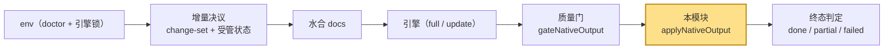
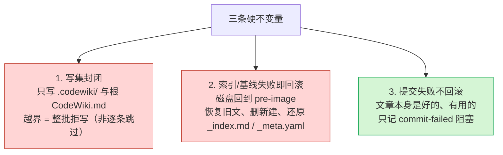
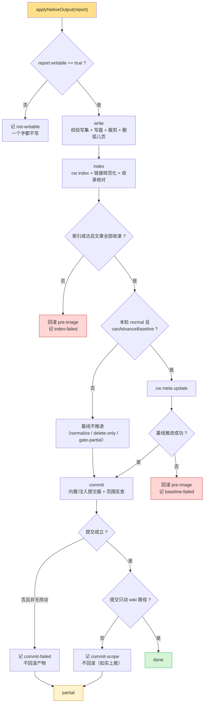
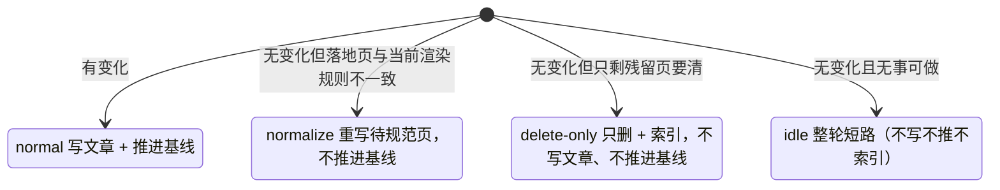
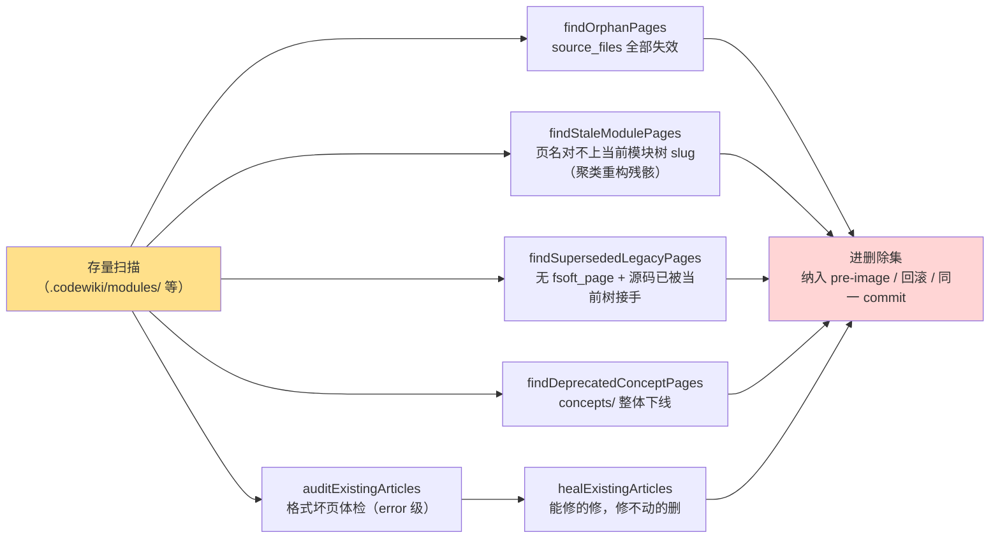
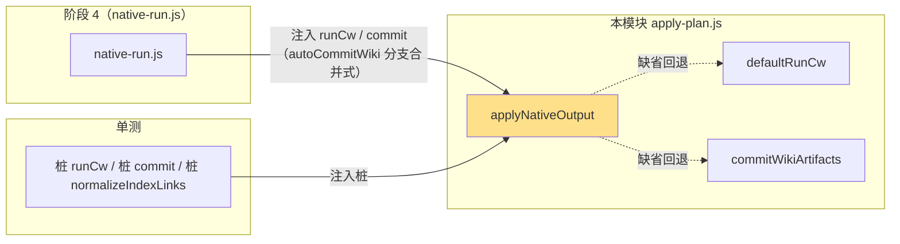
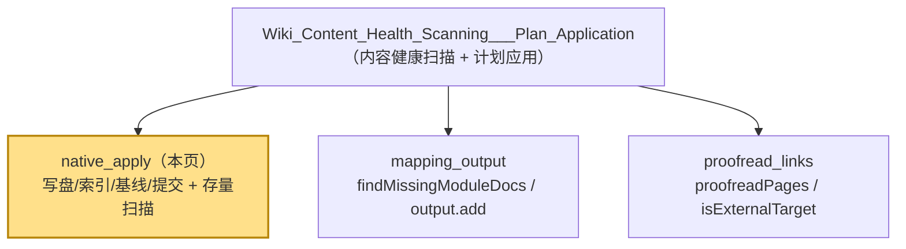

# 原生产物落地器（native apply）

## 简介

本模块（`lib/engine/apply-plan.js`）是 CodeWiki 原生通道的 **阶段 3 落地器（plan applicator）**——位于「质量门给出采用裁决之后、产物真正进入仓库之前」的那一层。它把一次裁决（`gateNativeOutput` 的 `report`）原子地落地成仓库事实：**写盘 → `cw index` → `cw meta update`（基线）→ 自动提交**，并在中间任一步失败时按预定义不变量回滚或如实上报。

它存在的根本原因是：**「这批页可以入库」（裁决）与「入库这件事真的成立了」（落地）是两件事**。中间四步（写盘、索引、基线、提交）各自会失败，而 0.14.0 的教训正是把「写成几篇」当成「成立」——1 篇成功 + 19 篇失败也报 done。本模块就是为消灭这类「假绿」而设。

> 本页覆盖的是 [Wiki_Content_Health_Scanning___Plan_Application](../Wiki_Content_Health_Scanning___Plan_Application.md) 父模块中「原生通道落地」这一子域；映射/输出校验、校对/死链两条兄弟子域分别见 [mapping_output](Wiki_Content_Health_Scanning___Plan_Application_mapping_output.md) 与 [proofread_links](Wiki_Content_Health_Scanning___Plan_Application_proofread_links.md)。

---

## 在系统中的位置

原生通道的裁决链由 [Native_CodeWiki_Runtime_Lifecycle_Management](../Native_CodeWiki_Runtime_Lifecycle_Management.md) 中的编排层（`lib/engine/native-run.js`）固定为一条直线，本模块是其末端的 `apply` 一步：

各相邻层的职责分工：

| 层 | 模块 | 对本模块的关系 |
| --- | --- | --- |
| 质量门 | [Native_Output_Quality_Gating](../Native_CodeWiki_Runtime_Lifecycle_Management/Native_Output_Quality_Gating.md)（`quality-gate.js`） | 产出 `report`（`writable` / `outcome` / `rendered` / `canAdvanceBaseline`） |
| 契约词表 | [Core_Engine_Public_API___Result_Validation](../Core_Engine_Public_API___Result_Validation.md)（`contract.js`） | 提供 `BLOCKER_KINDS`，本模块的 blocker 必须映射到该枚举 |
| 映射常量 | [mapping_output](Wiki_Content_Health_Scanning___Plan_Application_mapping_output.md)（`mapping.js`） | 提供 `WIKI_DIR` / `WIKI_ENTRY` / `WIKI_META_REL` / `WIKI_MODULES_REL` / `moduleSlug` |
| 文章契约 | `article-contract.js` | 提供 `parseFrontmatter` / `inspectArticle` / `NATIVE_ARTICLE_OPTS` |
| 存量修复 | `article-repair.js` | 提供 `repairArticle`（先修后删处置） |
| 路径工具 | [Shared_Infrastructure_Utilities](../../Shared_Infrastructure_Utilities.md)（`git-paths.js`） | 提供 `decodeGitPaths` / `withQuotepathOff` / `toPosix` |

---

## 核心组件总览

本文件导出 6 个核心函数 + 若干常量：

| 组件 | 职责 |
| --- | --- |
| **`applyNativeOutput`** | 主入口：把一次采用裁决原子落地，编排 write → index → baseline → commit 四阶段，失败按不变量回滚 |
| **`defaultRunCw`** | 默认 `cw` CLI 通道（同步 `spawnSync`），可被调用方注入替换 |
| **`findOrphanPages`** | 扫描存量模块页中 `source_files` **全部已失效** 的孤儿页（进删除集） |
| **`findStaleModulePages`** | 扫描存量模块页中**不属于当前模块树**的旧页（聚类重构残骸） |
| **`findSupersededLegacyPages`** | 扫描源码已被当前树接手、页名却对不上任何模块的旧页（最宽判据） |
| **`findDeprecatedConceptPages`** | `concepts/` 目录整体下线（Node 通道遗留） |

---

## 三条硬不变量（本模块唯一的验收标准）

1. **写集封闭**：渲染结果里的路径由引擎的 page 名映射而来，直接信它等于把「引擎能写仓库任意文件」写进契约。绝对路径、盘符、`..` 上跳、白名单外路径**一律整批拒写**——写集不完整时部分写入等于制造一份没人在意的半成品。
2. **索引/基线失败即回滚**：文章写盘之后 `cw index` 或 `cw meta update` 失败，磁盘必须回到应用前的样子。否则库里留下「文章在、索引没有」或「文章在、基线已推进」的脏结构，下次编译会在脏库上误判「已消化」。
3. **提交失败不回滚**：自动提交是「产物入库」的最后一步。它失败时文章本身是好的（与索引/基线失败相反——那两步失败说明这批产物还没被库接受）。所以只记 `commit-failed` 阻塞并如实返回，**绝不**因提交失败把有价值的文章删掉。

---

## 四阶段落地流程（APPLY_STAGES）

落地阶段与面板步骤条、日志对齐，顺序即推进顺序：`write → index → baseline → commit`。

### 阶段详解

**write（写盘）**
- `checkWriteTargets`：纯函数校验写集。坏路径（空/绝对/上跳/越界）、content 非字符串、同路径重复且内容不同 → 记问题，**整批拒写**。
- `capturePre`：对写集 + `_index.md` + `_meta.yaml` + 裁剪对象 + 删除对象拍 pre-image 快照（区分「读不到」与「不存在」，避免误删真实文件）。
- `writeAll`：内容等价比对（行尾不参与）后落盘；未变文件跳过重写（避免 mtime 抖动与空提交）。
- `collectPruneTargets`：受管状态目录裁剪根下「本轮写集里没有」的文件（上一轮引擎删掉的文章/图必须跟着消失）。
- `checkDeleteTargets`：删除集与写集**共用同一把尺子** `checkTargetPath`（删错比写错更不可逆）。

**index（索引）**
- `cw index`：退出码非 0 → 回滚一切（库是坏的）。
- `normalizeIndexLinksIn`：Windows 上 `cw index` 可能写出 `\` 分隔链接，规范成 `/`。**失败即回滚**（索引不可信 = 半个索引不允许落地）。
- `findArticlesMissingFromIndex`：`cw index` 退出码 0 但 frontmatter 解析失败会**静默跳过**收录。按本轮写集（`targets`，非实际落盘 `written`）比对 `_index.md`，缺页 → 回滚。

**baseline（基线）**
- 只有 `roundKind === 'normal'` 且 `report.canAdvanceBaseline === true`（或被 `advanceBaseline` 覆盖）才跑 `cw meta update`。
- 失败 → 连文章一起回滚：此时把文章留下、基线不动 = 「文章比基线新」，下一轮会重复消费。

**commit（提交）**
- 默认走内置 `commitWikiArtifacts`（安全边界逐条对齐 `autoCommitWiki`）；`deps.commit` 可注入。
- 提交成立后 `verifyCommitScope` 用 `git show --name-only --first-parent` 反查实际提交内容，把「pathspec 限定」变成「可断言的事实」。
- 提交失败不回滚；未提交（且非无改动可提交）时终态**绝不 done**。

---

## 四种互斥轮次（roundKind）

早先这里是 `noChanges` / `deleteOnly` / `normalizeOnly` 三个布尔散在五处组合判断，存在非法态。现收成一个枚举，每个分支只读一次：

| 轮次 | 写文章 | 推进基线 | 索引 | 删除残留 | 说明 |
| --- | --- | --- | --- | --- | --- |
| `normal` | ✅（仅 defects=0 的页） | ✅ | ✅ | ✅ | 有真实变化，照常消化 |
| `normalize` | ✅（含坏页，职责是对齐渲染规则） | ❌ | ✅ | ✅ | 引擎报 no_change，但旧落地页按新渲染规则（页名别名、跨页链接改写）已过时 |
| `delete-only` | ❌（本轮全部意义就是删残骸） | ❌ | ✅ | ✅ | no_change 轮残留页清理 |
| `idle` | ❌ | ❌ | ❌（短路） | ❌ | 引擎与四路变化集均无变化 |

> **例外设计**：`noChanges` 原本会无条件短路，但「有残留页待删」与「待规范化落地页」必须例外——源码没有变化不等于库里没有残骸，而残骸只有落地器能删（要能回滚、要与索引同事务、要进同一个 commit）。

---

## 存量健康扫描（4 个 find* 组件）

这组函数回答同一个问题：**「库里躺着的、不是本轮写出来的坏页/旧页怎么办？」** 它们是落地层独有、质量门照不到的盲区（门只体检**本次产物**）。

| 函数 | 判据（刻意保守） | 覆盖的真实现场 |
| --- | --- | --- |
| `findOrphanPages` | `source_files` 非空且**每个**都已不存在；空 `source_files` 跳过（whole-repo 模式无归属证据 ≠ 孤儿证据） | 删除模块时 FSoft 回 `full_fallback` + `pages_removed: []`，失效页永久残留 |
| `findStaleModulePages` | 页名对不上当前树任一模块 slug；嵌套目录里同名也算残留（原生页永远 flat） | 聚类重构后 92 页里 72 页是历次残骸，正文链接大量 404 |
| `findSupersededLegacyPages` | 无 `fsoft_page` + `type=module` + 至少一个 source_file 已被当前树认领 | 真机 Wxxy-CampusHub 11 篇描述性 title 旧页，三条窄判据全不中 |
| `findDeprecatedConceptPages` | `concepts/` 整目录（Node 通道遗留，原生通道从不写这里） | 横切层蒸馏出的「概念」与模块页大面积重复 |
| `auditExistingArticles` / `healExistingArticles` | 复用 `NATIVE_ARTICLE_OPTS`（与质量门 `checkRendered` **逐字同口径**）判 error 级 → 先 `repairArticle` 修，判 drop 才删 | 61 篇判坏页里 50 篇只是格式坏（缺 frontmatter / 未闭合 / type 不符） |

> **设计哲学**：判据每多一条「可证特征」，就多一类旧页能绕过它。真机先后漏掉过三批（描述性 title、平铺 modules/ 根、source_files 部分幸存），最终反过来——**不是本轮写的就删**。`modules/` 是引擎专属产物目录，人工补过的内容这里一律不留。

---

## 依赖注入设计（为何不 import index.js）

- **刻意不 `import index.js`**：那里是插件主入口，加载它会拉起宿主服务与 webServer，单测就成了「为测一个写盘函数启动整个插件」。
- `runCw` / `commit` / `normalizeIndexLinks` / `verifyCommit` 全部可由调用方注入。
- **但「可注入」不等于「默认什么都不做」**：默认必须自带一个同语义提交器 `commitWikiArtifacts`（只 add `.codewiki` + `CodeWiki.md`、不 amend 不 push、合并冲突/无 HEAD 一律拒绝）。否则阶段 3 自己跑起来产物只落盘不入库，报告却仍 done——那正是「自动提交失败被改写成成功」的前身。

---

## 结果词表与契约映射

落地问题（`APPLY_RESULT_KINDS`）通过 `toApplyBlockers` 映射到契约 `BLOCKER_KINDS`，让面板与终态判定共用一套词表：

| 落地问题 kind | 契约 BLOCKER kind | 含义 |
| --- | --- | --- |
| `write-failed` | `quality-gate` | 写盘 / 写集校验失败 |
| `index-failed` | `index-failed` | `cw index` 失败 / 缺页 / 链接规范化失败 |
| `baseline-failed` | `baseline-failed` | `cw meta update` 失败 |
| `commit-failed` | `commit-failed` | 自动提交未成立 |
| `commit-scope` | `commit-failed` | 提交成立但混进 wiki 之外路径 |
| `not-writable` | `quality-gate` | 裁决本身不允许入库 |
| `wiki-missing` | `index-failed` | `.codewiki/` 未初始化或状态损坏 |
| `gate-partial` | `quality-gate` | 裁决 partial 但 writable=true（照写但不许洗成 done） |

> **硬约束**：kind 必须落在 `BLOCKER_KINDS` 枚举里，写错会让面板与终态判定同时失明；`toApplyBlockers` 对未登记 kind 直接抛错。

---

## 输出结构（ApplyResult）

`applyNativeOutput` 返回可 JSON 序列化的 `ApplyResult`，关键字段：

| 字段 | 含义 |
| --- | --- |
| `outcome` | `done` / `partial` / `failed`（有 blockers 时 done 自动降为 partial） |
| `applied` | 产物是否真的落盘（`dryRun` 恒 false） |
| `written` / `unchangedFiles` / `pruned` / `deleted` | 本轮磁盘动作清单 |
| `index` / `baseline` / `commit` | 三阶段各自的执行事实（含 `rolledBack` / `normalized` / `scope`） |
| `rolledBack` | 是否发生过回滚 |
| `problems` / `blockers` | 机读问题清单（blockers 是契约映射后形态） |
| `notes` | 人读流水账（面板日志按它对齐） |
| `baselineAdvanced` / `canAdvanceBaseline` | 基线是否**真的**推进（落地事实，不是许可） |

---

## 关键工程细节（踩坑实录）

- **行尾等价比对**：`sameContent` 把 CRLF/LF 归一后再比。CRLF/LF 是写入时机产物（`git core.autocrlf=true`），不是内容偏离。写入侧与判定侧必须同一口径，否则会把整批仅行尾不同的页翻成 LF、制造无意义 diff。
- **quotepath 双保险**：所有 git 读路径统一 `withQuotepathOff` + `decodeGitPaths`。中文模块名在默认 `core.quotepath=true` 下会被写成八进制转义，少了前者，中文合法产物会被提交范围白名单误判成「越界」。
- **`--first-parent`**：自动提交走「主题分支提交 → merge 回原分支」，编译期间用户在原分支有提交时会合成真 merge commit。`git show --name-only` 对 merge 默认不输出 diff，空清单会把「越界检查」洗白成 ok。
- **pre-image 区分读不到与不存在**：`EBUSY`/`EPERM` 若记成 `exists=false`，回滚会 `unlinkSync` 删掉一份真实存在的文件。
- **缺页静默成功**：`cw index` 对 frontmatter 解析失败是静默 `continue` 且 exit 0。必须按本轮写集比对 `_index.md` 收录情况。
- **入口页剥 frontmatter**：`CodeWiki.md` 是仓库级入口（不参与 `cw index`），保留 frontmatter 只是噪音。

---

## 与兄弟子域的边界

- 本模块**只负责「落地动作」与「存量清理」**；不负责产物自洽校验（归 [mapping_output](Wiki_Content_Health_Scanning___Plan_Application_mapping_output.md)），不负责死链校对（归 [proofread_links](Wiki_Content_Health_Scanning___Plan_Application_proofread_links.md)）。
- 本模块消费的 `report.rendered` / `report.entry` / `report.writable` 均由质量门（[Native_Output_Quality_Gating](../Native_CodeWiki_Runtime_Lifecycle_Management/Native_Output_Quality_Gating.md)）产出，**不重复判定门的结论**，只认它。

---

## 参考

- 父模块：[Wiki_Content_Health_Scanning___Plan_Application](../Wiki_Content_Health_Scanning___Plan_Application.md)
- 兄弟子域：[mapping_output](Wiki_Content_Health_Scanning___Plan_Application_mapping_output.md) ｜ [proofread_links](Wiki_Content_Health_Scanning___Plan_Application_proofread_links.md)
- 引擎子系统入口：[CodeWiki_Engine_Subsystem](../../CodeWiki_Engine_Subsystem.md)
- 质量门（上游裁决来源）：[Native_Output_Quality_Gating](../Native_CodeWiki_Runtime_Lifecycle_Management/Native_Output_Quality_Gating.md)
- 契约词表：[Core_Engine_Public_API___Result_Validation](../Core_Engine_Public_API___Result_Validation.md)
- 原生运行时编排：[Native_CodeWiki_Runtime_Lifecycle_Management](../Native_CodeWiki_Runtime_Lifecycle_Management.md)
- 宿主入口：[Core_Application_Runtime_Entry](../../Core_Application_Runtime_Entry.md)
