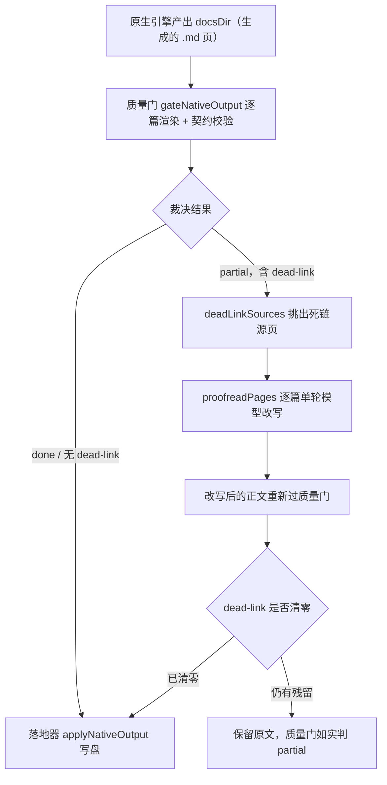
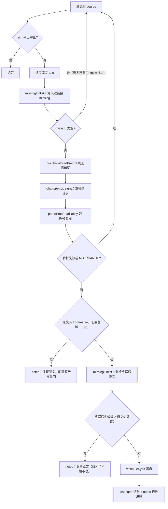
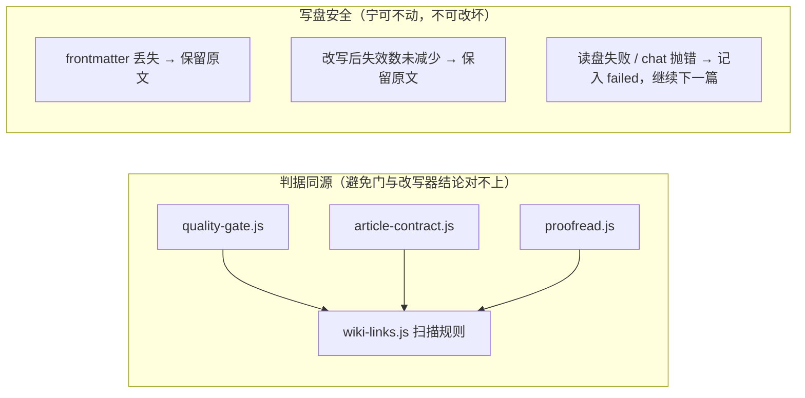
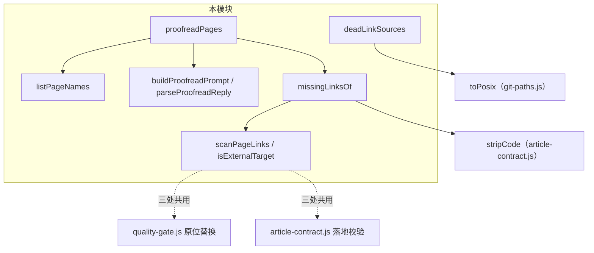

# Wiki 链接校对与死链修复（proofread_links）

## 简介

本模块是 [Wiki 内容健康扫描与计划应用](../Wiki_Content_Health_Scanning___Plan_Application.md) 的子模块，由两个文件组成：

- `lib/engine/proofread.js`：**链接校对器**——在质量门判定出「正文链到不存在的页面」之后，用单轮模型请求把这些死链当场改掉（改成真实页名，或降级为纯文字），而不是让仓库每轮都停在「部分完成」。
- `lib/engine/wiki-links.js`：**跨页链接扫描规则的唯一出处**——`[文字](x.md)` 与 `[[x]]` 两种链接语法的正则、外部协议判定，供 article-contract、proofread、quality-gate 三处共用，避免判据分叉。

### 要解决的问题

原生引擎写作时，模型会照着旧版聚类的记忆**编造页面名**（真机案例：`client_review_console/status_readouts.md`、漏写 `_ui` 后缀的 `settings_and_logs.md`），而模块树里根本没有那些页。质量门如实判 dead-link，于是这些仓库每轮都停在 partial——判据没错，是产物真的错。

### 核心立场（不可妥协的约束）

1. **修的是正文，不是判据。** 校对后的正文仍要重新过一遍质量门，改不掉就照旧判 partial；绝不在渲染期或终态里豁免缺页/死链。
2. **只管一类问题：跨页链接目标不存在。** 这是模型幻觉里唯一可以「只看本页 + 页名清单」就修对的问题。正文事实错误需要读源码，属于重写文章，不在校对范围（那是另一套逐篇校对通道的职责）。
3. **判据必须与质量门同源。** 校对器用与质量门完全相同的页名清单与链接语法识别死链，绝不另立判据——否则会出现「门判它是死链、改写器却认不出这条链接」的哑口。

---

## 在引擎流水线中的位置

> 落地器只写 `defects === 0` 的页（规范化轮除外），因此校对改写必须先把死链消除、让缺陷计数归零，页面才允许入库。详见 [原生输出质量门](../Native_CodeWiki_Runtime_Lifecycle_Management/Native_Output_Quality_Gating.md) 与 [落地应用](Wiki_Content_Health_Scanning___Plan_Application_native_apply.md)。

---

## 核心组件

### `proofreadPages({ docsDir, sources, chat, maxPages, signal })`（`lib/engine/proofread.js`）

校对器主入口。单轮处理若干篇文章，**每篇一次模型请求**。

| 参数 | 说明 |
| --- | --- |
| `docsDir` | 引擎产物目录 |
| `sources` | 要校对的页（docs 内相对路径，由 `deadLinkSources` 产出） |
| `chat` | 单轮文本生成函数 `(prompt, signal) => Promise<string>`；不是函数时直接返回空结果 |
| `maxPages` | 上限，默认 `DEFAULT_MAX_PAGES = 6`——已能盖住真机上「一批页同时引用同一个被合并掉的模块」的形态，再多就变成整轮重跑 |
| `signal` | 可选的 `AbortSignal`，中断时立即停止后续页面 |

返回值：`{ checked, changed, failed, notes }`，其中 `notes` 记录每篇的处置结论（改写几处、跳过原因等）。

**逐篇执行流程：**

### `deadLinkSources(problems)`（`lib/engine/proofread.js`）

从质量门的 defects/problems 里挑出「正文链到不存在的页」的源页。死链在门里有**两个来源，必须都认**：

| 来源 | kind | 真实类别位置 |
| --- | --- | --- |
| `output.js` 判引擎原始页之间的引用 | `dead-link` | kind 直接就是 |
| article-contract 判**落地后**的 wiki 页链接 | `article-contract`（被质量门统一改名） | 留在 `issue` 字段里 |

只认前者会漏掉后者：契约层是唯一检查 `[[...]]` 与落地 slug 的地方，漏掉等于校对永远不接手。返回值为 POSIX 化、去重、排序后的源页清单。

### `listPageNames(docsDir)`（`lib/engine/proofread.js`）

递归列出 docs 目录内全部 `.md` 页（POSIX、已排序），供模型从「真实页名清单」里选。跳过规则：

- 以 `.` 开头的隐藏目录；
- `temp/`——引擎工作文件目录，不是页。

### `buildProofreadPrompt(...)` / `parseProofreadReply(reply)`（`lib/engine/proofread.js`）

- **提示词刻意给足两侧事实**：本页原文 + 真实页名清单 + 门报出的失效目标。只给其中一侧，模型只能靠猜——那正是它当初写错的方式。要求模型只改链接、不动叙述/标题/代码块/表格/行号锚点/frontmatter；清单里找不到对应页时把链接降级为纯文字（去掉 `` 语法）；无需改动时在末尾单独一行写 `NO_CHANGE`（省一次 diff）。
- **解析**：用正则取 `<PAGE>...</PAGE>` 段；末尾的 `NO_CHANGE` 标记表示「无需改动」，从正文中剥除后保留清洗结果。

### `missingLinksOf(text, source, knownSet)`（`lib/engine/proofread.js`）

该页正文里指向 docs 内不存在页面的链接目标清单（POSIX 解析后去重排序）。两种链接形态都认，因为**质量门就是这么判的**：

| 形态 | 例子 | 处理 |
| --- | --- | --- |
| 相对链接 | `[文字](x.md)` | 直接由 `scanPageLinks` 捕获 |
| wiki 索引语法 | `[[x]]` / `[[x|文字]]` | 词条层 article-contract 照样当引用；不带 `.md` 时补一次后缀再判（`core` 与 `core.md` 指同一篇，任一写法命中 knownSet 即算有效） |

判定细节：

- 输入正文先经 `stripCode` 剥掉代码块与行内代码（等长替换，保证偏移一致），代码里的 `.md` 字样不算链接；
- 外部协议目标（`isExternalTarget`）直接跳过；
- 解析后逃逸出 docs 根（`../` 开头）的目标不算——它们本来就不指向本库页面；
- 只收集「失效目标」本身，不负责改写。

### `isExternalTarget(target)` / `scanPageLinks(text)`（`lib/engine/wiki-links.js`）

- `isExternalTarget`：用 `/^[a-z][a-z0-9+.-]*:/i` 识别 `https:`、`mailto:` 等外部协议链接，这类不参与页面内解析。
- `scanPageLinks`：共享的链接扫描器，正则 `/\[([^\]\n]*)\]\(([^)\s]+?\.md)(#[^)\s]*)?\)/g`。约定目标是**第一个** `.md` 结尾的那一段（惰性匹配，避免 `x.md.y.md` 被整段吞成目标），锚点 `#...` 单独捕获。返回 `{ index, whole, label, target, anchor }`，`index`/`whole` 供原文原位替换使用。

---

## 设计决策与不变量

1. **共用正则的来历**：同一件事（「这段正文里有哪些 .md 链接」）原来在三处各写一个正则，演进中分叉——`[^)\s]+?\.md`（惰性）与 `[^)\s]+\.md`（贪婪）谁对谁错没人说得清。分叉的直接后果是「门判它是死链、改写器却认不出这条链接」。本模块把规则收敛到 `wiki-links.js` 单一出处。
2. **不白跑一次门**：`[[x]]` 形态若校对器看不见，门因它判了死链、校对拿到源页后 `missingLinksOf` 却为空直接跳过，等于白跑。因此两种形态必须与门同判。
3. **frontmatter 是硬保护**：校对本来就要动正文，所以不要求「正文一字不动」；但模型若把 frontmatter 吃掉或改坏，这篇宁可不动（原样保留，问题留给质量门如实上报）。
4. **改坏了不如不改**：复检改写后正文的失效链接数，没有减少就回退到原文。
5. **NO_CHANGE 标记**：模型原样返回正文时用 `NO_CHANGE` 标记，既省一次 diff，也让「改了哪些页」有据可查。

---

## 依赖关系

| 依赖 | 来源模块 | 用途 |
| --- | --- | --- |
| `toPosix` | [共享基础设施工具](../../Shared_Infrastructure_Utilities.md)（`lib/git-paths.js`） | 把 Windows 反斜杠路径统一成 POSIX，保证 Set 命中与排序一致 |
| `stripCode` | [Agentic 文章处理库](../../Agentic_Article_Processing_Library.md)（`lib/article-contract.js`） | 剥掉代码块后再扫链接，避免代码里的 `.md` 字样误判 |
| 质量门 problems 流 | [原生输出质量门](../Native_CodeWiki_Runtime_Lifecycle_Management/Native_Output_Quality_Gating.md)（`gateNativeOutput` / `toQualityIssues`） | `deadLinkSources` 的输入来源 |
| 落地器 | [落地应用](Wiki_Content_Health_Scanning___Plan_Application_native_apply.md)（`applyNativeOutput`） | 只写 defects===0 的页——校对后正文必须重新过门达标 |
| `chat` 单轮模型通道 | [核心运行时入口](../../Core_Application_Runtime_Entry.md) 注入 | 每篇一次请求的模型生成能力 |

---

## 相关页面

- 父模块：[Wiki 内容健康扫描与计划应用](../Wiki_Content_Health_Scanning___Plan_Application.md)
- 兄弟模块：[落地应用（native_apply）](Wiki_Content_Health_Scanning___Plan_Application_native_apply.md)、[映射与输出（mapping_output）](Wiki_Content_Health_Scanning___Plan_Application_mapping_output.md)
- 上游：[原生输出质量门](../Native_CodeWiki_Runtime_Lifecycle_Management/Native_Output_Quality_Gating.md)
- 引擎整体：[CodeWiki 引擎子系统](../../CodeWiki_Engine_Subsystem.md)、[引擎公共 API 与结果校验](../Core_Engine_Public_API___Result_Validation.md)
