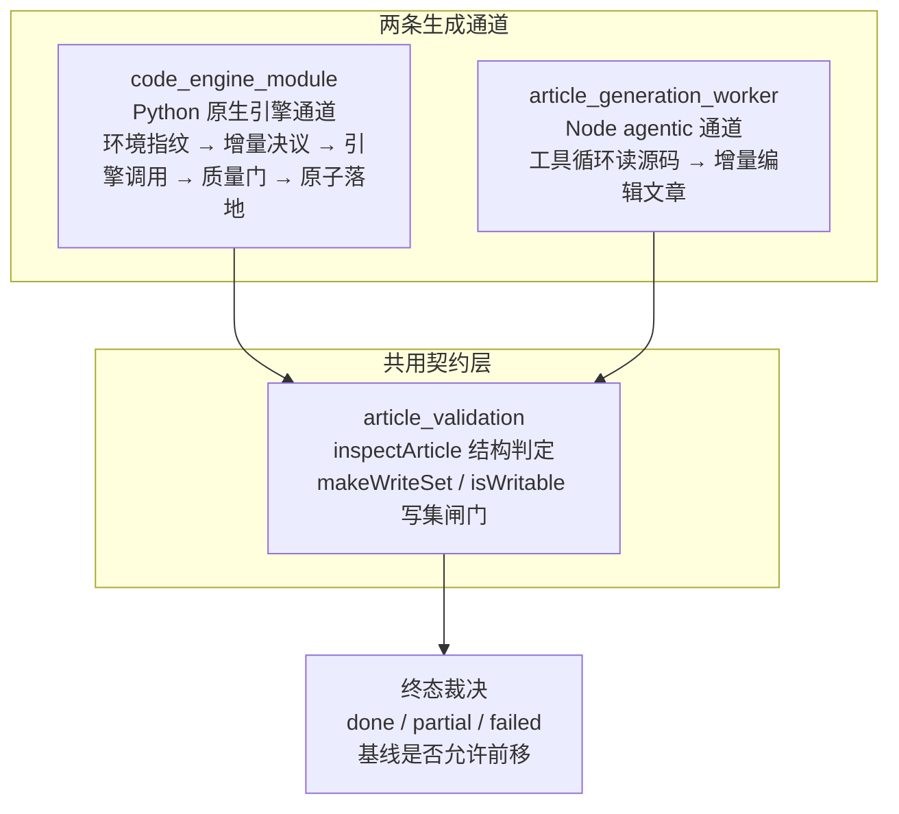
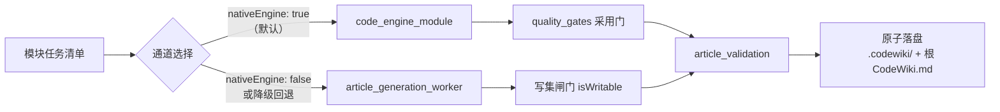

# Code_Engine_Processing_Pipeline 代码引擎处理管线

`Code_Engine_Processing_Pipeline` 是 DSH CodeWiki 扩展中**承接「把源码编译成知识库文章」这一核心任务的执行管线**。它统一了两条互补的生成通道——Python 原生引擎通道与 Node 侧 agentic 写作通道——并在文章落盘前用统一的契约校验与采用门做结构裁决，确保「1 篇成功 + 19 篇失败也报 done」这类模糊终态不再出现。

模块由三部分组成：

- [code_engine_module](Code_Engine_Processing_Pipeline/code_engine_module.md)：驱动 Python FSoft 原生引擎完成知识库编译的完整子系统，把一次编译固定为从环境指纹、增量决议、模型桥、子进程协议、产物映射、质量门到原子落地的单向裁决链。
- [article_generation_worker](Code_Engine_Processing_Pipeline/article_generation_worker.md)：agentic 文章生成执行通道，让模型像工程师一样用工具循环读源码、增量编辑文章，适合大模块。
- [article_validation](Code_Engine_Processing_Pipeline/article_validation.md)：单篇 wiki 文章结构合规判定的纯函数模块，是两条通道共用的「落盘前闸门」。

## 模块架构

两条通道在产物质量上收敛到同一组判据：`article_validation` 提供页面级 defects / degradations 词表，原生引擎通道由 `quality_gates` 逐篇调用，agentic 通道由 worker 在落盘前用 `isWritable` 与空文章兜底校验，最终统一合成严格终态。

## 通道分工

- **原生引擎通道**（`code_engine_module`）：跨进程调用 Python FSoft 引擎，图/聚类/写作一次跑完，产物经自洽校验与质量门后原子落地，并采集跨轮 `.codewiki/_native-state` 以支持增量编译。
- **agentic 通道**（`article_generation_worker`）：模型按需 `read_code` / `edit_article`，双池限流（默认档 + 大档），支持子模块递归派发与写集硬边界，天然适合超大模块。

## 核心组件文档

| 模块 | 职责一句话 |
|------|-----------|
| [code_engine_module](Code_Engine_Processing_Pipeline/code_engine_module.md) | Python 原生引擎编译子系统：环境校验、增量决议、子进程协议、质量门与原子落地的单向裁决链 |
| [article_generation_worker](Code_Engine_Processing_Pipeline/article_generation_worker.md) | agentic 文章生成执行通道：工具循环、双池并发调度、子模块递归派发与写集闸门 |
| [article_validation](Code_Engine_Processing_Pipeline/article_validation.md) | 单篇文章结构合规纯函数判定：frontmatter / 章节 / 死链 / source_files 校验与写集规范化 |

## 核心不变量

| # | 不变量 | 实现位置 |
|---|--------|----------|
| 1 | 锁不一致 / 依赖不闭合 → 直接 `failed`，不跑引擎 | [code_engine_module](Code_Engine_Processing_Pipeline/code_engine_module.md) → engine_manifest_management |
| 2 | 引擎 `done` 不能替代质量门：gate 说 `partial`，终态就是 `partial` | [code_engine_module](Code_Engine_Processing_Pipeline/code_engine_module.md) → quality_gates |
| 3 | error 级契约问题的页面绝不进落盘写集；warning 级放行但阻止基线前移 | [article_validation](Code_Engine_Processing_Pipeline/article_validation.md) |
| 4 | 写集封闭：模型只能写调度器分配的路径，越界一律拒写 | [article_generation_worker](Code_Engine_Processing_Pipeline/article_generation_worker.md) + [article_validation](Code_Engine_Processing_Pipeline/article_validation.md) |
| 5 | 空文章兜底：模型全程未产出正文时记失败，不能覆盖旧文 | [article_generation_worker](Code_Engine_Processing_Pipeline/article_generation_worker.md) |