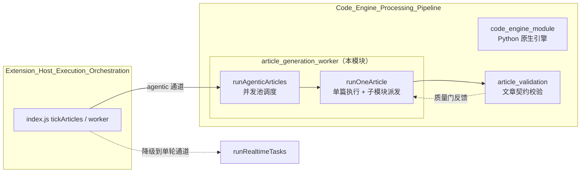
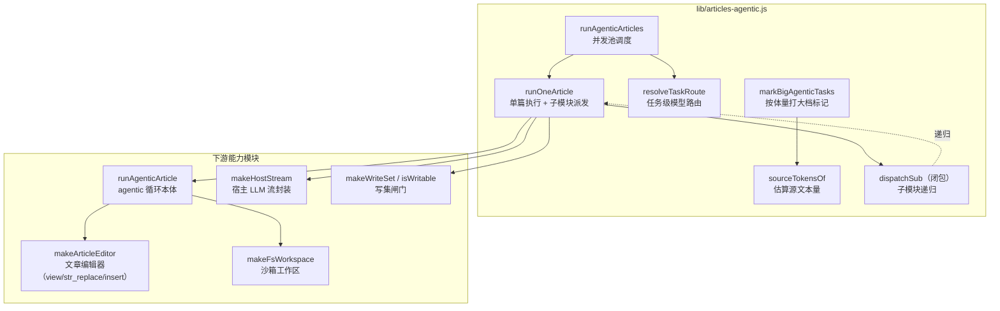
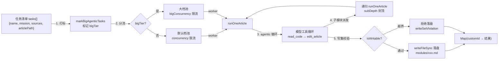
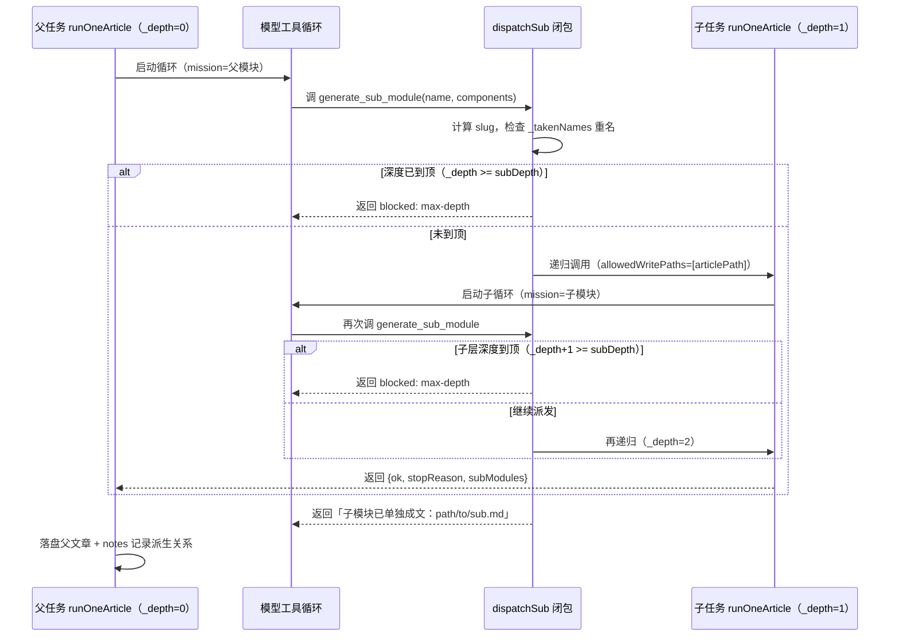
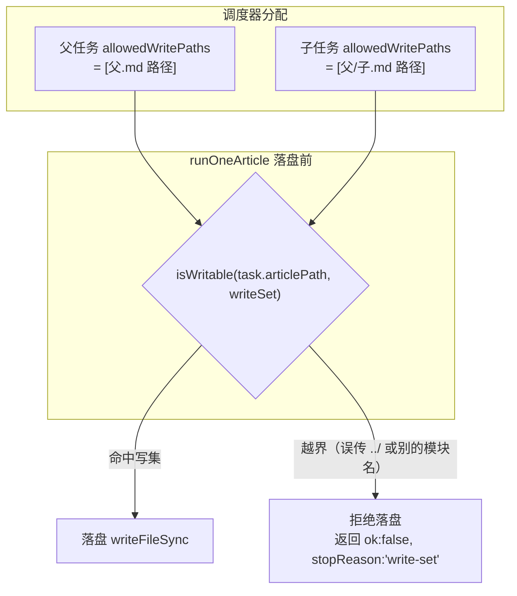

# 文章生成 Worker（article_generation_worker）

## 简介

`article_generation_worker` 是 [Code_Engine_Processing_Pipeline](../Code_Engine_Processing_Pipeline.md) 下的 **agentic 文章生成执行通道**，对应唯一文件 `lib/articles-agentic.js`。它负责把「模块任务清单」真正跑成一篇篇落盘的文章：模型不再一次性吞下整包源码，而是像工程师一样**自己用工具循环读源码、增量编辑文章**。

与 `index.js` 里的 `runRealtimeTasks`（单轮 prompt → 全文通道）并列，本模块是吸收自 FSoft-AI4Code/CodeWiki `module agent` 的第二条执行通道：

| 对比维度 | 单轮通道（runRealtimeTasks） | agentic 通道（本模块） |
| --- | --- | --- |
| 源码装填 | 整包内联进 prompt | 模型按需用 `read_code` / `list_files` 读 |
| 写文方式 | 模型一次吐出全文 | 模型用 `edit_article` 增量改 |
| 预算问题 | 装填超预算 → 拆观察批 → 合成 | 无此问题，天然适合大模块 |
| 失败语义 | 单任务失败只记账、不影响其它 | 相同：返回 `Map(customId → 结果)` |

## 模块定位



## 核心组件

### 1. `runOneArticle(task, options)` — 单篇执行器

这是本模块的核心，负责跑一次完整的 agentic 循环并落盘：

```javascript
runOneArticle(task, {
  llm, provider, model, reasoningEffort = '',
  language = '中文', cwd, fsImpl = fs, pathImpl = path,
  articleFormat = '', systemPrompt = '',
  maxSteps = DEFAULT_MAX_STEPS,   // 步数上限 = 30（唯一定义在 lib/agentic.js）
  signal = null, onDelta = null,
  onSubModule = null, subModuleBlocked = null,
  writeArticle = true, fixAnchors = null,
  allowedWritePaths = null,       // 写集闸门
  streamFn = null,                // 可注入（离线测试用假模型）
  subDepth = 2,                   // 子模块派发深度封顶
  _depth = 0, _takenNames = null, // 递归内部参数
})
```

返回 `{ ok, stopReason, article, steps, usedTools, outputTokens, subModules }`。

**关键执行步骤：**

1. **读取已有文章**：若 `task.prevArticlePath` 存在，读入作为初始内容交给 `makeArticleEditor(initialArticle)`，让模型用 `str_replace` 增量改而非从零重写。
2. **构建工作区**：`makeFsWorkspace(fsImpl, pathImpl, cwd)` 提供沙箱化的 `readFile` / `listDir`（相对路径必须落在 cwd 内）。
3. **构建写集**：若调用方给了 `allowedWritePaths`，编译成写集；未给（`undefined`）保持旧行为不设限；传 `null`/`[]` 视为「谁都不许写」。
4. **调用 agentic 循环**：把 `mission`、`streamFn`、`workspace`、`editor`、`dispatchSub` 交给 `runAgenticArticle`。
5. **兜底校验**：空文章算失败，防止空文件覆盖旧文。
6. **写集闸门校验**：落盘前 `isWritable(task.articlePath, writeSet)`，越界一律不落盘并返回 `writeSetViolation`。
7. **锚点修正 + 落盘**：可选 `fixAnchors` 修正链接，`mkdirSync` + `writeFileSync` 落盘。

### 2. 子模块派发机制

模型在写父模块时可以调 `generate_sub_module` 把「这部分其实该单独成文」拆出去。本模块**就地递归**跑一次 `runOneArticle` 写子模块文章：

- 子模块路径：`<wiki>/modules/<父 slug>/<子 slug>.md`
- 父子分开落盘，父文章不用先写死子文章内容
- **递归深度封顶** `subDepth`（默认 2）：`_depth >= subDepth` 时不再派发
- 深度到顶时用 `subModuleBlocked='max-depth'` 告诉工具层真实原因——避免模型在父文里写「详见 xxx.md」却从未生成那个文件（形成死链且父任务仍记 `ok:true`）
- **全局唯一 slug**：同一次父任务内共享 `_takenNames`，重名加父模块名前缀，仍重则跳过（对应上游 issue #76/#113 的教训：重名会互相覆盖文章）
- **写集隔离**：子模块的写集只有它自己那一条路径，父文章的路径不在内——子层越界写父文或别的模块文章会被拒

### 3. `runAgenticArticles(tasks, options)` — 并发池调度

并发池形状与单轮通道 `runRealtimeTasks` 一致（返回 `Map(customId → 结果)`），但每个任务跑的是 agentic 循环：

```javascript
runAgenticArticles(tasks, {
  concurrency = 2,       // 默认档池并发
  bigConcurrency = 0,    // 大档池并发（0/未传时回落到 concurrency）
  notes = [],            // 笔记收集器
  signal = null,
  onTaskDone = null, onRequestStart = null,
  ...rest
})
```

**双池机制：** 带 `bigTier` 标记的任务走大档池（`bigConcurrency`），其余走默认档池（`concurrency`）。两池各自独立限流、同时推进——大档常是付费长上下文，与免费默认档配额互不相干。

**Worker 取任务循环：**
1. 检查 `signal.aborted`，中止则退出
2. `cursor++` 取下一个任务，任务取完则 worker 退出
3. `resolveTaskRoute(t, rest)` 解析模型路由
4. `runOneArticle(...)` 跑单篇
5. 失败时按原因记账（越界写入 / 未产出正文 / 请求失败）
6. 子模块派生出的文章写入 `notes`

### 4. `resolveTaskRoute(task, options)` — 任务级模型路由

单任务的选档逻辑：

- 任务自带 `provider` + `model`（大档任务，由 `markBigAgenticTasks` 打标）时**完全以任务为准**，`reasoningEffort` 也以任务为准（空 = 模型默认档）——不回落默认档的 effort，因为默认档的 effort（如 `off`）可能不被大档模型支持
- 否则全用参数里的默认档

### 5. `sourceTokensOf(task, cwd)` — 源文本量估算

近似 token 数，给 `markBigAgenticTasks` 当判据。与 `index.js estimateTokens` 同一口径（**CJK 按 1、其余按 3.5 字符/token**），这样大档预算（`bigTokenBudget`，单位 token）可以直接比较。读不到的文件按 0 计，不阻断。

### 6. `markBigAgenticTasks(tasks, options)` — 大档打标

按体量给 agentic 任务打大档标记（纯逻辑，与 `index.js prepareArticleTasks` 的 `markBig` 同语义）：

- agentic 通道不装填源码（模型自己读），所以单轮通道那条「装填超预算」判据不适用
- 等价物：模块源文本量超过 `budget` 就当大档任务——模块大到一个普通上下文模型读不完，交给大上下文档写更稳
- `bigTier = { provider, model, reasoningEffort?, budget }`；未配置（无 provider）时原样返回

## 组件关系图



## 数据流



## 子模块递归流程



## 写集闸门语义

写集（write-set）是本模块吸收自 FSoft 的安全机制：**模型在 agentic 通道里有自由工具循环，但能写哪些文件必须由调度器说了算**。



**边界情况：**
- `allowedWritePaths === undefined`：不设限（旧行为，供既有调用方与测试沿用）
- `allowedWritePaths === null 或 []`：视为「谁都不许写」（有意的收紧）
- 子模块的写集**只有它自己那一条路径**，父文章的路径不在内——子层越界写父文会被拒

## 与其它模块的关系

| 模块 | 关系 | 说明 |
| --- | --- | --- |
| [Code_Engine_Processing_Pipeline](../Code_Engine_Processing_Pipeline.md) | 父模块 | 本模块是其文章生成执行通道 |
| [Extension_Host_Execution_Orchestration](../Extension_Host_Execution_Orchestration.md) | 上游调用方 | `index.js tickArticles` 通过本模块跑 agentic 通道，失败时降级到单轮通道 |
| [agentic_edit_capability](../Extension_Host_Execution_Orchestration/agentic_edit_capability.md) | 下游依赖 | `makeArticleEditor` 的 `edit` 工具实现（view / str_replace / insert） |
| [agent_runtime](../Extension_Host_Execution_Orchestration/agent_runtime.md) | 下游依赖 | `makeFsWorkspace` / `makeHostStream` 的宿主适配层 |
| [article_validation](article_validation.md) | 下游依赖 | `makeWriteSet` / `isWritable` 写集契约；质量门反馈 |
| [code_engine_module](code_engine_module.md) | 兄弟模块 | Python 原生引擎通道（`nativeEngine: true` 时的默认通道） |

## 关键设计要点

1. **步数上限单一来源**：`DEFAULT_MAX_STEPS`（= 30）唯一定义在 `lib/agentic.js`，本模块再导出保持既有导入路径可用，避免出现两份独立常量。
2. **失败语义与单轮通道一致**：单任务失败只记账、不影响其它任务；任何环节（缺 llm / 无 workspace / agentic 循环抛错）都抛或返回 `ok:false`，由调用方决定是否整体降级到单轮通道。
3. **双池独立限流**：大档（付费长上下文）与默认档（免费配额）互不干扰，`bigConcurrency` 为 0/未传时回落到 `concurrency`。
4. **空文章兜底**：模型全程没写过正文但最后一段文本像文章时，`runAgenticArticle` 已收下它；本模块再做兜底校验——空文章算失败，不能把空文件写下去覆盖旧文。
5. **CRLF 行尾处理**：`str_replace` / `insert` 前统一按 `\n` 归一化，命中后按原文风格（CRLF/LF）写回，避免悄悄把整个文件改成 LF。

## 配置依赖

本模块本身不直接读配置，但行为受 `package.json`（第 4 行）声明的引擎通道选择影响：

- `nativeEngine: true`（0.16.0 起默认）：走 Python 原生引擎（`code_engine_module`），本模块作为 Node 侧备用通道
- `nativeEngine: false`：本模块成为主执行通道

`bigTier`（`{ provider, model, reasoningEffort?, budget }`）由宿主在调用 `markBigAgenticTasks` 时注入；未配置（无 provider）时原样返回任务清单，不打标。
