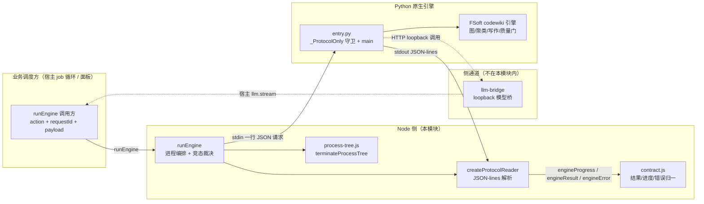
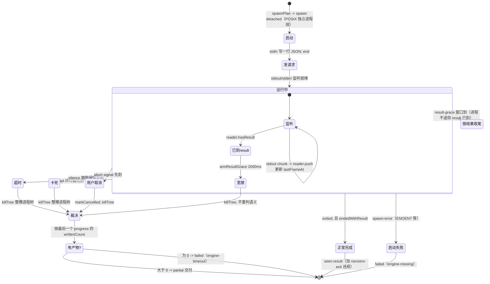
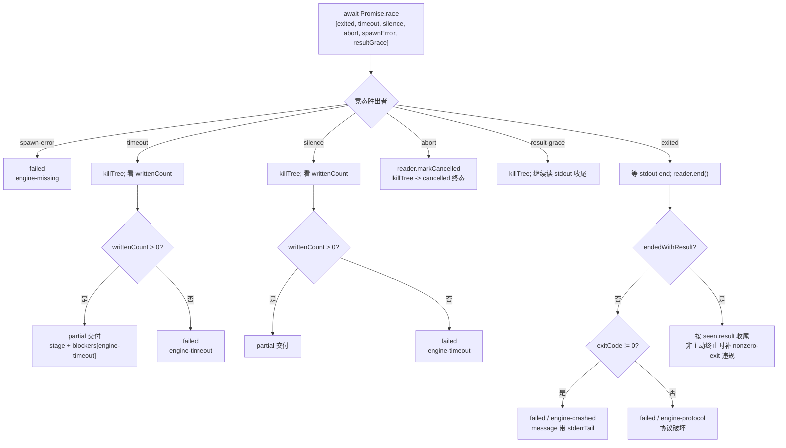

# 引擎客户端（engine_client）

引擎客户端是 Node ↔ Python 原生引擎之间**唯一的跨语言边界**。它由 `lib/engine/client.js` 实现，对外暴露两个构件：`runEngine`（起进程、跑一次动作的完整编排）与 `createProtocolReader`（纯逻辑的增量 JSON-lines 协议解析器）。它把 FSoft Python 引擎的进程生命周期与 JSON-lines 协议流，翻译成系统其余部分可机读的 `EngineResult` / `EngineProgress` / `EngineError`。

> 上游定位：本页只讲「如何驱动一次引擎进程并归一其结果」。整个处理管线的入口与上下游协作见 [Code_Engine_Processing_Pipeline](../../Code_Engine_Processing_Pipeline.md)，引擎整体的模块族见 [code_engine_module](../code_engine_module.md)。

## 职责边界

该模块的设计刻意保持窄而稳定（源码注释称之为「薄适配层」）：

| 它做 | 它不做 |
| --- | --- |
| 起一个受管子进程（spawn），写一行请求 JSON、读回 JSON-lines | 不实现聚类、图 diff、文章写作（那是引擎自身的算法） |
| 把引擎消息翻译为 `contract.js` 定义的结果/进度/错误类型 | 不读凭证、不连模型（模型通道由独立桥提供，见下文） |
| 超时 / 取消 / 崩溃 / 协议破坏时给出**可机读**的失败 | 不写 `.codewiki/`（产物落盘由 apply-plan / mapping 负责） |

### 在整体架构中的位置

## 两个核心构件

### `runEngine(options)` — 一次引擎动作的完整编排

这是对外的主入口。它把一次调用（`doctor` / `generate` / `update` / `cancel`）从「发请求」到「归一结果」完整跑完，**任何路径都返回一个 `EngineResult` 形态的对象**，而不是抛出模糊异常。

关键参数：

| 参数 | 含义 |
| --- | --- |
| `engine` | `{ command, args?, env?, cwd? }` 引擎命令描述，由 `spawnPlan` 规范化 |
| `requestId` / `action` | 关联键与动作枚举（两者都会被显式校验） |
| `payload` | 动作附加字段（scope / language / model / compareTo…），直接拼进请求行 |
| `timeoutMs` | 整体超时，默认 600000ms（10 分钟） |
| `signal` | `AbortSignal`，用于用户取消 |
| `onProgress` / `onLog` | 实时进度帧回调、日志（stderr / terminate）回调 |
| `silenceMs` | 静默卡死阈值，默认 10 分钟，可用 `DSH_CODEWIKI_ENGINE_SILENCE_MS` 覆盖（测试用） |
| `resultGraceMs` | result 到达后等进程自行退出的宽限，默认 2000ms |

返回对象在归一的 `EngineResult` 之上还附带一层运行事实：`contractVersion`、`requestId`、`action`、`protocolViolations[]`、`exitCode`、`exitSignal`、`terminated`、`stderrTail`、`durationMs`、`startedAt` / `finishedAt`。

### `createProtocolReader(options)` — 增量 JSON-lines 解析器

纯逻辑、不碰进程，因此可以按字节逐段喂（模拟管道任意切分），也因此可被单元测试钉死。它按行缓冲，正确处理多字节 UTF-8 跨 chunk 不被切断，单行超过 `maxLineBytes`（默认 4MB）即记 `line-too-long` 违规并跳过，防引擎失控吐超长行吃内存。

对外方法：`push(chunk)`（喂一段 stdout，返回本次新解析出的 progress 快照数组）、`progress` 只读访问器、`hasResult`、`markCancelled()`、`end()`（收尾并返回 `{ result, progress, errors, violations, cancelled, endedWithResult }`）。

## 协议不变量

解析器与 `runEngine` 共同守护六条协议不变量（注释指明它们对应 `test-engine-client.mjs` 的断言）：

1. **stdout 只是 JSON-lines**：任何非 JSON 行记 `not-json` 违规，但**不丢弃**已收结果。
2. **每条消息必须带匹配的 `requestId`**：不匹配记 `unknown-request`，绝不参与本次结果。
3. **没有 `result` 消息 = 协议破坏**：即使退出码是 0 也判失败。
4. **退出码只表达进程层结果**：语义以 `result` 为准 —— 退出码 0 + 语义 failed 仍是失败；语义 done + 退出码非 0 保留 done 并记 `nonzero-exit` 违规。
5. **取消后到达的 result 记 `late-result` 并丢弃**：取消是终态，不能被迟到的成功洗白。
6. **重复 result 先到的赢**：后到的视为引擎 bug。

协议层版本与结果契约版本相互独立：`ENGINE_PROTOCOL_VERSION = 1` 管「行怎么长」，`ENGINE_CONTRACT_VERSION`（来自 contract.js，当前为 2）管「结果字段」。

### 违规种类清单

`protocolViolations[]` 中记录的种类，是排障时区分「引擎日志误写 stdout」与「引擎真坏了」的第一手证据：

| 种类 | 含义 |
| --- | --- |
| `not-json` | 非 JSON 文本行 / 收尾残留半行（最常见：引擎日志误写 stdout） |
| `bad-shape` | 消息不是对象 / 未登记的消息类型 / progress 字段不合法 |
| `protocol-version` | hello 帧的协议版本与本端不符 |
| `unknown-request` | requestId 缺失或不匹配 |
| `line-too-long` | 单行超过 4MB 上限 |
| `late-result` / `duplicate-result` | 取消后迟到的 result / 重复 result |
| `bad-result` | result 内容过不了 `engineResult()` 归一 |
| `engine-timeout` / `engine-cancelled` | 由 `runEngine` 追加的运行层违规 |
| `nonzero-exit` | 语义已 done/failed 但退出码非 0（且非我们主动终止） |

## 进程编排与竞态裁决

`runEngine` 把多种「终止条件」建模为一组 Promise 再 `Promise.race`，谁先到达谁决定结局：

### 三条关键防线的动机

- **静默检测（silenceMs）**：单靠整体超时兜不住「已经卡死」。源码注释记录了 0.16.9 真机事故 —— 僵死引擎会把 180 分钟超时全部占满，调度闸门被锁死，其它仓库一条都推不动。判据改为「多久没收到任何协议帧」：Python 侧心跳线程按 60s（`_HEARTBEAT_SEC`）补帧，正常在跑的引擎绝不静默；真静默即卡死。默认阈值留 10 倍余量（10 分钟），以区分「慢」（单模块模型调用实测 20 秒级）与「死」。
- **结果宽限（resultGraceMs）**：协议约定「语义以 result 为准」。若引擎把 `result(done)` 发出后卡在收尾（僵死线程、没关的 pipe），已**确定成功**的编译会被静默/超时改判成 partial 或超时。因此 result 到达后给进程 2 秒自行收场窗口，超时即杀、按已有 result 收尾，绝不把已确定的成功改判。
- **整棵进程树终止**：FSoft 的 Python 进程还会派生 flake8、find 乃至模型子进程，只 kill 直接子进程会留下孤儿继续烧 token。`terminateProcessTree` 在 POSIX 上按独立进程组先 SIGTERM 后 SIGKILL，在 Windows 上走 `taskkill /T /F`；根进程仍存活时返回 `ok=false` 并经 `onLog` 上报，而不是假装取消成功。详见 [native_runtime_support](native_runtime_support.md)。

## 终态判定口径

要点：

- **超时/卡死但有产物 → `partial` 交付**（从 0.16.1 起）。已写的文章不能丢，partial 允许基线推进、打破「同一输入反复失败」的死循环；一篇没写成才是 `failed`。两者共用错误码 `engine-timeout`（属契约登记的可重试码），差别只在文案——「判定卡死」比「跑太久」是更明确的事实，直接重跑通常就能过。
- **崩溃现场进 message**：`engine-crashed` / `engine-protocol` 的 message 会带上 `stderrTail`（默认截取尾部 4000 字节），不让可机读的失败退化成需要人工翻日志的失败。
- **主动终止不污染退出码语义**：经 result-grace / silence / timeout / abort 杀过的进程，其退出码是终止方式的产物，不再记 `nonzero-exit` 违规。

## 与 Python 入口的协议握手

本模块的对端是 [python_native_runtime](python_native_runtime.md) 中的 `lib/engine/python/entry.py`：

- **请求行**：`{ requestId, action, ...payload }` 一行 JSON + 换行，随后立即关闭 stdin —— 引擎读到 EOF 即开始干活。
- **hello 帧**：引擎启动即发 `{ type: "hello", protocolVersion, engine }`，本端校验协议版本是否为 1，不符记违规但继续。
- **进度帧**：引擎长阶段（聚类、逐模块写作）由心跳线程按 60s 补帧，这是静默检测能成立的前提。
- **stdout 污染防护对端实现**：`entry.py` 在导入任何 FSoft 模块之前就把 `sys.stdout` 换成 `_ProtocolOnly` 守卫对象 —— FSoft 的人类文案全部改道 stderr。这解释了为什么 Node 侧能放心地把 stdout 当成纯协议流、把 stderr 仅当日志收集。

## 环境与构建依赖

- 引擎命令本身由上层（宿主 job 循环）依据已建好的独立 venv 拼出；该 venv 由 `tools/fsoft-engine/setup-env.sh` 按冻结清单 `--no-deps` 落盘并经 `pip check` 反向验证依赖闭合。`runEngine` 只负责调用，不负责建环境。
- Node 版本要求见 `package.json` 的 `engines.node >= 20`；`runEngine` 使用的 `unref()` 计时器行为、`detached` 进程组语义都以此为基线。
- 模型凭证不落盘：引擎侧只拿到 loopback 地址与占位 key，真实凭证经 [llm_integration_bridges](llm_integration_bridges.md) 的宿主 `llm.stream` 间接注入。`runEngine` 对此无感知 —— 模型通道是环境变量与进程外桥的事。

## 相关模块

- 结果/进度/错误的归一与校验：[engine_contracts](engine_contracts.md)
- 整棵进程树的终止与存活探测：[native_runtime_support](native_runtime_support.md)
- 协议对端（Python 入口、心跳、阶段映射）：[python_native_runtime](python_native_runtime.md)
- 模型通道桥：[llm_integration_bridges](llm_integration_bridges.md)
- 产物落盘 / 索引 / 基线（本模块交付结果之后的落地层）：[plan_application](plan_application.md)
