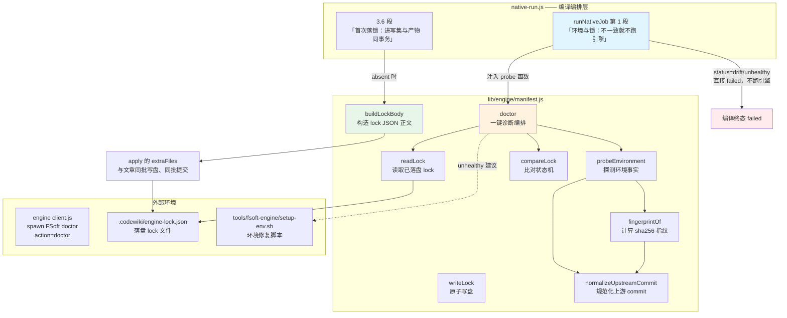
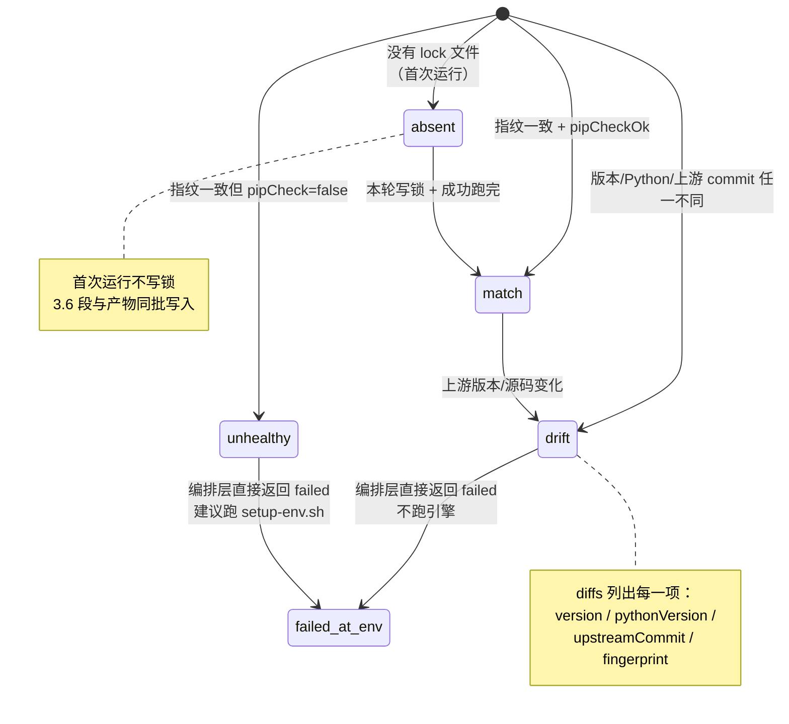
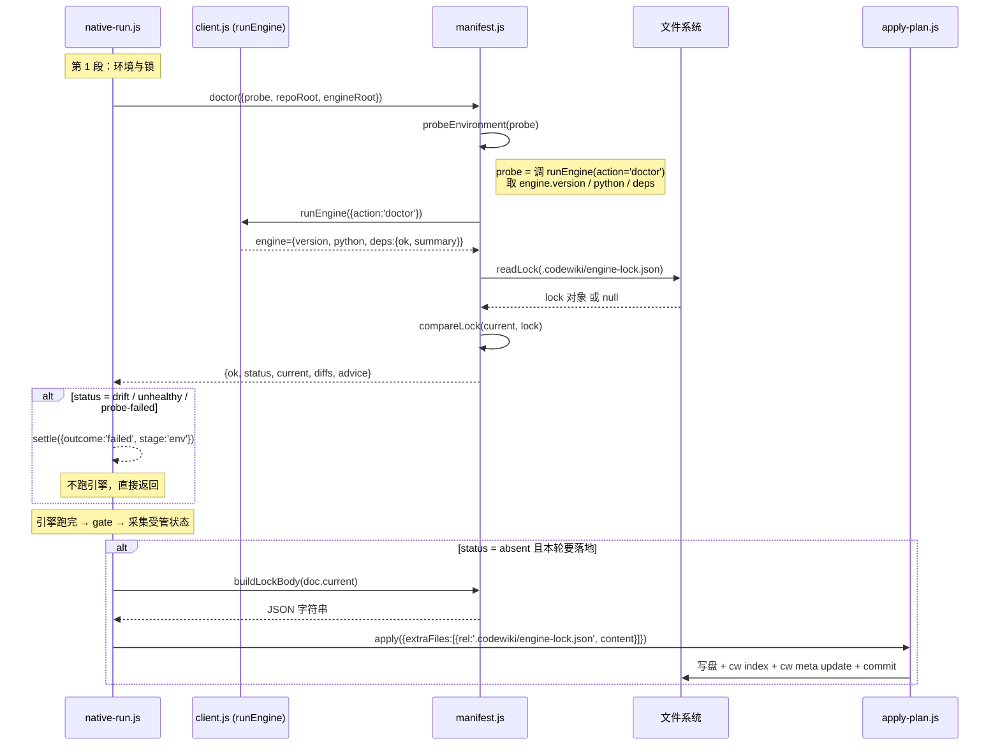

# 引擎清单管理（engine_manifest_management）

## 概述

`engine_manifest_management` 是 `lib/engine/manifest.js` 提供的**引擎环境指纹与锁定**模块，回答的核心问题是：「现在跑的到底是哪个引擎、哪个环境？」

FSoft 引擎是**外部依赖**——它的版本、Python 解释器、依赖闭包状态、甚至上游源码 commit 都不由本仓库控制。没有清单的话，同一份 wiki 在不同机器、不同 pip 状态下会产出不同结果，而这些差异往往以「模型不听话」的形式暴露，而不是「环境漂了」——这是最难排查的一类问题。

本模块只做三件事：

1. **指纹（fingerprint）**：读取引擎版本 + Python 版本 + 上游源码 commit，计算一个稳定 hash；
2. **比对（compare）**：把当前指纹与落盘的 lock 对比，不一致就明确报告是哪一项不一致；
3. **落盘（write/build）**：把指纹写到 `.codewiki/engine-lock.json`，供下次比对与审计。

它**不做**的事情也很重要：不装依赖、不修环境、不联网。`doctor` 是**只读诊断**——它报告事实，由上层（`native-run.js` 的裁决链）决定要不要终止编译，由 `tools/fsoft-engine/setup-env.sh` 负责修复环境。

---

## 架构与组件关系



### 核心组件一览

| 组件 | 职责 | 对外形状 |
|------|------|----------|
| `probeEnvironment({probe, engineRoot, upstreamCommit})` | 调用注入的 `probe` 函数获取环境事实，规范化后附指纹 | `{version, pythonVersion, upstreamCommit, pipCheckOk, pipCheckOutput, engineRoot, fingerprint}` |
| `fingerprintOf(facts)` | 对 `manifest:MANIFEST_VERSION` + 版本 + Python + 上游 commit 做 sha256，截前 16 位 | 16 位 hex 字符串 |
| `normalizeUpstreamCommit(value)` | 校验 40 位小写 hex commit；不合法返回 `''`（=未知） | 规范 commit 字符串 |
| `readLock({repoRoot})` | 读 `.codewiki/engine-lock.json`；文件不存在/JSON 坏 → 返回 `null`（非抛错） | lock 对象 或 `null` |
| `compareLock({current, lock})` | 状态机比对：`absent / match / drift / unhealthy` | `{status, diffs, current, locked}` |
| `buildLockBody(current)` | 构造 lock 的 JSON 正文（**不写盘**），供编排层作为写集一项 | 带换行的 JSON 字符串 |
| `writeLock({repoRoot, current})` | 原子写盘（临时文件 + rename） | 相对路径 `.codewiki/engine-lock.json` |
| `doctor({probe, repoRoot, engineRoot, upstreamCommit})` | 一次调用完成探测+读取+比对+建议；**不抛**（probe 异常 → `ok:false`） | `{ok, status, current, diffs, advice}` |

---

## 关键设计决策

### 1. 指纹只吃「决定产物内容」的因素

```
fingerprint = sha256(
  "manifest:1\n" +
  "version:<引擎版本>\n" +
  "python:<Python 版本>\n" +
  "upstream:<上游 commit>\n"
).hexdigest()[0:16]
```

**为什么上游 commit 必须进指纹**：FSoft 的产物由算法决定，而 `codewiki 2.0.0` 这个版本号在源码从 git 直接安装时**不会跟着变**（版本是 pyproject 里写死的）。上游换了一个 commit 而版本号不动，指纹若只看版本就会误报 match——「换了引擎」被静默当成「环境没变」，产物差异再被误诊成模型问题。

**为什么 pip check 的 ok 不进指纹**：依赖闭合是「能不能跑」的闸门，不是「产物会是什么」的输入。把它算进指纹会让每次修依赖都像换了引擎。pip 状态以 `unhealthy` 状态单独判定。

### 2. 上游锁是显式常量，不是运行时探测

```javascript
export const UPSTREAM_COMMIT = '03d0a294ad58f3c878bd8aeb0ef5e95a2ff8c3ca'
```

引擎的 doctor/generate 都会自报一个 `engine.commit`，但那个值取自 `_git_commit(repo_path)`——它是**被编译仓库的 HEAD**，不是 FSoft 源码自己的 commit。两个概念必须分开：

- `upstreamCommit` —— 本仓库声明的上游源码锁（审计与漂移判据的唯一来源）
- `engine.commit` —— 引擎自报的运行现场（只作证据，不参与判定）

升级上游源码的正确路径是「改这个常量 + 跑契约测试」，而不是 `pip install` 到最新版然后祈祷。

### 3. `doctor` 不抛错，只返回 `ok:false`

调用方（编排层）不需要 try/catch 套 `doctor`；probe 抛错会被吞成 `{ok:false, status:'probe-failed', advice:...}`。`unhealthy` 状态即使指纹一致也返回 `ok:false`——**依赖不闭合就是不可信环境**，不重试、不装包、不「先跑起来再说」。

### 4. lock 的落盘时机：必须与产物同批

`buildLockBody` 被单独拆出来不写盘，是因为「落锁」的时机必须由编排层控制：

- **不能在 doctor 阶段写**：`.codewiki/` 目录会早于 `cw init` 存在，落地器会把「有 `.codewiki/` 却没有 `_meta.yaml`」判成人工破坏的半截库并拒绝自动初始化（`wiki-missing` 分支），首次编译整批失败并回滚。
- **不能在 apply 之后直接写盘**：那份文件会落在提交之外，下一轮被当成「有未提交改动」再提交一次——无变化的一轮也因此凭空产生一个 commit。
- **正确做法**：把 `buildLockBody(current)` 的结果作为 `apply` 的 `extraFiles` 一项，与文章共享同一份 pre-image——写入与提交都跟着产物走，失败一起回滚。

---

## 状态机：`compareLock` 的四种判定



| 状态 | 含义 | `ok` | 编排层动作 |
|------|------|------|-----------|
| `absent` | 首次运行，没有 lock | `true` | 允许跑；3.6 段把 lock 进写集 |
| `match` | 环境与上次一致 | `true` | 正常跑引擎 |
| `drift` | 引擎版本/Python/上游 commit 变了 | `false` | 直接 failed（`engine-deps`），**不跑引擎** |
| `unhealthy` | 指纹一致但 pip check 失败 | `false` | 直接 failed，建议跑 `setup-env.sh` |
| `probe-failed` | 探测本身失败（解释器缺失/入口崩） | `false` | 直接 failed（`engine-missing`） |

---

## 数据流：一次编译如何使用清单



---

## 依赖与相邻模块

本模块在系统中的位置：

- **上游调用方**：[native_runtime_support](native_runtime_support.md)（`runNativeJob` 的 env 段与 3.6 段）—— 本模块的唯一生产消费者
- **探测来源**：[engine_client](engine_client.md)（`runEngine` 的 `action='doctor'`）—— `probe` 函数的真实实现
- **落盘目的地**：[plan_application](plan_application.md)（`applyNativeOutput` 的 `extraFiles`）—— `buildLockBody` 的正文作为写集一项被消费
- **环境修复**：`tools/fsoft-engine/setup-env.sh`（仓库脚本，详见 [build_deployment_config](../../build_deployment_config.md)）—— `unhealthy` 状态时上层建议运行
- **受管状态协同**：[native_state_management](native_state_management.md)（`stateDocFiles` / `stateFileItem`）—— 与 lock 文件同在 `.codewiki/` 下，同批写入

---

## 落盘文件格式

`.codewiki/engine-lock.json` 的结构（由 `buildLockBody` 生成）：

```json
{
  "manifestVersion": 1,
  "fingerprint": "a1b2c3d4e5f60718",
  "version": "2.0.0",
  "pythonVersion": "3.11.9",
  "upstreamCommit": "03d0a294ad58f3c878bd8aeb0ef5e95a2ff8c3ca",
  "engineRoot": "/abs/path/to/fsoft-src",
  "pipCheckOk": true,
  "recordedAt": "2025-01-01T00:00:00.000Z"
}
```

字段说明：

| 字段 | 来源 | 作用 |
|------|------|------|
| `manifestVersion` | 常量 `MANIFEST_VERSION=1` | 未来格式演进的判据 |
| `fingerprint` | `fingerprintOf()` | 比对的快速入口 |
| `version` | 引擎自报 | drift 判据之一 |
| `pythonVersion` | 引擎自报 | drift 判据之一 |
| `upstreamCommit` | 显式常量（config 可覆盖） | drift 判据之一；落盘是为了让「锁了 commit」从文档变成机器可比对的事实 |
| `engineRoot` | 编排层传入 | 审计用，不参与判定 |
| `pipCheckOk` | 引擎 doctor 自报 | unhealthy 判据 |
| `recordedAt` | 写入时刻 | 审计 |

---

## 不变量汇总

1. **probe 注入而非 spawn**：本层是纯的、可单测的；进程管理留在 `client.js`。
2. **不抛错诊断**：`doctor` 返回 `ok:false` 而非抛异常；`readLock` 返回 `null` 而非抛异常。
3. **不装依赖、不修环境**：本模块只读；修复是 `setup-env.sh` 的职责。
4. **不直接写盘**：`buildLockBody` 与 `writeLock` 分离；生产路径走 `buildLockBody` + `extraFiles`，`writeLock` 仅用于测试或独立工具。
5. **原子写盘**：`writeLock` 用临时文件 + rename，避免半截 lock 文件。
6. **上游锁是声明**：`upstreamCommit` 只能被 config 覆盖，不能从引擎自报中「学到」。
