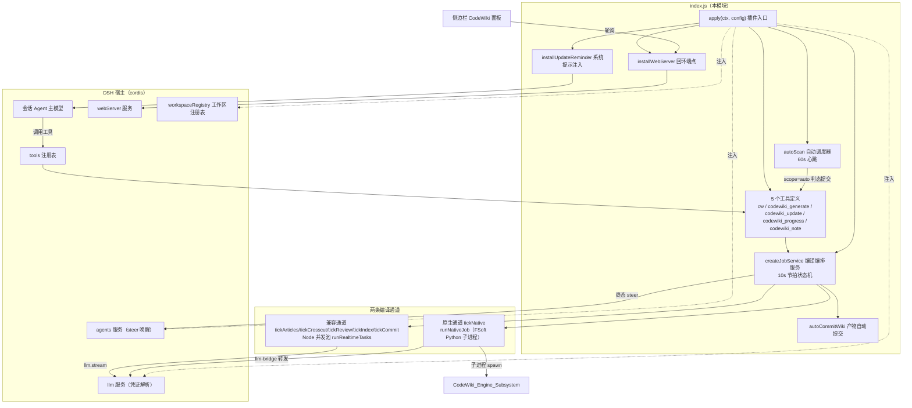
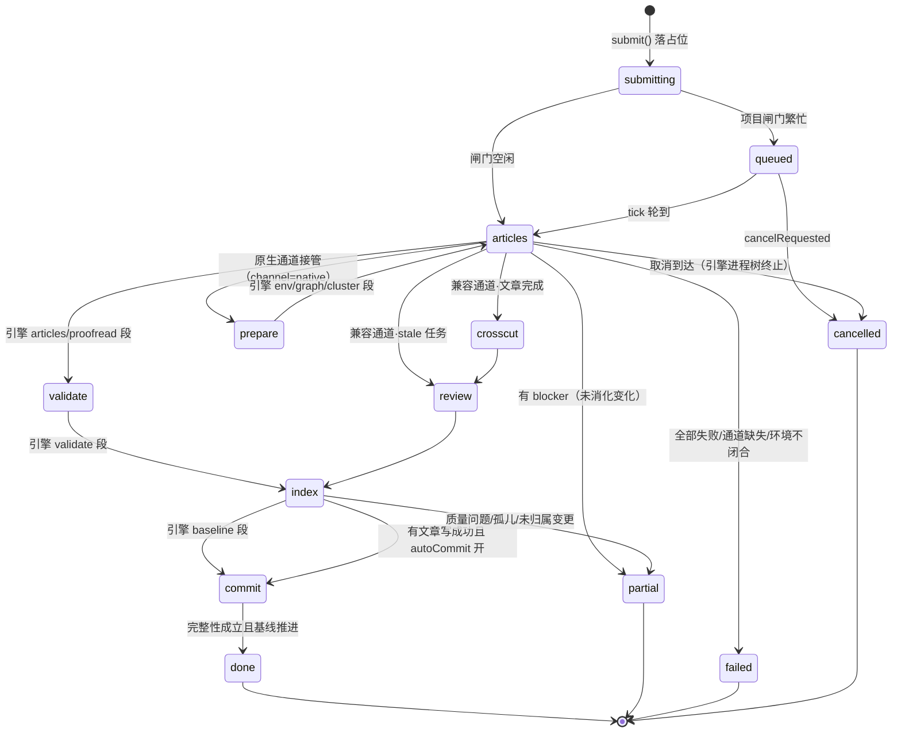
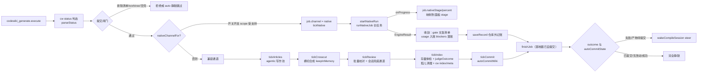
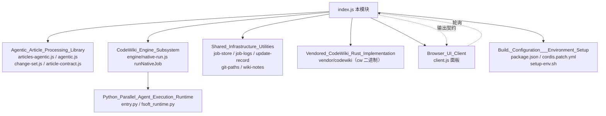

# Core_Application_Runtime_Entry 模块文档

## 简介

`Core_Application_Runtime_Entry` 是 **dsh-codewiki** 插件的运行时入口，对应唯一文件 `index.js`。它把一个 fork 的 Rust CLI `cw`（CodeWiki，源码见 [Vendored_CodeWiki_Rust_Implementation](Vendored_CodeWiki_Rust_Implementation.md)）接入 DeepSeek Harness（DSH）宿主，完成三件事：

1. **工具面**：向宿主注册 5 个模型可调用工具（`cw` / `codewiki_generate` / `codewiki_update` / `codewiki_progress` / `codewiki_note`）。
2. **后台编译服务**：以 `createJobService` 为核心的常驻编排服务，用 ~10s 节拍（`TICK_MS`）驱动一条编译任务状态机，把「判态 → 提交 → 推进 → 收尾 → 入库」整条流水线跑在插件内，而不是塞进发起会话的主模型里。
3. **面板与自动化后端**：一组仅回环可访问的 HTTP 端点（供侧边栏面板 [Browser_UI_Client](Browser_UI_Client.md) 轮询）、自动增量调度器（`autoScan`）、以及会话系统提示里的 wiki 维护提醒。

自 `0.16.0` 起，编译默认走**原生引擎通道**（`nativeEngine: true`，上游 FSoft Python 引擎子进程）；内置 Node 流水线降级为「兼容通道」（`nativeEngine: false`），不再接收新能力。两条通道在本入口处完成通道决议，具体引擎实现见 [CodeWiki_Engine_Subsystem](CodeWiki_Engine_Subsystem.md)。

## 总体架构

## 核心组件清单

以下组件均定义/导出于 `index.js`，按职责分组。

### 插件装配层

| 组件 | 职责 |
| --- | --- |
| `apply` | 插件入口。经 `ctx.inject(['agents','llm','workspaceRegistry'])` 取得宿主服务引用；创建并启动 `createJobService`；注册 5 个工具；挂载回环 Web 端点；装自动调度器与更新提醒；注册 `ctx.effect` 清理函数（`service.stop()` / 清定时器）。 |
| `Config` | `@deepseek-ai/schemastery` 描述的插件配置 schema（全部 `.volatile()`，热改即生效），覆盖通道选择、模型档位、并发、增量阈值、自动提交、排除清单等 30+ 项。 |
| `liveConfig` / `updateOptionsOf` / `bigTierOf` | 配置归一化：把 volatile 原始值收口成运行参数（硬顶钳制、大档开关在关闭时清空 provider、增量参数只留空时透传上游默认）。 |

### 任务状态机（createJobService 闭包内）

| 组件 | 职责 |
| --- | --- |
| `submit` | 提交编译任务。依次过排除清单 → linked worktree 闸门 → 空壳目录闸门 → 幂等判定（`findActiveJob`）→ 校验模型通道与思考档位 → 按项目闸门（`serialProjects`/`parallelLimit`）决定直接进 `articles` 还是先 `queued`。 |
| `cancel` | 标记 `cancelRequested` 并落盘；真正的中断动作在 `tick()` 里执行（abort 在飞 LLM 请求、kill 原生引擎进程树）。 |
| `tick` | 10s 主节拍。取 tick 锁（多实例互斥）→ `mergeFromDisk` 吸收他实例变更 → 拾取取消标记 → 项目闸门调度 → 按 job.channel 分派 `tickNative` 或 `STAGE_HANDLER`。 |
| `tickArticles` / `tickCrosscut` / `tickReview` / `tickIndex` / `tickCommit` | 兼容通道五段阶段处理器：agentic 写作 → 横切合成（`_architecture.md`/`_patterns.md`/概念页）→ 批量校对 → 索引+基线裁决 → 产物提交。 |
| `jobSummary` | 任务的统一外发形态：面板、`codewiki_progress`、`/api/codewiki/jobs` 共用同一份结构（stage/outcome/blockers/writtenCount/usage/nativeStage/nativeLogs/autoCommit 等）。 |
| `progressView` | 在 `jobSummary` 之上按 `taskList` 完成数计算百分比。 |
| `list` | `service.list()`：先 `mergeFromDisk` 再返回全部 `jobSummary`。 |
| `finishJob` / `fail` | 终态收口：`done`/`partial`/`failed`/`cancelled` 三态（+取消），控制 `canAdvanceBaseline`——只有完整性成立才推进编译基线。 |
| `wakeCompileSession` | 终态时对发起会话 `agent.steer` 一条消息。成功且插件已自动提交（或无改动）时**完全静默**；只有「失败」或「产物待提交」才打扰会话。 |

### 并发池与模型通道

| 组件 | 职责 |
| --- | --- |
| `runPool` / `worker` | `runRealtimeTasks` 内部的双池执行器：大档任务（`bigTier`）与默认档任务分池独立限流，每个池按 `limit` 个 `worker` 协程消费任务队列。 |
| `allowedLinkTargets` | 为文章契约闸门构建允许的内部链接目标集合（现存 wiki 文章 + 本轮计划产出，相对路径/裸名/basename 三形态）。 |
| `symbolsOnLine` | 从文章行内提取反引号符号（供行号锚点自动修正用），与 `test-wiki-anchors.mjs` 同源。 |

### 判态、仓库与持久化工具

| 组件 | 职责 |
| --- | --- |
| `parseStatus` / `normalizeArticlePath` / `normalizeIndexLinks` | 解析 `cw status` 三态输出（missing/uncompiled/clean/stale），并把 Windows 反斜杠路径规范化为 `/`（纵深防御）。 |
| `currentCommit` | `git rev-parse --short HEAD`，返回当前 HEAD 短 sha（快照留档用）。 |
| `makeLinkExists` | 基于存量 + 计划文章构建链接存在性判定函数（stale 扫描用）。 |
| `reposFileFor` | 从 jobs 文件名推导已知仓库清单文件路径（`-jobs` → `-repos`），保证测试隔离不串写宿主清单。 |
| `detectLinkedWorktree` / `isWorktreeCwd` / `hasCompilableSources` / `isDeadCompileTarget` | 编译对象合法性判定：linked worktree 拒编、空壳目录拒编，判定带 60s/10min 缓存避免 2s 轮询打爆 git。 |
| `onAbort` | `runCw` 的 AbortSignal 回调（超时与取消时 SIGKILL 子进程）。 |

## 工具面（注册给会话模型）

| 工具 | 语义 | 关键行为 |
| --- | --- | --- |
| `cw` | 薄封装 Rust CLI | 限 `init/status/index/meta/path/projects/setup/uninstall` 八个子命令；`resolveBinary` 优先 PATH 里的 `cw`，兜底插件自带 `bin/cw(.exe)`。 |
| `codewiki_generate` | 提交制编译入口 | `cw status` 判态 → 原生通道接管增量（决议权归引擎）→ 兼容通道走文件级归属判定 → 立即返回 `jobId`，明确要求模型「不要等待、不要轮询」。 |
| `codewiki_update` | 日常维护快捷入口 | 固定 `scope=auto` 复用 `generateDef.execute`，文案引导模型「本步收尾、继续下一项」。 |
| `codewiki_progress` | 只读进度查询 | 按 `cwd`/`jobId` 过滤返回 `progressView(jobSummary)`，输出 stage/百分比/篇数/引擎阶段/日志文件/自动提交结果。 |
| `codewiki_note` | 手工页写入 | 把修复经验（`learnings/`）或设计决策（`decisions/`）写成手工维护页（编译不会覆盖）；过同一套文章契约闸门后落盘并跑 `cw index`。 |

## 任务生命周期（状态机）

终态语义（`finishJob` 吸收自 FSoft updater 的不变量）：

- **done**：完整成功——计划内必需文章全部写好、变更全部有归属、质量闸门全过，基线前移。
- **partial**：写成的文章可以入库，但有未消化变化/质量阻塞——**不推进基线**，下次编译还会看见这些变化。
- **failed**：没有任何可交付成果。
- **cancelled**：取消是终态但不是成功，`canAdvanceBaseline` 恒 false；原生通道取消只杀引擎进程树，已进入落地事务（写盘→index→基线→提交）的部分按真实结果收割，绝不回滚已落盘产物。

## 编译数据流（提交 → 收尾）

## 依赖关系

**关键外部契约**（详见对应模块文档，本页不重复展开）：

- [CodeWiki_Engine_Subsystem](CodeWiki_Engine_Subsystem.md)：原生通道的全部实现——Python 子进程拉起、LLM 桥占位 key、质量门、落地器 apply-plan、工作区快照。本模块只负责「起进程 / 收进度 / 按结果判终态」，绝不在 tick 里重写裁决。
- [Agentic_Article_Processing_Library](Agentic_Article_Processing_Library.md)：兼容通道的 agentic 写作循环（模型自己 `read_code`/`edit_article`）、变更集采集与文章契约检查。
- [Shared_Infrastructure_Utilities](Shared_Infrastructure_Utilities.md)：任务存储（`job-store.js` 的多实例合并/tick 锁/孤儿接管）、引擎日志 NDJSON、更新记录、git 路径与 wiki 笔记工具。
- [Browser_UI_Client](Browser_UI_Client.md)：面板前端，消费本模块注册的 `/api/codewiki/*` 端点。

## 回环 Web 端点（installWebServer）

所有端点先过 `isLoopbackRequest` 守卫（非回环 403）：

| 端点 | 用途 |
| --- | --- |
| `GET /api/codewiki/jobs` | 任务列表。应用工作区过滤（`workspaceOnly`）、编译对象闸门、queued 任务标注「在等谁」（`queueAhead`）。 |
| `GET /api/codewiki/repos` | 仓库总览：合并 job 历史与已知仓库清单，30s 缓存（缓存签名含工作区清单与活动任务），现算 `cw status`。 |
| `GET /api/codewiki/sessions` / `/sessions/item` | 并发池 LLM 请求的 prompt/输出记录（24h TTL），面板「会话」视图数据底座；`activeSessionJobs` 列出在跑但尚未发请求的任务。 |
| `GET /api/codewiki/logs` | 引擎事件日志翻页（内存只留最近 40 条，完整 NDJSON 在仓库外临时目录）。 |
| `GET /api/codewiki/models` / `/model-efforts` | 设置页级联下拉数据源：与宿主模型目录同源（`llm.listProviders` + `resolveModelInfo`）。 |
| `POST /api/codewiki/control` | 动作：`cancel`（取消任务）、`compile`（面板手动编译）、`confirm`（首次编译待确认）、`refresh`（清总览缓存）。 |

## 自动化与提醒

- **自动增量调度器**（`autoScan`，60s 心跳）：对「已知仓库清单 ∪ job 历史」逐个 `scope=auto` 判态提交；首次编译的仓库（无任务历史 + 无 wiki）只登记 `pendingConfirm`，等用户在面板点确认，**不替用户决定要不要生成 wiki**。
- **更新提醒**（`installUpdateReminder`）：会话系统提示注入 `codewiki:update-reminder` section，仅当会话仓库根存在 `CodeWiki.md` 时出现；`commitHintText` 在「最近成功编译的完成时间晚于 wiki 产物最后一次 git 提交」时追加一次性的「产物待提交」提醒（60s TTL 缓存）。
- **自动提交**（`autoCommitWiki`）：主题分支 `codewiki/wiki-<jobId>` 提交（只 `git add -- .codewiki CodeWiki.md` 两个 pathspec）→ ff 合并回原分支 → 删主题分支；detached HEAD/建分支失败降级 `direct`；merge 冲突一律 `merge --abort` 保留主题分支，绝不强合。

## 构建与装配（来自仓库产物）

- `package.json`：包名 `@local/dsh-codewiki`，`main: index.js`；`engines.node >= 20`、`engines.dsh >= 0.2.0-rc.0`；唯一运行时依赖 `@deepseek-ai/schemastery`。
- `cordis.patch.yml`：bundle 补丁——宿主 profile 以 `link:` 依赖 + `dsh.profile.bundles` 装载，cordis 插件 id 固定为 `codewiki`；同 id 覆盖条目是整对象替换，未写的键回落 `index.js` 的 `Config` 默认值。
- `tools/fsoft-engine/setup-env.sh`：原生通道要求本机 Python 3.10+ 闭合 venv；环境不闭合时以 `engine-deps` 明确失败，**绝不悄悄回退 Node 通道**。

## 设计约束速记

1. **模型唯一通道**：所有编译环节走宿主 `llm.stream`（凭证由宿主按 provider 解析），插件不持有任何密钥；provider/model 留空在提交入口显式报错，绝不静默空跑。
2. **通道锁定**：`job.channel` 一旦写入（`native`/`legacy`）就跟着 job 走——原生任务一律只进 `tickNative`，避免同一批产物被两套实现各写一遍。
3. **基线不变量**：`cw meta update` 只在 `judgeOutcome(...).canAdvanceBaseline === true` 时执行；partial/failed 的 wiki 索引照建（链接可看），但基线绝不前移。
4. **多实例安全**：tick 锁 + `mergeFromDisk` + `dirtyIds` 合并 + 孤儿任务接管（`ORPHAN_TAKEOVER_MS` 默认 5 分钟）+ 跨实例取消标记拾取，保证宿主重启/插件重载后任务不被旧快照回写。
