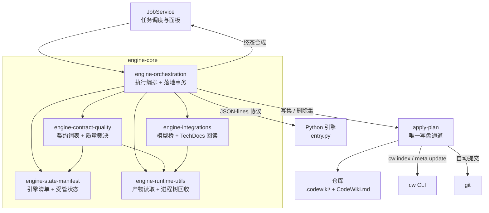
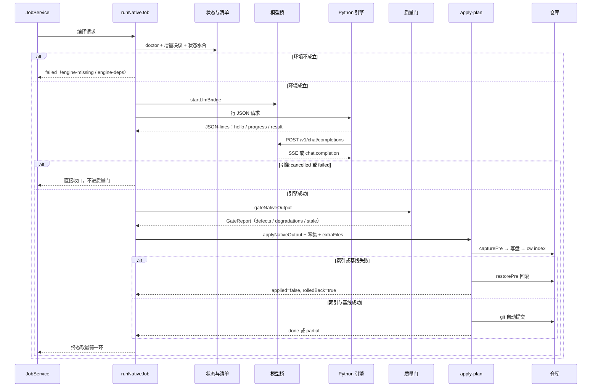

# engine-core 模块概览

`engine-core` 是 Documentation_Generation_Engine 的**原生（FSoft）编译内核**，负责把一次「为仓库生成 wiki」的请求，从环境探测一路推进到可机读的终态结论，并把通过质量门的产物真正写进 `.codewiki/` 与 `CodeWiki.md`。

它不实现文章生成算法——聚类、图 diff、写作都在 vendored 的 Python 引擎里；它实现的是围绕这台外部引擎的**全部工程约束**：跨语言进程协议、结果契约、质量裁决、跨轮状态记忆、模型桥接、落地事务与回滚。模块的设计主线只有一句：**每一步的结论都不能被下一步洗白**。

## 模块定位

| 维度 | 说明 |
| --- | --- |
| 输入 | 一次编译请求（scope / kind / 模型配置）+ 仓库工作区 |
| 输出 | `EngineResult`（`done` / `partial` / `failed` / `cancelled`）+ 已落盘的文章与索引 + 基线推进事实 |
| 不做 | 文章生成算法、任务调度与面板、依赖安装、上游引擎源码维护 |
| 关键约束 | 不跑引擎就不判质量、质量门不过不落地、落地失败要回滚、只有完整成功才推进基线 |

## 架构

模块由五层组成，边界清晰且依赖方向单一：工具层不认业务，裁决层不写盘，编排层不直接改仓库。

| 层 | 职责 | 是否写盘 |
| --- | --- | --- |
| [engine-orchestration](engine-core/engine-orchestration.md) | `client.js` 跨语言边界与 `runNativeJob` 裁决链；`apply-plan` 写盘、索引、基线、提交与回滚 | 仅 `apply-plan` |
| [engine-contract-quality](engine-core/engine-contract-quality.md) | `EngineResult` / `EngineProgress` / `EngineError` 契约、采用门、死链语义校对、wiki 链接扫描规则 | 仅 `proofread.js` 改正文 |
| [engine-state-manifest](engine-core/engine-state-manifest.md) | 引擎指纹与 `engine-lock.json`、跨轮受管状态、产物映射、工作区快照 commit | 产出写集项，不直接落盘 |
| [engine-integrations](engine-core/engine-integrations.md) | 进程内 loopback 模型桥（OpenAI 兼容 ↔ 宿主 LLM）、TechDocs 站点回读 | 否 |
| [engine-runtime-utils](engine-core/engine-runtime-utils.md) | `docs` 树读取与自洽性校验、受管子进程树终止 | 否 |

## 一次编译的主干流程

## 贯穿全层的硬约束

- **终态取最弱**：引擎、质量门、落地器三者中任一降级，终态都不能是 `done`；`done` 不许带 blockers，`partial` 必须带 blockers，`failed` 必须带 error。
- **契约是唯一词表**：`BLOCKER_KINDS`、`ENGINE_STAGES`、`ENGINE_ERROR_CODES` 只允许追加，其它模块不得硬编码复制；未登记的 kind 直接抛错，而不是静默忽略。
- **写盘单通道**：只有 `apply-plan` 修改 `.codewiki/` 与 `CodeWiki.md`，文章、受管状态、`engine-lock.json`、TechDocs 站点共享同一份 pre-image 与回滚语义。
- **状态只由完整成功推进**：`partial` / `failed` / `cancelled` 一律不推进基线、不裁剪状态，未消费的改动显式携带到下一轮。
- **产物读取与进程回收各只有一处实现**：`output.js` 与 `process-tree.js` 被上层复用，而不是被顺手复制。

## 核心组件文档

| 文档 | 覆盖内容 |
| --- | --- |
| [engine-orchestration](engine-core/engine-orchestration.md) | 执行与裁决层总览，含 [engine-runner](engine-core/engine-orchestration/engine-runner.md)、[engine-runner_process-protocol](engine-core/engine-orchestration/engine-runner/engine-runner_process-protocol.md)、[engine-runner_native-pipeline](engine-core/engine-orchestration/engine-runner/engine-runner_native-pipeline.md)、[apply-plan](engine-core/engine-orchestration/apply-plan.md) |
| [engine-contract-quality](engine-core/engine-contract-quality.md) | 结果契约、采用门三类问题（defect / degradation / stale）、死链语义校对、基线可推进性 |
| [engine-state-manifest](engine-core/engine-state-manifest.md) | 引擎指纹与锁状态机、受管状态水合与采集、未消费账合并、工作区快照 |
| [engine-integrations](engine-core/engine-integrations.md) | 模型桥安全模型、OpenAI 双向转换语义、空产出可观测性与熔断、TechDocs 回读 |
| [engine-runtime-utils](engine-core/engine-runtime-utils.md) | `collectOutput` / `validateOutput` 问题类别、页别名与死链判定、跨平台进程树终止 |

## 相关模块

- 上层总览：[Documentation_Generation_Engine](../Documentation_Generation_Engine.md)
- 上游引擎实现：[Execution_Runtime___Vendored_Engine](../Execution_Runtime___Vendored_Engine.md)（`entry.py`、并行运行时、`stage_map.py`）
- 任务调度与进度落账：[Job_Orchestration___State_Management](../Job_Orchestration___State_Management.md)
- 文章格式契约：[article-pipeline](article-pipeline.md)
- 引擎环境与依赖闭合：[Build___Development_Infrastructure](../Build___Development_Infrastructure.md)
- 面板进度消费：[ui-client](../ui-client.md)