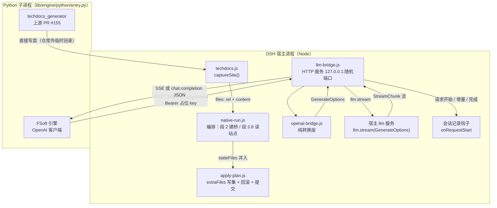
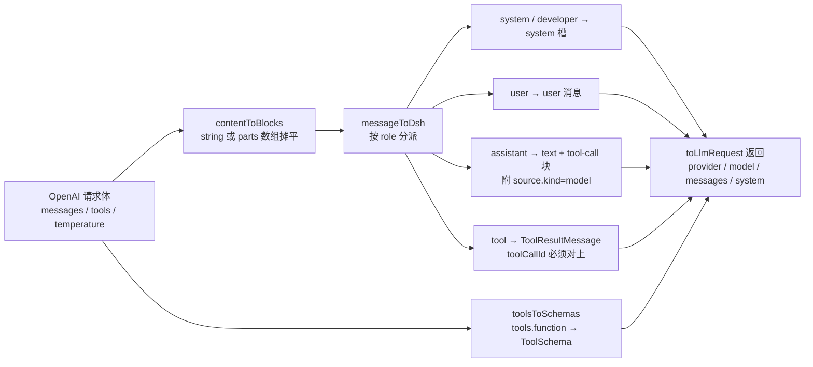
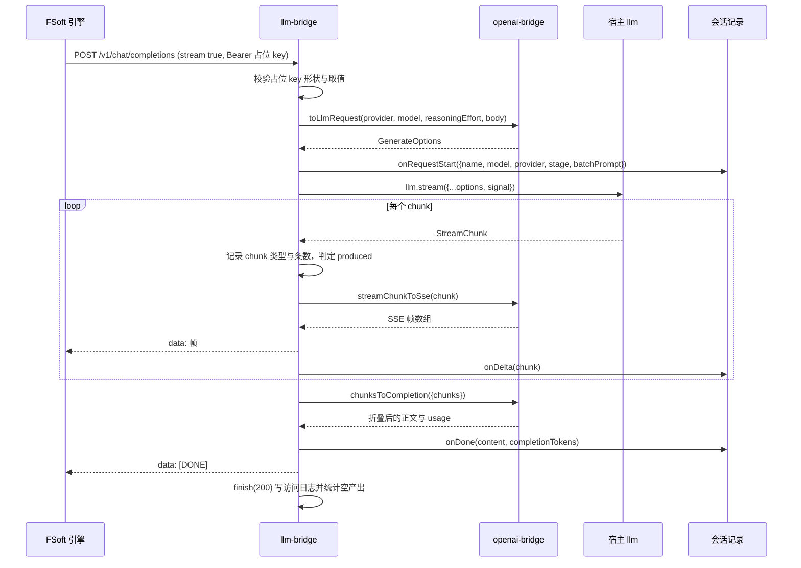
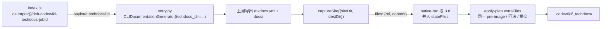

# 引擎外部集成层（模型桥与 TechDocs 回读）

本模块是原生引擎通道的**外部边界层**：它把上游 FSoft Python 引擎与两个「外部世界」接起来——
一是宿主的模型服务（`llm.stream`），二是上游自己写盘产出的 TechDocs 站点。它不参与任何编译
裁决，只负责两件事：**让引擎能调到模型**，**让引擎的附加产物能进入落地事务**。

| 文件 | 角色 | 关键导出 |
| --- | --- | --- |
| `lib/engine/llm-bridge.js` | 进程内 loopback HTTP 桥（有 I/O、有端口、有生命周期） | `startLlmBridge`、返回对象的 `setStage` |
| `lib/engine/openai-bridge.js` | OpenAI-compatible ↔ DSH LLM 的**纯转换**（无 I/O、无网络、无密钥） | `PLACEHOLDER_KEY_PATTERN`、`toLlmRequest`、`chunksToCompletion`、`streamChunkToSse` |
| `lib/engine/techdocs.js` | 仓库外 TechDocs 站点目录 → 写集项 | `captureSite`、`TECHDOCS_DIR` |

三个文件被 [引擎编排](engine-orchestration/engine-runner.md) 的 `native-run.js` 直接接线：
桥在「段 2」建立、在 `finally` 里关闭并取统计；站点在「段 3.8」读成写集，随后交给
[落地器](engine-orchestration/apply-plan.md) 的 `extraFiles`。

---

## 一、为什么需要这一层

FSoft 引擎只认 OpenAI-compatible 的 `base_url` + `api_key`；而 DSH 的凭证只存在于宿主
provider 配置里，插件**既不保存也不传递密钥**（0.10.1 起的硬约束）。两端口径不兼容，
所以只能在中间放一个「用宿主凭证换模型调用」的开关——这就是桥。

桥的安全模型由三道闸门叠加构成，缺一即失效：

| 闸门 | 实现 | 挡住什么 |
| --- | --- | --- |
| 绑定 `127.0.0.1` | `server.listen(0, '127.0.0.1')` | 外网访问 |
| 随机端口（`0` → 内核分配） | `server.address().port` | 同机其它进程的端口猜测 |
| 每次启动随机占位 key | `dsh-bridge-${randomBytes(32).toString('hex')}` | 误连、端口扫描 |

桥**从不**读取凭证文件、**从不**接收真实 `api_key`、**从不**转发 `Authorization` 头；
真实凭证只存在于宿主 provider 内部，桥通过传入的 `llm` 对象间接使用它。`toLlmRequest()`
的返回值里永远没有 `apiKey` 字段。

---

## 二、架构与组件关系



桥是**进程内**服务：`startLlmBridge` 不 spawn 任何东西，只在本进程里 `createServer`。
它返回的对象形状是固定的契约：

```
{ url, placeholderKey, port, stats(), setStage(), close() }
```

注意它**不含** `model` 字段——桥只负责转发，不知道也不该知道模型选择。因此
`nativeEnginePlan()` 必须由调用方显式传入 `model`；误用 `bridge.model` 会让
`CODEWIKI_MAIN_MODEL` 变成空串，引擎在 `cluster` 阶段以 `engine-model` 失败，
而失败原因看起来像「环境没配好」。

---

## 三、请求方向：OpenAI → GenerateOptions



几条必须守住的转换语义（写错时的症状各不相同，且都很隐蔽）：

| 转换点 | 规则 | 破了的后果 |
| --- | --- | --- |
| `assistant.tool_calls[].function.arguments` | 保持**原始 JSON 字符串**，不提前 `parse` | 破坏 DSH 的增量拼接，工具参数错乱 |
| `assistant` 历史消息 | 必须带 `source.kind='model'`（provider/model），**不伪造** `replayState` | 宿主 `LlmRuntime.forAdapter()` 读 `message.source.replayState` 抛 `Cannot read properties of undefined`，整轮判 error |
| `tool` 消息 | `toolCallId` 必须与 `assistant.tool_calls[].id` 对上 | 工具循环断链，引擎报莫名错误 |
| `tools[].function` | 必须转成 `ToolSchema` | agentic 工具循环退化成空谈 |
| `content` 为 `null` 的 assistant 消息 | 仍要保留（只带 tool-call 块） | 调用链断裂 |
| 非文本 part（`image_url` 等） | 显式跳过，不造块 | 引擎只发文本，造块会污染请求 |

入参校验也是契约的一部分：缺 `provider`、缺 `model`、`messages` 不是非空数组、或除 system 外
没有任何消息，`toLlmRequest` 一律抛错——桥把它翻成 HTTP 400。

---

## 四、响应方向：StreamChunk → OpenAI

两条路径共用同一套 chunk 折叠语义（`foldChunks` 是私有实现，对外只暴露
`chunksToCompletion` 与 `streamChunkToSse`）：

| DSH chunk | 非流式（`chunksToCompletion`） | 流式（`streamChunkToSse`，逐帧） |
| --- | --- | --- |
| `text-delta` | 累加进 `message.content` | 一帧 `delta.content` |
| `tool-call-delta` | 按 `index` 拼接 `arguments`，**只保留带 `name` 的调用** | 一帧 `delta.tool_calls[0]`，`finish_reason: null` |
| `usage` | 折算进 `usage` 字段 | `choices: []` 的 usage 帧 |
| `finish` | `finish_reason` | 一帧空 `delta` + `finish_reason` |
| `reasoning-delta` / `block-start` / `block-end` | 丢弃（思考不进正文） | **不映射任何帧** |

两个易踩的坑，都是「看起来只是风格问题、实际会毁掉一整轮」：

1. **逐帧转发绝不补 `finish_reason`**。`chunksToCompletion` 的入参是「一整条已结束的流」，
   缺 finish 时它会补一个结束帧；而逐帧中转时任何中间 chunk 后面都还没结束，替它补
   finish 会让引擎认为这一轮到此为止（既不执行工具也没拿到正文），最终报
   pydantic-ai 的 `Please return text or call a tool` 并重试到上限。
2. **usage 字段是互斥计数**。DSH 的 `inputTokens` **不含缓存**，OpenAI 的 `prompt_tokens` 含缓存，
   所以 `prompt_tokens = inputTokens + cacheRead + cacheWrite`，缓存另列
   `prompt_tokens_details.cached_tokens`。直接照搬会让成本核算与上下文占用都对不上。

`finishReasonToOpenAI` 的映射：`tool-calls → tool_calls`、`max-tokens → length`、
`error`/`aborted → error`、其余（含 `stop`）`→ stop`。

---

## 五、协议面与端点

桥只实现引擎真正用到的那一小部分，不假装完整 OpenAI：

| 方法 | 路径 | 说明 | 是否要求占位 key |
| --- | --- | --- | --- |
| `GET` | `/healthz` | 桥自身存活（返回 `{ok, provider, model}`，不含任何模型信息） | 否 |
| `GET` | `/v1/models` | 引擎/探针的连通性检查，返回单个模型条目 | 是 |
| `POST` | `/v1/chat/completions` | `stream` 缺省/false → 非流式 JSON；`stream: true` → SSE | 是 |

所有 `/v1/*` 请求必须带 `Authorization: Bearer <占位 key>`，且必须**严格等于**本次启动生成的
那个 key（先用 `PLACEHOLDER_KEY_PATTERN` 判形状，再比字符串）。不符时返回 401，错误体里
**不回显**收到的 key（哪怕它是错的），避免把用户误配的真实 key 写进日志。

请求体上限 `MAX_BODY_BYTES = 32 MiB`，超限返回 413 并销毁连接；单次模型调用默认超时
`DEFAULT_TIMEOUT_MS = 10 分钟`（`native-run` 传入 `min(timeoutMs, 10min)`）。客户端断连会触发
`AbortController.abort()`，把中止传到 `llm.stream({signal})`——既省 token，也让引擎的取消语义
真正生效。

### 一次流式请求的完整时序



### 阶段化 reasoningEffort

`setStage(stage)` 由 `native-run` 在 `onProgress` 里同步（`bridge?.setStage?.(p.stage)`）。
桥按当前阶段从 `effortByStage` 取档位，取不到就回落到 `reasoningEffort`（兜底）。这样
「图构建不烧思考预算、文章写作给高档」可以按环节配置，而环节没单独配时行为与单档配置
完全一致。

### 会话记录钩子

`onRequestStart(task)` 在每次 chat 请求开始时调用一次，返回 `{onDelta, onDone, onError}`
句柄。`task` 含 `name` / `model` / `provider` / `stage` / `batchPrompt`，**不含** `Authorization`
与占位 key。`batchPrompt` 是把 OpenAI `messages` 拼成可读文本（保留 `[role]` 前缀），上限
`MAX_SESSION_PROMPT_CHARS = 200 000` 字符，超出显式标注「已截断」——原生通道单请求输入可达
110k–420k token，全文落盘没有意义。

所有会话回调都用 `callSession()` 包一层沙箱：面板记账失败**绝不**影响正在跑的模型请求。

---

## 六、统计与「空产出」可观测性

`stats()` 返回一份快照：

| 字段 | 含义 |
| --- | --- |
| `requests` | 收到的 chat 请求数 |
| `streamRequests` | 其中 `stream: true` 的数量 |
| `authRejected` | 占位 key 校验失败次数 |
| `failures` | 上游异常/解析失败次数 |
| `emptyResponses` | 上游 200 但**一个产出型 chunk 都没有**的调用次数 |
| `lastError` | 最近一次失败的文本 |

`emptyResponses` 是这套集成里最有价值的一个数：引擎会把「只有 reasoning/usage/finish、
既没正文也没工具调用」的调用记成「这一页无需改动」，于是整轮看起来 `done` 却一篇文章没写。
桥用 `produced`（见过 `text-delta` 或 `tool-call-delta`）判定，且**只在正常结束的出口**计数
（中途失败已由 `failures` 记账，不该再算空产出）。`native-run` 在关桥后读取统计，
非零时写一条 note（不参与裁决，只作独立证据）。

访问日志只记 `method` / `path` / `status` / `ms` / chunk 类型计数 / usage，**不记**
`Authorization`，也**不记**正文（可能含源码与文章内容）。

---

## 七、TechDocs 站点回读

上游 PR #155 的导出步骤是 `Path.write_text` 直接写盘（`codewiki/cli/techdocs_generator.py`），
不经过落地器。若让它往 `.codewiki/` 里写，就等于开出**第二条写盘通道**：partial/failed 轮会留下
半成品站点，而它与文章不在同一份 pre-image 里，回滚也收不走。因此流程被拆成三步：



`captureSite` 的返回契约：

```
{ files: [{ rel: '<destDir>/<rel>', content: string }], captured: [rel], skipped: [说明] }
```

三条实现约束：

- **只收 utf8 文本**。读出的内容含 `U+FFFD` 就说明原始字节不是合法 utf8（图片、字体、压缩资源），
  写回去就是坏文件——这类项记进 `skipped` 并跳过。落地器的 `extraFiles` 通道要求 `content`
  是字符串，塞二进制等于写坏文件；将来若上游往 docs 里放素材，需要另开二进制通道。
- **目录不存在不报错**，返回空 `files` 与 `skipped: ['（站点目录不存在）']`。
- **`.codewiki/_techdocs` 首段是 `_`**。`cw index` 会 `WalkDir` 递归整个 `.codewiki/`，
  只跳过仓库相对路径以 `_` 开头的项，所以站点的 `.md` 不进索引，也不会被判成
  「写集里的 `.md` 没被收录」。

站点是**引擎原始产物**的可浏览版本（与 `_native-state/docs` 同源），不是 `.codewiki/modules/`
里那批过了质量门、链接改写成 wiki 小写 slug 的模块页。两者各有用途，不要指望它们逐字相同。

裁剪（`pruneRoots`）只在**本轮真的读到站点**（`captured.length > 0`）时才包含 `TECHDOCS_DIR`：
否则一次导出失败就会把上一轮整站删光，而这一轮什么也没写。

---

## 八、与编排层的接线点

| 位置 | 行为 |
| --- | --- |
| `native-run.js` 段 2 | `startLlmBridge({llm, provider, model, reasoningEffort, effortByStage, timeoutMs, onLog, onRequestStart})`；抛错 → `settle({outcome:'failed', stage:'cluster', error.code:'engine-model'})` |
| `native-run.js` 段 3.8 | `captureSite({siteDir: techdocsDir, destDir: TECHDOCS_DIR})`；`idleRound` 时跳过（内容逐字相同，重写只会制造纯改动提交） |
| `native-run.js` 引擎 `onProgress` | `bridge?.setStage?.(p.stage)` 同步阶段 |
| `native-run.js` `finally` | 先 `stats()` 再 `close()`——先关桥会让还在读流的引擎拿到 502 |
| `native-run.js` 段 4 | `stateFiles` 作为 `extraFiles` 交给落地器；`pruneRoots` 按 `idleRound` / `stateIncomplete` / `siteCapture.captured.length` 决定 |
| `index.js` `nativeEnginePlan` | 把 `bridge.url` / `bridge.placeholderKey` 写进子进程环境（`CODEWIKI_BASE_URL` / `CODEWIKI_API_KEY`），并显式传 `CODEWIKI_MAIN_MODEL` |
| `index.js` `startNativeRun` | 建仓库外临时站点目录，并注入 `onRequestStart` 到会话记录（缺它面板「会话」视图永远为空） |

子进程环境里另有两条硬约束：`PYTHONIOENCODING=utf-8` / `PYTHONUTF8=1`（Windows 默认 cp936 会把
中文文章写成乱码），以及 `CODEWIKI_NO_KEYRING=1`（引擎绝不该自己去翻本机凭证库）。

---

## 九、配置项

配置来自 `index.js` 的 `Config` schema，通过 `cordis.patch.yml` 的 `codewiki` 条目覆盖
（未写的键回落默认值）：

| 键 | 影响 |
| --- | --- |
| `batchProvider` / `batchModel` | 桥的路由目标；留空时无法提交任务 |
| `batchReasoningEffort` | 兜底思考档位 |
| `effortByStage` | 按 `ENGINE_STAGES` 阶段名分档，缺省用兜底 |
| `techdocs` | 是否导出站点（默认 `false`） |
| `nativeEnginePython` / `nativeEngineEntry` | 解释器与入口路径（见 [构建与配置](../../Build___Development_Infrastructure/build-configuration.md)） |

依赖侧只需要 `@deepseek-ai/schemastery`；`package.json` 的 `engines` 要求 Node `>=24.9.0`、
DSH `>=0.2.0-rc.0`，打包时 `bin/cw`、`lib`、`tools/fsoft-engine/*` 一并进入 `files`。

---

## 十、失败模式与处置

| 现象 | 触发点 | 处置 |
| --- | --- | --- |
| `startLlmBridge` 抛「需要宿主 llm 服务 / provider / model」 | 段 2 参数缺失 | 终态 `failed` + `engine-model`，阶段 `cluster` |
| 401 `invalid bridge key` | 占位 key 不符（误连/扫描/误配真实 key） | `authRejected++`；错误体不回显收到的 key |
| 400 请求体非法 JSON / 缺 `messages` | `toLlmRequest` 校验失败 | `failures++`，返回 OpenAI 风格错误体 |
| 413 请求体过大 | 超过 32 MiB | 拒绝并销毁连接 |
| 502 `upstream_error` | 上游 `llm.stream` 抛错（非流式） | 若流已开始，改发 error 事件 + `[DONE]` |
| `emptyResponses > 0` | 上游 200 但无产出型 chunk | 只写 note（「引擎会记成无需改动，请检查编译模型」），不参与裁决 |
| 站点目录不存在 | `captureSite` 找不到 `siteDir` | 返回空写集 + `skipped`，编译不受影响 |
| 站点读回抛异常 | `captureSite` 内部错误 | note「不影响本轮终态」；不把 `_techdocs` 加进 `pruneRoots` |
| 站点含二进制 | `U+FFFD` 检测命中 | 进 `skipped`，不写进写集 |

---

## 十一、模块边界

- 桥与转换层**不实现**聚类、图 diff、文章写作——那是 [Python 运行时](../../Execution_Runtime___Vendored_Engine/engine-python-runtime.md) 的职责。
- 桥**不判断**终态、不写 `.codewiki`；写盘、索引、基线、提交全部由 [落地器](engine-orchestration/apply-plan.md) 承担。
- 空产出、站点读回失败这类事实只进 `notes`，不进 blockers；终态仍由
  [契约与质量门](engine-contract-quality.md) 与编排层的最弱合成决定。
- 受管状态（`module_tree.json` / 依赖图 / `metadata.json`）的持久化不属于本模块，见
  [状态与清单](engine-state-manifest.md)；`extraFiles` 的写入通道本身见
  [运行时工具](engine-runtime-utils.md)。
- 上游锁 commit、依赖闭合与 venv 重建见 [构建与配置](../../Build___Development_Infrastructure/build-configuration.md) 与
  [vendored 引擎](../../Execution_Runtime___Vendored_Engine.md)。
