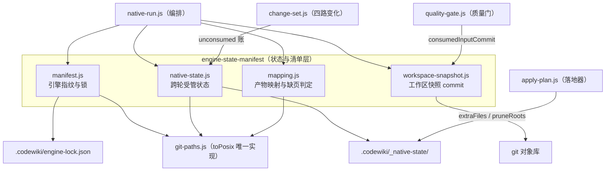
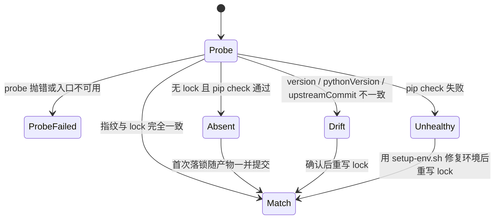
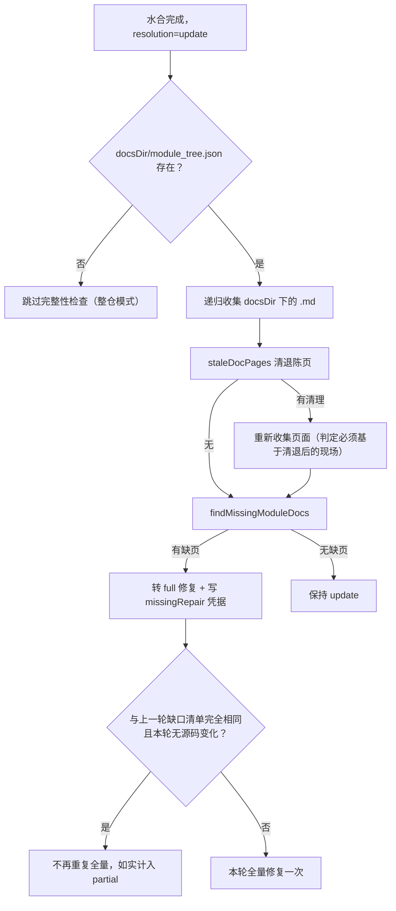
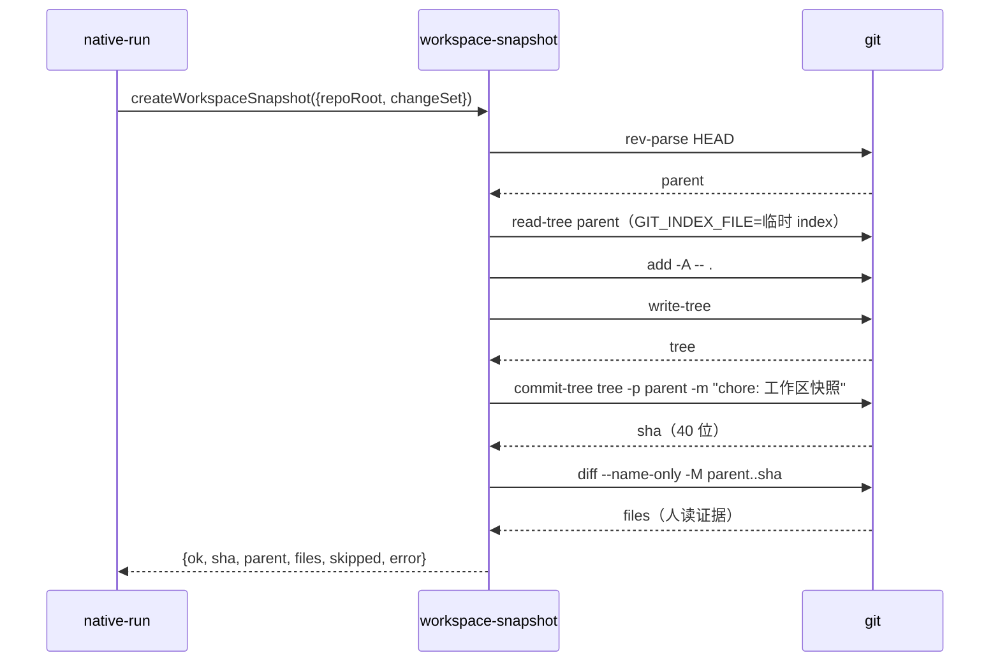
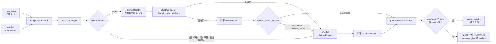

# engine-state-manifest：引擎清单与跨轮受管状态

`engine-state-manifest` 是原生引擎通道的**「记忆与身份证」层**。它回答三个否则无人能答的问题：

1. **现在跑的是哪个引擎、哪个环境？**（`manifest.js`：指纹 + `engine-lock.json` + 只读 `doctor` 诊断）
2. **上一轮的产物是什么状态，本轮还能不能做组件级增量？**（`native-state.js`：受管状态目录 + `state.json`）
3. **本轮产物到底对应哪一份代码？**（`workspace-snapshot.js`：把未提交改动合成一个不挂 ref 的真实 commit）

此外它还提供 `mapping.js` 中的**缺页/陈页判定**：受管状态水合进 `docsDir` 之后，模块树里的模块是否都真的有页，是增量能否成立的前置证据。

这一层本身**不跑引擎、不写 wiki、不装依赖**。它只产出可机读的事实与写集项，由 [engine-orchestration.md](engine-orchestration.md) 里的 `native-run.js` 编排进裁决链，最终由落地器（见 [apply-plan.md](engine-orchestration/apply-plan.md)）与文章同事务落盘。

---

## 1. 在系统中的位置



| 组件 | 文件 | 职责 | 是否纯函数 |
| --- | --- | --- | --- |
| 引擎清单 | `lib/engine/manifest.js` | 探测环境、算指纹、与 lock 比对、产出 lock 正文 | 除 `readLock`/`writeLock` 外均为纯逻辑 |
| 受管状态 | `lib/engine/native-state.js` | 状态目录的读写、水合、采集、裁剪判据、未消费账合并 | 读写文件，但无进程/网络 |
| 产物映射 | `lib/engine/mapping.js` | FSoft docs 树 → cw 写集描述；缺页/陈页判定 | 纯函数 |
| 工作区快照 | `lib/engine/workspace-snapshot.js` | 用独立 index 造一个含未提交改动的 commit | 有 git 副作用，但不改工作区 |

所有路径归一都走 `lib/git-paths.js` 的 `toPosix`（唯一实现），避免「同一条路径在两份报告里判不等」——细节见 [../../Build___Development_Infrastructure/fsoft-engine-tools.md](../../Build___Development_Infrastructure/fsoft-engine-tools.md)。

---

## 2. 引擎清单：`manifest.js`

### 2.1 为什么需要清单

FSoft 是**外部**引擎：版本、依赖树、源码 commit 都不由本仓库控制。没有清单时，同一份 wiki 在不同机器或不同 pip 状态下会产出不同结果，而故障会表现为「模型不听话」而不是「环境漂了」——这是最难定位的一类问题。

清单层只做三件事：**算指纹 → 与 lock 比对 → 落盘**。它**不装依赖、不修环境、不联网**；修复环境是 `tools/fsoft-engine/setup-env.sh` 的职责（见 [../../Build___Development_Infrastructure/build-configuration.md](../../Build___Development_Infrastructure/build-configuration.md)）。

### 2.2 常量

| 常量 | 值 | 说明 |
| --- | --- | --- |
| `MANIFEST_VERSION` | `1` | 指纹算法的版本，进 hash 输入 |
| `ENGINE_LOCK_REL` | `.codewiki/engine-lock.json` | 锁文件位置（仓库相对） |
| `UPSTREAM_COMMIT` | `a1b9f4acac4d3e1925c9d49e258b618741410540` | 上游 FSoft 源码锁（显式声明，非探测） |

`UPSTREAM_COMMIT` 必须是**显式常量**而不是从运行时学习：引擎自报的 `engine.commit` 取自 `_git_commit(repo_path)`，那是**被编译仓库的 HEAD**，不是 FSoft 源码自己的 commit。两个概念必须分开记：

- `upstreamCommit` —— 本仓库声明的上游源码锁，是审计与漂移判据的唯一来源；
- `engine.commit` —— 引擎自报的运行现场，只作证据，不参与判定。

升级上游的契约是「改这个常量 + 跑契约测试」，而不是 `pip install` 到最新版。

### 2.3 指纹：只吃决定产物内容的因素

`fingerprintOf(facts)` 用 `sha256` 拼接后取前 16 位十六进制，输入只有四项：

```
manifest:<MANIFEST_VERSION>
version:<引擎版本>
python:<Python 版本>
upstream:<规范化的 40 位 commit>
```

两条刻意的排除：

- **`pipCheckOk` 不进指纹**。依赖闭合是「能不能跑」的闸门，不是「产物会是什么」的输入；算进去会让每次修依赖都像换了引擎。
- **上游 commit 必须进指纹**。`codewiki 2.0.0` 这个版本号写在 `pyproject.toml` 里，源码从 git 直接安装时**根本不跟着变**。只看版本号会把「换了引擎」误判成 `match`，产物差异再被误诊成模型问题。

`normalizeUpstreamCommit(value)` 只接受 40 位小写十六进制，认不出就返回空串（未知），而不是把半截/大写串写进锁——那是「锁了但锁错了」。

### 2.4 lock 的状态机

`compareLock({current, lock})` 返回可机读差异项而非抛错：



| status | 含义 | `doctor().ok` | 上层处置（native-run 段 1） |
| --- | --- | --- | --- |
| `probe-failed` | 解释器缺失 / `entry.py` 崩溃 | `false` | 直接 `failed`，`code=engine-missing` |
| `absent` | 没有 lock（首次运行） | `true` | 继续跑，锁进写集随产物提交 |
| `match` | 环境与上次一致 | `true` | 继续跑 |
| `drift` | 版本/Python/上游 commit 变了 | `false` | 直接 `failed`，`code=engine-deps` |
| `unhealthy` | 指纹一致但 `pip check` 失败 | `false` | 直接 `failed`，不重试、不自动绕过 |

一个容易被吞掉的事实：**「没有 lock」不等于「环境健康」**。`compareLock` 在没有 lock 时仍先检查 `pipCheckOk`，失败则报 `unhealthy` 而不是 `absent`——否则调用方会把「依赖不闭合」误读成「首次运行」，照跑不误。

`diffs` 是数组，每项形如 `{field, locked, current}`，`field` 取值 `version` / `pythonVersion` / `upstreamCommit` / `fingerprint`。`fingerprint` 单独成一条是为了诊断「各项都一致但指纹不一致」＝指纹算法本身变了。

### 2.5 落锁时机：与产物同事务

`buildLockBody(current)` 只构造正文（JSON 字符串），**不写盘**。这是刻意的：落锁必须与产物同批。

- 若在 `doctor` 阶段写 `.codewiki/engine-lock.json`，`.codewiki/` 会在 `cw init` 之前就存在，落地器会把「目录存在却没有 `_meta.yaml`」判成人工破坏的半截库并拒绝初始化，首次编译在最后一步整批失败并回滚所有文章。
- 若在 `apply` 之后用 `writeLock` 直接写盘，锁文件落在提交之外，下一轮会把它当成未跟踪脏文件再提交一次，无变化的一轮也会凭空产生 commit。

所以 `native-run.js` 的实际做法是：把 `buildLockBody(...)` 的结果作为 `extraFiles` 的一项，与文章共享 pre-image、回滚与提交。`writeLock({repoRoot, current})` 仍保留（原子写：临时文件 + `rename`），供审计脚本或独立工具使用。

### 2.6 `doctor` 的契约

```js
doctor({ probe, repoRoot, engineRoot, upstreamCommit = UPSTREAM_COMMIT })
// → { ok, status, current, diffs, advice }
```

- **不抛**：`probe` 抛错被转成 `{ok:false, status:'probe-failed', advice}`。
- `probe` 由调用方注入而不是在此 `spawn`，这样本层保持可单测，进程管理留在 `client.js`（见 [engine-runner.md](engine-orchestration/engine-runner.md)）。
- `advice` 是按 status 查表的**人读建议**，另外会追加一条「上游 commit 未声明或格式不合法」的提示（此时本轮不构成有效锁定）。

---

## 3. 跨轮受管状态：`native-state.js`

### 3.1 为什么必须有这一层

FSoft 的组件级增量（`rung=3`）不是「再跑一遍全量再挑几篇改」，它必须读到**上一轮留下的四样东西**才能算出「改了什么」：

1. `module_tree.json` —— 上一轮模块树。`_update_options()` 里 `exists()` 为假就直接返回 `None`，整个增量退化成全量；
2. `temp/dependency_graphs/<repo>_dependency_graph.json` —— 上一轮依赖图，`snapshot_old_graph()` 复制成 `*.prev.json` 后交给 updater 做图 diff；
3. `metadata.json` —— 上一轮生成信息，`generation_info.commit_id` 是 updater 的 `old_commit`，也是质量门的 `artifactCommit`；
4. **上一轮的文章** —— updater 是**原地 patch**，页不在就要走 `missing_page` 重建，等于白退全量。

这些文件都在引擎的 docs 输出目录里，而那是每轮一个新 job id 的临时目录。不持久化它们，第二轮的 `_update_options()` 必然返回 `None`——这正是「每轮都在全量、又慢又贵，却一路绿到底」的根源。

### 3.2 状态目录布局

```
.codewiki/
├── _native-state/              ← 受管状态（首段以 _ 开头，cw index 跳过）
│   ├── state.json              ← 跨轮凭据（scope / unconsumed / missingRepair …）
│   └── docs/                   ← 上一轮引擎产物的完整副本
│       ├── overview.md
│       ├── <模块页>.md
│       ├── module_tree.json    ← 硬依赖
│       ├── metadata.json       ← 硬依赖
│       └── temp/
│           ├── reference_index.json
│           ├── artifact_index.json
│           └── dependency_graphs/
│               └── <sanitize(仓库名)>_dependency_graph.json   ← 硬依赖
└── engine-lock.json            ← 引擎指纹锁（见第 2 节）
```

**目录名为什么以 `_` 开头**：`cw index`（`vendor/codewiki/src/main.rs:236-256`）会 `WalkDir` 递归整个 `.codewiki/`，收录所有 `.md` 且**只**跳过仓库相对路径首段以 `_` 开头的项。放在 `.codewiki/temp/native-state/` 会让持久化的原始文章被索引收成**第二份**文章，同一页在索引里出现两条链接。落地器「索引必须收录本次写的 `.md`」的校验也带同样的过滤（`apply-plan.js` 的 `findArticlesMissingFromIndex` 里 `seg.startsWith('_')`）。

### 3.3 常量与判据

| 导出 | 值/行为 |
| --- | --- |
| `NATIVE_STATE_VERSION` | `1`，`state.json` 的版本闸门 |
| `NATIVE_STATE_DIR` | `.codewiki/_native-state` |
| `NATIVE_STATE_FILE` | `state.json` |
| `STATE_REQUIRED_DOCS` | `['module_tree.json', 'metadata.json']`（缺一即退全量） |
| `STATE_TEMP_FILES` | `temp/reference_index.json`、`temp/artifact_index.json` |
| `STATE_TEMP_DIRS` | `temp/dependency_graphs` |

`stateDocFiles(stateDir)` 返回「哪些仓库相对路径属于受管状态」的清单（`[{rel, docRel}]`），供审计与文档使用。

`isStateDocPath(rel)` 的判据是「它是不是下一轮增量需要读的输入」，不是「它在 docs 里」：

- 所有 `.md`（updater 原地 patch 的目标）→ 收；
- 顶层 `.json`（`module_tree` / `first_module_tree` / `metadata` / `update_record`）→ 收；
- `temp/` 下白名单（`reference_index`、`artifact_index`、`dependency_graphs`）→ 收；其余 temp 中间件每轮重算，收进来只会让提交变大、还会把过期中间件当成有效输入；
- `dsh_leaf_checkpoint.json` 及其副本 → **明确排除**。

`graphFileName(repoRoot)` 必须逐字符对齐上游 `graph_store.sanitize_repo_name`：Python 用的是 `c.isalnum()`，那是 **Unicode** 字母数字，中文/日文字符原样保留。因此这里用 `/[^\p{L}\p{N}]/gu` 而不是 `[A-Za-z0-9]`——后者会把中文仓库名的图判成「缺失」，于是每轮白退全量。

### 3.4 三条不变量

1. **只有「完整成功」才允许把本轮采集到的状态写成下一轮的基线**。`partial` / `failed` / `cancelled` 一律不推进，否则未消化的变化会被当成已消化。
2. **状态不完整（缺图 / 缺 `module_tree` / 版本不符 / 基线不可达）→ 显式 `full`**，并在 `state.json` 里留 `fallbackReason`；绝不假装 clean。
3. **水合是复制而不是移动**。源状态目录在仓库里（受 git 管理，是下一轮的权威），`docsDir` 在临时目录（引擎就地改写）。移动会让「这一轮失败」直接毁掉下一轮的输入。

### 3.5 读与判定

`readState(stateDir, repoRoot)` 是反序列化边界，磁盘残留、旧版本、手改过的 JSON 都走这里。失败时返回 `ok:false` + 机读 `code`：

| code | 含义 |
| --- | --- |
| `absent` | 文件不存在（首次增量） |
| `unreadable` | 读失败（权限/IO） |
| `corrupt` | 非法 JSON / 不是对象 |
| `version` | `stateVersion` 与 `NATIVE_STATE_VERSION` 不兼容 |

`isUpdateEligible({stateDir, repoRoot, baseCommit, engineVersion, headCommit})` 逐条排事实，每个不可增量的原因都**说出来**（进 `fallbackReason`）：

| 检查 | 不通过时的结论 |
| --- | --- |
| `state.json` 可读 | `readState` 的 `reason` |
| `STATE_REQUIRED_DOCS` 都在 | `eligible:false` + `missing` 列表 |
| 依赖图存在（按当前仓库名） | 同上，`missing` 带图路径 |
| 记录的 `engineVersion` == 当前版本 | `eligible:false`（旧图/旧树是另一版本的产物，diff 不可信） |
| 记录的 `consumedRange.baseCommit` == 本次 cw 基线 | **仍 `eligible:true`**，但把差异写进 `reason`（cw 基线可能被别的任务前移，这不是错误但要可见） |

### 3.6 水合：`hydrateDocsDir`

```js
hydrateDocsDir({ stateDir, repoRoot, docsDir, overwrite = true })
// → { hydrated: string[], retained: string[], skipped: string[] }
```

跑引擎**之前**把受管状态复制进 `docsDir`。`overwrite=false`（`resume` 场景）时，目标已存在且是合法 JSON 的文件会被 `retained` 而不是覆盖；目标 JSON 坏了则仍然覆盖——把坏文件当有效输入比覆盖更危险。复制失败逐项进 `skipped`，由编排层记 note。

`native-run.js` 在水合后还会做一次完整性检查：状态目录存在但**一个文件都没复制过去**，等同于缺图，直接退全量而不是让引擎拿空目录跑。

### 3.7 采集：`captureDocsDir`

```js
captureDocsDir({ docsDir, stateDir })
// → { files: [{rel, content}], captured: string[], missing: string[] }
```

在 **gate 之后、apply 之前**采集，返回的是**仓库相对路径**的写集项，可直接交给落地器的 `extraFiles`。因此「图/模块树/metadata/update_record 与文章同事务」不是约定，而是结构。

- 文本按 `utf8` 读、`utf8` 写，逐字节往返成立；内容含 `U+FFFD` 说明原始字节不是合法 utf8，直接跳过并记 `missing`，而不是写回去一份坏文件。
- 硬依赖缺失会单独报出：`STATE_REQUIRED_DOCS` 任一未采集、或 `temp/dependency_graphs/` 下没有任何图，都进 `missing`。编排层据此置 `stateIncomplete=true`，最终以 blocker 形式否决 `done`。

### 3.8 `state.json` 的内容与指纹

`buildStatePayload(...)` 组装下一轮凭据。关键设计：**它不记录本轮结局**，只记录「本轮开始时的已消费范围」与「本轮看见了哪些变化」。

| 字段 | 语义 |
| --- | --- |
| `stateVersion` | 版本闸门 |
| `consumedRange` | `{baseCommit, headCommit}`，本轮开始时的已消化范围（权威在 `_meta.yaml:last_compiled_commit`，这里留副本供审计） |
| `pendingChanges` | 四路变化快照（`committed`/`staged`/`unstaged`/`untracked`/`deleted`/`renamed`，各有条数上限） |
| `unconsumed` | 「已读进产物、但还没进任何 commit」的路径 |
| `engineVersion` | 引擎版本（与 `manifest.js` 探测值同源） |
| `scope` / `effectiveScope` | 请求的 scope 与实际生效的 scope（显式记下 full 回退） |
| `updateOutcome` | 引擎自报的增量结局（`incremental` / `no_change` / `full_fallback` …） |
| `fallbackReason` | 退全量的原因 |
| `missingRepair` | 缺页修复凭据：`{baseCommit, modules[], overviewLinks[], attempts, at}`；`undefined` = 沿用上一轮，`null` = 明确清除 |
| `notes` | 最近 20 条人读记录 |
| `updatedAt` | 时间戳（**不参与**指纹） |

「未消费凭据」为何成立：本轮失败时 `_meta.yaml` 基线未前移（apply 回滚），下一轮 change-set 仍从旧基线算起，`pendingChanges` 里的变化会重新出现；本轮成功时基线前移，`pendingChanges` 只作为审计记录保留。

`stateFingerprint(text)` 去掉 `updatedAt` 与 `notes` 后比较实质内容。只有实质内容变了才写新的时间戳——否则无变化的一轮也会因为时间戳不同而产生一次真实提交。

`stateFileItem(payload, stateDir)` 把 payload 变成一条 `{rel, content}` 写集项。

### 3.9 未消费账的合并：`mergeUnconsumed`

```js
mergeUnconsumed({ changeSet, prevUnconsumed })
// → { unconsumed, consumedNow, dropped, effectiveChanges, carried }
```

为什么需要它：引擎读的是**工作区实际文件**，未提交改动确实会被写进文章；但 cw 基线推进的是 `HEAD`。于是「文章已覆盖未提交改动，基线却停在 HEAD」——下一轮 change-set 从新 HEAD 算起，那些改动再也算不进变化集，文章与源码脱节而系统一路绿。

合并规则：

- 本轮的 `staged` / `unstaged` / `untracked` 一律算未消费，并入下一轮；
- 上一轮携带的路径**只有出现在本轮 `committed` 里**才算被消化（移入 `consumedNow`）；
- 仍被 git 看见（`committed` ∪ 四路）但未提交的继续携带；
- **git 完全看不见的旧账进 `dropped`**。判据是「git 看不见」，所以被 `.gitignore` 忽略的文件也会被丢——这是有意的：用户写进 `.gitignore` 就是声明「这不是仓库内容」，携带它们等于保证 `idleRound` 永不成立（永久白跑整轮）。
- `effectiveChanges` = 本轮 `sourceChanges` ∪ `unconsumed`（去重排序），引擎与质量门都按它判断「消化了什么」。

### 3.10 原始树留档：`archiveDocsTree`

引擎把产物直接写进 `docsDir`，而后续每一步都在同一棵树上动手（采集状态、落地器按映射改写、裁剪过期文件）——**原始产物被就地消费**。一旦落地器做了无法从 `.codewiki/` 反推的加工，就没有任何地方能回答「引擎到底给了什么」。

`archiveDocsTree({docsDir, destDir})` 在消费之前把整棵树完整复制到独立目录：

- 目标目录**绝不能在仓库内**：`.codewiki/` 下任何非 `_` 开头的目录都会被 `cw index` 收集成文章，原始树会变成索引里的第二份副本；
- 源与目标互不嵌套（两个方向都查），跨盘时用 `path.isAbsolute` 排除误判；
- 失败语义：留档是**证据**不是产物，拷不动就返回 `ok:false + error`，由编排层记 note，**绝不让一次编译失败**。

---

## 4. 产物映射与缺页判定：`mapping.js`

完整映射规则（`mapFsoftOutput` 的四条硬规则、`source_files` 的证据来源、slug 冲突处置）属于格式翻译层，归 [engine-contract-quality.md](engine-contract-quality.md) 与 [apply-plan.md](engine-orchestration/apply-plan.md) 的落地逻辑。本模块只消费其中两个**判定函数**：

### 4.1 `findMissingModuleDocs({pages, moduleTree, overviewName})`

返回「模块树里有、但 docs 里没有对应页」的模块名列表。判据与上游 `find_doc()` 同口径：

- 先看层级路径 `moduleDocRelPath(modulePath)`（`hierarchical` 是 `<父路径...>/<模块名>.md`，`flat` 是 `<模块名>.md`）；
- 再看根部同名 `<模块名>.md`；
- **不接受其它目录下的同名页**——那是模块搬家后遗留的旧页，算缺页才是修复性全量要处理的事（放宽它等于把 `partial` 伪装成 `done`）。

`indexModuleTree` 记录的是**完整层级** `modulePath`（含自己），而不只是名字：只记名字会让「同一模块从上层搬到更深一层」看起来「页已存在」，把真实缺页漏掉。

### 4.2 `staleDocPages({pages, moduleTree, overviewName})`

返回产物目录里**不属于当前模块树**的页面（模块改名、聚类重建后留下的旧页）。修复性全量必须先把它们清掉：否则引擎写完全部新页，旧页仍在 `docsDir` 里被映射成 `unmapped-page`，质量门每轮照样判 `partial`——这就是「缺页修好了但还是 `partial`」的成因。

`moduleTree` 为空（whole-repository 模式）时返回 `[]`：没有权威模块名，不能凭名字删页。清理只动 `docsDir`（仓库外的临时产物目录）；已提交的 wiki 页由落地器按写集处理。

### 4.3 在增量决议中的用法



两个收敛细节值得记住：

- **陈页清退与缺页判定独立**。模块树一页不缺时，旧路径上的同名副本仍会被判 `unmapped-page`，把整轮拖成 `partial`。
- **`missingRepair` 凭据防止无限重跑**。判据用「已提交的编译基线」而不是 `HEAD`（`partial` 轮也会产生 wiki 提交，`HEAD` 每轮都变，拿它比对等于永不收敛）。同一基线 + 同一批缺口 = 已经试过一次全量仍补不上，本轮不再浪费几十分钟，但缺口一条都不豁免、终态照旧 `partial`。缺口补齐时凭据被清成 `null`。

`module_tree.json` 损坏（`SyntaxError`）必须抛成 `failed`（`code=engine-output`）；目录读不到之类的环境问题不阻塞增量，但文案写「未执行」而不是「失败」——「检查失败」与「没做检查」是两件事。

---

## 5. 工作区快照：`workspace-snapshot.js`

### 5.1 要解决的记账错位

FSoft 只从 `<old_commit>..<new_commit>` 取 diff，未提交改动不进它的 `update_record`。插件侧 `lib/change-set.js` 能采到四路变化，但采到之后只是**记账**（`state.json` 的 `unconsumed`），引擎没有一个「本轮消费到哪」的对象可以对齐：它读的是工作区文件（内容是对的），可 `metadata.json` 的 `commit_id` 只能写 `HEAD`。后果有两个：

1. 工作区脏时，产物与 `HEAD` 之间的对应关系是假的：文章写的是工作区内容，记账却指向 `HEAD`，下一轮拿它当 `old_commit` 就会漏掉这些改动；
2. 质量门只能报「工作区有 N 个未提交源码改动」——如实，但回答不了「产物到底对应哪个状态」。

`createWorkspaceSnapshot` 解掉第 1 条。第 2 条仍由质量门如实表述（它照旧判 `partial`，因为快照不是仓库历史里的提交，**不能**当前移的基线——那是对的）。

### 5.2 实现：独立 index，不写 ref



- 用**独立 index 文件**（`GIT_INDEX_FILE`）走 `read-tree → add -A → write-tree → commit-tree`，**不写任何 ref**。用户的分支、`HEAD`、工作区、真实 index 一个字节都不动。
- 得到的 sha 是**真实可达** commit（对象在 `.git/objects` 里，可被 `rev-parse` 校验）。引擎写进 `metadata.generation_info.commit_id` 后，下一轮能拿它做 `old_commit`。
- 它不挂任何 ref，因此**不能**作为已提交基线推进（gc 后自然消失）。
- 提交身份用 `-c user.name=dsh-codewiki -c user.email=dsh-codewiki@localhost` 显式给出，不依赖用户 git 配置。

### 5.3 失败语义

快照是**对齐精度**的改进，不是编译成立的前提：

| 情形 | 返回 | 编排层处置 |
| --- | --- | --- |
| `changeSet` 显示无未提交改动 | `ok:false`，`error='工作区没有未提交改动，无需快照'` | 直接用 `HEAD` 记账（不多造一个内容相同的 commit） |
| `rev-parse HEAD` 失败 | `ok:false` + error | 退回 `HEAD` 记账 + note |
| `commit-tree` 输出不是 40 位 sha | `ok:false` + error | 同上 |
| 任意异常 | `ok:false` + error（截断 300 字符） | 同上，绝不升级成编译失败 |

临时 index 目录在 `finally` 里清理（tree 与 commit 对象已落进 `.git/objects`，index 只是中间产物）。

### 5.4 与质量门的接线

`native-run.js` 把快照 sha 作为 `consumedInputCommit` 传给质量门。`assessBaseline` 据此把「产物 commit == 快照 sha」判定为「对得上比 `HEAD` 更完整的代码」，并把它记成 `consumedInput = {commit, paths}` 而不是 `commit-mismatch` / `uncommitted-input` 缺陷——见 [engine-contract-quality.md](engine-contract-quality.md)。反过来，产物对不上快照（`art` 是 `HEAD` 或别的东西）才真的没被覆盖，照旧拦基线。

编排层还单独维护两个变量，**不能混成一个**：

- `baseCommit` —— 增量起点（cw 基线，来自 `_meta.yaml`）；
- `consumedCommit` —— 本轮产物对应的内容状态（有快照用快照，否则 `HEAD`）。

`snapshotExists({repoRoot, sha})`（`git cat-file -t` 校验）与 `shortSha(sha)`（前 12 位）只给测试与日志用，**不参与裁决**。

---

## 6. 一轮原生编译中的数据流



对应的编排顺序（`native-run.js`，细节见 [engine-orchestration.md](engine-orchestration.md)）：

1. **段 1 环境与锁** —— `doctor()`；`probe-failed` / `drift` / `unhealthy` 一律 `failed`，**不跑引擎**。
2. **段 1.5 增量决议** —— `collectChangeSet` → `mergeUnconsumed` → `isUpdateEligible` → `hydrateDocsDir` → 缺页/陈页判定。
3. **段 1.9 工作区快照** —— `createWorkspaceSnapshot`，得到 `consumedCommit`。
4. **段 2 引擎** —— `action = update | generate`，`commitId = consumedCommit`。
5. **段 2.9 原始树留档** —— `archiveDocsTree`（仓库外）。
6. **段 3.5 采集受管状态** —— `captureDocsDir` + `buildStatePayload` + `stateFingerprint`，进 `extraFiles`。
7. **段 3.6 首次落锁** —— `buildLockBody` 作为 `extraFiles` 的一项（仅 `absent` 且非无变化轮）。
8. **段 4 落地** —— `applyNativeOutput({extraFiles, pruneRoots, deleteFiles, advanceBaseline})`。

### 6.1 无变化轮（idleRound）的特殊处理

`idleRound` 的判据是三者同时成立：`resolution === update` + `updateOutcome === 'no_change'` + `effectiveChanges` 与 `unconsumed` 都为空。

| 行为 | 无变化轮 | 原因 |
| --- | --- | --- |
| 重写受管状态 | 否 | 引擎在 `no_change` 时仍会把 `metadata`/`graph`/`update_record` 里的 `commit_id` 刷成本轮 `HEAD`，照采就是每次查询都产生一次纯记账提交 |
| 写 `state.json` | 否（沿用旧文本） | `stateFingerprint` 相同即不重写，避免 `updatedAt` 制造假提交 |
| 首次落锁 | 否 | 只在真正要落地的一轮才进写集 |
| `pruneRoots` | 空 | 那轮不写状态，裁剪会按「写集里没有它们」把上一轮的图/树/文章副本整批删掉 |
| 基线/提交 | `noChanges: true` | 完整无变化轮连基线也不能碰 |

**只要还有一项未消化的账（哪怕只是未提交的源码改动），本轮就必须照常采集**——那份状态是下一轮唯一能把它算进变化集的凭据。

### 6.2 状态不完整时的「一票否决」

`stateCapture.missing` 非空（或采集抛异常）时，编排层置 `stateIncomplete = true`，并连锁触发：

- `stateFiles = []`：**保留上一轮状态，不裁剪**。缺图/树/metadata 时裁掉旧状态，等于把唯一的增量输入毁掉；
- `advanceBaseline: false`：下一轮已经无法增量，再推进基线就是把「没消化完的变化」记成已消化；
- `gateOutcome` 从 `done` 降为 `partial`；
- 追加一条 `kind: 'quality-gate'` 的 blocker，detail 以 `[native-state]` 开头。

`pruneRoots` 的语义与此配套：受管状态目录是**下一轮引擎的输入**，必须维持「状态目录 == 上一轮引擎的最终产物」这个等价关系。上一轮有、本轮引擎删掉的页若留在状态里，下一轮水合会把它原样搬回 docs——已删的页复活、已合并的页重现、旧图覆盖新图。裁剪根同样要过 `checkTargetPath` 的上跳校验（`.codewiki/../src` 的前缀是 `.codewiki/`，只做字符串前缀比会删掉整棵源码目录）。

---

## 7. 配置与环境

清单层的行为受插件配置与外部脚本共同影响：

| 配置项（`cordis.patch.yml`，命名空间 `codewiki`） | 对状态/清单的影响 |
| --- | --- |
| `nativeEnginePython` | 决定 `probe` 用的解释器；留空 → 环境变量 `DSH_CODEWIKI_PYTHON` → `python`。**不做「找一个能用的解释器」的启发式**，猜错会把「环境不闭合」伪装成「引擎坏了」 |
| `nativeEngineEntry` | `entry.py` 路径（默认 `lib/engine/python/entry.py`） |
| `nativeEngineTimeoutMs` | 单次引擎调用上限（默认 180 分钟），超时后走 `client.js` 的 partial 抢救路径 |
| `techdocs` | 打开后站点产物以写集项进入 `.codewiki/_techdocs/`，与受管状态同一套 `extraFiles` / `pruneRoots` 机制 |

`native-run.js` 允许用 `deps.config.upstreamCommit` 覆盖 `UPSTREAM_COMMIT`：上游锁是**声明**而不是探测结果，所以只允许从这里换，不允许从引擎自报里「学到」。

`doctor` 报 `unhealthy` 时的修复路径是 `tools/fsoft-engine/setup-env.sh <目标目录> <FSoft 源码根> [python]`：它按冻结快照 `--no-deps` 落盘 → editable 安装引擎本体 → `pip check` → import 冒烟，四步任一非零即退出。脚本只在插件仓库**之外**建环境，不把 venv 提进 git，也不碰 DSH 进程的 Python。详见 [../../Build___Development_Infrastructure/build-configuration.md](../../Build___Development_Infrastructure/build-configuration.md)。

包侧约束：`package.json` 要求 `node >= 24.9.0`、`dsh >= 0.2.0-rc.0`，且 `files` 白名单包含 `tools/fsoft-engine/setup-env.sh` 与 `tools/fsoft-engine/constraints.txt`——环境脚本随包发布是 `doctor` 的 `advice` 能落地的前提。

---

## 8. 失败模式速查

| 症状 | 根因 | 本层的处置 |
| --- | --- | --- |
| 每轮都全量、又慢又贵却一路绿 | 受管状态没持久化，`_update_options()` 返回 `None` | `captureDocsDir` + `hydrateDocsDir` 成对存在；`isUpdateEligible` 显式报缺什么 |
| 换了上游源码但指纹报 `match` | 只看版本号（`pyproject` 里写死，不跟 commit 变） | `upstreamCommit` 进指纹，并单独成一条 diff |
| 首次编译在最后一步整批失败并回滚 | 在 `doctor` 阶段就写了 `.codewiki/engine-lock.json` | 落锁进 `extraFiles`，与产物同事务 |
| 无变化的一轮也产生一次提交 | `state.json` 的 `updatedAt` 每轮都变 | `stateFingerprint` 去掉时间戳与 notes 后比较 |
| 工作区干净却每轮判「有变化」 | `unconsumed` 里积了 git 已看不见的死条目 | `mergeUnconsumed` 的 `dropped`（git 看不见即丢） |
| 缺页修好了但还是 `partial` | 旧页残留在 `docsDir` 里被判 `unmapped-page` | `staleDocPages` 先清退，再重新收集页面做缺页判定 |
| 缺页反复触发全量、永远补不上 | 没有「已经试过」的凭据 | `missingRepair` 以编译基线为键收敛，`attempts` 累加 |
| 增量水合把旧页/旧图搬回来 | 状态目录没裁剪 | `pruneRoots`（无变化轮与状态不完整轮显式禁用） |
| 中文仓库名永远拿不到依赖图 | 用了 `[A-Za-z0-9]` 而不是 Unicode 字母数字 | `graphFileName` 用 `\p{L}` / `\p{N}` |
| 产物「对不上 HEAD」被误报成缺陷 | 未提交改动没有对齐对象 | `createWorkspaceSnapshot` + `consumedInputCommit` |
| 依赖不闭合被当成首次运行 | 无 lock 时直接返回 `absent` | `compareLock` 先查 `pipCheckOk`，失败报 `unhealthy` |

---

## 9. 相关文档

- 上层编排与裁决链：[engine-orchestration.md](engine-orchestration.md)、[engine-runner.md](engine-orchestration/engine-runner.md)
- 契约、质量门与死链校对：[engine-contract-quality.md](engine-contract-quality.md)
- 落地器、写集封闭与回滚：[apply-plan.md](engine-orchestration/apply-plan.md)
- 模型桥与 TechDocs 导出：[engine-integrations.md](engine-integrations.md)
- 输出解析与进程树工具：[engine-runtime-utils.md](engine-runtime-utils.md)
- 模块总览：[../engine-core.md](../engine-core.md)、[../../Documentation_Generation_Engine.md](../../Documentation_Generation_Engine.md)
- Python 运行时与上游 vendor：[../../Execution_Runtime___Vendored_Engine/engine-python-runtime.md](../../Execution_Runtime___Vendored_Engine/engine-python-runtime.md)、[../../Execution_Runtime___Vendored_Engine/codewiki-vendor.md](../../Execution_Runtime___Vendored_Engine/codewiki-vendor.md)
- 环境搭建与包配置：[../../Build___Development_Infrastructure/build-configuration.md](../../Build___Development_Infrastructure/build-configuration.md)、[../../Build___Development_Infrastructure/fsoft-engine-tools.md](../../Build___Development_Infrastructure/fsoft-engine-tools.md)
- 任务与状态存储（插件侧作业状态，与本模块的受管状态是两回事）：[../../Job_Orchestration___State_Management/job-and-state.md](../../Job_Orchestration___State_Management/job-and-state.md)
