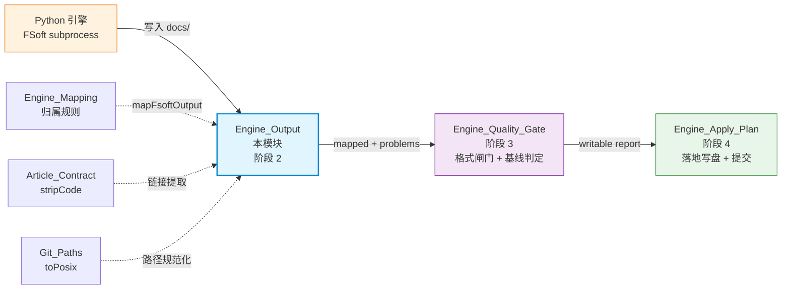
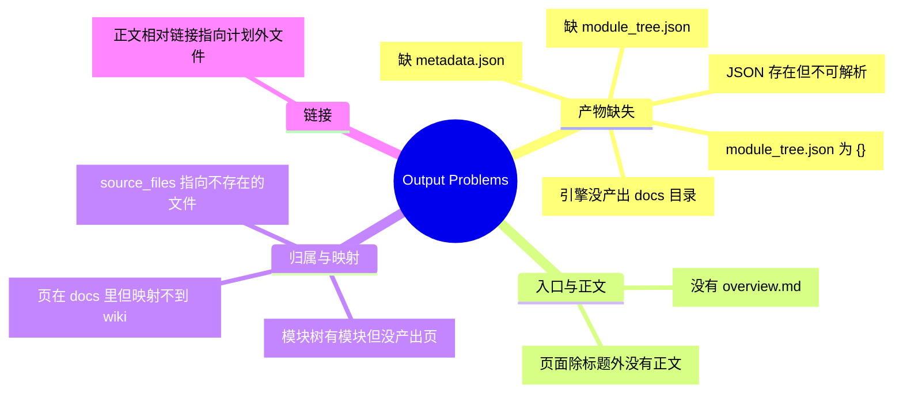
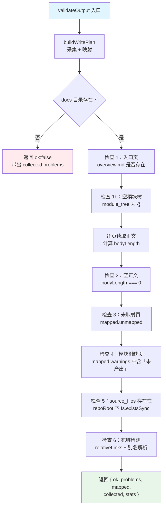

# Engine_Output 模块文档

## 简介

`Engine_Output` 是 FSoft 引擎产物到 CodeWiki 写集之间的**解析、校验与转换层**，位于引擎原生运行通道（native engine pipeline）的「阶段 2」。它的职责边界非常明确：把 Python 引擎产出的 `docs/` 目录读成结构化事实，交给映射规则生成写集计划，并判出可机读的问题列表，供上层质量门使用。

该模块刻意**只做三件事**：

1. **读** —— 把 docs 目录读成结构化事实（页清单 + 四个 JSON），坏文件变成 `problem` 而不是异常；
2. **映射** —— 委托给 [Engine_Mapping](Engine_Mapping.md) 的 `mapFsoftOutput`，自身不重复实现任何归属规则；
3. **校验** —— 把「产物自身是否自洽」判成可机读的 `problems` 列表。

它**绝不做**以下事情（这是迁移的安全边界）：

- 不重新聚类、不做图 diff、不改写文章正文 —— FSoft 已经算完了；
- 不臆造 `source_files` —— 沿用 mapping.js 的证据规则；
- 不因为「产物看起来差不多」就把 problem 降级成 warning —— 缺页就是缺页；
- 不做目标格式闸门（frontmatter / 锚点 / 写集冲突）—— 那是阶段 3（[Engine_Quality_Gate](Engine_Quality_Gate.md)）的职责。

---

## 在整体管线中的位置



---

## 核心导出

| 导出 | 类型 | 职责 |
|------|------|------|
| `OUTPUT_PROBLEM_KINDS` | `string[]` | 稳定的问题类别枚举，供上层按 `kind` 机读分派 |
| `collectOutput({ docsDir })` | function | 只读采集：列出页清单 + 读取四个 JSON，坏输入变成 problems |
| `buildWritePlan({ docsDir, componentFiles, overviewName, repoRoot })` | function | 采集 + 映射，产出 `{ collected, mapped }` |
| `validateOutput({ docsDir, repoRoot, componentFiles, overviewName })` | function | 完整校验，返回 `{ ok, problems, mapped, collected, stats }` |
| `bodyLength(text)` | function | 去除标题与空白后的正文字符数（判「只有标题的空壳页」） |
| `relativeLinks(text)` | function | 提取正文里的相对 markdown 链接（跳过代码块、锚点、外链） |
| `pageAliases(pages)` | function | 页名别名表：正文写法 → 真实落地页（仅唯一命中时给出） |
| `overviewStaleLinks({ overviewText, pages, moduleTree })` | function | 检测 overview 正文里指向已消失页的死链 |

---

## 问题类别目录（OUTPUT_PROBLEM_KINDS）

这些类别**稳定、可机读**，上层按 `kind` 分派，不靠 message 文本匹配。



---

## 核心数据流

### validateOutput 的完整校验流程



---

## 关键设计细节

### 1. 只读不抛的安全哲学

`collectOutput` 与 `validateOutput` 全程**不抛异常**：

- 文件缺失 → push `problem`，返回 `null`；
- JSON 损坏 → push `bad-json`，返回 `null`；
- 目录不存在 → push `missing-docs-dir`，返回空壳结构。

这保证了上游引擎产出任意垃圾时，本层永远能给出结构化诊断，而不是让调用方被未捕获异常打断。

### 2. 页名别名解析（pageAliases）

引擎给页文件命名有三条固定约定，而正文跨页链接写的是「模块名」，两者常常对不上：

| 约定 | 引擎页名 | 正文写法 | 别名解析 |
|------|----------|----------|----------|
| 模块名带扩展名 | `X.ts.md` | `X.md` | 去掉扩展名 |
| 子模块页加父前缀 | `<dir>/<dir>_Y.md` | `<dir>/Y.md` | 去掉父前缀 |
| kebab-case slug | `llama-and-llm-management.md` | `llama_and_llm_management.md` | 与 `moduleSlug` 互逆 |

**安全边界**：别名只在**唯一命中**时给出。同一目录同时存在 `X.ts.md` 与 `X.js.md` 时，`X.md` 无法判定指哪一篇 —— 猜一个会把「链接断了」静默改写成「连接到另一篇」，比报死链更糟。

### 3. 死链判定的分层

死链检测（检查 6）只查**指向 docs 内相对路径**的链接：

- `../src/x.py` 这类指向仓库源文件的链接 → 不在 docs 内，交给阶段 3 的 source 校验；
- `http://` 外链 → 网络不是本层的责任，不查；
- `./README.md` / `./overview.md` → 根页别名，指向 wiki 入口 `CodeWiki.md`，天然豁免。

### 4. 与阶段 3 的分界


---

## 依赖关系

### 上游依赖（本模块调用的其他模块）

| 模块 | 使用的组件 | 用途 |
|------|-----------|------|
| [Engine_Mapping](Engine_Mapping.md) | `mapFsoftOutput`, `moduleSlug`, `WIKI_ENTRY` | 页 → wiki 落地方案映射 |
| [Article_Contract](Article_Contract.md) | `stripCode` | 把代码块等长替换为空格，避免误判语法示例为死链 |
| [Job_Logs](Job_Logs.md)（`lib/git-paths.js`） | `toPosix` |  Windows 反斜杠 → POSIX 正斜杠 |

### 下游依赖（谁调用本模块）

| 模块 | 调用方式 | 用途 |
|------|----------|------|
| [Engine_Quality_Gate](Engine_Quality_Gate.md) | `validateOutput()` | 把 problems 分流为 defect / degradation，判 `done/partial/failed` |
| [Engine_Apply_Plan](Engine_Apply_Plan.md) | 间接消费 gate 的 `rendered` | 按裁决结果写盘 |
| [Job_Orchestration](Job_Orchestration.md) | 经由 native-run 通道 | 驱动整轮编译 |

---

## 典型调用示例

```javascript
import { validateOutput } from './lib/engine/output.js'

const result = validateOutput({
  docsDir: '/tmp/fsoft-run-123/docs',
  repoRoot: '/home/user/my-repo',
  componentFiles: { 'auth/login.ts': 'src/auth/login.ts' },
  overviewName: 'overview.md',
})

if (!result.ok) {
  for (const p of result.problems) {
    console.log(`[${p.kind}] ${p.detail}`)
  }
}
// result.mapped.articles → 每篇文章的 source / wikiPath / sourceFiles
// result.stats → { pages, articles, unmapped, problems }
```

---

## 设计原则总结

1. **可测试性** —— 文件头注释明确写「三件事都必须可被测试逐条钉死」；
2. **不吞错误** —— 引擎写坏的东西永远报 `bad-json`，即使文件本身是「可选」的；
3. **不静默降级** —— 缺页就是缺页，上层据此判 partial；静默吞掉会让 wiki 少一篇而没人知道；
4. **证据优先** —— `source_files` 无真实映射证据时留空并记 warning，绝不臆造；
5. **一次读原则** —— `collected` 原样带出给上层，避免「两次读之间目录被改」导致判据漂移。
