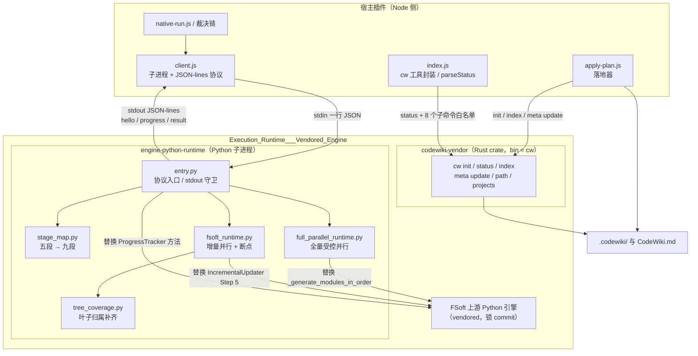
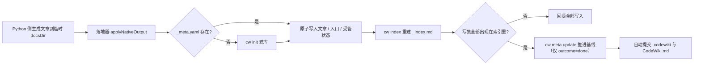

# Execution_Runtime___Vendored_Engine 概览

本模块是插件在**编译执行期**真正“动手”的那一层：一半是运行在独立子进程里的 Python 引擎适配层，另一半是随包分发的 Rust `cw` 命令行工具。它不实现任何文档理解算法——依赖图、模块聚类、文章写作与增量 diff 全部交给 vendored 的上游 FSoft 引擎；`cw` 只负责“文件系统 + git + YAML”这一层确定性操作。本模块的职责是让这两者**安全、可观测、可裁决地**接入宿主 Node 侧：把一次编译变成可翻译的协议流，把产物变成可索引、可记账的库。

## 模块组成

| 子模块 | 语言 / 形态 | 职责 |
| --- | --- | --- |
| [engine-python-runtime](Execution_Runtime___Vendored_Engine/engine-python-runtime.md) | Python 子进程（`lib/engine/python/`，5 个文件约 2 000 行） | 协议入口与 JSON-lines 进度桥、阶段映射、全量受控并行、增量叶子隔离并行与断点、未归属文件补挂 |
| [codewiki-vendor](Execution_Runtime___Vendored_Engine/codewiki-vendor.md) | Rust crate（`[[bin]] name = "cw"`） | `.codewiki/` 初始化、`_index.md` 重建、`_meta.yaml` 基线推进、变更/stale 状态查询 |

两者的分工是硬边界而非实现偏好：**文章内容由 Python 侧写，索引与基线只能由 `cw` 写**。`.codewiki/_index.md` 只能由 `cw index` 生成，`last_compiled_commit` 只能由 `cw meta update` 推进。

## 架构

四个设计取向决定了整个模块的形状：

1. **入口极薄**：算法留在上游，Python 侧只做协议、观测与契约翻译，避免长出“第二个编译器”。
2. **旁路观察、不打补丁**：进度与模块名靠替换方法 / 挂只读 handler 获得；上游升版时靠**源码锚点校验**显式失败，而不是静默降级成另一套语义。
3. **边界自洽**：UTF-8 三条流、`sys.stdout` 守卫、子进程 text 模式补丁全部在 `import codewiki` **之前**装好，因为上游会缓存 stdout 包装器。
4. **失败必须显式**：已写文章尽量降 `partial` 交付，但绝不把空产物伪装成“部分完成”；`cw index` 失败等于库坏了，整批回滚。

## 一次编译中两个写者的顺序

这条链路解释了两处容易被忽略的契约：`cw` 的**退出码只表达文件操作成没成**（内容裁决在质量门），而**退出码 0 也不等于语义达成**（索引必须真的收录本轮写集，因此落地器自己比对写集与 `[[...]]` 链接）。同时 `cw meta update` 只写当前 HEAD，所以基线结构性落后于当轮产物提交——这也是 `parseStatus` 必须把 `.codewiki/` 自身产物从变更清单里摘出去的原因。

## 核心组件文档

| 关注点 | 页面 |
| --- | --- |
| Python 侧协议入口、进度桥、心跳、异常分类、并行与断点 | [engine-python-runtime](Execution_Runtime___Vendored_Engine/engine-python-runtime.md) |
| `cw` 子命令面、`WikiMeta` / frontmatter、stdout 文本协议、fork 点与构建分发 | [codewiki-vendor](Execution_Runtime___Vendored_Engine/codewiki-vendor.md) |
| Node 侧协议适配与超时 / 静默 / 取消裁决 | [engine-runner](Documentation_Generation_Engine/engine-core/engine-orchestration/engine-runner.md) |
| `EngineResult` 字段与不变量、质量门与文章契约 | [engine-contract-quality](Documentation_Generation_Engine/engine-core/engine-contract-quality.md) |
| 环境指纹、引擎锁、状态水合与 `_native-state/` | [engine-state-manifest](Documentation_Generation_Engine/engine-core/engine-state-manifest.md) |
| loopback 模型桥与占位 key（`CODEWIKI_*` 环境变量来源） | [engine-integrations](Documentation_Generation_Engine/engine-core/engine-integrations.md) |
| 落地器（唯一调用 `cw init` / `index` / `meta update` 的地方） | [apply-plan](Documentation_Generation_Engine/engine-core/engine-orchestration/apply-plan.md) |
| venv 构建与打包配置 | [fsoft-engine-tools](Build___Development_Infrastructure/fsoft-engine-tools.md)、[build-configuration](Build___Development_Infrastructure/build-configuration.md) |
| 任务判态、排队与 `cw` 工具封装 | [Job_Orchestration___State_Management](Job_Orchestration___State_Management.md) |

## 跨子模块的运行约束

- **环境由外部提供**：Python 侧不自管 venv，解释器路径由设置项 `nativeEnginePython` 决定（不做“找一个能用的解释器”的启发式）；`doctor` 动作跑 `pip check` 并如实上报，与 `engine-lock.json` 指纹比对不通过时直接 failed，不跑引擎。
- **协议流不可污染**：`sys.stdout` 在导入上游前被替换为只放行协议写出的守卫，所有协议行经统一 `emit()` 加锁整行写出；观测代码（探针 handler、心跳）的任何异常都必须被吞掉。
- **阶段口径唯一**：`stage_map.py` 的九段枚举必须与 `contract.js` 的 `ENGINE_STAGES` 完全一致，进度上限刻意压在 90%，剩余 10% 留给 Node 侧 `index` / `baseline` / `commit`。
- **`_` 前缀是三方隐式契约**：`cw index` 跳过 `.codewiki/` 下首段以 `_` 开头的整棵子树，受管状态（`_native-state`）与站点（`_techdocs`）因此不进索引；改这条规则等于同时改三处。
- **vendor 目录不可被上游覆盖**：`codewiki-vendor` 相对上游只有两处 fork（wiki 内化到仓库内、相对路径统一 `/`），覆盖会退回中心制并让 `cw index` 报 `No wiki found`。