# engine-python-runtime：FSoft 原生引擎的 Python 侧运行时

`engine-python-runtime` 是本插件在 **Python 进程内**运行的那一半引擎运行时。它不实现任何文档算法——
依赖图、模块聚类、文章写作、增量 diff 全部由 vendored 的上游 FSoft（CodeWiki）引擎完成。
这一层只负责把上游引擎**安全、可观测、可裁决地**接到 Node 侧：

- 把 stdin 的一行 JSON 变成一次 FSoft 调用（`doctor` / `generate` / `update` / `cancel`）；
- 把 FSoft 的五段进度翻译成引擎契约的阶段名（九段枚举中的前四段）与 0–90% 百分比，以 JSON 行推回 Node；
- 把成功 / 部分成功 / 失败 / 取消翻译成与 `lib/engine/contract.js` 同语义的 `EngineResult`；
- 在**不改上游源码**的前提下，为全量与增量两条路径注入受控并行（源码锚点校验，锚点不匹配即拒绝安装）；
- 守住两条红线：**不读本机凭证库**、**不让上游打印污染协议流**。

对应源码目录：`lib/engine/python/`，共 5 个文件、约 2 000 行。

---

## 1. 在整体系统中的位置

```
┌─────────────────────────────── Node 侧（宿主进程） ───────────────────────────────┐
│  Job_Orchestration___State_Management（index.js，调度/闸门/终态）                  │
│        ↓                                                                          │
│  Documentation_Generation_Engine（lib/engine/*）：                                │
│    native-run.js  ── 裁决链 env → graph/cluster/articles → gate → apply            │
│    client.js      ── 起子进程、JSON-lines 协议、超时/静默/取消                     │
│    llm-bridge.js  ── loopback 模型桥（注入 CODEWIKI_* 环境变量）                   │
│    contract.js    ── EngineResult / EngineProgress / EngineError 校验              │
└───────────────────────────────────┬──────────────────────────────────────────────┘
                                    │ stdin: 一行 JSON 请求
                                    │ stdout: JSON-lines（hello/progress/result）
                                    │ env: CODEWIKI_BASE_URL / API_KEY / MAIN_MODEL
┌───────────────────────────────────┴──────────────────────────────────────────────┐
│  Python 侧（本模块，独立子进程）                                                  │
│    entry.py                 ── 协议入口、进度桥、心跳、异常分类                    │
│    stage_map.py             ── 五段 → 九段 + 百分比（纯函数）                      │
│    full_parallel_runtime.py ── 全量：同层模块受控并行                             │
│    fsoft_runtime.py         ── 增量：叶子隔离并行 + 断点续跑                      │
│    tree_coverage.py         ── 未归属文件补挂到已有叶子                           │
└───────────────────────────────────┬──────────────────────────────────────────────┘
                                    │ import / 运行时打补丁
┌───────────────────────────────────┴──────────────────────────────────────────────┐
│  vendor\codewiki（FSoft 上游，锁 commit a1b9f4a）                                  │
└──────────────────────────────────────────────────────────────────────────────────┘
```

上下游文档：

| 关注点 | 页面 |
| --- | --- |
| 所属上级模块（执行期与 vendored 引擎总览） | [Execution_Runtime___Vendored_Engine](../Execution_Runtime___Vendored_Engine.md) |
| Node 侧协议适配与超时/静默/取消裁决 | [engine-runner](../Documentation_Generation_Engine/engine-core/engine-orchestration/engine-runner.md) |
| `EngineResult` 字段与不变量 | [engine-contract-quality](../Documentation_Generation_Engine/engine-core/engine-contract-quality.md) |
| 环境指纹、引擎锁、状态水合 | [engine-state-manifest](../Documentation_Generation_Engine/engine-core/engine-state-manifest.md) |
| loopback 模型桥与占位 key | [engine-integrations](../Documentation_Generation_Engine/engine-core/engine-integrations.md) |
| 上游 FSoft 引擎本体 | [codewiki-vendor](codewiki-vendor.md) |
| 文档引擎总览（gate/apply/质量门） | [Documentation_Generation_Engine](../Documentation_Generation_Engine.md) |
| venv 构建脚本 | [fsoft-engine-tools](../Build___Development_Infrastructure/fsoft-engine-tools.md) |
| 插件打包与设置项声明 | [build-configuration](../Build___Development_Infrastructure/build-configuration.md) |

---

## 2. 架构总览

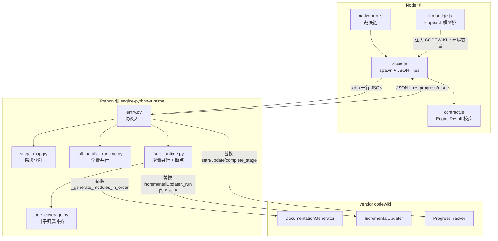

四个设计取向决定了整个模块的形状：

1. **入口极薄**。算法一律留在上游，本层只做协议、观测与契约翻译，避免长出"第二个编译器"。
2. **旁路观察，不打补丁**。进度与模块名都靠替换/挂 handler 获得，不 fork 上游类，上游升版时靠源码锚点校验显式失败而非静默降级。
3. **边界自洽**。编码、stdout 守卫、子进程 text 模式补丁全部在导入 `codewiki` **之前**装好，因为上游会缓存 stdout 包装器。
4. **失败必须显式**。已写文章尽量降 `partial` 交付，但绝不把空产物伪装成"部分完成"。

---

## 3. 文件级详解

本模块的 5 个文件职责清晰、彼此边界明确，但每个文件都围绕同一条协议链路，规模也不足以各自成页，故在此逐文件详述。
每个小节对应一个源文件，可直接作为该文件的阅读指南。

核心组件索引：

| 组件 | 文件 | 职责 |
| --- | --- | --- |
| `main` | `lib/engine/python/entry.py` | 协议主循环：hello → 读一行请求 → 分派 → 写 result |
| `_ProtocolOnly` | `lib/engine/python/entry.py` | `sys.stdout` 替身：只放行协议写出，其余改道 stderr |
| `_popen_init_utf8` | `lib/engine/python/entry.py` | `subprocess.Popen` 默认 UTF-8 补丁（仅 text 模式） |
| `run_leaf_agents` | `lib/engine/python/fsoft_runtime.py` | 增量 Step 5 入口：排序活跃叶子 → 补挂归属 → 隔离并行执行 |
| `_install_shared_tree_io` | `lib/engine/python/full_parallel_runtime.py` | 在 `FileManager` 类上串行化 `module_tree.json` 读改写 + 并行分支增量合并 |
| `file_owner` | `lib/engine/python/tree_coverage.py` | 查询某文件被哪个叶子认领 |

文件间依赖（箭头 = import / 调用）：

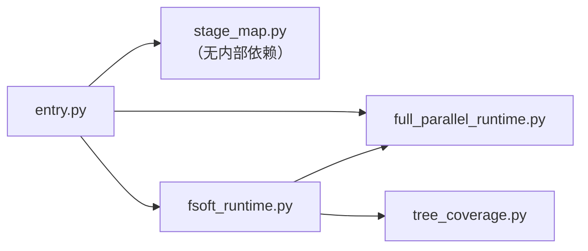

`entry.py` 是唯一的入口，其余四个都是被它（或彼此）调用的库：
`fsoft_runtime` 复用 `full_parallel_runtime.write_tree_exclusive` 与 `tree_coverage.adopt_unowned_files`；
`stage_map` 保持零内部依赖，因此可被单独导入做纯函数测试。

### 3.1 `entry.py` —— 协议入口

`entry.py` 是 Node 与 FSoft 之间唯一的跨语言边界。它只做四件事：解析请求、翻译进度、翻译结果、守住协议流。

#### 3.1.1 协议流守卫 `_ProtocolOnly`

```python
_REAL_STDOUT = sys.stdout
sys.stdout = _ProtocolOnly()   # 必须在 import codewiki 之前
```

上游大量使用 `print` / `click.secho` / `print_banner` 往 stdout 写人类文案（`codewiki/cli/utils/branding.py`、`commands/generate.py`），
而 **click 会缓存 text stdout 包装器**——事后替换 `sys.stdout` 拦不住已缓存的引用。因此入口在导入任何 `codewiki` 模块之前就把 `sys.stdout`
换成一个守卫对象：

| 成员 | 行为 |
| --- | --- |
| `write(text)` | 一律改道 `sys.stderr`（变成日志），返回长度以兼容调用方 |
| `flush()` | 转发到 `stderr.flush()`，防止半行日志挤进协议流 |
| `isatty()` | 恒 `False`，让上游走非交互分支 |
| `fileno()` | 返回 `stderr` 的句柄，避免探测终端的库抛错 |
| `encoding` | 恒 `"utf-8"` |

真正的协议写出走保存下来的 `_REAL_STDOUT`，且必须经过 `emit()`：

```python
def emit(obj):
    line = json.dumps(obj, ensure_ascii=False)
    with _EMIT_LOCK:              # 心跳线程与主线程并发写，必须整行串行
        _REAL_STDOUT.write(line + "\n")
        _REAL_STDOUT.flush()
```

GIL 只保证单次 `write` 调用不交错，而文本缓冲流的一次 `write` 可能被拆成多次底层写入，因此显式加锁——半行 JSON 会让 Node 侧解析器丢帧，进度就此断掉。

#### 3.1.2 UTF-8 三条流水位

Windows 下 Python 的 stdin/stdout 默认按 locale（cp936）编解码，而 Node 侧一律按 UTF-8 收发。入口钉死三条流：

```python
for _stream in (_REAL_STDOUT, sys.stderr):
    _stream.reconfigure(encoding="utf-8", errors="replace")   # 宁可读得到，不要中断协议行
sys.stdin.reconfigure(encoding="utf-8")                        # strict：非法请求字节应当当场报错
```

第三条流水位是**子进程的 text 模式**。上游（如 `dependency_analyzer/analysis/repo_analyzer.py`）用
`subprocess.run(..., text=True)` 读 `git rev-parse --show-toplevel`，在 Windows 上按 gbk 解码；仓库路径含中文时 git 返回 UTF-8 字节，
reader 线程抛 `UnicodeDecodeError` → `stdout` 变成 `None` → 上游 `Path(None.strip())` 直接 `AttributeError`，整轮编译以"引擎内部错误"失败。
上游代码不改（vendor 锁版本），因此给 `subprocess.Popen.__init__` 打默认编码补丁 `_popen_init_utf8`：

```python
def _popen_init_utf8(self, *args, **kwargs):
    text_mode = kwargs.get("text") is True or kwargs.get("universal_newlines") is True
    if text_mode and not kwargs.get("encoding") and not kwargs.get("errors"):
        kwargs["encoding"] = "utf-8"
        kwargs["errors"] = "replace"
    return _real_popen_init(self, *args, **kwargs)
```

只补 text 模式；二进制调用保持原样，否则会把 `bytes` 变成 `str` 反而破坏别人。

#### 3.1.3 常量与契约版本

| 常量 | 值 | 说明 |
| --- | --- | --- |
| `PROTOCOL_VERSION` | `1` | 协议版本：管"行怎么长"（hello 帧） |
| `CONTRACT_VERSION` | `3` | 结果契约版本，必须与 `contract.js` 的 `ENGINE_CONTRACT_VERSION` 同步 |
| `ACTIONS` | `("doctor", "generate", "update", "cancel")` | 允许的动作 |
| `_WRITTEN_RECOUNT_SEC` | `2.0` | 产物指纹重算节流间隔 |
| `_HEARTBEAT_SEC` | `10.0` | 心跳间隔，必须显著小于 `client.js` 的 `silenceMs`（默认 10 分钟） |
| `ENV_BASE_URL` / `ENV_API_KEY` / `ENV_MAIN_MODEL` / `ENV_CLUSTER_MODEL` | `CODEWIKI_*` | 模型通道环境变量名 |

契约版本被抽成单一常量而非散落的字面量 `1`：此前 5 处字面量分散在 `emit_progress` / `failure` / `doctor` / `_done_result` / `_cancelled_result` 里，
升版本时漏改一处就会出现"同一进程报两个契约版本"，而 `validateEngineResult` 只在测试里跑，真机上没人拦。

#### 3.1.4 请求分派 `main` 与 `handle_request`

```python
def main():
    emit_hello()                     # {"type":"hello","protocolVersion":1,"engine":"fsoft-native"}
    raw = sys.stdin.readline()       # 一行 JSON，读到 EOF 就开工
    ...
    request_id, result = handle_request(msg)
    emit_result(request_id, result)
    return 0
```

`handle_request` 的关键细节是**入参形状**：契约与 `client.js` 都按 `{requestId, action, ...payload}` **平铺**发送，
而假引擎（`test-fixtures/fake-native-engine.mjs`）也按平铺读，因此"只读 `msg["payload"]`"的旧实现能在测试里全绿却让真引擎丢参：

```python
nested = msg.get("payload") if isinstance(msg.get("payload"), dict) else {}
flat = {k: v for k, v in msg.items() if k not in ("requestId", "action", "payload")}
payload = {**nested, **flat}     # 顶层平铺优先
```

丢参的真实后果：`docsDir` 丢失 → 回退写进 `repo/.codewiki`，增量轮把水合过的状态目录再写回去，长出 `_native-state/docs/_native-state/docs/...` 自嵌套；
`commitId` 丢失 → 退化成用 HEAD，悄悄换掉调用方的记账语义。

各动作的返回：

| action | 返回 | 备注 |
| --- | --- | --- |
| `doctor` | `EngineResult`（`outcome=done/failed`，附 `checks[]`） | 只读诊断：导入冒烟 + `pip check` |
| `generate` | `EngineResult` | `action_generate(is_update=False)` |
| `update` | `EngineResult` | `action_generate(is_update=True)` |
| `cancel` | `{"cancelled": true}` | **不是** `EngineResult`：取消是控制面动作，真正的终止由 Node 侧杀进程树 |

未登记的 action 与非法请求行都返回 `engine-protocol` 失败，且**永远返回 result**——退出码只表达进程层结果，语义以最后那条 `result` 行为准，
协议破坏用 0 退出 + failed result 表达，让 Node 侧拿到结构化失败原因而不是一句 "exit 1"。

#### 3.1.5 `doctor`：环境可信性

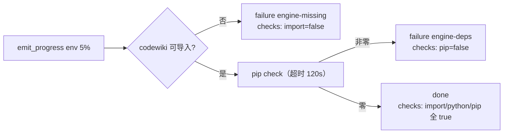

`_pip_check` 是"装到一半的 venv"门禁的运行时版本：依赖不闭合会让 FSoft 在**生成中途**才因缺包崩掉，代价是一整轮模型调用白烧。
探测本身失败也要如实上报（`pip check 无法执行：...`），不吞异常。

#### 3.1.6 源码分析面：排除非源码

```python
WIKI_PRODUCT_PATTERNS = (".codewiki", "CodeWiki.md")
```

这两项是本插件每轮都会改写的产物。引擎按"旧图 vs 新图"判增量，不排掉它们就永远有"变化"——实测源码零改动的一轮里引擎自报 `outcome=incremental`，
图 diff 恒命中 `.codewiki/_meta.yaml`，于是每轮产出一笔纯记账提交，还白花一次 routing 的模型调用。

`dangling_gitlink_patterns(repo_path)` 处理更隐蔽的一类：**被提交进索引、但没有 `.gitmodules` 登记的嵌套仓库**（孤立 gitlink）。
它在索引里是 mode `160000`，指向另一个仓库的 commit，`git checkout` 都不会恢复内容，但它**是 tracked**，`use_gitignore=True` 拦不住
（gitignore 只管未跟踪文件），引擎会把整个嵌套仓库当源码分析。实测代价：本仓库里一次探针克隆误提交的 `.probe-fsoft/src`（18 MB / 186 个文件）
进了分析面，最终在 45 分钟超时上限上被进程树终止，整轮零产出——而真正的源码只有 7 个 `.py`。

- 正规 submodule（`.gitmodules` 有登记）**不排除**：那是项目架构的一部分。
- 读不到索引时返回空列表——排除是优化，不是编译前置条件，绝不能因为它失败而让整轮编译挂掉。

`source_exclude_patterns` 每次返回**新列表**而不是共享模块级常量：调用方（`RepoAnalyzer`）会把 default 与 user 两组模式合并进自己的字段，共享同一个 list 会让两处互相污染。

#### 3.1.7 模型通道：只读环境变量

`_model_config()` 从 `CODEWIKI_BASE_URL` / `CODEWIKI_API_KEY` / `CODEWIKI_MAIN_MODEL`（可选 `CODEWIKI_CLUSTER_MODEL`）读通道配置。
它**刻意不走 `ConfigManager`**：后者会读 `~/.codewiki/config.json` 或系统 keyring。迁移后模型通道由 Node 侧的 loopback 桥注入
（见 [engine-integrations](../Documentation_Generation_Engine/engine-core/engine-integrations.md)），密钥只活在进程环境里，不需要也不允许落盘。

错误信息只说"环境变量未设置"，**不打印值**——即使环境变量被误设成密钥，也不会因为这条信息被写进 job 日志。

`fallback_model` 必须显式给：adapter 用 `self.config.get("fallback_model")` 透传，缺省 `None` 会让上游 `create_fallback_models`
在 `model_name.lower()` 上抛 `AttributeError`，且崩在 graph 阶段开头，表现为 `engine-crashed` 而不是可理解的模型错误。

#### 3.1.8 进度桥接 `bridge_progress`

FSoft 在 `CLIDocumentationGenerator.__init__` 里直接 `ProgressTracker(total_stages=5)` 构造，没有注入点。因此采用**替换三个方法**的旁路方式：

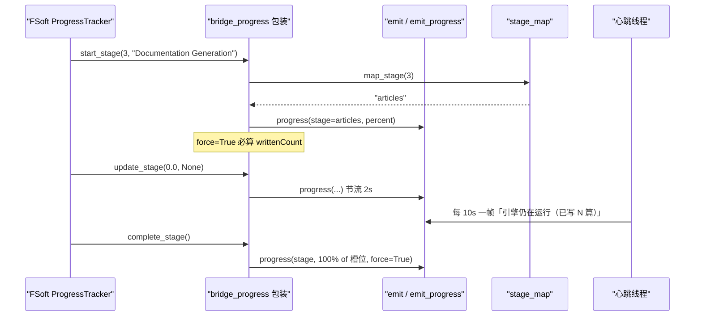

四处关键设计：

**（a）`writtenCount` 是进度事实，必须每帧真实**

`client.js` 判"超时但有进度 → partial"的唯一依据就是最后一条 progress 的 `writtenCount`。计数用 `_doc_fingerprints(docs_dir)` 递归真实清点，
且上报的是**本轮真实改动篇数**（进场指纹表 vs 当前指纹表之差），不是 docs 绝对篇数、也不是篇数净差：

- 拿绝对篇数当 written：增量轮进场时 `docsDir` 已被 Node 侧 `hydrateDocsDir` 灌入上一轮文章，"一篇没写的一轮"也报几十篇；
- 只看篇数净差："原地重写 20 篇"的增量轮被记成零进展。

按路径比对 `(size, mtime_ns)` 两种都能算对，成本只是一次目录遍历，无需读文件内容。mtime 在这里可信：`docsDir` 是本轮引擎刚写出的临时目录，不存在跨文件系统精度问题。

**（b）节流**：`writtenCount` 靠递归遍历算，而 FSoft 的进度条一秒可能调好几次 `update_stage`；docs 有数百篇时不节流会把 45 分钟预算啃掉一块。
普通 update 每 `_WRITTEN_RECOUNT_SEC`（2 s）算一次，阶段切换/阶段完成 `force=True` 必算（那是超时判 partial 的关键帧）。

**（c）增量轮按 description 识别，不按阶段号**

FSoft 的 `_run_incremental_update` 复用 `start_stage(2, "Incremental Update")`——拿的是"模块聚类"的槽位，实际整轮都在逐页写文章。
照阶段号映射成 `cluster`，面板会把 90 分钟的文章写作显示成"聚合类模块"，进度还钉在 36%。因此 `stage_map.is_incremental(description)` 命中后，
后续帧一律按 `articles` 报。

**（d）阶段 1 的百分比从日志数**：阶段 1 的 `stage_progress` 恒为 0（`update_stage` 全在 `if self.verbose:` 里），真实进度只能从逐文件日志数。
阶段完成帧（`stage_progress=1.0`）不走这条路：上游每十分之一文件才打一条日志，最后一条常停在 0.9，拿它算完成帧会让百分比倒退。

#### 3.1.9 心跳线程

```python
state = {"on": True}
def _heartbeat():
    while state["on"]:
        time.sleep(_HEARTBEAT_SEC)
        ...
        emit(stage, tracker.stage_progress, f"引擎仍在运行（已写 {written} 篇）{detail_suffix()}", force=True)
```

为什么必须有：FSoft 阶段 3 的所有 `update_stage` 都写在 `if self.verbose:` 里，而我们传 `verbose=False`——从 `start_stage(3)` 到
`complete_stage()` 之间**一帧进度都不发**。真机上这段可持续 40 分钟以上，Node 侧看不到任何 stdout，进度停在 54%，`job.updatedAt` 冻结：
面板上它跟"进程已经挂了"长得一模一样，而调度闸门（`parallelLimit` 默认 1）又被它占着，后续仓库永远轮不到。

心跳只做两件事：按固定间隔重发**当前**阶段与**当前**真实篇数。它不推进 percent（不谎报进展），也不改任何 FSoft 行为；Node 侧据此区分
"慢"（心跳在、篇数偶尔涨）与"僵死"（心跳在、篇数长期不涨）。`stage=0` 时跳过——`map_stage` 按 1..5 映射，硬发一帧会抛错。

线程挂在 `adapter.generate` 上而不是调用方：`generate` 是唯一同步入口，包起来后 stop 一定在 `try/finally` 里执行，不会出现"任务已结束、心跳还在污染 stdout"的泄漏。
若 adapter 没有 `generate`（只验阶段映射的探针），只装桥不装心跳：少一层观测，不能少一层功能。

#### 3.1.10 细节探针 `_DetailHandler` / `attach_detail_tap`

FSoft 以 `verbose=False` 运行时会把自己的 logger 压到 WARNING，于是逐模块日志（`Processing leaf module: X`）全被吞掉。
阶段 3 里桥接层只知道"已写 N 篇"，不知道"在写哪一篇"——真机上一次编译能卡在单个模块上几十分钟，这个信息量不足以区分"在推进"与"死了"。

做法是旁路：把 `codewiki.src.be` logger 临时降到 INFO 并挂一个**只读** handler，从日志文本里抽当前模块名：

| 阶段 | 正则族 | 产出 |
| --- | --- | --- |
| 1 解析 | `^\s*\[(\d+)/(\d+)\]\s`、`Parsing (\d+) source files` | `已解析 N/M 个源文件` |
| 2 聚类 | `Module clustering input for (.+?):`、`Requesting LLM module clustering for (.+?) because` 等 | `正在聚类 X` |
| 3 写作 | `Processing leaf module: X`、`Processing parent module: X`、`Generating parent documentation for: X` | `正在写 X` |
| 3 收尾 | `Generating repository overview` | `正在生成仓库总览` |
| 2 归并 | `Requesting super-grouping of N top-level modules` | `正在做子系统归并` |

三处刻意的保守：

- **emoji 不参与匹配**：cp936 控制台下非 ASCII 文本直接 print 会抛 `UnicodeEncodeError`，正则只吃 ASCII 部分。
- **同时压已有 handler 的 level**：FSoft 自己在 `doc_generator.py` 挂了 `StreamHandler(sys.stderr)`，只降 logger level 会让 INFO 灌进 stderr，
  被 `client.js` 当 stderr tail 收走，噪音暴涨。因此把会放行 INFO 的 handler 提到 WARNING，INFO 只走我们的只读 handler。
- handler 里任何异常都被吞掉——观测失败绝不能弄崩编译。`release_detail_tap` 在 `generate` 的 `finally` 里还原，不给后续请求留下被降级过的 logger。

#### 3.1.11 `generate` / `update`：config 组装

`action_generate` 不判断"改了什么、该写哪些文章"——那是 FSoft 的 diff 与 agentic 循环。它只做：准备 config → 跑 adapter → 把异常翻成契约终态。

关键 config 项：

| 键 | 值 / 来源 | 为什么 |
| --- | --- | --- |
| `update` | `is_update` | 决定走 generate 还是 update |
| `max_tokens` / `max_token_per_module` / `max_token_per_leaf_module` / `max_depth` | 常量 | 与上游默认档位对齐 |
| `request_limit` | `payload.requestLimit` 夹到 `1..1000`；未下发时取 `100` | 上游默认 100，但 `doc_guard.run_until_doc_written` 会续发最多 2 次提醒，各自吃满一份预算，大模块在 100 处撞上限 → `article-missing` → 整轮从 done 掉 partial，已写好的 31 篇白写。非正值一律忽略：0 会让 agent 循环一开就撞上限 |
| `module_concurrency` | `payload.moduleConcurrency`，夹到 1..8，缺省 1 | 上游 `_generate_modules_in_order` 是串行循环，单篇约 12 分钟 |
| `agent_retries` | 3 | — |
| `use_gitignore` / `prompt_caching` | `True` | — |
| `agent_instructions.exclude_patterns` | `source_exclude_patterns(repo_path)` | 见 3.1.6 |
| `agent_instructions.language` | `payload.language`（空则不写） | 上游只从 `agent_instructions.language` 读；不传等于静默按英文写，`articleLanguage` 设置形同虚设 |
| `update_options` | `payload.updateOptions`（字典时透传） | `rung` 决定增量算法档位 |
| `commit_id` | `payload.commitId` 或 `HEAD` | 落进 `metadata.json` 的 `generation_info.commit_id`，即下一轮 updater 眼里的 `old_commit` |

注意 `language` 必须在组装 `config` **之前**取出，否则 `UnboundLocalError`（真机 P1 修复时踩过）。

安装运行时：

```python
from full_parallel_runtime import install_full_runtime
install_full_runtime(config.get("module_concurrency", 1))
if is_update:
    from fsoft_runtime import install_incremental_runtime
    install_incremental_runtime()
```

TechDocs 导出目录（`payload.techdocsDir`）刻意放在**仓库外**的临时位置：上游这一步直接写盘，让它往仓库里写就绕过了落地器的写集封闭与回滚
（partial/failed 轮会留下半份成品站点）。

#### 3.1.12 结果构造与异常分类

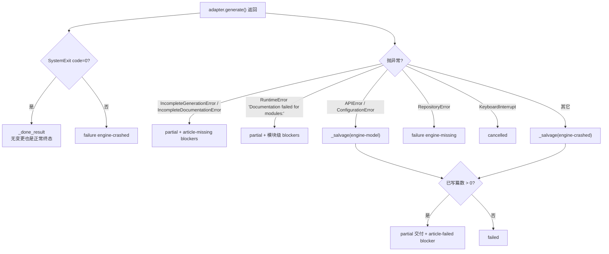

`_salvage` 的存在理由：原生引擎一条任务动辄几十上百分钟（真机全量实测约 174 分钟），失败点通常在阶段 3 中途。整轮判 `failed` 的代价不只是
"这次白跑"——`native-run.js` 对 `failed` 直接 settle 短路，不做原始树留档、不采集受管状态，于是下一轮增量因缺持久化状态又退回全量，
再跑一遍同样的时间、再撞同样的墙。把已写部分降 `partial` 才可能打破这个循环。但一篇都没写时仍是 `failed`：用空产物冒充"部分完成"会让基线与面板失真。

分类依据是**异常类型**而非消息文本（文本随版本变，类型相对稳定）。上游 1b4af43 起 `_generate_modules_in_order` 在有模块失败时抛
`RuntimeError("Documentation failed for modules: ...")`——语义上它仍是"计划内文章没写成"，不是"进程崩了"，所以翻成 `partial` + 点名缺哪些模块。

三个计数函数把引擎自己的记账读成契约事实：

| 函数 | 来源 | 含义 |
| --- | --- | --- |
| `_update_outcome_of` | `adapter._last_update_record.outcome` | `incremental` / `no_change` / `full_fallback` / `detector_failure` / `None`（没走增量） |
| `_counts_of` | `record.verdicts` 中 `verdict == 'no-op'` 的页数；`pages_removed` 去重；`repair.orphans` 长度 | `keptCount` / `removedCount` / `unmappedCount` |
| `_failed_calls_of` | `record.calls` 里 `kind ∈ {leaf_agent, missing_pages}` 且 `error` 非空 | 翻成 `article-failed` blockers |

`_failed_calls_of` 解决的是**假 done**：上游 `leaf_agent.py` 把 agent 异常吞进 `record.calls`，然后给该叶子要改的每一页记一条
`verdict="no-op"` + `reason "no verdict returned by agent"`——账本上跟"这页确实不用改"一模一样，两处都不改 `outcome`。
插件只读 `outcome` 就会把"模型连续三轮没吐任何内容"读成"整轮无需改动"（真机 `job-mw0cn6cv-4` 的 24 条 no-op 里有 2 条正是这样来的）。

`_usage_of` 必须被**每条出口**调用：partial 分支曾直接 return，于是写了一半的任务用量恒为 0——面板与成本核算看到的都是"没花钱"，
而实际上这一轮可能已经跑了上百次请求。

`_state_files(docs_dir)` 只报磁盘上**真实存在**的跨轮状态文件（顶层 `*.json`、`temp/dependency_graphs/*`、`temp/reference_index.json`、
`temp/artifact_index.json`），不让上层按白名单猜：白名单写错会把"引擎其实没产出依赖图"误记成"已持久化"，下一轮增量拿空图跑，
图 diff 恒为空，于是永远 `no_change`、文章与源码脱节。

`_done_result` 是**唯一**的成功出口（`_salvage` 也复用它，只把 `outcome` 改成 `partial`）。它输出的契约字段：

| 字段 | 值 |
| --- | --- |
| `contractVersion` / `outcome` / `stage` | 契约版本、`done`、最后一个**真实到达**的阶段（由 `on_stage` 记录，不写死） |
| `blockers` / `error` | 成功时为空 |
| `writtenCount` / `failedCount` | 递归清点的产物篇数 / 失败调用数 |
| `keptCount` / `removedCount` / `unmappedCount` | 来自 `_counts_of`，全量路径恒 0 |
| `usage` | 由调用方用 `_usage_of(job)` 覆盖（默认全 0） |
| `engine` | `version`（`codewiki.__version__` 或 `importlib.metadata`）、`commit`（`git rev-parse HEAD`）、`python` |
| `artifacts` | `docsDir`、`rawTreeDir`（`module_tree.json`）、`updateRecord`（`update_record.json`）、`stateFiles`（磁盘实测） |
| `updateOutcome` | 与 `artifacts` **并列**而非塞进去：`artifacts` 描述"产物在哪"，它描述"这次编译是什么性质" |
| `startedAt` / `finishedAt` | UTC ISO 时间 |

`stage` 必须是实测值：写死常量会让面板永远说"停在校验"，而实际可能连聚类都没跑到。

#### 3.1.13 `_count_docs` 与 `_doc_fingerprints` 的递归要求

hierarchical 布局把页写在子目录里（`doc_layout.py:module_doc_relpath` 是 `posixpath.join(*module_path[:-1], f"{module_path[-1]}.md")`），
只 glob 根层会把整棵子树漏掉——于是 `written` 少计而终态看着像成功，这正是"1 篇成功 + 19 篇失败也报 done"那类误判的来源之一。
`temp/` 与点开头目录要排除：`temp/update-record.json` 等是记账文件，不是文章。

### 3.2 `stage_map.py` —— 五段 → 九段映射

这是 Node 与 Python 唯一共享的**枚举口径**，纯函数、无副作用。契约里的 `ENGINE_STAGES` 是面板步骤条、`job.stage` 与取消检查点的共同依据；
FSoft 自己的 `ProgressTracker` 只有五段。两边一旦漂移，表现是"面板显示在写作，实际已经在校验"——错得不响但很难查。
仓库内的契约测试（`test-engine-python-entry.mjs`）反向断言两边集合完全一致：改一边不改另一边，测试立刻红。

| FSoft 阶段 | 名称 | 权重 | 映射到的引擎阶段 |
| --- | --- | --- | --- |
| 1 | Dependency Analysis | 0.40 | `graph` |
| 2 | Module Clustering | 0.20 | `cluster` |
| 3 | Documentation Generation | 0.30 | `articles` |
| 4 | HTML Generation | 0.05 | `validate` |
| 5 | Finalization | 0.05 | `validate` |

4/5 都落在 `validate`：HTML 本插件不做，finalization 就是产物整理，两者都属于"文章已写完、在收口"；报成 `articles` 会让面板一直显示在写作。

**进度上限刻意压在 90%**：FSoft 只覆盖九段中的前四段（`env` 由 doctor 承担，`index` / `baseline` / `commit` 由 Node 侧后续执行），
剩下 10% 留给 Node 收尾，避免"引擎说 100% 但 wiki 还没索引/没提交"这种假完成。

核心 API：

| 函数 | 语义 |
| --- | --- |
| `map_stage(fsoft_stage)` | 阶段号 → 引擎阶段名；未知阶段归 `DEFAULT_ENGINE_STAGE`（`articles`），**不抛错**——进度上报是旁路，任何时刻都不该因版本差异打断编译 |
| `percent_of(fsoft_stage, stage_progress)` | 与上游 `get_overall_progress` 同构（已完成权重和 + 当前权重×进度），再乘 90 并夹到 [0,100]。自己重算而非调上游方法，是为了在不持有 tracker 实例时也能算（测试与日志回放） |
| `articles_percent(written, total)` | articles 槽位内的百分比：`lo = percent_of(3, 0.0)`，`hi = percent_of(3, 1.0)`，按 `written/total` 线性插值（阶段 3 完成时的上限即 `hi`） |
| `is_incremental(description)` | description 是否含 `incremental update` |

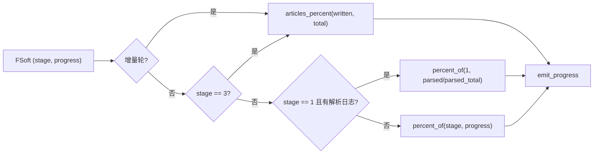

### 3.3 `full_parallel_runtime.py` —— 全量受控并行

上游 `DocumentationGenerator._generate_modules_in_order` 是严格串行：`for module_path, module_name in processing_order: await ...`，单篇约 12 分钟。
本仓库 16 节点串跑 180 分钟预算耗尽只写出 18 篇（真机 `job-mvuf1c5b-5`）。

`install_full_runtime(concurrency)` **只替换这一个方法**，把同一父节点下的兄弟模块并发执行，并保证四条不变量：

1. **父模块必须等它所有子模块结束**——并行不能破坏拓扑顺序。实现上不需要"父等待时让出槽位"的机制：父节点此时根本没占槽位，不会自锁。
2. **并行分支各自往 `module_tree` 里加的子模块都要合并回主树**，不能互相覆盖。
3. **单个模块失败不拖垮同批其它模块**，失败清单仍然上抛（上游 1b4af43 起有模块失败就 raise，这条判据不能被并行化吃掉）。
4. **每个模块开始前从磁盘重读 `module_tree`**，用磁盘状态而非内存快照决定它是否还有子节点、`components` 是什么。

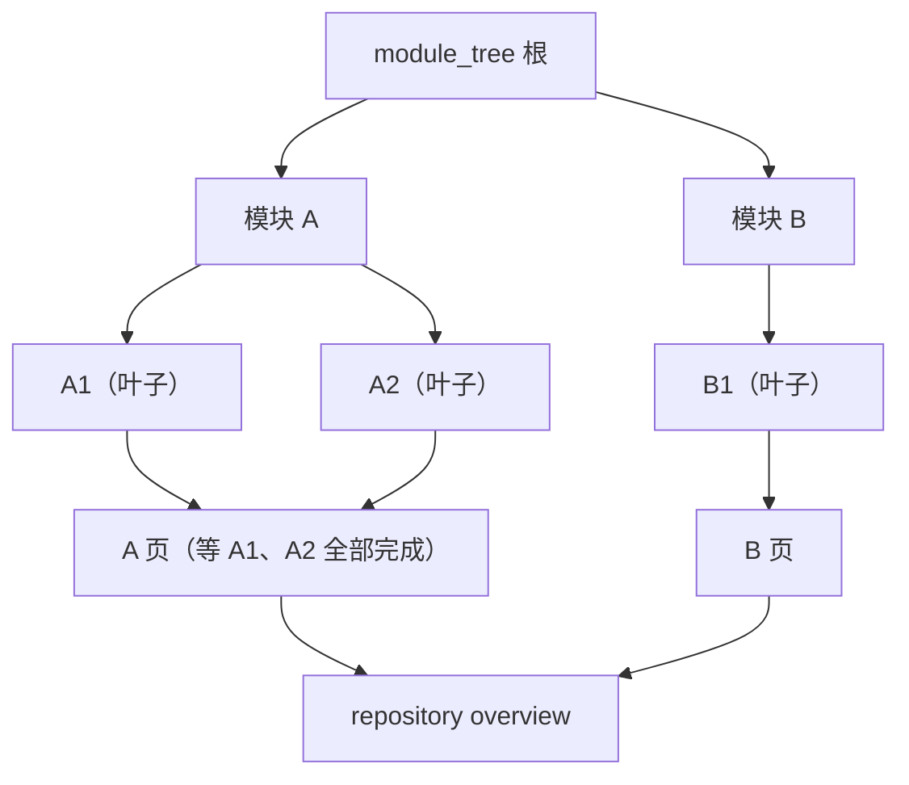

调度是"按初始树递归 `_walk`"：先 `asyncio.gather` 全部孩子，再 `_run_module` 自己。信号量 `asyncio.Semaphore(concurrency)` 限流。
根总览在所有顶层模块写完后统一生成（与上游顺序一致）。收尾三件事必须保留：**覆盖校验**（`validate_module_file_coverage`）、
**页面归位**（`organize_docs`）、**失败上抛**（`RuntimeError("Documentation failed for modules: ...")`）。

#### `_install_shared_tree_io` 与 `_merge_tree`：并发读改写

并行分支各自 `from codewiki.src.utils import file_manager` 拿到的是同一个类对象，因此必须在**类方法**上串行化读写；只替换
`documentation_generator` 模块里的名字，真实后端（`pydantic_ai_backend` / `caw_backend`）仍会用自己 import 的那份，
两条分支的 read-modify-write 会互相覆盖，后写者的子模块直接丢失。

`_install_shared_tree_io`（由 `install_full_runtime` 调用，全进程只装一次）直接把 `file_manager.__class__` 的
`save_json` / `load_json` 换成 `staticmethod` 包装：只接管 `module_tree.json`（其它文件走原实现），在 `_TREE_LOCK`（`threading.RLock`）内做 read-merge-write。
原始两个方法保存在模块级的 `_ORIG_SAVE` / `_ORIG_LOAD` 里，`write_tree_exclusive` 与合并逻辑都靠它们绕过包装直接读写磁盘。

`_merge_tree` 的冲突判据分三类：

| 情形 | 处置 | 理由 |
| --- | --- | --- |
| 父模块 `components` 不同 | 取并集 | 父模块的 `components` 是整棵子树的并集，两分支各新增不同子模块时本就不同，属信息互补 |
| 叶子 `components` 不同且互不包含 | **抛 `RuntimeError`** | 同一叶子被分给不同组件是真矛盾，静默取一个会丢内容且无法回溯 |
| 一边是另一边的真子集 | 取并集 | 树里记 3 个组件、某分支看到 4 个，说明另一分支还没见到本轮新出现的符号（真机 `job-mw0rkcel-0` 因此整轮 articles 中断） |
| 其它键 | 只补缺（`key not in old` 才写入） | 不覆盖已有值 |

`write_tree_exclusive(filepath, mutate)` 是给"调用方已基于磁盘最新状态算出完整目标树"的场景准备的：跳过合并、直接覆盖写。
走 `save_json` 的合并语义会把"旧值是新值的真子集"误判成叶子组件冲突，整轮增量中断（`tree_coverage.adopt_tree_coverage` 正是这种调用方）。

`install_full_runtime(concurrency)` 是幂等的，并做**双重防护**：若 `_generate_modules_in_order` 已被其它适配器替换则抛
`RuntimeError("...已被其它适配器替换，拒绝重复安装")`，绝不静默退回串行。

公开 API 一览：

| 函数 / 类 | 职责 |
| --- | --- |
| `install_full_runtime(concurrency=None)` | 安装并行 `_generate_modules_in_order`；`concurrency` 为 `None` 时沿用已配置值 |
| `configure_full_runtime(concurrency)` | 设置模块级并发度（1 = 上游串行），夹到 `>=1` |
| `current_concurrency()` | 读当前并发度（加锁读取） |
| `write_tree_exclusive(filepath, mutate)` | 在树锁内做「读 → mutate → 覆盖写」，跳过合并语义；需在 `install_full_runtime()` 之后调用 |
| `_install_shared_tree_io()` | 在 `file_manager` 类上装 `module_tree.json` 的串行化读写（全进程一次），原始方法存进 `_ORIG_SAVE` / `_ORIG_LOAD` |

`_CONCURRENCY` 用 `threading.Lock` 保护：`configure_full_runtime` 由 `entry.py` 在构造 generator **之前**调用，
但并行分支是协程，读取可能发生在任意时刻，因此不能裸读全局变量。

### 3.4 `fsoft_runtime.py` —— 增量 Step 5 隔离并行与断点

上游把所有叶子放在一个 `docsDir` 里串行执行。本模块给每个叶子独立的工作副本，并行完成模型调用，再按原顺序合并真实页面变化；
同一页被多个叶子修改时，后序叶子在已经合并的现场**串行重跑**。这样既保留串行语义，也不必把保守写集里共同出现的 `overview` 当成全局串行锁。

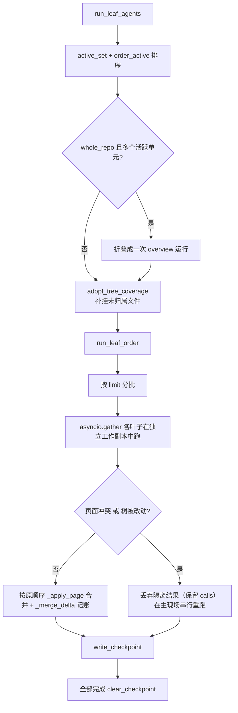

#### 断点续跑

`checkpoint_path(docs_dir)` = `<docsDir>/dsh_leaf_checkpoint.json`，内容 `{version, signature, completed}`，写入走
"临时文件 + `fsync` + `os.replace`"的原子替换。

`_signature` 是 **sha256** 的规范化 JSON，材料包含 `adapter` 版本、`record.revision`、`opts.to_dict()`（剔除 `extra.resume`）、
新树、新图、叶子顺序。`_canonical` 会先 `model_dump(mode="json")`、字典按 key 排序、集合排序，保证同一语义得到同一签名。

签名变化时 `_load_completed` 有两种处置：

- 有 `opts.extra.resumeBaselineDocsDir` 且目录存在 → `rmtree` 当前 `docsDir` 并从受管基线 `copytree` 恢复（保留断点文件），重跑全部叶子；
- 没有可恢复基线 → 抛 `RuntimeError("增量断点签名已变化，且没有可恢复的受管基线，拒绝混用旧现场")`。**拒绝混用**而不是"尽力合并"，因为混用会让账本与页面来自两个不同的现场。

#### 记账合并 `_delta` / `_merge_delta`

隔离分支在 `task_record`（一个独立 `UpdateRecord`）里记账，成功合并时整体 `extend` 回主 record。冲突丢弃时只保留 `calls` 与
`detector_notes`（模型调用真的花掉了，必须计入成本），其余列表清空，并把串行重跑产生的增量再合并进去。

`_RECORD_LISTS` = `calls` / `verdicts` / `pages_written` / `pages_removed` / `write_set_violations` / `detector_notes` / `errors`，另加 `write_sets` 字典。

`run_leaf_order(updater, order, reports, new_tree, new_graph, leaf_nodes, ref_index)` 是适配器与测试**共用的公开 seam**：
它接收已排序的叶子列表并负责分批、隔离、合并、断点，`run_leaf_agents` 只是"排序 + 补挂 + 调用它"的薄壳。
测试可以绕过上游调度直接驱动这一段，因此它的签名与语义变更属于契约变更。

#### 安装方式：源码锚点

```python
_STEP5_START = "    # ---- Step 5: sequential leaf agents\n"
_STEP5_END = "    # ---- Step 6.1: generate any page still missing"
```

`install_incremental_runtime` 用 `inspect.getsource` 取出上游 `IncrementalUpdater._run` 的源码，按上述两个锚点切片，
把 Step 5 段落替换成 `await _dsh_run_leaf_agents(...)`，然后 `exec(compile(...))` 到上游模块的命名空间里，替换 `_run` 并打上
`__dsh_runtime__ = True` 标记（幂等）。

锚点找不到时抛 `RuntimeError("FSoft IncrementalUpdater Step 5 源码锚点不匹配，拒绝安装运行时适配")`——**不静默退回另一套算法**。
这是本模块对上游升版的核心防御：宁可显式失败，也不要让"增量语义悄悄变成别的样子"。

### 3.5 `tree_coverage.py` —— 未归属文件补挂

上游 `validate_module_file_coverage` 要求"依赖图里出现的每个文件都被某个叶子模块认领"，而 Step 2 的 `repair_tree` 只处理**本轮 `diff.added`** 的组件。
于是历史上某轮没写进树的文件永远不进树，之后每轮增量都会在校验处抛 `Invalid module file coverage: missing=[...]`，且**不会自愈**。

`adopt_unowned_files(tree, components, opts)` 按上游自己的规则补挂：

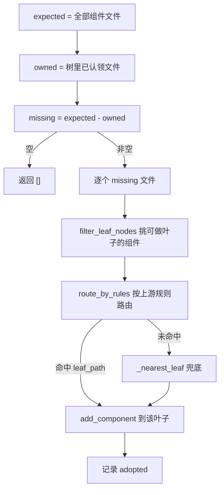

`file_owner(tree, components, relative_path)` 是公开查询：返回该文件被哪个叶子认领（斜杠分隔路径），无人认领返回 `None`。

`_nearest_leaf` 的排序键是 `(-共享目录前缀深度, 叶子文件数, 路径字典序)`——优先同目录/近邻，其次负载轻的叶子，最后用路径保证确定性。
补挂**不改变任何已写页面**，只把缺失文件里的组件登记到最近的叶子上；校验本身仍由上游执行。

`adopt_tree_coverage(updater, new_tree, new_graph)` 是给 `IncrementalUpdater` 用的包装：基于**磁盘最新树**（而不是 Step 4 的 `new_tree` 快照）
做补挂，并走 `write_tree_exclusive` 覆盖写。两个理由：①盘上可能已被本仓库历史轮次写下更多节点，用快照会丢掉它们；②补挂结果必须覆盖写，
走合并会被叶子判据当成"两个分支分给不同组件"而抛错。补挂失败只记 `detector_notes` 与 warning，不让整轮增量崩掉。

公开 API：

| 函数 | 语义 |
| --- | --- |
| `file_owner(tree, components, relative_path)` | 该文件被哪个叶子认领；无人认领返回 `None` |
| `adopt_unowned_files(tree, components, opts=None)` | 就地补挂未归属文件，返回被补挂的文件相对路径列表；空树（上游整仓单页模式）直接返回 `[]` |
| `adopt_tree_coverage(updater, new_tree, new_graph)` | 面向 `IncrementalUpdater` 的包装：磁盘树 + 覆盖写 + 失败降级为 note |

`adopt_unowned_files` 的候选过滤链是 `component_files` → `module_file_owners` → `compute_valid_leaf_types` / `filter_leaf_nodes` →
`route_by_rules` → `_nearest_leaf` 兜底。全部复用上游函数，本模块不重新定义"哪个文件属于哪个模块"的规则——只在规则**给不出答案**时提供确定性兜底。

---

## 4. 一次 `generate` 请求的完整时序

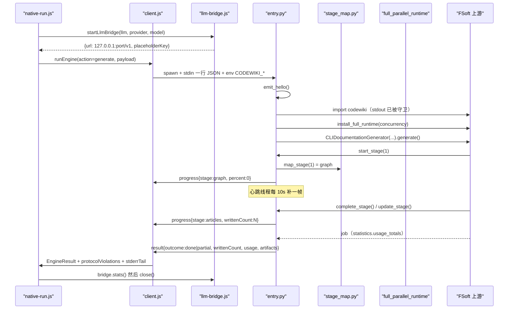

Node 侧的 `client.js` 对这条流有六条协议不变量（stdout 只含 JSON-lines、`requestId` 必须匹配、无 `result` 即失败、退出码只表达进程层、
取消后到达的 result 丢弃、重复 result 先到者胜），并在超时/静默/取消三条分支上都按 `writtenCount` 决定 `partial` 还是 `failed`。
这解释了为什么 `entry.py` 的 `writtenCount` 必须每帧真实——见 [engine-runner](../Documentation_Generation_Engine/engine-core/engine-orchestration/engine-runner.md)。

### 4.1 `update`（增量）路径的差异

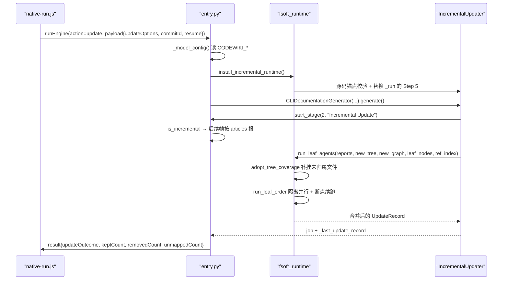

三个增量专属的契约字段由 `entry.py` 从 `UpdateRecord` 直接读出（见 3.1.12）：`updateOutcome`（`incremental` / `no_change` / `full_fallback` /
`detector_failure`）、三个计数（`keptCount` / `removedCount` / `unmappedCount`）、以及 `artifacts.stateFiles`（磁盘上真实存在的跨轮状态文件）。
它们共同决定"基线能不能推进"——`native-run.js` 与 `native-state.js` 只认 `incremental` / `no_change` 为"变化已消化"，
其余一律不推进，下一轮 change-set 仍从旧基线算起。

---

## 5. 运行环境与构建

本模块**不自己管环境**，依赖外部已就绪的 venv：

- `package.json` 的 `files` 白名单包含 `lib`（排除 `lib/**/__pycache__`）、`tools/fsoft-engine/setup-env.sh` 与 `tools/fsoft-engine/constraints.txt`，
  因此 Python 源码随插件分发，`__pycache__` 不进包。
- `engines` 要求 Node `>=24.9.0`、dsh `>=0.2.0-rc.0`；`dsh.bundle.patch` 指向 `cordis.patch.yml`。
- venv 由 `tools/fsoft-engine/setup-env.sh` 在**插件仓库之外**构建：`--no-deps` 按冻结快照落盘 → editable 安装 FSoft 本体 → `pip check`
  → import 冒烟。之所以不重解析依赖，是因为 `openai` / `pydantic-ai-slim` / `pydantic` 的版本约束互相打架，正常解析必然
  `ResolutionImpossible`。详见 [fsoft-engine-tools](../Build___Development_Infrastructure/fsoft-engine-tools.md) 与
  [build-configuration](../Build___Development_Infrastructure/build-configuration.md)。

`entry.py` 的 `doctor` 动作与 `manifest.js` 的 `doctor` 是这条链的两端：前者跑 `pip check` 并如实上报，后者把结果算成指纹与
`.codewiki/engine-lock.json` 比对（`absent` / `ok` / `drift` / `unhealthy` / `probe-failed`），不一致时 `native-run.js` **直接 failed，不跑引擎**。
见 [engine-state-manifest](../Documentation_Generation_Engine/engine-core/engine-state-manifest.md)。

### 5.1 与本模块相关的插件设置项

这些键在 `cordis.patch.yml` 的 `codewiki` 命名空间下声明（同 id 覆盖条目是整对象替换，未写的键回落到 `index.js` 的 `Config` 默认值），
并由 `native-run.js` 一路带到 `entry.py`：

| 设置项 | 默认 | 在 Python 侧的落点 |
| --- | --- | --- |
| `nativeEnginePython` | 空 → `DSH_CODEWIKI_PYTHON` → `python` | 解释器路径；不做"找一个能用的解释器"的启发式——猜错会把环境不闭合伪装成引擎坏了 |
| `nativeEngineEntry` | `lib/engine/python/entry.py` | 入口脚本，一般不用改 |
| `nativeEngineTimeoutMs` | 180 分钟 | `client.js` 的 `timeoutMs`；超时后按 `writtenCount` 决定 partial 还是 failed |
| `moduleConcurrency` | 0（跟随 `maxConcurrency`） | `payload.moduleConcurrency` → `config["module_concurrency"]` 与 `install_full_runtime` |
| `articleLanguage` | 中文 | `payload.language` → `agent_instructions.language` |
| `techdocs` | 关 | `payload.techdocsDir`（仓库外临时目录） |
| `batchProvider` / `batchModel` / `batchReasoningEffort` | — | 不经 Python 侧，由 `llm-bridge.js` 消费 |

注意 `articleLanguage` 默认是中文，而原生通道在修复前整条链路都没把它带下来（`nativeEnginePlan` 不接、`startNativeRun` 不传、
`entry.py` 也不设），于是引擎静默按英文写，README 承诺的"文章语言，默认中文"在默认通道上完全落空。这是 `agent_instructions.language`
必须显式传的直接原因。

---

## 6. 设计不变量清单

| # | 不变量 | 违反后果 | 守护位置 |
| --- | --- | --- | --- |
| 1 | `sys.stdout` 必须在 import `codewiki` 之前被接管 | 上游打印污染协议流，Node 侧丢帧 | `_ProtocolOnly` |
| 2 | 所有协议行必须经 `emit()` 且在 `_EMIT_LOCK` 内整行写出 | 半行 JSON，进度断掉 | `emit` |
| 3 | stdin/stdout/stderr 与子进程 text 模式一律 UTF-8 | 中文路径乱码 / `UnicodeDecodeError` 崩整轮 | 三条 `reconfigure` + `_popen_init_utf8` |
| 4 | 不读 `ConfigManager`、不读 keyring、不打印密钥 | 凭证落盘或被写进 job 日志 | `_model_config` |
| 5 | `writtenCount` 每帧必须是本轮真实改动篇数 | 超时后 partial 自救失效，已写文章被丢弃 | `_doc_fingerprints` + 节流 |
| 6 | 心跳间隔必须显著小于 `client.js` 的 `silenceMs` | 心跳自己被判成卡死 | `_HEARTBEAT_SEC = 10s` |
| 7 | 进度上限 90%，留给 Node 侧 `index`/`baseline`/`commit` | 引擎说 100% 但 wiki 未提交的假完成 | `FSOFT_PROGRESS_CEILING` |
| 8 | `ENGINE_STAGES` 必须与 `contract.js` 完全一致 | 面板阶段错位，且错得不响 | `stage_map.py` + 双向对账测试 |
| 9 | 运行时补丁的源码锚点不匹配必须显式失败 | 增量/并行语义静默变成别的样子 | `install_*_runtime` |
| 10 | `module_tree.json` 读改写必须在锁内且做合并 | 并行分支互相覆盖，子模块丢失 | `_install_shared_tree_io` / `_TREE_LOCK` |
| 11 | 叶子 `components` 真冲突必须抛错 | 静默丢内容且无法回溯 | `_merge_tree` |
| 12 | 断点签名变化且无基线时拒绝续跑 | 账本与页面来自两个现场 | `_load_completed` |
| 13 | 空产物不得伪装 `partial` | 基线与面板失真 | `_salvage` |
| 14 | 已写部分必须降 `partial` 而非整轮 `failed` | 下一轮退回全量，重跑同样时间 | `_salvage` + `_classify_exception` |
| 15 | `cancel` 返回 `{cancelled:true}` 而非 `EngineResult` | 下游误判"这轮编译结束了" | `handle_request` |
| 16 | 观测代码（探针/handler/心跳）的任何异常都不能弄崩编译 | 排障手段变成故障源 | 各处 `except Exception` |
| 17 | `_count_docs` / `_doc_fingerprints` 必须递归并排除 `temp/`、点目录 | 少计篇数导致假成功，记账文件被当文章 | 两函数 |
| 18 | 排除清单每次返回新列表 | 与调用方的模式列表互相污染 | `source_exclude_patterns` |

---

## 7. 排障速查

| 现象 | 最可能的成因 | 先看哪里 |
| --- | --- | --- |
| 面板停在 54%、`job.updatedAt` 冻结 | 阶段 3 无 `update_stage`，心跳缺失或被打断 | `_heartbeat`、`client.js` 的 `silenceMs` |
| 面板显示"聚合类模块"但实际在写文章 | 增量轮被按阶段号 2 映射成 `cluster` | `is_incremental` |
| 超时后一篇都没救回来 | progress 帧的 `writtenCount` 恒 0 | `written_now` / `_doc_fingerprints` |
| 中文路径报"仓库路径不存在" | stdin 被按 cp936 解码 | `sys.stdin.reconfigure` |
| 引擎内部错误，stderr 有 `UnicodeDecodeError` | 上游 `text=True` 子进程按 locale 解码 | `_popen_init_utf8` |
| 整轮零产出、stderr 刷 `not found in components` | 孤立 gitlink 被当源码 | `dangling_gitlink_patterns` |
| 源码零改动却每轮都 `incremental` | `.codewiki` / `CodeWiki.md` 未排除 | `WIKI_PRODUCT_PATTERNS` |
| `Invalid module file coverage: missing=[...]` 每轮复现 | 历史未归属文件，Step 2 不处理 | `adopt_unowned_files` |
| 报 `RuntimeError(...源码锚点不匹配...)` | 上游升版改了被替换的方法 | `_STEP5_START` / `_STEP5_END` |
| `module_tree 冲突：X 在两个并行分支里组件归属不一致` | 同叶子被分给不同组件 | `_merge_tree` |
| `增量断点签名已变化，且没有可恢复的受管基线` | 上游/选项/树/图变了但没给 `resumeBaselineDocsDir` | `_load_completed` |
| 整轮报 `done` 但文章明显没写 | agent 异常被上游吞成 `no-op` | `_failed_calls_of` |
