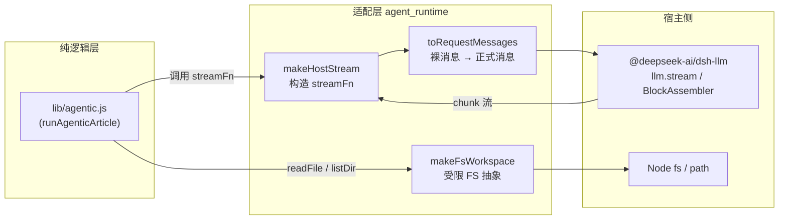
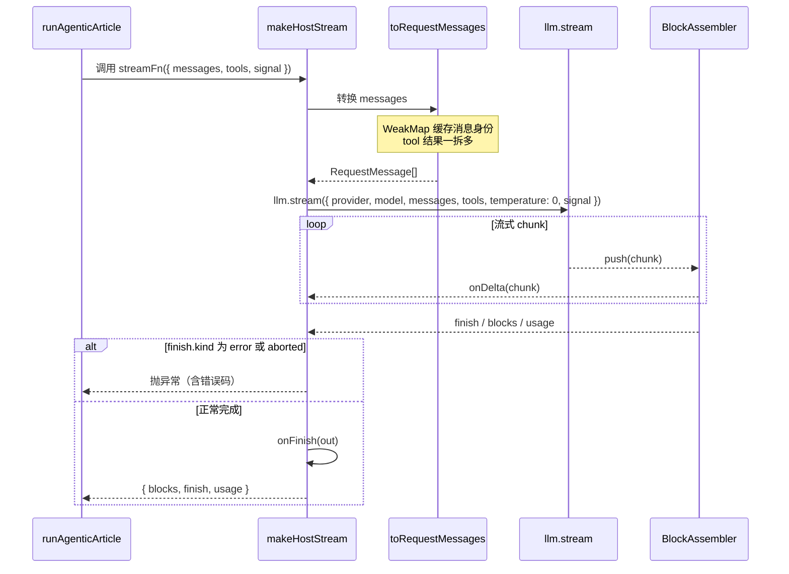

# Agent 运行时适配层（agent_runtime）

## 简介

`agent_runtime` 是 `Extension_Host_Execution_Orchestration` 下的运行时适配模块，核心文件为 [`lib/agentic-host.js`](../../lib/agentic-host.js)。它是 **纯逻辑工具循环**（`lib/agentic.js`）与 **宿主 LLM 服务**（`@deepseek-ai/dsh-llm` 的 `llm.stream`）之间的桥梁：

- 把工具循环消费的裸消息 `{role, content}` 转换为宿主要求的正式 `RequestMessage`（带稳定 id、source）；
- 把宿主返回的 chunk 流式输出用 `BlockAssembler` 收敛为 blocks；
- 为工具循环提供一个只认 `readFile / listDir` 的受限文件系统抽象，并用真实路径解析兜住目录逃逸。

> 该模块与兄弟模块的关系：
> - 纯逻辑工具循环与 `edit` 编辑能力 → 见 [agentic_edit_capability](agentic_edit_capability.md)
> - 变更集收集 → 见 [change_set_management](change_set_management.md)
> - 宿主编排入口（runPool / worker / 各 tick）→ 见 [extension_host_core](extension_host_core.md)

## 架构定位



## 核心组件

### `toRequestMessages(messages, { provider, model })`

把循环产生的裸消息列表转换为宿主可消费的 `RequestMessage[]`。

| 角色 | 处理策略 |
| --- | --- |
| `user` | 首次构造 `createUserMessage({ content, source: { kind: 'plugin:codewiki' } })`，并用 `WeakMap` 缓存身份 |
| `assistant` | 若已带 `id`（已是正式消息）则直接透传；否则构造 `createAssistantMessage`，source 携带 provider / model |
| `tool` | 一条裸 tool 消息含多条 `tool-result` 时**展开为多条** `createToolResultMessage`，每条只装一个结果（带 `toolCallId`、`isError`） |

#### 消息身份缓存（`IDENTITY: WeakMap`）

宿主 `d.ts` 要求 *"Stable identity preserved across every representation boundary"*。若每轮都重新 `createUserMessage / createAssistantMessage`，同一对话内的同一条消息每步都会换一个新 UUID——下游若按 id 去重或做游标即失真。

- `WeakMap` 以裸消息对象为键，跟随循环消息生命周期自动回收；
- tool 角色一拆多，缓存值再用一层 `Map`，键由 `stableKeyFor(role, r, index)` 生成（`role#index#toolCallId`），保证同一结果多次转换命中同一消息实例。

### `makeHostStream({ llm, provider, model, reasoningEffort, onDelta, onFinish })`

返回一个供 `runAgenticArticle` 使用的 `streamFn`，签名为 `({ messages, tools, signal }) => { blocks, finish, usage }`：

1. 校验 `llm.stream` 存在，否则抛错；
2. 用 `BlockAssembler` 逐 chunk 收敛输出；
3. 构造请求：`temperature: 0`，可选带 `reasoningEffort`、`tools`（映射为 `{ name, description, parameters }`）、取消 `signal`；
4. `finish.kind` 为 `error` 或 `aborted` 时抛出带错误码与消息的异常；
5. `onDelta` / `onFinish` 回调包裹在 `try/catch` 中，**回调失败不影响写作主流程**。

### `makeFsWorkspace(fs, path, cwd)`

为 agentic 工具提供的最小 workspace 抽象（只暴露 `readFile` / `listDir`）：

```javascript
const absOf = (rel) => {
  const abs = path.resolve(rootAbs, rel)
  const within = abs === rootAbs || abs.startsWith(rootAbs + path.sep)
  return within ? abs : null
}
```

- 以 `cwd` 的真实绝对路径 `rootAbs` 为根；
- 相对路径解析后必须落在 `rootAbs` 之内（相等或以 `${rootAbs}${path.sep}` 为前缀），否则返回 `null`；
- `readFile` / `listDir` 对越界路径抛 `越界路径：${rel}`；
- 与 `safeRelPath` 的参数层校验形成**双重防护**，防止符号链接逃逸到仓库外。

## 数据流



## 设计要点

1. **关注点分离**：`lib/agentic.js` 保持纯逻辑、易离线测试；本层独占宿主 SDK 的消息形态与流式协议细节，宿主接口演进时只改这一层。
2. **身份稳定**：`WeakMap` 缓存既满足宿主对 MessageId 稳定性的契约，又在循环结束后随垃圾回收自动释放，无内存泄漏。
3. **一拆多展开**：工具循环中「一轮多个调用」产生的多结果 tool 消息，在此展开为宿主要求的「一条结果一条消息」。
4. **失败隔离**：`onDelta` / `onFinish` 等观察回调全部 try/catch 包裹，避免 UI 层异常中断写作。
5. **路径沙箱**：`absOf` 基于真实路径前缀判断，是相对路径校验之外的第二道逃逸防线。

## 依赖与被依赖关系

| 方向 | 模块 / 包 | 说明 |
| --- | --- | --- |
| 依赖 | `@deepseek-ai/dsh-llm` | `BlockAssembler`、`createUserMessage` / `createAssistantMessage` / `createToolResultMessage` |
| 依赖 | Node 内置 `fs` / `path` | `makeFsWorkspace` 的文件读写与路径解析 |
| 被调用 | [agentic_edit_capability](agentic_edit_capability.md)（`lib/agentic.js` 的 runAgenticArticle） | 消费本层提供的 `streamFn` 与 workspace |
| 被编排 | [extension_host_core](extension_host_core.md)（`index.js` 的 worker / tickArticles） | 在宿主任务流程中实例化本层适配器 |
