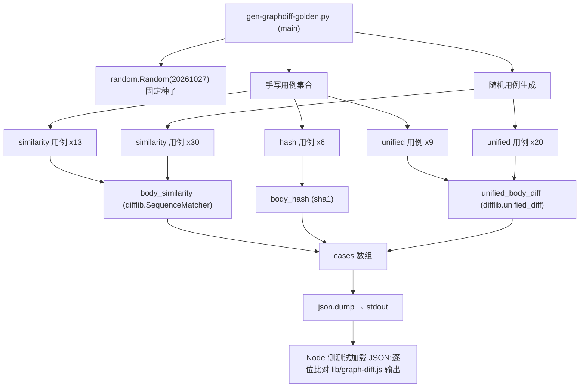
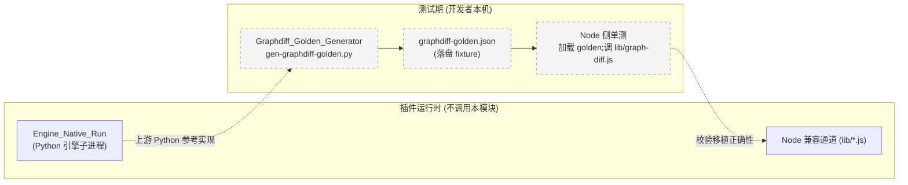

# Graphdiff Golden Generator

## 概述

`Graphdiff_Golden_Generator` 是一个**纯测试夹具工具**，位于 `test-fixtures/gen-graphdiff-golden.py`。它的唯一职责是：用 Python 标准库（`difflib`）与 FSoft 原版函数实现，为"图差异"相关算法的 Node.js 移植版生成一份**对拍（golden）基准 JSON**，供 Node 侧测试逐位比对。

该模块**不参与插件运行时**：不被 `index.js`、不被引擎流水线、不被 UI 调用，只在开发/测试期由人工或测试脚本执行一次，产出期望值清单。

它存在的根本原因（见文件头 docstring）：

> `difflib.SequenceMatcher` 的匹配块算法有大量边界情形（空序列、重复 token、autojunk），靠肉眼核对不可信，必须用 Python 原版喂同一批输入产出期望值，再让 Node 侧比对。

---

## 核心组件

模块只导出一个入口：

| 组件 | 位置 | 职责 |
|------|------|------|
| `main()` | `test-fixtures/gen-graphdiff-golden.py::main` | 用固定种子的随机数生成器构造三类用例，调用 Python 参考实现计算期望值，序列化 JSON 到 stdout |

辅助函数（同文件内）：

| 函数 | 职责 |
|------|------|
| `normalize_body(text)` | 把连续空白折叠为单空格并去首尾空白 |
| `documented_source(code, docstring)` | 把 docstring 前置到 code 前（若 docstring 尚未包含在 code 中） |
| `body_hash(code, docstring)` | 对 `normalize_body(documented_source(...))` 做 SHA-1 |
| `_tokens(text)` | 用 `\w+|[^\w\s]` 切 token（与上游 tokenizer 对齐） |
| `body_similarity(a, b)` | 对 token 序列跑 `difflib.SequenceMatcher(autojunk=False).ratio()` |
| `unified_body_diff(old_lines, new_lines, label, n=2)` | 生成 unified diff 文本（`a/<label>` 与 `b/<label>`） |

---

## 用例分类（`main()` 产出的 JSON 数组）

`main()` 构造一个 `cases: list[dict]`，最后 `json.dump(cases, sys.stdout, ensure_ascii=False, indent=1)`。每个元素形如：

```json
{ "kind": "similarity" | "hash" | "unified", ...输入字段, "expected": ... }
```

### 1. `kind = "similarity"`（body 相似度）

字段：`a`, `b`, `expected`（`body_similarity(a, b)` 的返回值，0–1 浮点）。

输入来自两组：

- **手写 13 例**：空串对空串、单侧空串、完全相同、部分相同、代码行级差异（`sum += i` vs `sum += i * 2`）、重复 token（`dup dup dup dup` vs `dup dup`）、括号符号串（`{}[]()`）、中文注释相邻字符差异（`中文注释 abc` vs `中文注释 abd`）、多行空白折叠前后对比。
- **随机 30 例**：`rng = random.Random(20261027)`（固定种子，保证可复现），从字母表 `["a","b","c","d","(",")","+","1","2"]` 随机拼 1–25 个 token 的两段文本。

### 2. `kind = "hash"`（body 哈希）

字段：`code`, `docstring`, `expected`（`body_hash(code, docstring)` 的 SHA-1 hex）。

6 个手写用例覆盖：空 code + 空 doc、纯空白 code + 空 doc、code 与独立 docstring（应拼接）、code 自带 docstring（不重复拼接）、多字节中文、多行 code + 单行 doc。

### 3. `kind = "unified"`（unified diff 文本）

字段：`oldText`, `newText`, `label`, `expected`（`unified_body_diff(...)` 的完整字符串，含 `--- a/<label>` / `+++ b/<label>` / `@@ ... @@` hunk 头与行内容）。

- **手写 9 例**：双空、完全相同（无 diff 输出）、单行改动、短 old → 长 new（多 hunk）、中间夹改两行（`X`/`Y`）、纯删除、纯新增、无末尾换行（`no-trailing-newline` vs `no-trailing-newline-changed`）、`a\nb` vs `a\nb\n`（末尾换行边界）。
- **随机 20 例**：用 `L{0..5}\n` 随机拼 0–12 行的两段，label 固定为 `"r"`。

---

## 架构与数据流



### 运行方式

```bash
python test-fixtures/gen-graphdiff-golden.py > test-fixtures/graphdiff-golden.json
```

> 该命令在仓库内**无内置 npm script** 自动执行——它是一个开发者手动跑一次、把输出落盘为 fixture 后提交进 git 的工具。种子 `20261027` 写死在 `main()` 里，任何机器/任何 Python 3.x 版本产出的 JSON 逐字节一致（只要 `difflib` 算法本身不变）。

---

## 在系统中的定位



要点：

- 上游 Python 引擎（见 [Engine_Python_Entry](Engine_Python_Entry.md)、[Engine_Native_Run](Engine_Native_Run.md)）持有**唯一权威**的图差异实现（`body_similarity` / `body_hash` / `unified_diff` 的原始语义）。
- 本模块把这份权威语义"冻结"成 JSON，避免 Node 侧测试每次都要启动 Python venv 才能比对。
- 一旦 Node 侧 `lib/graph-diff.js` 与上游发生漂移（例如 tokenizer 正则不一致、`autojunk` 被意外开启、unified diff 的 `n=2` 上下文行数写错），Node 单测会立刻在具体某条用例上 fail。

---

## 设计取舍

| 决策 | 理由 |
|------|------|
| 固定随机种子 `20261027` | 让 fixture 文件可提交进 git；CI 上任何机器产出同一份 JSON，不存在"测试机上随机挂" |
| `autojunk=False` | Python 默认 `autojunk=True` 会对高频 token 做启发式跳过，导致大输入下 `ratio()` 不稳定；上游移植约定是关闭，必须显式对齐 |
| token 正则 `\w+|[^\w\s]` | 与上游 FSoft 的 tokenizer 逐字一致；`\w` 自带 Unicode 支持，所以中文注释用例（`中文注释 abc`）能跑通 |
| `unified_diff(n=2)` | 与上游默认 2 行上下文对齐；`n` 写错会导致 hunk 头 `@@ -x,y +a,b @@` 数字不一致 |
| 手写 + 随机混合 | 手写用例钉死边界（空、无末尾换行、纯增删），随机用例覆盖手写想不到的组合爆炸 |
| JSON 输出到 stdout（不落盘） | 让调用方决定保存路径与文件名；脚本本身零副作用 |

---

## 与其它模块的关系

- **不被运行时引用**：与 [Job_Orchestration](Job_Orchestration.md)、[Agentic_Host](Agentic_Host.md)、[Web_UI_Panel](Web_UI_Panel.md) 等运行时模块无调用关系。
- **语义对齐目标**：其校验对象是 `lib/graph-diff.js`（Node 侧移植，当前未列入模块树——属于"已退役但 fixture 仍保留"的历史产物）；上游参考实现来自 [Engine_Python_Entry](Engine_Python_Entry.md) 驱动的 FSoft Python 包。
- **同类工具**：与 [No-LLM_Graph_Probe](No-LLM_Graph_Probe.md) 同属 `tools/` / `test-fixtures/` 下的"离线探针/生成器"家族，都不进运行时。
- **环境依赖**：仅需 Python 3.x 标准库（`difflib`/`hashlib`/`json`/`random`/`re`/`sys`），**不依赖** [FSoft_Engine_Setup_Script](FSoft_Engine_Setup_Script.md) 装的 venv——故意只依赖 stdlib，让任何人 `python gen-graphdiff-golden.py` 都能跑，不需要先配好 FSoft 环境。

---

## 维护提示

- 若上游 FSoft 修改了 `body_similarity` / `body_hash` / `unified_diff` 的语义（例如改 tokenizer、改 `autojunk` 默认、改上下文行数），需要**同步更新本脚本并重跑 fixture**。
- 新增用例优先往"手写段"加——随机段只是稀释覆盖率，不能用来钉死某个具体 bug。
- 修改随机种子会让 30+20=50 条随机用例全部变化，fixture JSON 的 diff 会很大；提交前确认是有意为之。
