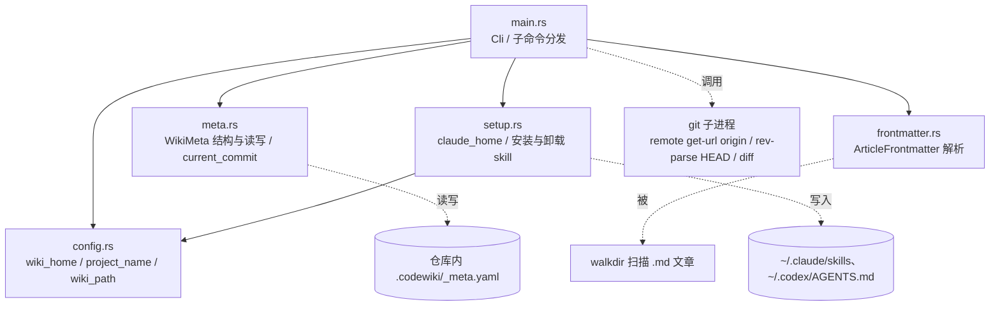
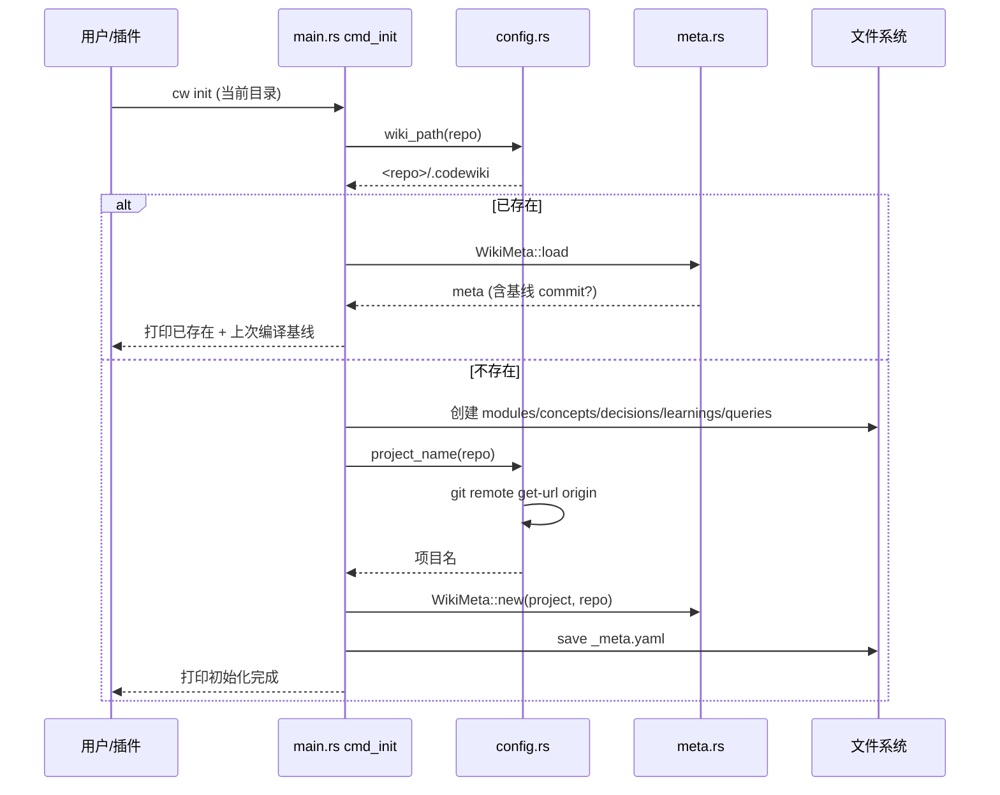
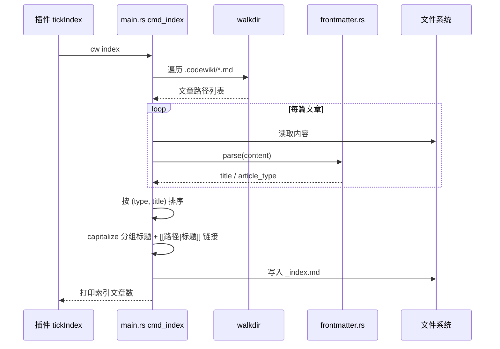
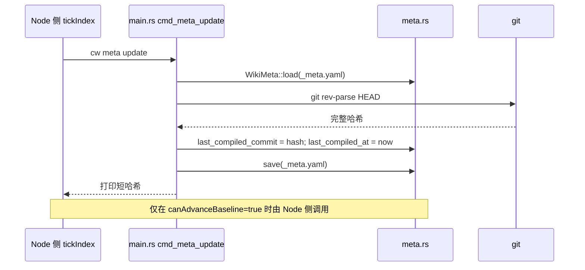
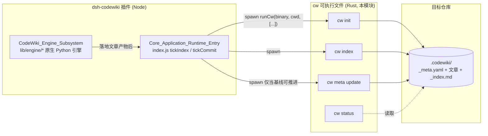

# Vendored CodeWiki Rust 实现（cw CLI）

## 简介

本模块是上游 CodeWiki 项目（`FSoft-AI4Code/CodeWiki`）Rust 命令行工具 **`cw`** 的一份 **vendored 副本**，源码位于 `vendor/codewiki/src/`，编译产物为可执行文件 `cw`（Windows 下为 `bin/cw.exe`）。

它不是插件编译流水线的主力引擎——真正的整篇 wiki 编译由 [CodeWiki_Engine_Subsystem](CodeWiki_Engine_Subsystem.md) 驱动 Python 原生引擎完成——而是一条**轻量、确定性、无 LLM 依赖**的基础设施通道，负责 wiki 的“骨架与元数据”层面的操作：

- 在仓库内初始化 wiki 目录结构与 `_meta.yaml`；
- 扫描全部文章 frontmatter 重建 `_index.md` 索引；
- 把当前 git 提交写回 `_meta.yaml`，推进“编译基线”；
- 对比基线提交与工作区 HEAD，列出变更文件与“过期文章”；
- 把 codewiki 的使用说明/skill 安装进 Claude Code、Codex，或注册到 QMD 检索。

插件在编译任务收尾阶段由 [Core_Application_Runtime_Entry](Core_Application_Runtime_Entry.md) 的 `tickIndex` 通过 spawn 子进程调用 `cw init` / `cw index` / `cw meta update`，见 `index.js` 中 `runCw(binary, cwd, [...])` 的调用点。

> **FORK 关键差异**：上游把每个项目的 wiki 放在 `~/.codewiki/<project>/`（用户目录下、脱离仓库）；本 fork 在 `config.rs::wiki_path` 中把 wiki 固定在 **仓库内** `<repo>/.codewiki/`，使 wiki 产物随代码一起版本控制、可被 `cw status` 与插件一起提交。这是理解本模块所有路径行为的前提。

---

## 架构与模块依赖

`cw` 的 Rust 源码按职责切分为 5 个模块，`main.rs` 作为入口聚合并分发子命令。



### 模块职责一览

| 模块 | 核心组件 | 职责 |
| --- | --- | --- |
| `main.rs` | `Cli`、`capitalize`、`main` | clap 命令行定义与子命令分发（init / status / meta / index / projects / path / setup / uninstall） |
| `config.rs` | `project_name` | 解析 `~/.codewiki` 根目录、项目名（git remote → 目录名回退）、仓库内 wiki 路径 |
| `meta.rs` | `WikiMeta` | `_meta.yaml` 的序列化/反序列化，及读取 HEAD 提交哈希 |
| `frontmatter.rs` | `ArticleFrontmatter` | 解析 markdown 文件顶部的 YAML frontmatter（title / type / source_files / tags） |
| `setup.rs` | `claude_home` | 把嵌入的 skill/说明安装到 Claude Code、Codex，并把 wiki 注册进 QMD |

---

## 核心组件详解

### `main.rs` — CLI 入口与子命令

`Cli`（`#[derive(Parser)]`）定义了二进制名 `cw`，其下挂一组 `Commands` 子命令：

| 子命令 | 处理函数 | 行为要点 |
| --- | --- | --- |
| `cw init` | `cmd_init` | 在 `<repo>/.codewiki` 下创建 `modules/ concepts/ decisions/ learnings/ queries/` 五个子目录，并写入 `_meta.yaml`；已存在时打印当前编译基线摘要，不重建 |
| `cw status` | `cmd_status` | 用 `git diff --name-only <基线>..HEAD` 列出变更文件；再扫描所有文章 frontmatter 的 `source_files`，凡有任一源文件变更即标为“过期文章” |
| `cw meta update` | `cmd_meta_update` | 读取当前 HEAD 哈希与时间，写入 `_meta.yaml` 的 `last_compiled_commit` / `last_compiled_at`，即推进编译基线 |
| `cw index` | `cmd_index` | 遍历 `.codewiki` 下所有 `.md`（跳过 `_` 开头文件），按 `type` 分组、按标题排序，重建 `_index.md`，产出 `[[路径|标题]]` 形式的 wiki 链接 |
| `cw projects` | `cmd_projects` | 扫描 `~/.codewiki/*/` 下含 `_meta.yaml` 的目录，列出全部 wiki 项目及其编译状态 |
| `cw path` | `cmd_path` | 仅打印当前仓库的 wiki 绝对路径 |
| `cw setup <target>` | `setup::setup_*` | 安装到 Claude Code / Codex / QMD |
| `cw uninstall <target>` | `setup::uninstall_*` | 从 Claude Code / Codex 移除 |

两个值得注意的内部辅助：

- `capitalize(s)`：把文章类型（如 `module`）首字母大写，用于 `_index.md` 的 `## Module` 分组标题。
- `rel_path_string(rel)`：把 `Path::display()` 的输出中的 `\` 统一替换为 `/`。这是一处 **FORK FIX**——Windows 上 `Path` 会输出反斜杠，会污染“过期文章列表”和 `_index.md` 里的 `[[...]]` 链接；而其余系统（frontmatter `source_files`、Node 侧插件解析）一律使用 `/`。

### `config.rs` — 路径与项目名解析

- `wiki_home()`：返回 `~/.codewiki/`（仅用于 `cw projects` 列项目，以及 `setup qmd` 注册检索集合）。
- `wiki_path(repo_path)`：**FORK 行为** —— 返回 `<repo>/.codewiki`，而非上游的 `~/.codewiki/<project>`。注释中明确写了这是“in-repo; FORK MOD”。
- `project_name(repo_path)`：先跑 `git remote get-url origin`，取 URL 最后一段并去掉 `.git` 后缀；失败时回退为仓库目录名。用于 `_meta.yaml` 的 `project` 字段。

### `meta.rs` — `WikiMeta` 元数据

`WikiMeta` 是 `_meta.yaml` 的强类型结构：

```yaml
project: <项目名>
repo_path: <仓库绝对路径>
last_compiled_commit: <完整 40 位哈希 或 null>
last_compiled_at: <UTC 时间 或 null>
created_at: <UTC 时间>
```

- `WikiMeta::new / load / save`：YAML 序列化（基于 `serde_yaml`）。
- `current_commit(repo_path)`：跑 `git rev-parse HEAD` 取完整哈希。

> 插件侧约定：`last_compiled_commit` 是 **增量编译基线**。`tickIndex` 中只有当“完整性判定成立（`canAdvanceBaseline`）”才允许调用 `cw meta update` 推进基线；`partial` / `failed` 时索引照建、但基线绝不前移，避免把“未消化的变化”误标为已编译。

### `frontmatter.rs` — 文章 frontmatter 解析

`ArticleFrontmatter` 对应每篇 wiki 文章顶部的 YAML 块：

```yaml
---
title: Module Name
type: module          # 被 serde 重命名为 article_type
source_files:
  - path/to/file
tags: [relevant, tags]
---
```

`parse(content)`：仅当内容以 `---` 开头且能找到结束的 `\n---` 时才解析，否则返回 `None`。`source_files` 字段是 `cw status` 判定文章是否过期的依据，也是文章写作侧必须写回的契约字段（见 [Agentic_Article_Processing_Library](Agentic_Article_Processing_Library.md) 中文章生成产物的一致性要求）。

### `setup.rs` — agent 工具接入

- `claude_home()`：返回 `~/.claude`。
- 嵌入的 `SKILL_MD`（`include_str!("../skills/codewiki-session.md")`）在 `cw setup claude-code` 时写入 `~/.claude/skills/codewiki/SKILL.md`。
- `cw setup codex` 把一段 `CODEX_AGENTS_SECTION`（会话开始强制 `cw status`、工作中先读 wiki、结束时回写文章并 `cw index` + `cw meta update`）追加到 `~/.codex/AGENTS.md`，幂等（已含 `## CodeWiki` 则跳过）。
- `cw setup qmd` 调用外部 `qmd collection add` / `qmd embed`，把 `~/.codewiki` 注册为向量检索集合 `codewiki`。
- `uninstall_*` 做反向清理；Codex 卸载用 `remove_section` 按 `## ` 头部边界精确摘除 CodeWiki 段落。

---

## 命令流程（序列图）

### `cw init` 初始化 wiki



### `cw index` 重建索引



### `cw meta update` 推进基线



---

## 在系统中的位置与集成



集成要点：

1. **二进制定位**：配置项 `binaryPath`（见 `cordis.patch.yml`）显式指定 `cw` 路径；留空时按 `PATH` 查找，最后回落到插件自带的 `bin/cw.exe`。因此本模块编译出的可执行文件必须随包分发到该位置。
2. **调用边界极窄**：Node 侧只通过退出码判定成败（`runCw(...).exitCode === 0`），stdout 文本只用于日志/提醒，不做结构化解析。这保证 `cw` 的输出格式变化不会反过来耦合插件。
3. **基线闸门在 Node 侧**：`cw meta update` 本身不判断“是否该推进”，它只是无脑写入当前 HEAD。是否调用它由 `tickIndex` 的 `judgeOutcome`（`canAdvanceBaseline`）决定——这是 [Core_Application_Runtime_Entry](Core_Application_Runtime_Entry.md) 的职责，不在本模块内。
4. **骨架缺失兜底**：当仓库连 `.codewiki/` 目录都没有时，`tickIndex` 会先 `cw init` 建骨架；但当“目录在却缺 `_meta.yaml`”（人工删改的半截状态）时，插件**拒绝**自动补写，直接记 `wiki-missing` 阻塞，要求人工处理——与原生落地器 `lib/engine/apply-plan.js` 的判据保持一致。
5. **文章契约共享**：`cw status` 与 `cw index` 依赖的 frontmatter（`title` / `type` / `source_files`）正是 [Agentic_Article_Processing_Library](Agentic_Article_Processing_Library.md) 与 Python 引擎落地文章时必须遵守的格式。本模块的 `frontmatter.rs::ArticleFrontmatter` 是这份契约的 Rust 侧镜像。

---

## 关键设计与 Fork 决策汇总

| 决策 | 位置 | 原因 |
| --- | --- | --- |
| wiki 放在仓库内 `<repo>/.codewiki` 而非 `~/.codewiki/<project>` | `config.rs::wiki_path` | 让 wiki 产物随代码版本控制、可被插件自动提交 |
| Windows 路径反斜杠统一为 `/` | `main.rs::rel_path_string` | 避免污染 `_index.md` 的 `[[...]]` 链接与过期文章列表（其它侧一律 `/`） |
| 基线推进只写入、不裁决 | `meta.rs` + Node `tickIndex` | “是否算编译完成”是完整性问题，由 Node 侧的 `judgeOutcome` 统一判定，`cw` 保持无状态 |
| `cw status` 过期判定只看 `source_files` | `cmd_status` | 文章必须显式声明其源文件，否则无法做增量失效检测 |
| setup 操作幂等 | `setup.rs::setup_codex` / `setup_claude_code` | 重复执行不产生重复段落或报错 |
| 项目名解析优先用 git remote | `config.rs::project_name` | 避免仓库本地目录名变化导致 `_meta.yaml` 的 `project` 漂移 |

---

## 相关模块

- [Core_Application_Runtime_Entry](Core_Application_Runtime_Entry.md) — 调用 `cw init/index/meta` 的插件主循环（`tickIndex` / `tickCommit`）。
- [CodeWiki_Engine_Subsystem](CodeWiki_Engine_Subsystem.md) — 真正执行整篇 wiki 编译的原生 Python 引擎子系统；本模块只做其“骨架收尾”。
- [Wiki_Content_Health_Scanning___Plan_Application](CodeWiki_Engine_Subsystem/Wiki_Content_Health_Scanning___Plan_Application.md) — 与 `cw status` 对应的 Node 侧健康扫描与产物落地。
- [Agentic_Article_Processing_Library](Agentic_Article_Processing_Library.md) — 文章写作库，其产出的 frontmatter 契约被本模块 `frontmatter.rs` 消费。
- [Build,_Configuration___Environment_Setup](Build,_Configuration___Environment_Setup.md) — `binaryPath` 等配置与插件打包说明。
