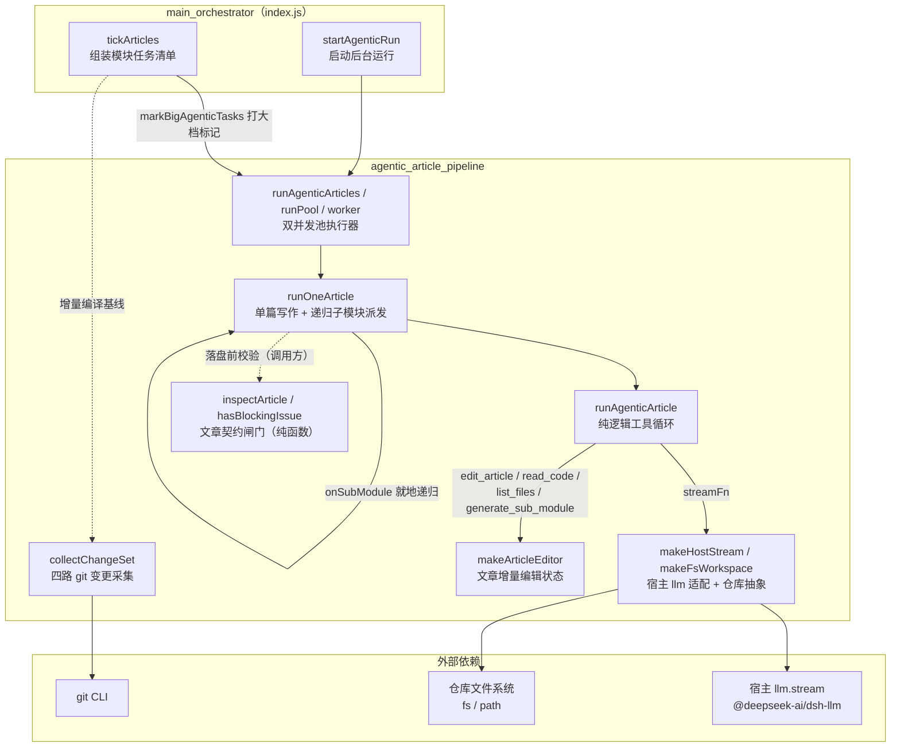
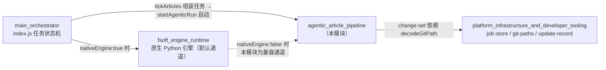
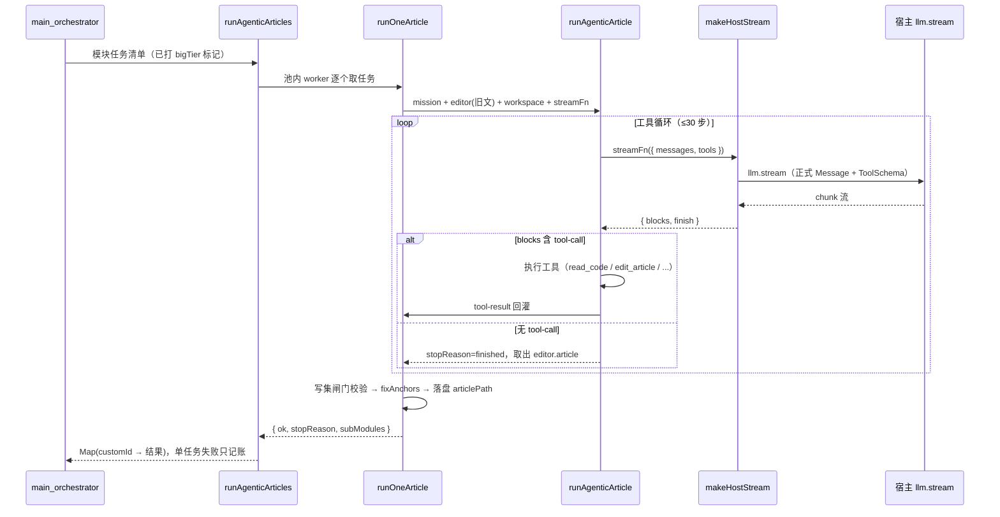

# agentic_article_pipeline（Agentic 文章写作管道）

## 概述

`agentic_article_pipeline` 是 CodeWiki 插件的**第二条文章生成执行通道**（agentic 通道），与 `index.js` 中的单轮通道（把源码整包塞进 prompt、模型一次吐出全文）并列。它吸收自上游 `FSoft-AI4Code/CodeWiki` 的 module agent 设计：不再把所有源码塞进一次 prompt 求一篇文章，而是给模型一个**可反复读代码、可对文章做精确编辑、可把子模块拆给子任务的工作台**——行号、签名这类硬事实可以现场核对，而不是靠一次性读进上下文后猜。

本模块由 5 个文件组成，职责切分清晰：

| 文件 | 职责 |
| --- | --- |
| `lib/agentic.js` | 纯逻辑的 agentic 工具循环本体：工具定义、工具实现、步数循环、参数解析 |
| `lib/agentic-host.js` | 宿主适配层：把裸消息形态转成宿主 `llm.stream` 要求的正式 Message，把 chunk 流收成 blocks，并提供仓库文件系统抽象 |
| `lib/articles-agentic.js` | 执行器：把「模块任务清单」跑成文章（含递归子模块派发、双并发池、大档选路） |
| `lib/article-contract.js` | 文章契约闸门：纯函数判定一篇 wiki 文章的最低结构，统一在这里判 |
| `lib/change-set.js` | 变更采集：把 committed / staged / unstaged / untracked 四路 git 改动收成一个规范化 ChangeSet |

## 架构总览



## 核心机制

### 1. 工具循环（`lib/agentic.js`）

循环写成**纯逻辑 + 注入 `streamFn` / 工具实现**，不绑死 pydantic-ai，也不绑死宿主 llm 服务，因此可完全离线测试。契约为：

```
runAgenticArticle({ mission, workspace, streamFn, tools?, maxSteps })
  -> { article, steps: [...], usedTools: [...], stopReason }
```

给模型的 4 个 JSON Schema 工具：

| 工具 | 作用 |
| --- | --- |
| `read_code` | 按组件路径读源码（可带行范围），行号以返回的「行号\| 」前缀为准 |
| `list_files` | 列出目录树（隐藏 node_modules / .git / dist 等依赖与构建目录） |
| `edit_article` | 对当前文章做精确编辑：`view` / `str_replace` / `insert` |
| `generate_sub_module` | 把可独立成篇的子模块委派出去单独写作 |

循环内置的若干「防模型自伤」措施（均来自实跑教训）：

- **重复读抑制**：同一 `(path, 起始行, 结束行)` 再读不再回吐正文，只回一句「你已在第 N 步读过这段」——真实模型曾在 45 步里把同一个 `index.js` 读了 13 次，步数全耗在读码上。
- **读量上限**：单次 `read_code` 限 2000 行 / 40000 字符（压缩产物单行 20 万字符的文件一次就能回吐 5.7 万 token）。
- **JSON 三级解析**：原样 → 剥 ```` ```json ```` 围栏 → 截取首个括号平衡的 `{...}`；坏参数不中断，回灌成工具警告让模型自己改。
- **CRLF 行尾归一**：`str_replace` 匹配两侧统一成 `\n`，命中后按原文风格写回——真实仓库 `core.autocrlf=true`，不做归一模型永远匹配不上。
- **越界路径防护**：`safeRelPath` 拒绝绝对路径、盘符路径与 `../` 逃逸。

### 2. 宿主适配层（`lib/agentic-host.js`）

`lib/agentic.js` 消费 `{role, content}` 裸消息、只认 blocks；而宿主 `llm.stream` 要求带 `id + source` 的正式 Message（`createUserMessage` / `createAssistantMessage` / `createToolResultMessage`）。这层做三件事：

1. **裸消息 → 正式消息**：用 `WeakMap` 缓存消息身份（MessageId 必须跨表示边界稳定），工具角色一条多结果的消息展开成多条 `ToolResultMessage`。
2. **chunk 流 → blocks**：用 `BlockAssembler` 收成结构化 blocks，失败/中止态抛错。
3. **仓库抽象**：`makeFsWorkspace` 提供 `readFile / listDir`，并在真实路径上再兜一层 `absOf` 防符号链接逃逸。

### 3. 执行器与子模块递归（`lib/articles-agentic.js`）

- **`runOneArticle`**：单篇跑一次 agentic 循环并落盘。已有旧文作为初始内容交给 editor，模型用 `str_replace` 增量改而不是从零重写。
- **子模块派发**：模型在写父模块时调 `generate_sub_module`，执行器**就地递归**再跑一次 `runOneArticle` 写 `modules/<父>/<子>.md`。递归深度封顶 `subDepth`（默认 2）；到顶时把原因 `subModuleBlocked='max-depth'` 透传给工具层，让工具对模型说实话（「那个文件不会存在，请在本文里写成普通小节」），避免父文留下永远生成不了的死链。
- **写集闸门**：`allowedWritePaths` 限制父任务只能写自己那篇、子模块只能写调度器分配的路径；越界一律不落盘并记 `write-set` 违例。
- **双并发池**：`bigTier` 任务（大上下文模型）走 `bigConcurrency`，其余走 `concurrency`，两池独立限流同时推进——大档常是付费长上下文，与免费默认档配额互不相干。
- **大档选路**：`markBigAgenticTasks` 按模块源文本量（`sourceTokensOf`，CJK 按 1、其余按 3.5 字符/token 估算）给超大模块打 `bigTier` 标记。

### 4. 文章契约闸门（`lib/article-contract.js`）

纯函数模块（不碰文件系统，可单测），统一判定一篇 wiki 文章的最低结构。问题分两级：

- **error（硬拒写）**：frontmatter 缺失/未闭合/重复贴头、缺必填字段、type 与目录不匹配、`source_files` 指向不存在的文件或不是本次读取的证据、正文为空、必需章节空着、代码围栏未闭合、死链、重复章节。
- **warning（放行但记账）**：缺必需章节标题、非必需章节空着——让编译终态降为 `partial` 并阻止基线前移。

关键判据细节：链接与「重复 frontmatter」检测前先用 `stripCode` 把围栏块与行内代码替换成**等长**占位（文章里常拿 `[[target]]` / `---` 当示例来讲，不跳过会把刚写好的文章误判成坏文章）；YAML 双引号标量优先用 `JSON.parse` 还原转义。

### 5. 变更采集（`lib/change-set.js`）

修复的背景缺陷：旧 `cw status` 只跑 `git diff <last>..HEAD`，于是**改完没提交 / 只暂存 / 新建未跟踪**三类改动对它完全隐形——「改完代码就编译」会把未消化的变化当成已消化，基线被前移，文章与源码脱节却一路绿到底。

本模块把 committed / staged / unstaged / untracked 四路改动（`-M` 打开改名检测）收成一个规范化 ChangeSet，`.codewiki/` 产物目录一律剔除。任何采不全的情形（无基线、非 git 仓库、基线被 rebase/GC 掉、git 命令失败）都明确暴露 `state + fallback='full'`，让调用方退回全量编译——**绝不假装 clean**。

## 与系统其他模块的关系



- **上游**：[main_orchestrator](main_orchestrator.md)（`index.js`）的任务状态机在 `tickArticles` 阶段组装模块任务清单、按源文本量打大档标记，再经 `startAgenticRun` 调 `runAgenticArticles` 启动本模块。
- **平级**：自 0.16.0 起默认通道是 [fsoft_engine_runtime](fsoft_engine_js_core.md)（驱动上游 Python 引擎子进程）；本模块是插件内 Node 侧兼容通道（`nativeEngine: false`），两条通道并存。
- **依赖**：[platform_infrastructure_and_developer_tooling](job_repository_infrastructure.md) 的 `decodeGitPath` 被 `change-set.js` 用来还原 git quotepath 转义的非 ASCII 路径。

## 核心组件清单

### `lib/agentic.js` — 工具循环本体

| 组件 | 职责 |
| --- | --- |
| `TOOL_SCHEMAS` | 4 个工具的 JSON Schema 定义（`read_code` / `list_files` / `edit_article` / `generate_sub_module`） |
| `runAgenticArticle(opts)` | 循环本体：反复调 `streamFn` 拿 assistant blocks → 执行其中的 `tool-call` → 结果回灌为 `tool-result`，直到无工具调用（`finished`）、步数耗尽（`max-steps`）、中止（`aborted`）或流错误（`stream-error`） |
| `makeReadCodeTool(workspace, { seen, getStep })` | 带「重复读抑制」的读码工具：同一行范围二次读只回提示；限 2000 行 / 40000 字符 |
| `makeListFilesTool(workspace)` | 目录列举工具，过滤依赖与构建目录（`node_modules` / `.git` / `dist` / `vendor` 等） |
| `makeArticleEditor(initial)` | 文章编辑状态机（`view` / `str_replace` / `insert`），CRLF 行尾归一，返回 `{ edit, get article, set article }` |
| `buildToolset({ workspace, editor, onSubModule, getStep, subModuleBlocked })` | 把 4 个工具装配成调度表；子模块不可用时按 `max-depth` / `unsupported` 分别给模型可行动的指示 |
| `parseToolArgs` / `stripJsonFence` / `sliceBalancedObject` | 工具参数的三级容错 JSON 解析 |
| `buildOpeningPrompt(...)` | 开场提示词：任务、工具清单、六步工作法、拆分准则与硬要求（不许编造文件/行号） |
| `numberLines` / `safeRelPath` | 行号前缀格式化；相对路径越界防护 |
| `DEFAULT_MAX_STEPS` | 单篇默认步数上限（= 30），全仓库唯一定义点 |

### `lib/agentic-host.js` — 宿主适配层

| 组件 | 职责 |
| --- | --- |
| `toRequestMessages(messages, { provider, model })` | 裸消息 → 宿主正式 Message；`WeakMap` 缓存身份，工具结果一拆多 |
| `makeHostStream({ llm, provider, model, reasoningEffort, onDelta, onFinish })` | 建一个交给 `runAgenticArticle` 的 `streamFn`：`BlockAssembler` 收成 blocks，错误/中止抛错 |
| `makeFsWorkspace(fs, path, cwd)` | 仓库文件系统抽象（`readFile` / `listDir`）；`absOf` 保证真实路径不逃逸出 cwd |

### `lib/articles-agentic.js` — 执行器

| 组件 | 职责 |
| --- | --- |
| `runOneArticle(task, opts)` | 单篇写作 + 落盘：装配 editor / workspace / writeSet / streamFn，就地递归派发子模块（`subDepth` 封顶默认 2），写集越界返回 `stopReason='write-set'` |
| `runAgenticArticles(tasks, opts)` | 并发池入口：按 `bigTier` 拆默认档池与大档池，各自独立限流（内部 `runPool` / `worker` 协程），返回 `Map(customId → 结果)` |
| `sourceTokensOf(task, cwd)` | 模块源文本量近似 token 数（CJK 按 1、其余按 3.5 字符/token） |
| `resolveTaskRoute(task, opts)` | 单任务选路：任务自带 provider+model 时以任务为准，否则回落默认档 |
| `markBigAgenticTasks(tasks, { bigTier, sizeOf })` | 按源文本量超 `budget` 的任务打 `bigTier` 标记（换大上下文模型） |

### `lib/article-contract.js` — 契约闸门

| 组件 | 职责 |
| --- | --- |
| `inspectArticle(content, opts)` | 主入口：返回 `issues[]`（空数组 = 通过），含 frontmatter 解析、字段/章节/链接/围栏全套判据 |
| `hasBlockingIssue(issues)` | 是否存在 error 级问题（硬拒写分界） |
| `issueSummary(issues)` | 把 issues 压成一行人类可读文案（null 表示通过） |
| `parseFrontmatter` / `parseYamlLite` / `unquote` | 文首 `---` 块解析；极简 YAML（含双引号标量的 JSON 转义还原） |
| `extractSections` / `fencesBalanced` | 正文 `## 标题` 章节抽取；代码围栏成对性检查 |
| `collectWikiLinks` / `stripCode` | 收集 `[[target]]` 与 `.md` 链接目标；围栏块与行内代码的等长占位（等长是下游链接改写的硬契约） |
| `hasDuplicateFrontmatter` | 正文里是否又贴了一份 frontmatter（围栏内示例除外） |
| `makeWriteSet` / `normalizeWritePath` / `isWritable` | 写入路径白名单：规范化 POSIX 路径比对，防 `../` 越界 |

### `lib/change-set.js` — 变更采集

| 组件 | 职责 |
| --- | --- |
| `collectChangeSet(cwd, baseCommit, opts)` | 主入口：committed / staged / unstaged / untracked 四路采集并分类去重；采不全时返回 `state + fallback='full'`，调用方退回全量编译 |
| `parseNameStatus(out)` | `git diff --name-status` 输出解析（R/C 改名复制、D 删除），每条路径过 `decodeGitPath` 还原 quotepath 转义 |
| `normChangePath(p)` | 路径归一（反斜杠转 POSIX、去 `./` 前缀），越界路径直接丢弃 |
| `isWikiProduct(relPath)` | 是否 wiki 产物目录（`.codewiki/` 前缀），从变更集里剔除 |

## 数据流


