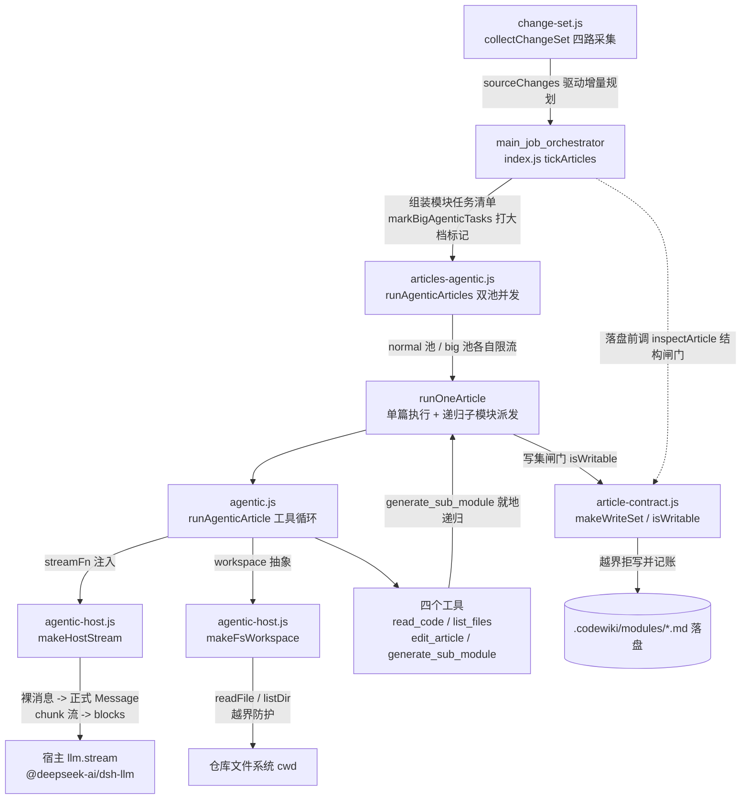
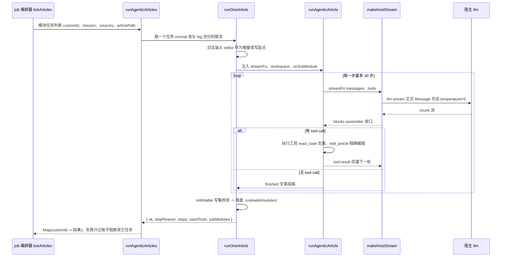

# Agentic 文章写作工作流（agentic_article_workflow）

## 模块简介与用途

本模块是 CodeWiki 插件中「agentic 文章写作」通道的全部核心逻辑，吸收自上游 FSoft-AI4Code/CodeWiki 的 module agent 思路。它与 index.js 里的单轮通道（一次性把源码内联进 prompt、模型吐出全文）并列，是第二条、也是 0.17.5 之后模块文章的默认执行通道。

核心价值主张：**不把所有源码塞进一次 prompt 求一篇文章**，而是给模型一个可反复读代码、可对文章做精确编辑、可把大模块拆给子任务的工作台——行号、函数签名这类硬事实可以现场核对，而不是靠一次性读进上下文后猜。

模块按职责分为五个文件、四层结构：

| 文件 | 职责层 | 核心导出 |
| --- | --- | --- |
| `lib/agentic.js` | 纯逻辑工具循环 | `runAgenticArticle`、`TOOL_SCHEMAS`、`makeReadCodeTool`、`makeArticleEditor`、`buildOpeningPrompt`、`DEFAULT_MAX_STEPS` |
| `lib/agentic-host.js` | 宿主适配层 | `makeHostStream`、`toRequestMessages`、`makeFsWorkspace` |
| `lib/articles-agentic.js` | 执行调度层 | `runAgenticArticles`（双池并发）、`runOneArticle`（单篇+递归派发）、`markBigAgenticTasks`、`sourceTokensOf`、`resolveTaskRoute` |
| `lib/article-contract.js` | 质量闸门层 | `inspectArticle`、`hasBlockingIssue`、`issueSummary`、`makeWriteSet`、`isWritable` |
| `lib/change-set.js` | 变更采集层 | `collectChangeSet`、`parseNameStatus`、`isWikiProduct`、`normChangePath` |

设计上一个关键约束是**可离线测试**：`agentic.js` 是纯逻辑，只消费 `{role, content}` 裸消息与注入的 `streamFn`/`workspace`，不绑死 pydantic-ai、也不绑死宿主的 `llm.stream`；所有与宿主形态相关的转换都被隔离在 `agentic-host.js`。

## 架构总览



### 一次写作的数据流



## 各文件核心组件详解

### 工具循环与宿主适配：`lib/agentic.js` + `lib/agentic-host.js`

**`runAgenticArticle(opts)`** 是循环本体，契约为 `runAgenticArticle({ mission, workspace, streamFn, tools?, maxSteps }) -> { article, steps, usedTools, stopReason, messages }`。每步调用注入的 `streamFn({ messages, tools, signal })` 取回一条 assistant 消息的 blocks；若无 tool-call 则视为 `finished`（模型认为写完了），有 tool-call 则执行后把 tool-result 回灌继续。`stopReason` 取值：`finished` / `max-steps` / `aborted` / `stream-error` / `empty-response`。`DEFAULT_MAX_STEPS = 30` 是步数上限的唯一定义点，`articles-agentic.js` 与 index.js 都从这里导入。

**四件工具**（`TOOL_SCHEMAS` 声明 + `buildToolset` 装配）：

- `read_code`（`makeReadCodeTool`）：按仓库相对路径读源码片段，返回带「行号| 」前缀的正文（`numberLines`）。两道硬上限：`MAX_READ_LINES = 2000` 行、`MAX_READ_CHARS = 40000` 字符（后者专挡单行 20 万字符的压缩产物）。核心防劣化设计是**重复读抑制**：按 `(path, 起始行, 结束行)` 记账，再读同一段只回「你已在第 N 步读过这段」——实跑发现模型会把同一文件读 13 次、步数全耗在读码上。
- `list_files`（`makeListFilesTool`）：列目录，自动屏蔽 `node_modules`/`.git`/`dist`/`vendor` 等 `IGNORED_DIRS`，避免模型把依赖当源码探索白烧步数。
- `edit_article`（`makeArticleEditor`）：文章状态在闭包里，三命令 `view` / `str_replace` / `insert`。两个真实仓库踩坑后的细节：①CRLF 行尾归一化——匹配前两侧统一成 `\n`、命中后按原文风格写回，否则模型按 view 输出写的 `\n` 永远匹配不上仓库里的 `\r\n`；②负数行号直接报错，不被 `Math.max(0,...)` 静默吞成「插到最前」。
- `generate_sub_module`：把大模块的一块子能力委派出去单独成文。**不支持递归或到达深度上限时必须回 `isError` 并指示模型写成普通章节**——此前笼统回「已派发」导致父文留下指向从未生成文件的死链。

**参数鲁棒性**：`parseToolArgs` 三级递进（原样 → `stripJsonFence` 剥 ```json 围栏 → `sliceBalancedObject` 截首个括号平衡的对象），坏参数不中断循环，而是当成工具结果回灌让模型自己改。

**宿主适配层**（`agentic-host.js`）：解决两套消息形态的差异。`toRequestMessages` 把裸 `{role, content}` 消息转成宿主 `@deepseek-ai/dsh-llm` 的正式 Message（`createUserMessage`/`createAssistantMessage`/`createToolResultMessage`），并用 `WeakMap` 缓存稳定身份（宿主要求 MessageId 在各表示边界间保持稳定）；一条 tool 消息装多条结果时展开成多条 ToolResultMessage。`makeHostStream` 建好 `streamFn`：用 `BlockAssembler` 把 chunk 流收成 blocks，`finish` 为 error/aborted 时抛错，`temperature: 0`。`makeFsWorkspace` 提供 `{readFile, listDir}` 抽象，`absOf` 兜底真实路径越界防护（resolve 后必须落在 cwd 内）。

### 并发执行与子模块派发：`lib/articles-agentic.js`

**`runOneArticle(task, opts)`** 单篇跑一次 agentic 循环并落盘：

- 已有旧文（`task.prevArticlePath`）装入 editor 作为初始内容，模型用 `str_replace` **增量改**而不是从零重写；
- 子模块派发 `dispatchSub`：模型调 `generate_sub_module` 时就地递归跑 `runOneArticle`，子文章落在 `<wiki>/modules/<父 slug>/<子 slug>.md`；递归深度封顶 `subDepth`（默认 2），判定点在本层 `_depth >= subDepth`，子层重建自己的 `onSubModule`（绑定自己的深度）；子模块名全局去重（重名加父模块前缀，仍重则跳过）；
- 写集闸门：`allowedWritePaths` 编译成 `writeSet`，落盘前 `isWritable` 校验，越界返回 `stopReason: 'write-set'` + `writeSetViolation`，**不静默写也不静默丢**；
- 空文章落盘前兜底判失败（`empty-article`），避免空文件覆盖旧文。

**`runAgenticArticles(tasks, opts)`** 并发池（导出的 `runPool`/`worker` 即其内部实现）：与单轮通道同形状返回 `Map(customId -> 结果)`。**双池设计**：带 `bigTier` 标记的任务走大档池（`bigConcurrency`，付费长上下文），其余走默认档池（`concurrency`），两池独立限流、同时推进，配额互不干扰。`resolveTaskRoute` 让大档任务自带 provider/model/reasoningEffort，不回落默认档。`onTaskDone` 回调按步数粗估 outputTokens 记账。

**`markBigAgenticTasks(tasks, { bigTier })`**：agentic 通道不装填源码，所以用「模块源文本量」（`sourceTokensOf`，CJK 按 1、其余按 3.5 字符/token，与 index.js `estimateTokens` 同口径）等价判大档——模块大到普通上下文读不完就换大上下文档。

### 文章契约闸门：`lib/article-contract.js`

纯函数（不碰文件系统，可单测），主入口 `inspectArticle(content, opts)` 返回 `issues[]`，空数组 = 通过。这是对旧闸门的审计修复：旧版只查 frontmatter 有没有开头闭合，于是重复贴头、空章节、死链、围栏未闭合都能入库。判据：

- **结构解析**：`parseFrontmatter`（文首第一个 `---` 块 + 极简 `parseYamlLite`，双引号标量优先 `JSON.parse` 还原转义）、`extractSections`（跳过代码围栏收集 `## ` 章节）、`fencesBalanced`；
- **判项**：必填字段 `title/type/source_files/tags`、type 与目录匹配（`TYPE_BY_DIR`）、`source_files` 格式/存在性/**证据校验**（格式只按仓库相对路径守卫——拒绝绝对路径、Windows 盘符、`../` 上跳与尾部斜杠，**不再按「有无扩展名」判目录**：`Dockerfile`/`Makefile`/`LICENSE` 这类无扩展名文件是合法条目；存在性与证据校验要求必须是本次实际读给模型的文件子集，`source-not-evidence`）、重复 frontmatter（`hasDuplicateFrontmatter`，跳过围栏内的 `---` 示例）、死链（`collectWikiLinks`，先用 `stripCode` 把围栏块与行内代码等长替换——等长是硬契约，供 `rewritePageLinks` 偏移回原文）；
- **两级严重度**（`SEVERITY`）：`error` = 结构已破坏必须拒写（`hasBlockingIssue` 判据）；`warning` = 内容不达标但结构完整，放行但让编译终态降为 partial、阻止基线前移。
- 通道适配：原生引擎通道可传 `requiredSections=[]`（它的章节名不是本仓库的 `## Overview`）与 `allowEmptySourceFiles=true`（whole-repo 模式下 source_files 为空是诚实记录），默认值对既有通道行为不变。
- `issueSummary(issues)` 把问题压成一行人类可读文案（null = 通过）。写集闸门 `makeWriteSet`/`isWritable`/`normalizeWritePath` 也在本文件，供执行层复用。

### 变更集采集：`lib/change-set.js`

**`collectChangeSet(cwd, baseCommit, opts)`** 把一次编译要「看见」的全部改动收成规范化 ChangeSet（导出的 `collect` 即此入口；注入 `execFile` 便于离线单测）。修复的背景缺陷：旧 `cw status` 只跑 `git diff <基线>..HEAD`，未提交/暂存未提交/未跟踪三类改动完全隐形，导致「改完代码就编译」把未消化变化当已消化。

- **四路采集**：committed（`base..HEAD`）、staged（`--cached HEAD`）、unstaged（工作区）、untracked（`ls-files --others`），均带 `-M` 改名检测；
- **路径处理**：`parseNameStatus` 解析 name-status 输出（R/C 改名复制成对路径），每条过 `decodeGitPath` 还原 git quotepath 的非 ASCII 八进制转义；`normChangePath` 丢弃越界路径；`isWikiProduct` 把 `.codewiki/` 产物从源码变更中剔除（否则增量永远 dirty）；
- **采不全绝不假装 clean**：无基线 / 非 git 仓库 / git 命令出错 / 基线被 rebase 或 GC 掉（`cat-file -e` 探可达性）四种情形一律返回 `ok: false, fallback: 'full', state, reason`，调用方据此退回全量编译。

## 与其它模块的关系

- **[main_job_orchestrator](main_job_orchestrator.md)**：本模块的直接驱动方。`tickArticles` 把规划出的模块清单映射成任务（`name`/`mission`/`sources`/`articlePath`/`prevArticlePath`），先经 `markBigAgenticTasks` 与 `sourceTokensOf` 打大档标记，再经 `startAgenticRun` 提交给 `runAgenticArticles`；返回的 `Map(customId -> 结果)` 由 `tally` 汇总记账，单篇失败不影响整体。
- **job_and_repository_infrastructure**：`lib/change-set.js` 通过 `decodeGitPath`/`decodeGitPaths`（见 [job_and_repository_infrastructure](job_and_repository_infrastructure.md)）还原 git 的非 ASCII 路径八进制转义；job-store/job-logs 负责本模块产出的任务结果与日志的持久化。
- **engine_runtime_and_codewiki_kernel**：原生引擎通道（默认通道）有自己的产物校验（`validateEngineResult`/`quality-gate`）；本模块的 `article-contract.js` 是 Node agentic 通道的对等闸门，两者判据独立配置（原生通道可传 `requiredSections=[]`、`allowEmptySourceFiles=true` 适配其产物形态）。
- **client_panel_ui**：执行期间的进度（已完成/总篇数、单篇步数、stopReason）通过 job 上的 `batchProgress`/`note` 暴露给侧栏面板展示。

## 关键设计决策速览

1. **纯逻辑与宿主隔离**：循环本体不 import 任何宿主 SDK，测试可注入假 `streamFn` 完全离线跑。
2. **重复读抑制**：真实模型实跑会反复读同一大文件（index.js 被读 13 次），工具侧按 `(path, start, end)` 记账，再读只回「你已在第 N 步读过」，省下的正是模型自己的上下文。
3. **死链防护**：`generate_sub_module` 在「不支持递归」或「到达深度上限」时必须对模型说实话（回 `isError` 并指示它写成普通章节），杜绝父文留下指向从未生成文件的链接。
4. **写集闸门**：模型有自由工具循环，但**能写哪些文件由调度器说了算**——父任务只准写自己那篇，子模块只准写分配给它的路径，越界拒写并记 `write-set` 原因。
5. **变更不丢**：`change-set` 采不全时绝不假装 clean，一律 `fallback='full'` 退回全量编译，防止「改完代码就编译」把未消化的变化当已消化。
