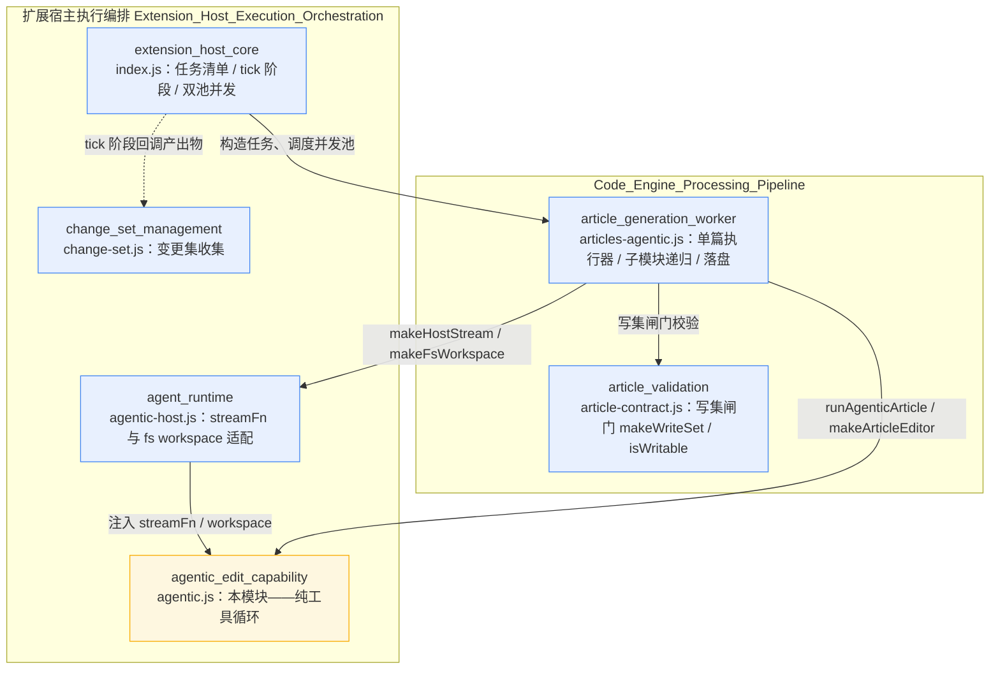
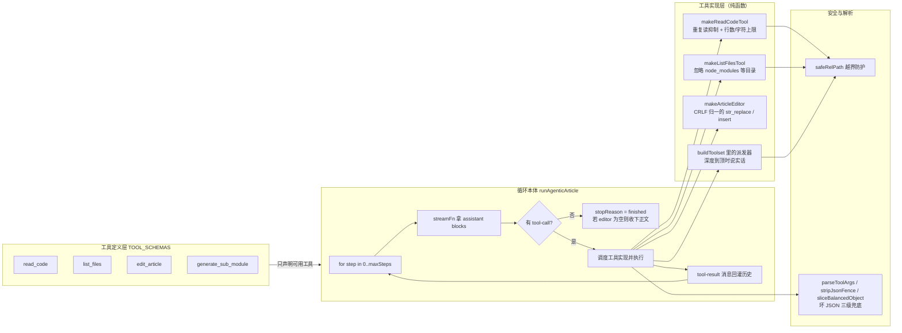
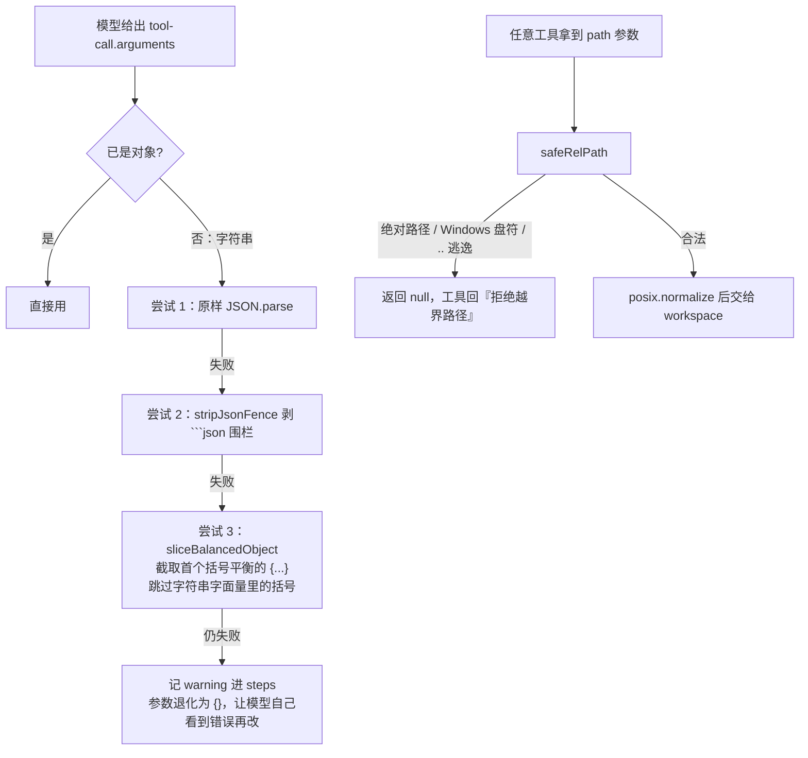

# agentic_edit_capability：Agentic 写作工具循环

## 概述

`agentic_edit_capability` 模块（对应 `lib/agentic.js`）是整个「agentic 文章写作通道」的**纯逻辑内核**。它实现了一个与具体 LLM 服务、具体文件系统解耦的「模型 ↔ 工具」循环：模型不是「把全部源码塞进一次 prompt 求一篇文章」，而是拿到一个可以反复读代码（`read_code`）、列目录（`list_files`）、对文章做精确编辑（`edit_article`）、把子模块委派出去（`generate_sub_module`）的工作台，边读边写、逐步成稿。

模块对应的上游原型是 FSoft-AI4Code/CodeWiki 的 `src/be/agent_tools/`（`read_code_components.py`、`str_replace_editor.py`、`generate_sub_module_documentations.py`）与 `documentation_generator.py` 里的 pydantic-ai 工具循环。本模块与上游的关键差异：

- **不绑死 pydantic-ai**：循环写成纯逻辑，通过注入 `streamFn`（任何返回消息 blocks 的函数）与工具实现，测试可完全离线跑通；
- **workspace 抽象**：工具不直接读盘，而是访问 `{ readFile, listDir }` 接口，便于在插件里接到任何 cwd、也便于测试注入假文件系统。

模块导出的核心契约：

```text
runAgenticArticle({ mission, workspace, streamFn, tools?, maxSteps })
  -> { article, steps: [...], usedTools: [...], stopReason, messages }
```

---

## 在系统中的位置

本模块是 `Extension_Host_Execution_Orchestration`（扩展宿主执行编排）下的子能力之一，处于「宿主适配层」与「编排层」之间的中间地带：



要点：

- **上游调用方**：[`article_generation_worker`](article_generation_worker.md)（`lib/articles-agentic.js`）把「模块任务清单」逐个跑成文章——它调用本模块的 `runAgenticArticle` 与 `makeArticleEditor`，并叠加子模块递归派发、写集闸门、落盘等生产语义；
- **宿主适配**：[`agent_runtime`](agent_runtime.md)（`lib/agentic-host.js`）把本模块的裸消息 / blocks 形态适配成宿主 `llm.stream` 需要的正式 Message，并提供真实文件系统 workspace；
- **入口调度**：[`extension_host_core`](extension_host_core.md)（`index.js`）负责生成模块任务清单、按阶段 tick 推进、管理并发池。

---

## 架构：工具循环的分层

`lib/agentic.js` 内部按职责分为四层：



---

## 工具清单与实现要点

### 1. `read_code` —— 按行范围读源码

- 通过 `workspace.readFile(rel)` 读取，返回行号格式为 `行号| 源码行`（与插件其余环节的 `numberLines` 格式一致），提示模型「引用代码位置时必须用返回行号，禁止自行推算」；
- **重复读抑制**：实跑发现模型会反复读同一大文件（探针里 `index.js` 被读 13 次），工具侧以 `(path, start_line, end_line)` 为键记账，命中后不再回吐正文，只回「你已在第 N 步读过这段」，省下模型自己的上下文；
- **双重截断上限**：`MAX_READ_LINES = 2000` 行 + `MAX_READ_CHARS = 40000` 字符。只限行数挡不住单行 20 万字符的压缩产物（一次回吐 5.7 万 token），字符上限专门兜这种情况；
- 重复读的 key 在「不带 `end_line`」与「显式写满全文」两种写法下视为同一段，防止模型换个参数再读一次。

### 2. `list_files` —— 列目录

- 通过 `workspace.listDir(rel, depth)` 列举，`depth` 被夹在 1–4 之间；
- 一律隐藏 `node_modules`、`.git`、`dist`、`build`、`.next`、`target`、`vendor`、`__pycache__`、`.venv`、`venv`（`IGNORED_DIRS`）——模型看到这些目录会当源码去探索，白烧步数。

### 3. `edit_article` —— 文章精确编辑（`makeArticleEditor`）

文章状态闭包在 `makeArticleEditor()` 返回的对象里，支持三种命令：

| 命令 | 语义 | 关键防护 |
| --- | --- | --- |
| `view` | 查看当前全文（带行号） | 空文章回「（文章当前为空）」 |
| `str_replace` | `old_str` 唯一匹配后替换为 `new_str` | 未命中、多次命中分别报错；**CRLF 行尾归一**：真实仓库 `core.autocrlf=true`，模型按 `\n` 写 `old_str` 而文章存的是 `\r\n`，直接字面匹配永远失败，匹配前两侧统一成 `\n`、命中后按原文行尾风格写回 |
| `insert` | 在第 `line` 行之后插入文本 | 负数行号直接报错（不被静默吞成「插到最前」）；位置越界报错；空文章不当作一行，避免每次插入多出空行 |

`makeArticleEditor(initial)` 支持把旧文章作为初始内容交给模型，走「增量改」而不是「从零重写」。

### 4. `generate_sub_module` —— 把子模块委派出去

工具层本身只做协议与错误语义：

- 真正的派发由调用方注入的 `onSubModule({ name, components, description })` 回调完成（生产实现见 [`article_generation_worker`](article_generation_worker.md) 的 `dispatchSub`：递归跑 `runOneArticle`，落盘到 `modules/<父 slug>/<子 slug>.md`，递归深度封顶 `subDepth`）；
- **不可派发时必须说实话**：
  - `subModuleBlocked === 'max-depth'`：回「已经到达子模块嵌套上限，请在本文里把它作为普通小节直接写清楚，不要写『详见某文件』之类的链接」；
  - 其他不支持递归的情况：回「当前模式不支持递归成文」。

  这是对旧实现的修正——旧实现无论什么原因都回「已记录子模块 X（已派发）」，模型据此在父文里写下指向从未生成文件的链接（死链），而父任务仍记 `ok: true`。

---

## 工具循环本体 `runAgenticArticle`

### 流程

```mermaid
sequenceDiagram
    participant CALLER["调用方<br/>articles-agentic.js"]
    participant LOOP["runAgenticArticle"]
    participant STREAM["streamFn（宿主 llm.stream 适配）"]
    participant TOOLS["工具实现<br/>read_code / edit_article 等"]
    participant WS["workspace 抽象"]

    CALLER->>LOOP: runAgenticArticle({ mission, streamFn, workspace, ... })
    LOOP->>LOOP: buildOpeningPrompt 拼开场提示词
    loop 每一步（最多 maxSteps = 30）
        LOOP->>STREAM: streamFn({ messages, tools: schemas, signal })
        STREAM-->>LOOP: assistant blocks（text + tool-call）
        alt signal.aborted
            LOOP-->>CALLER: stopReason = aborted
        end
        LOOP->>LOOP: blocks 原样 push 进 messages
        alt 没有 tool-call
            Note over LOOP: 模型认为写完了<br/>editor 为空时收下正文
            LOOP-->>CALLER: stopReason = finished，返回 article
        else 有 tool-call
            LOOP->>TOOLS: 逐个执行（parseToolArgs 解析参数）
            TOOLS->>WS: readFile / listDir
            WS-->>TOOLS: 内容
            TOOLS-->>LOOP: { isError, text }
            LOOP->>LOOP: 结果包成 tool-result 消息回灌
        end
    end
    Note over LOOP: 走完 maxSteps 仍有调用<br/>stopReason = max-steps
    LOOP-->>CALLER: { article, steps, usedTools, stopReason, messages }
```

### 停止原因（stopReason）

| stopReason | 含义 |
| --- | --- |
| `finished` | 模型返回的 blocks 里没有任何 tool-call，视为写完 |
| `max-steps` | 走完 `maxSteps`（默认 `DEFAULT_MAX_STEPS = 30`）仍未停 |
| `aborted` | `signal.aborted` 在某步开始时为真 |
| `stream-error` | `streamFn` 抛错（宿主 llm 失败 / 中断） |
| `empty-response` | streamFn 返回空 blocks |

注意：空文章不算 `finished`——`runAgenticArticle` 只把「模型全程没碰过 editor 且最后一段文本像文章」的情况兜底收下正文，**空文章的失败判定（`empty-article`）在上游 `runOneArticle` 里做**，避免空文件覆盖旧文。

### 步数上限

`DEFAULT_MAX_STEPS = 30` 是全插件的唯一定义点（0.17.5 起不再作为设置项暴露）。`articles-agentic.js` 从本模块再导出该常量，`index.js` 也直接引用——历史上两处各写一个常量（24 / 30）导致「直接调用拿 24、走生产链路拿 30」的不一致，现已收敛。

---

## 健壮性设计（坏 JSON 与路径越界）



- **坏 JSON 不中断循环**：三级解析（原样 → 剥围栏 → 截平衡对象）都失败时，只在 `steps` 里记一条 warning 并返回空参数——错误作为工具结果回灌给模型，让它自己修正，而不是整轮写作崩掉。不剥围栏的后果是真实的：围栏 JSON 一律解析失败，参数退化成 `{}`，模型只能反复重试同一个错；
- **路径越界防护双层**：工具层 `safeRelPath` 先拦一道（拒绝绝对路径、盘符、`..` 逃逸）；宿主 `makeFsWorkspace` 的 `absOf` 再按真实绝对路径是否落在 cwd 内兜第二道。

---

## 开场提示词 `buildOpeningPrompt`

每次写作的第一条 user 消息由 `buildOpeningPrompt({ mission, systemPrompt, articleFormat, schemas })` 拼出，内容包括：

1. 任务描述（`mission`）与可选的全局 `systemPrompt`、`articleFormat`；
2. 可用工具清单（只列实际可用的工具——schema 按「工具是否真实存在」过滤后才声明）；
3. **六步工作法**：`list_files` 探结构 → `read_code` 读引用文件 → `edit_article insert` 搭骨架（第 0 行起）→ `str_replace` 逐段填实 → `view` 通读校对 → 输出一句话收尾（不再调工具）；
4. 若 `generate_sub_module` 可用，追加拆分准则：「≥3 个组件、有自己职责边界才拆；拆完父文只写『做什么、为什么这样切、去哪看』并链接；小模块一律自己写完」；
5. **硬要求**：不许编造文件 / 函数 / 行号（行号以 `read_code` 返回前缀为准）、不要用 markdown 围栏包整篇文章。

---

## 依赖关系小结

| 方向 | 对象 | 说明 |
| --- | --- | --- |
| 被调用 | [`article_generation_worker`](article_generation_worker.md) | 生产链路：`runOneArticle` 导入 `runAgenticArticle`、`makeArticleEditor`、`DEFAULT_MAX_STEPS` |
| 被适配 | [`agent_runtime`](agent_runtime.md) | `makeHostStream` 提供 `streamFn`、`makeFsWorkspace` 提供 workspace |
| 被编排 | [`extension_host_core`](extension_host_core.md) | `index.js` 生成模块任务清单、管理并发池与 tick 阶段 |
| 协作 | [`article_validation`](article_validation.md) | 写集闸门在工作层做，本模块不感知 |

本模块本身**零外部运行时依赖**（仅 `node:path`），全部通过注入接入宿主——这正是它可以被离线测试、也可以被多条执行通道复用的原因。
