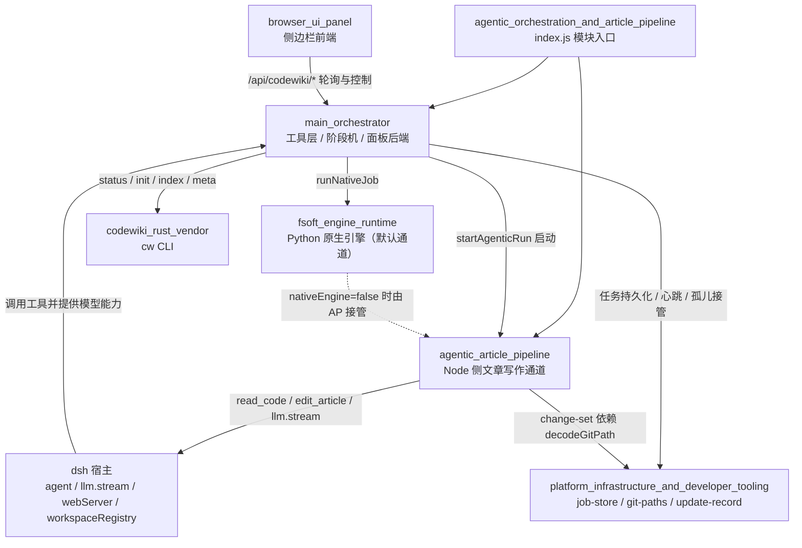

# agentic_orchestration_and_article_pipeline 模块概览

## 模块定位

本模块是 `@local/dsh-codewiki` 插件的运行时主干，入口为仓库根 `index.js`。它把 Rust CLI `cw` 与全仓库 wiki 编译流水线接入 DeepSeek Harness（dsh）宿主，对外提供编译工具与面板 API，对内驱动常驻任务编排服务。

自 0.16.0 起，编译默认走原生 Python 引擎通道；本模块同时保留插件内 Node 侧 agentic 文章管道作为兼容通道。两条通道最终会合于同一套 job 模型、阶段机、质量闸门、终态裁决与产物入库逻辑。

主要职责包括：

- 暴露 `cw`、`codewiki_generate`、`codewiki_update`、`codewiki_progress` 四个宿主工具；
- 以约 10s tick 驱动任务阶段机，负责排队、并发调度、终态判定、自动提交与会话唤醒；
- 提供仅回环可访问的 `/api/codewiki/*` 面板后端；
- 协调原生引擎通道与 agentic 文章写作通道；
- 在文章落盘前执行契约校验、锚点修正、孤儿文章清理与基线推进控制。

## 架构总览

## 核心组件

| 组件 | 文档 | 职责 |
| --- | --- | --- |
| `main_orchestrator` | [main_orchestrator.md](main_orchestrator.md) | 插件主入口与中枢：工具定义、`createJobService` 阶段机、三条执行器、质量与入库闸门、回环 HTTP 端点、自动调度器。 |
| `agentic_article_pipeline` | [agentic_article_pipeline.md](agentic_article_pipeline.md) | 插件内 agentic 文章写作通道：纯逻辑工具循环、宿主 llm 适配、并发池执行器、文章契约闸门与四路 git 变更采集。 |

## 关键边界

- **模型凭证零持有**：所有 LLM 请求经宿主 `llm.stream` 发出，插件与子进程不保存真实密钥；原生引擎通过占位 key 桥接。
- **通道不中途切换**：job 锁定为 `native` 通道后只走原生引擎收割逻辑，不会落入 legacy 阶段处理器，避免新旧实现重复写产物。
- **agentic 通道是工作台式写作**：模型通过 `read_code`、`list_files`、`edit_article`、`generate_sub_module` 反复核对代码并精确修改文章，而不是一次性把源码塞进 prompt。
- **坏文章不入库**：`contractCheck`、`fixAnchors`、`auditExistingArticles`、`judgeOutcome` 共同保证 error 级文章拒写，partial 产物不推进基线。
- **自动提交有固定边界**：只提交 `.codewiki/` 与 `CodeWiki.md`，任何冲突或不安全条件都降级为提醒会话提交，绝不强行合并。