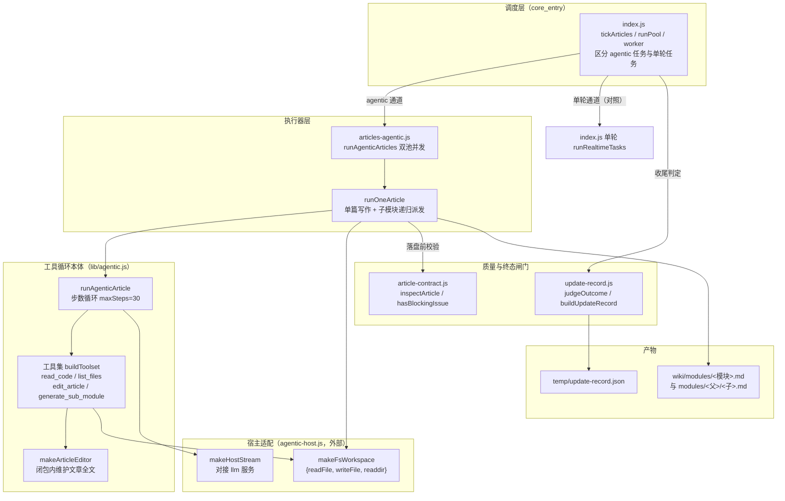
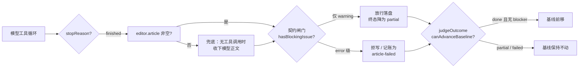

# Agentic 写作支持模块（agentic_support）

## 概述

`agentic_support` 是 CodeWiki 插件中支撑「agentic 文章写作通道」的一组基础库。它对应上游 FSoft-AI4Code/CodeWiki 的 `src/be/agent_tools/` 与 `documentation_generator.py` 的 pydantic-ai 工具循环，但其价值主张是一个**可反复读代码、可对文章做精确编辑、可把大模块拆给子任务**的工作台——行号、签名这类硬事实现场核对，而不是靠把所有源码一次性塞进 prompt 后凭记忆写作。

本模块由四个文件组成，各司其职：

| 文件 | 职责 | 主要导出 |
| --- | --- | --- |
| `lib/agentic.js` | 纯逻辑工具循环本体：四个工具的定义与实现、步数循环、参数解析、开场提示词 | `edit`（`makeArticleEditor`）、`runAgenticArticle`、`TOOL_SCHEMAS`、`DEFAULT_MAX_STEPS` |
| `lib/articles-agentic.js` | 宿主侧执行器：把「模块任务清单」跑成文章，含并发池、子模块递归派发、写集闸门、大档选档 | `runPool`、`worker`（`runAgenticArticles` 内部）、`runOneArticle` |
| `lib/article-contract.js` | 文章契约闸门（纯函数）：判一篇 wiki 文章是否满足最低结构要求，区分 error / warning 两级 | `hasBlockingIssue`、`issueSummary`、`inspectArticle` |
| `lib/update-record.js` | 更新记录：把一次编译的 ChangeSet / 计划 / 逐篇结果收成版本化 JSON，并判定终态 | `isTerminalStage`、`loadUpdateRecord`、`judgeOutcome` |

> 版本背景：本插件当前默认通道是原生引擎（`nativeEngine: true`，驱动上游 Python 引擎子进程，见 `package.json` 描述）；agentic 通道是插件内 Node 侧写作实现的一部分，与单轮 prompt 通道并列存在，作为兼容通道（`nativeEngine: false` 时）或原生引擎产物之外的补充写作能力。

## 架构总览

## 子模块

本模块的组件按职责可分为两个清晰的子域，详细文档见各自页面：

### 1. agentic_support_tooling —— 工具循环与并发执行

涵盖 `lib/agentic.js`（工具定义、纯函数式工具实现、步数循环、JSON 参数解析、开场提示词）与 `lib/articles-agentic.js`（单篇执行器、双档并发池、子模块递归派发、写集闸门、大档选档）。这是「写作发生」的地方。

详见：[agentic_support/agentic_support_tooling.md](agentic_support/agentic_support_tooling.md)

### 2. agentic_support_governance —— 契约闸门与终态记录

涵盖 `lib/article-contract.js`（文章结构契约的纯函数判据、error/warning 分级、写集路径判断）与 `lib/update-record.js`（编译终态判定 done/partial/failed、可机读更新记录的组装与读写）。这是「写得对不对、能不能推进基线」的裁决处。

详见：[agentic_support/agentic_support_governance.md](agentic_support/agentic_support_governance.md)

## 关键设计决策

1. **纯逻辑 + 注入依赖**：`runAgenticArticle` 不绑死 pydantic-ai，也不绑死宿主的 llm 服务——`streamFn` 与工具实现（workspace 抽象）全部注入，测试可完全离线。
2. **读码记账去重**：`makeReadCodeTool` 在工具侧记录已读 `(path, 起始行, 结束行)` 三元组；重复读不再回吐正文，只回「你已在第 N 步读过这段」。这是实测出来的护栏（真实模型 45 步内把同一文件读了 13 次，累计上下文 2.1MB，最终 max-steps 耗尽文章没写完）。
3. **CRLF 行尾归一**：`str_replace` 匹配前把文章与 `old_str` 两侧行尾统一成 `\n`，命中后再按原文风格（CRLF/LF）写回——避免仓库 `core.autocrlf=true` 导致模型永远匹配不上。
4. **子模块派发的诚实语义**：到达嵌套上限（`subModuleBlocked='max-depth'`）或当前模式不支持递归时，工具必须明确回「没有派出」并指示模型在父文里直接写成普通小节，而不是假报「已派发」制造死链。
5. **写集闸门**：agentic 通道里模型有自由工具循环，但能写哪些文件由调度器说了算——父任务只准写自己那篇，子模块只准写分配给它的那一条路径（`allowedWritePaths` + `isWritable`）。
6. **error / warning 分级**：结构已破坏（重复 frontmatter、围栏未闭合、死链、缺必填字段）才拒写；内容不达标但结构完整（缺必需章节、空章节）放行但记账，终态降为 partial 并阻止基线前移——「装绿」不允许。

## 与其他模块的关系

- [core_entry.md](core_entry.md)：插件入口。`index.js` 的 `isAgentic` / `runPool` / `worker` / `tickArticles` 决定哪些任务走本模块的 agentic 通道、哪些走单轮通道，并在收尾处调用 `update-record.js` 判定终态。
- [engine_core.md](engine_core.md)：原生引擎通道。其 `quality-gate.js::gateNativeOutput` 内部也调用 `article-contract.js` 的契约检查（`checkRendered`）来验证上游 Python 引擎产物——两套通道共享同一个契约判据。
- [client_ui.md](client_ui.md)：面板展示。`describeOutcome` 产出的 done/partial/failed 三态文案由面板呈现给用户。
