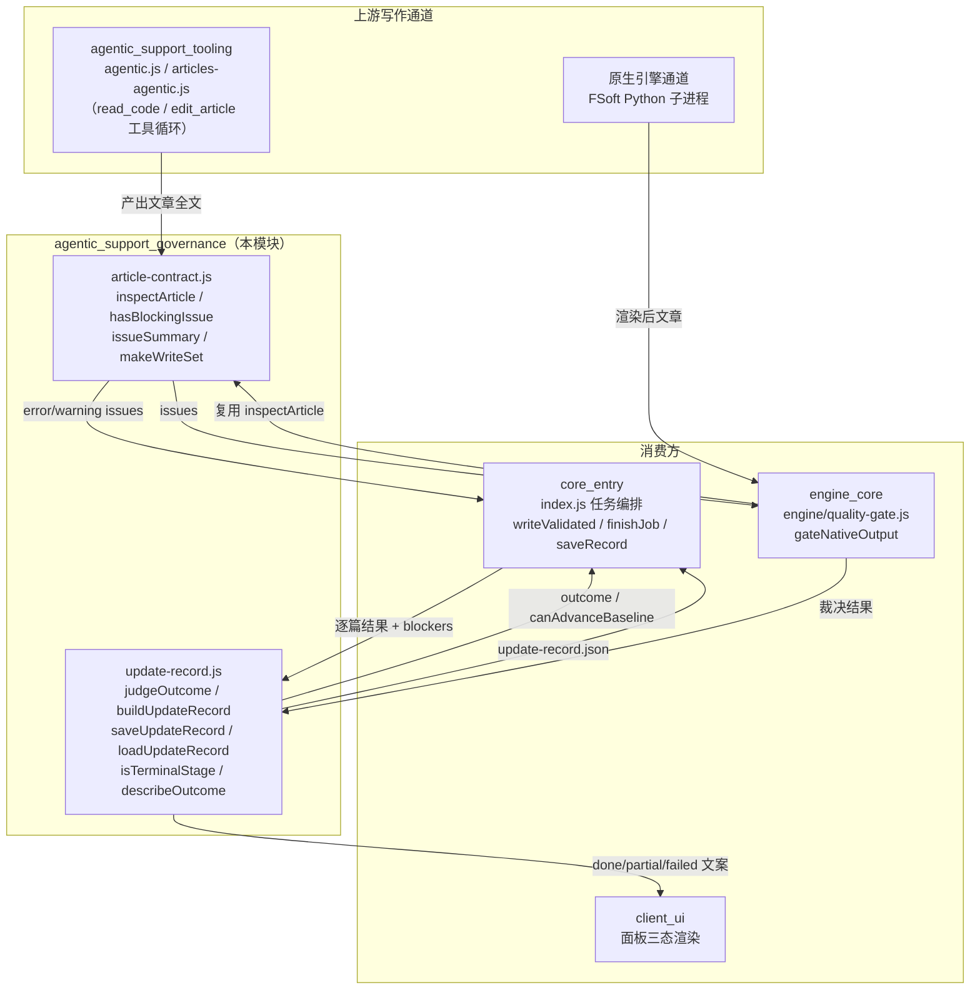
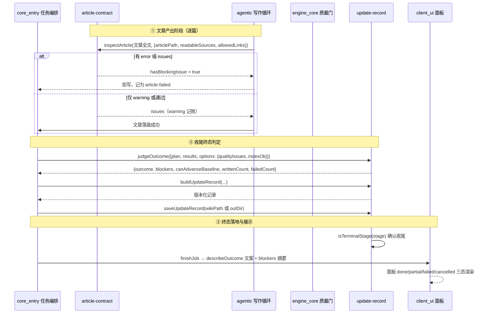
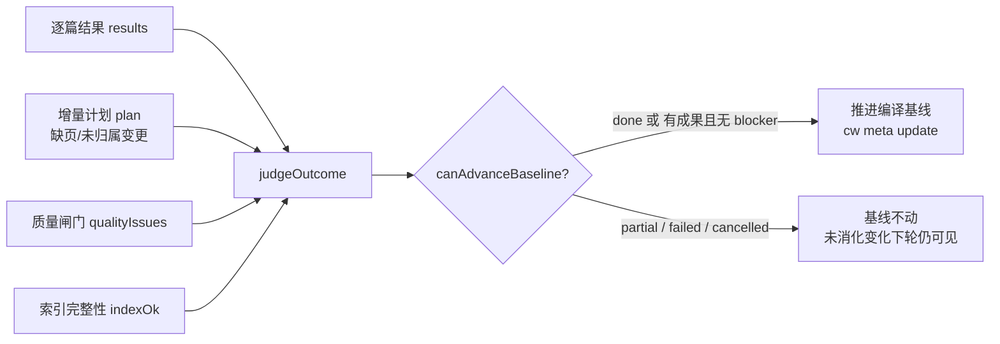

# agentic_support_governance — 编译治理与终态裁决层

## 引言

`agentic_support_governance` 是 CodeWiki 编译流水线的「治理与裁决」子模块，负责回答两个最关键的问题：

1. **一篇文章能不能入库**（`article-contract.js` 的文章契约闸门）；
2. **一次编译到底算不算「完成」**（`update-record.js` 的终态判定与基线推进裁决）。

它是 `agentic_support` 的治理臂，属于 `agentic_support` 模块下与 `agentic_support_tooling`（写作工具循环）并列的兄弟模块：tooling 负责「怎么写」，governance 负责「写出来的东西算不算数、这一轮算不算消化干净」。该层全部是**纯函数 + 两个 IO 助手**（便于单测），本身不碰 LLM、不调度并发，只提供判据与记账。

## 模块定位与架构

### 两个核心文件

| 文件 | 职责 | 关键导出 |
| --- | --- | --- |
| `lib/article-contract.js` | 文章落盘前的结构契约闸门（纯函数，不碰文件系统） | `inspectArticle`、`hasBlockingIssue`、`issueSummary`、`SEVERITY`、`REQUIRED_SECTIONS`、`makeWriteSet`、`isWritable` |
| `lib/update-record.js` | 编译终态判定与可复盘记账记录 | `judgeOutcome`、`buildUpdateRecord`、`saveUpdateRecord`、`loadUpdateRecord`、`isTerminalStage`、`TERMINAL`、`describeOutcome` |

## article-contract.js — 文章契约闸门

### 背景：它要挡住的真实缺陷

旧闸门 `validateArticleEnvelope`（在 `core_entry/index.js` 内）只查「frontmatter 有没有开头、有没有闭合」，于是以下坏文章都能入库：

- 正文里又贴了一份 frontmatter 与整段正文（重复贴头）；
- 必需章节存在但正文是空的（只有标题）；
- `source_files` 列着不存在的文件、或列了目录；
- 正文里的 `[[链接]]` 指向早已删掉的文章（死链）；
- 代码围栏没闭合，后面整篇被当成代码块。

本模块把这些判据统一收口成一个主入口 `inspectArticle(content, opts)`，返回 `issues[]`（空数组 = 通过）。

### 判据分级：error 与 warning 的行为分界

`SEVERITY` 表是**闸门行为**的分界，不是措辞差异：

| 级别 | 行为 | 典型 kind |
| --- | --- | --- |
| `error` | **拒写**（落盘即污染 wiki）：重复 frontmatter、围栏未闭合、`source_files` 不存在或不是证据、死链、缺必填字段、正文为空、必需章节空着 | `empty-body`、`unclosed-fence`、`bad-source`、`source-not-evidence`、`dead-link`、`duplicate-frontmatter`、`missing-field`、`type-mismatch` |
| `warning` | **放行但记账**：不拒写（旧通道整包装填产出天然是「一段正文」，硬拒会把存量文章全判死），但让本次编译终态降为 `partial` 并阻止基线前移——「装绿」不允许 | `missing-section`、`empty-section-optional` |

两个便捷函数：

- `hasBlockingIssue(issues)`：只有存在 `severity === 'error'` 的问题才拦落盘；warning 级放行但记账。
- `issueSummary(issues)`：把 issues 压成一行人类可读文案（`null` 表示通过），供 job note 与面板展示。

### 按文章类型配置必需章节

判据按「文章类型 → 必需章节」配置，避免对 learning/pattern 类文章过度要求：

- `REQUIRED_SECTIONS`：`module` / `architecture` 必须有 `Overview` + `Key Components`；其余类型只要求 `Overview`；`index` 不查章节。
- `TYPE_BY_DIR`：目录 → 允许的 type（`modules → module`、`concepts → concept`、`learnings → learning`、`decisions → decision`、`patterns → pattern`、`queries → query`）。
- `ROOT_TYPES`：根目录特殊文章（`_architecture.md → architecture`、`_index.md → index`）。

### 通道适配：两种通道共用一把尺

`inspectArticle` 提供两个关键开关，让同一把契约尺同时服务两条写作通道：

1. **`requiredSections` 覆盖**：原生引擎（FSoft）通道的正文由上游 prompt 决定章节名（`## Introduction and Purpose`、`## 1. Purpose`…），不是 agentic 通道的 `## Overview` / `## Key Components`。用默认表去判它等于「给被禁止手改的正文判死刑」——每条都是不可修复的 warning，闸门退化成噪声。因此 `engine_core` 的 `quality-gate.js` 传 `NATIVE_REQUIRED_SECTIONS = []`，只查结构完整性。
2. **`allowEmptySourceFiles`**：原生 whole-repository 模式下 `module_tree.json` 就是 `{}`，页没有任何归属证据可查，空 `source_files` 是**诚实记录**而非编造。按默认判 error 拒写会让整棵真实产物一篇都进不了 wiki。开启后空 `source_files` 由上层判 `partial`（证据降级，阻止基线推进）而不是在这里拒写。

### 写集闸门（防越界写入）

`makeWriteSet(paths)` / `isWritable(target, writeSet, { cwd })` 是 agentic 工具循环的 `allowedWritePaths` 闸门：按规范化后的 POSIX 路径比对，相对路径以 cwd 为基准解析后比对，避免 `../` 越界写到别的仓库。`core_entry/index.js` 的 `startAgenticRun` 把每个任务的 `articlePath` 作为写集传入。

## update-record.js — 终态判定与可复盘记账

### 背景：它要补上的审计缺口

旧实现里，编译结束只留 `writtenCount` / `failedCount` 两个数字，job 文件塞着整张图与任务快照。于是「为什么这篇没重写」「哪几个变更没人管」事后无法复盘，面板只能显示一句「完成」——而实际上可能 1 篇成功、19 篇失败也报 done。

本模块把一次编译收成一份**版本化、可机读**的 JSON 记录（`.codewiki/temp/update-record.json`），并明确回答「能不能推进编译基线」。

### 终态四态

`TERMINAL = new Set(['done', 'partial', 'failed', 'cancelled'])`，`isTerminalStage(stage)` 判断阶段是否已到终态：

| 终态 | 语义 | 基线能否前移 |
| --- | --- | --- |
| `done` | 完整成功：计划内必需文章全部写好、变更全部有归属、质量闸门全过 | ✅ 可以 |
| `partial` | 部分完成：已成功的文章可以入库，但「全部已消化」不成立 | ❌ 不可以 |
| `failed` | 失败：没有可交付成果（0 篇成功，或硬性前置条件缺失） | ❌ 不可以 |
| `cancelled` | 任务被取消 | ❌ 不可以 |

### judgeOutcome：六类 blocker 的来源

`judgeOutcome({ plan, results, options })` 逐类收集 blockers，任何一类非空都不会是 `done`：

1. **缺页**（`missing-article`）：计划要求写但没写、也没失败记录的文章；
2. **逐篇失败**（`article-failed`）：`results` 里 `ok=false` 的文章及错误摘要；
3. **未归属变更**（`unmapped-changes`）：没有任何文章消化的源码变更（非源码文件 README/CodeWiki.md/CHANGELOG 不算）；
4. **缺 source_files**（`missing-sources`）；
5. **质量闸门**（`quality`）：`article-contract` 的 error/warning 级问题由调用方以 `qualityIssues` 传入；
6. **索引/入口完整性**（`index`）与**调用方补充硬阻塞**（`extraBlockers`，如 git base 不可达导致的 full 退化、执行器整体失败）。

终态裁决规则：

- `blockers` 全空且无失败、无缺页 → `done`；
- 0 篇成功且有失败/缺页/阻塞 → `failed`；
- 其余（写成了一部分）→ `partial`。

`canAdvanceBaseline` 的判据是显式的「`done`，或 `partial` 但有成果且无 blocker」——注释中明确记载：当前实现里 `partial` 必然至少带一条 blocker，所以该分支**当前不可达**；写全是为了把「done-only」与「有成果且无硬缺陷」两种语义显式分开，避免将来放宽 blocker 规则时静默失效。原生引擎通道（`native-run.js` / `quality-gate.js`）用的正是后者这条更宽的语义。

### 记录的组装与存取

- `buildUpdateRecord({ jobId, scope, changeSet, plan, results, outcome, wikiPath, qualityIssues, notes, ... })`：把 ChangeSet + UpdatePlan + 逐篇结果 + 终态收成可序列化记录；job 里只存路径与摘要，不塞整图（否则 `/tmp` 任务文件无限膨胀）。
- `saveUpdateRecord(wikiPath, record)` / `loadUpdateRecord(wikiPath)`：写到 `<wikiPath>/temp/update-record.json`；版本不匹配（`UPDATE_RECORD_VERSION`）时 `loadUpdateRecord` 返回 `null`。
- **例外通道**：原生引擎通道的提交发生在落地器内部，记录要等落地结果出来才写得成——写到 `.codewiki/` 就必然晚于提交，每轮编译后工作区都留一个未跟踪文件。因此原生通道把记录写到**仓库外**的记账目录（`saveRecord` 的 `outDir` 参数），可复盘性不丢，工作区保持干净。
- `describeOutcome(outcome, blockers)`：面板与工具文案——`done / partial / failed / cancelled` 四态一眼可分。

## 组件交互：一次编译的治理流程

### 基线推进的硬不变量

## 与其他模块的关系

- **上游写作**：[`agentic_support_tooling`](agentic_support_tooling.md)（`agentic.js` / `articles-agentic.js`）产出的文章全文直接进入本模块的 `inspectArticle` 闸门；工具循环的写集限制也来自 `makeWriteSet` / `isWritable`。
- **任务编排**：[`core_entry`](../core_entry.md)（`index.js`）的 `writeValidated`（兼容通道落盘闸门）、`finishJob`（三态收尾）、`saveRecord`（记录落盘）、`startAgenticRun`（写集装配）全部消费本模块；`isTerminalStage` 与 `TERMINAL` 用于 tick 循环判断任务是否已到终态、是否停止推进。
- **原生引擎通道**：[`engine_core`](../engine_core.md) 的 `engine/quality-gate.js`（`gateNativeOutput`）复用 `inspectArticle` 作为「目标格式契约」一层（传入 `NATIVE_REQUIRED_SECTIONS = []` 与 `allowEmptySourceFiles: true` 的通道适配）；`engine/native-run.js` 的裁决链（env → 引擎 → gate → apply）产出的终态也经 `buildUpdateRecord` 落盘，并按「最弱终态」原则与本模块的 `judgeOutcome` 语义叠加。
- **面板展示**：[`client_ui`](../client_ui.md) 的 CodeWiki 面板读取 job 上的 `outcome` / `blockers` / `canAdvanceBaseline` 字段（由 `jobSummary` 透出），渲染 done/partial/failed 三态——文案由 `describeOutcome` 统一生成。
- **构建配置**：本模块为纯 JS 逻辑层，无额外构建依赖；运行环境约束见 [`package_manifest`](../Build___Dependency_Configuration_Layer/package_manifest.md)（`engines.node >= 20`，唯一运行时依赖 `@deepseek-ai/schemastery` 与本模块无关）。

## 设计要点总结

1. **纯函数优先**：两个文件主体不碰文件系统（只有 `saveUpdateRecord` / `loadUpdateRecord` 两个 IO 助手且可注入 `fsImpl`），全部判据可离线单测钉住。
2. **error 与 warning 分层**：结构破坏必拒写；内容不达标放行但降终态——既不把存量文章全判死，也绝不允许「装绿」。
3. **通道适配而非放宽**：原生引擎通道通过 `requiredSections` / `allowEmptySourceFiles` 两个开关复用同一把尺，而不是复制一套判据。
4. **终态只降不升**：原生通道的「最弱终态」原则（cancel < failed < partial < done）与本模块的 blocker 收集叠加，任何一步的结论都不能被下一步洗白。
5. **可复盘性**：一次编译做了什么、为什么、哪些变化没人管，全部落成版本化 JSON；job 文件只留摘要，面板与 `codewiki_progress` 共享同一份 `jobSummary`。
