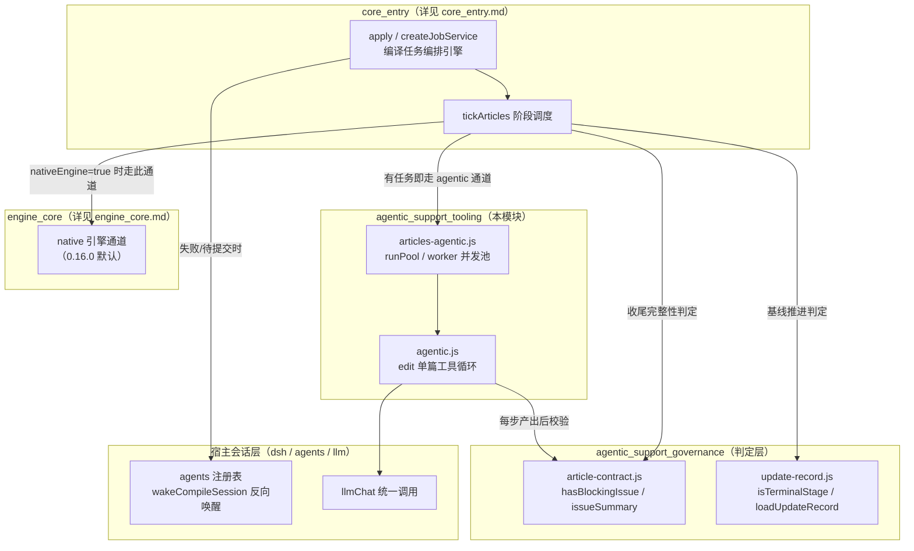
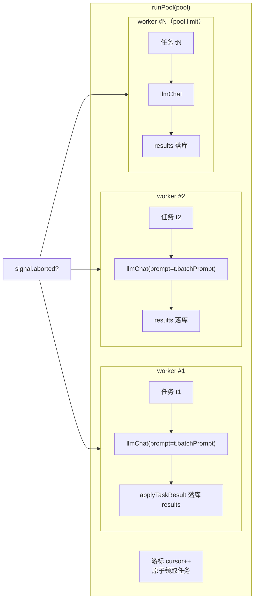
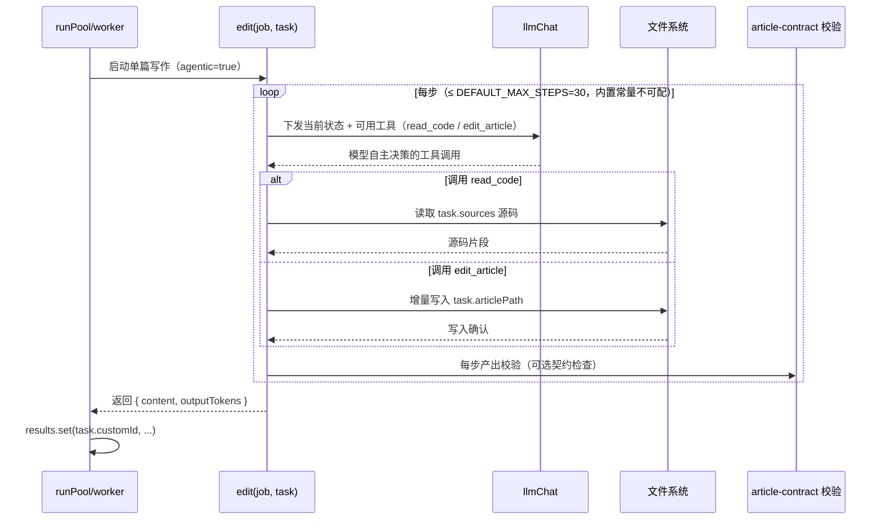
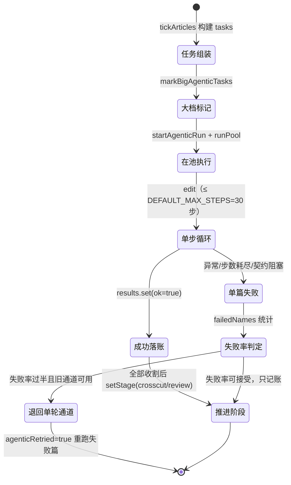

# agentic_support_tooling（agentic 写作执行工具层）

## 简述

`agentic_support_tooling` 是 [agentic_support](../agentic_support.md) 下负责**实际执行 agentic（自主式）文章写作**的工具层，包含两个核心模块：

| 文件 | 职责 |
|------|------|
| `lib/agentic.js::edit` | 模型驱动的文章编辑循环 —— 模型自主调用 `read_code` / `edit_article` 等工具，在步数上限内增量完成单篇文章撰写 |
| `lib/articles-agentic.js::runPool` / `worker` | 文章批量并发执行池 —— 用多 worker 游标推进一批 agentic 写作任务，按默认档/大档分池独立限流 |

它与 [agentic_support_governance](agentic_support_governance.md)（文章契约校验、增量更新记录等「判定与治理」能力）共同构成 agentic 支持子系统的全貌：**governance 决定「写成什么样才算合格」，tooling 负责「把它实际跑出来」**。

---

## 架构定位

下图展示 tooling 层在整个编译流水线中的位置：

> 注：自 0.16.0 起，默认通道已切换为原生引擎（`nativeEngine: true`），Node 侧 agentic 写作通道作为兼容通道保留（详见 [engine_core](../engine_core.md) 与 [package_manifest](../Build___Dependency_Configuration_Layer/package_manifest.md)）。

---

## 核心组件

### 1. `lib/articles-agentic.js` —— 并发执行池

`runPool(pool)` 与 `worker` 负责把一批 agentic 写作任务调度到多个并发槽位上执行。其设计要点与 [core_entry](../core_entry.md) 中 `runPool` 的实现同源（FSoft CodeWiki 批处理通道）：

**关键机制**：

- **游标领取**：所有 worker 共享一个递增游标 `cursor++`，无锁领取任务，天然实现并发槽位复用（一个 worker 完成当前任务后自动领取下一个）。
- **中止传播**：每次循环开头检查 `signal?.aborted`，收到取消信号立即退出 —— 与 [core_entry](../core_entry.md) 的 `cancel(jobId)` 流程联动。
- **失败隔离**：单个任务抛错只记入 `notes` 并把结果置为 `{ ok: false, stopReason: 'error' }`，不中断整池。
- **大档分流**：任务自带 `provider` + `model`（超大模块的「大档」标记）时，`reasoningEffort` 完全以任务为准，不回落普通档配置 —— 避免普通档的 effort（如 `off`）不被大档模型支持。

### 2. `lib/agentic.js` —— 单篇编辑循环 `edit`

`edit` 是吸收自 FSoft CodeWiki `module agent` 的核心工具循环：

**与「整包内联」旧通道的本质区别**（见 [core_entry](../core_entry.md) 的 `tickArticles` 源码注释）：

> agentic 写作通道不需要「源码整包内联 → 超预算拆观察批 → 合成」这套装填。模型自己读源码、增量写文章，因此没有 `sessionTasks`，也不受 110k 单请求预算的硬切割。

---

## 配置项

tooling 层的行为由 [cordis.patch.yml](../cordis.patch.yml) 中声明的 `codewiki` 命名空间配置驱动（注释原文摘录）：

| 配置项 | 默认值 | 作用域 | 说明 |
|--------|--------|--------|------|
| ~~`agenticArticles`~~ | ~~`true`~~ | ~~tooling 总开关~~ | 已移除：文章阶段有任务即走 agentic 通道，不再有开关 |
| ~~`agenticMaxSteps`~~ | ~~`30`~~ | ~~`edit`~~ | 已移除：单篇步数上限固定为内置常量 `DEFAULT_MAX_STEPS`（30 步），不再可配 |
| `batchProvider` / `batchModel` | workbuddy / hy3 | `runPool` 默认档 | agentic 通道使用的默认模型 |
| `bigProvider` / `bigModel` / `bigReasoningEffort` / `bigTokenBudget` / `bigEnabled` | 空 / `true` | `runPool` 大档池 | 超大模块（源文本量超限）切换的大上下文模型；`bigEnabled=false` 或大档模型留空时 `markBigAgenticTasks` 原样返回任务 |
| `maxConcurrency` / `bigConcurrency` | 2 / 跟随默认档 | `runPool` | 默认档与大档各自独立限流、同时推进 |

---

## 任务生命周期与容错

下图描述一篇文章从进入 agentic 通道到最终落账的完整路径：

**关键容错策略**（实现见 [core_entry](../core_entry.md) `tickArticles`）：

1. **只重排失败篇**：agentic 通道大面积失败时，已经写成功的文章**不重写** —— 重复写同一路径既费 token，又会覆盖模型在场读代码后写出的更好版本。
2. **观察批失败降级**：横切/分割观察全部失败时，若有会话通道任务在途则等它统一收尾，否则照旧推进，**不因观察失败 fail 整个 job**。
3. **重启续跑**：任务标记 `agentic: true`，宿主重启重跑时按 agentic 通道重跑，而不是去找不存在的 `batchPrompt`。

---

## 与其他模块的协作关系

| 协作方 | 关系 | 说明 |
|--------|------|------|
| [agentic_support](../agentic_support.md) | 父模块 | tooling 与 governance 的顶层容器 |
| [agentic_support_governance](agentic_support_governance.md) | 平级子模块 | `edit` 每步产出后调用 `hasBlockingIssue` / `issueSummary` 做契约校验；收尾时 `loadUpdateRecord` / `isTerminalStage` 决定基线是否推进 |
| [core_entry](../core_entry.md) | 上游编排 | `tickArticles` 是本模块的直接调用方；`isAgentic` 判定任务是否走本通道；`runPool` / `worker` 的批处理语义同源 |
| [engine_core](../engine_core.md) | 替代通道 | 0.16.0 起 `nativeEngine: true` 为默认通道，直接驱动上游 FSoft Python 引擎；本模块的 Node 侧 agentic 通道作为兼容通道（`nativeEngine: false`）保留 |
| [client_ui](../client_ui.md) | 展示消费 | 面板通过 `jobSummary` / `progressView` 展示 `batchProgress`、`stageTimings`、`tps` 等本模块运行时指标 |
| [Build___Dependency_Configuration_Layer](../Build___Dependency_Configuration_Layer.md) | 构建配置 | 配置命名空间与默认值定义见 [cordis.patch.yml](../cordis.patch.yml) 与 [package_manifest](../Build___Dependency_Configuration_Layer/package_manifest.md) |

---

## 参考源码

- `lib/agentic.js` —— `edit`（单篇 agentic 工具循环）
- `lib/articles-agentic.js` —— `runPool`、`worker`（并发执行池）
- `index.js` —— `tickArticles`（调用方与容错编排）、`runPool` / `worker`（同源批处理语义）、`isAgentic`（通道判定）
