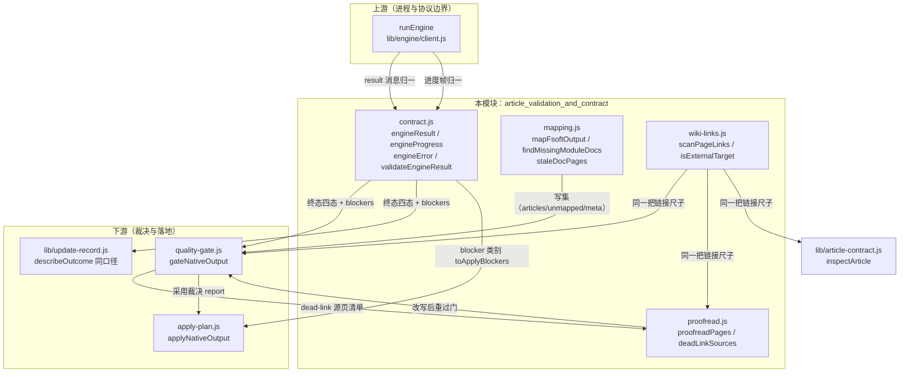
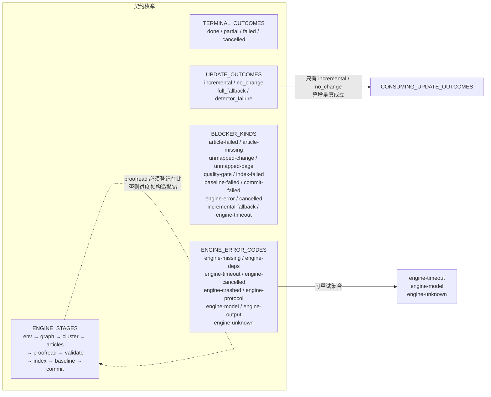
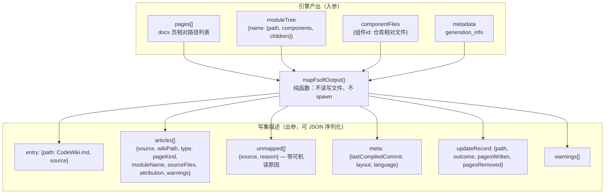
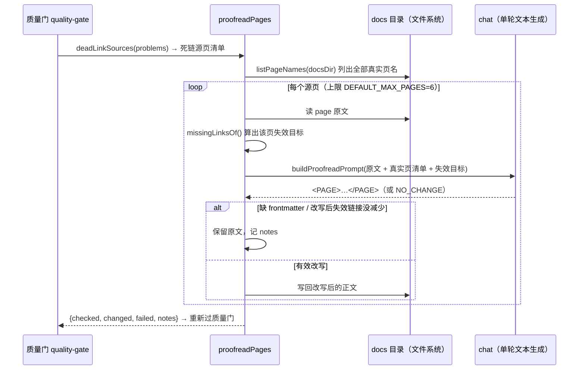
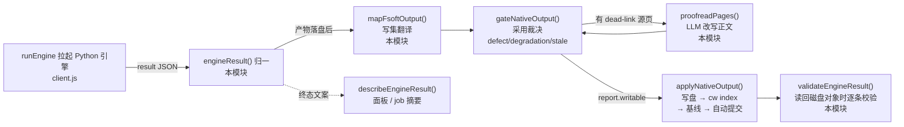

# 文章校验与契约（article_validation_and_contract）

## 概述

本模块是原生引擎通道（FSoft Python 子进程）在 Node 侧的**校验与契约边界**，位于 `lib/engine/` 之下，由四个文件组成：

| 文件 | 职责 |
| --- | --- |
| `lib/engine/contract.js` | 引擎跨进程结果契约：版本化的 `EngineResult` / `EngineProgress` / `EngineError` 构造、枚举注册、终态硬不变量校验 |
| `lib/engine/mapping.js` | FSoft 产物 → CodeWiki 的格式翻译（docs 树 → `.codewiki/` 写集），缺页/陈旧页探测 |
| `lib/engine/proofread.js` | 死链校对层：用单轮 LLM 把文章正文里指向「不存在页面」的跨页链接当场改对 |
| `lib/engine/wiki-links.js` | 正文链接扫描的**唯一**正则来源，供门、校对、文章契约三处共用 |

它存在的核心理由（文件头注释反复强调的历史教训）：0.14.0 之前「1 篇成功 + 19 篇失败也报 done」，终态语义含糊让每个消费方（JobService、面板、cw 基线、自动提交）各自猜测「引擎到底成功了没有」。本模块把**结果形态、终态不变量、页面归属、链接判据**全部收口为纯函数契约：

- 不碰文件、不碰进程、不碰模型（构造与校验部分）——纯函数才能被 TDD 钉死；
- 非法输入**抛错或返回逐条 errors**，而不是静默归一——契约破坏必须响；
- 「不臆造 source_files」「不静默丢弃未映射页」「不覆盖 slug 冲突页」「不改技术正文」是迁移安全四条硬规则。

## 架构定位

本模块处于引擎通道的中段：上游是进程协议（[engine_orchestration](engine_orchestration.md) 的 `runEngine`），下游是采用裁决与落地（[native_output_quality_gate](native_output_quality_gate.md)、[native_output_application_logic](native_output_application_logic.md)）。



## 核心组件详解

### 1. contract.js：跨进程结果契约

这是「引擎到底成功了没有」的唯一事实来源。文件头固定了三件事：

- **EngineResult** — 一次 generate/update 的完整结果（版本化、可校验）；
- **EngineProgress** — 推进中的阶段/计数快照（面板与 tick 共用）；
- **EngineError** — 可机读失败事实（`code` 决定重试语义，`message` 只给人看）。

#### 注册的枚举（新增只允许追加，消费者按 kind 分派）



关键设计点：

- **阶段枚举是契约不是实现细节**：面板步骤条、`job.stage` 映射、取消检查点都按它对齐。`proofread` 当初漏登记导致进度帧在构造时抛错、调用方 catch 吞掉、面板那一步永远不亮（0.17.32 的真实事故）。
- **`updateOutcome` 是「基线能不能推进」的第二个证据源**：质量门说产物完整，但引擎自报 `full_fallback` / `detector_failure`，这批变化就不算消化，基线不得推进——否则下一轮起点被抬到「其实没消化」的位置，变化永久丢失。
- **`engine-timeout` 既是 error code 又是 blocker kind**：超时但已写出文章时，`client.js` 把整轮判成 partial 并必须给出这条阻塞原因；它此前未登记会被 `normalizeBlocker` 静默降级成 `engine-error`，「这轮是超时被救回」的事实从终态与面板里消失。

#### 终态硬不变量（由 `engineResult` 与 `validateEngineResult` 双重保证）

| 不变量 | 违反时的行为 |
| --- | --- |
| `done` = 完整成功，**不许**带 blockers | 构造抛错：「done 表示完整成功，带阻塞原因即自相矛盾」 |
| `partial` = 部分完成，**必须**带至少一条 blockers | 构造抛错：「否则等于把失败伪装成部分成功」 |
| `failed` = 失败，必须带 error | 构造抛错 |
| `cancelled` = 取消，可带 blockers 说明已写成的部分 | 合法 |
| `updateOutcome` 一旦给值必须是登记枚举 | 抛错——「忽略它等于把引擎退全量洗成增量成功」 |

两个入口分工：

- `engineResult(input)` / `engineProgress(input)` / `engineError(input)` — **构造期**用。输入非法直接抛错（契约破坏必须响）；字段归一（计数 `num()`、usage、checks、detail 截断）在这里完成。
- `validateEngineResult(value)` — **反序列化边界**用（磁盘残留、旧版本对象从 `update-record.json` / job-store 读回时）。不抛错，返回 `{ ok, errors[] }` 逐条列出问题。
- `describeEngineResult(result)` — 终态文案，与 `lib/update-record.js` 的 `describeOutcome` 同一口径，四态一眼分清：

```
完成（写入 N 篇）
部分完成（写入 N 篇，M 篇未完成）：<第一条 blocker 明细>
失败：<error.message>
已取消（已写入 N 篇）
```

### 2. mapping.js：格式翻译（唯一的「两边不是同一个模型」处）

FShell 原生引擎产出一棵 docs 树，cw 要的是仓库内 `.codewiki/` 五类文章 + 顶层 `CodeWiki.md` 入口。映射关系：

| FSoft 产物 | CodeWiki 落地 |
| --- | --- |
| `overview.md` | `CodeWiki.md`（入口页，不是「文章」） |
| 模块页 `{Name}.md` | `.codewiki/modules/<slug>.md`（type=module，`moduleSlug` 转 kebab-case） |
| `module_tree.json` | 只作 `source_files` 的证据来源，**不落盘** |
| `metadata.json` | `.codewiki/_meta.yaml` 的 `last_compiled_commit` / `layout` |
| `update_record.json` | `.codewiki/temp/update-record.json`（原样搬运） |
| `pageKind=artifact` 的页 | 明确标 `artifact`，不冒充业务模块 |
| 有 children 的父模块页 | `pageKind=parent`，仍 `type=module` |



四条迁移安全硬规则（文件头明令）：

1. **不臆造 `source_files`**：只能来自组件→文件证据（`componentFiles` 或组件 id 里 `::` 前的文件部分），拿不到就是空数组 + warning。0.14.0 的闸门正是靠 `source_files` 判定增量归属，编造它会让未消化的变化被静默基线化。
2. **不静默丢弃**：任何没被映射的页都进 `unmapped` 并带原因，由上层判 partial。
3. **不覆盖**：slug 冲突（`A_B` 与 `A-B` 都 → `a-b`）时两页都进 `unmapped`，后到的不许赢。
4. **不改技术内容**：只搬路径与类型，正文一字不动；FSoft 原始树另存。

两个边界形态值得注意：

- **whole-repository 模式**：`module_tree.json` 就是 `{}`，而 agent 仍写了自己的页。这时页是真产物（必须进写集），但没有归属证据 → `sourceFiles: []`、`attribution: 'unattributed'` + warning。硬给证据才是错的（伪造增量 ownership），丢掉页更错（wiki 少一篇）。
- **`indexModuleTree` 记完整 `modulePath`（含父链）**：只记名字会让「模块从上层搬到更深一层」看起来「页已存在」，把真实缺页漏掉（真机 dsh-git-worktree 的事故）。

对外的缺页/陈旧页探测：

- `findMissingModuleDocs({pages, moduleTree})` — 树里有模块但 docs 里没有页（按上游 `find_doc()` 口径：先看层级路径 `moduleDocRelPath`，再看根部同名；**不接受其它目录下的同名页**——那是模块搬家后的遗留旧页）。
- `staleDocPages({pages, moduleTree})` — 产物目录里不属于当前模块树的页；修复性全量必须先清掉它们，否则旧页被映射成 `unmapped-page`，质量门每轮照样判 partial。whole-repository 模式（树为空）直接返回 `[]`，不能凭名字删页。

### 3. proofread.js：死链校对层

**立场：它修的是正文，不是判据。** 校对后的正文仍要重新过一遍质量门，改不掉就照旧判 partial；绝不在渲染期或终态里豁免缺页/死链。

存在原因：原生引擎写作时模型会照旧版聚类的记忆**编造页面名**（真机 `client_review_console/status_readouts.md`、漏写 `_ui` 后缀的 `settings_and_logs.md`），而模块树里根本没有那些页。质量门如实判 dead-link，仓库每轮都停在「部分完成」——判据没错，是产物真的错。

只管一类问题：跨页链接目标不存在。这是模型幻觉里唯一可以**只看本页 + 页名清单**就修对的问题（改成真实页名，或把链接降级成纯文字）。正文事实错误需要读源码，属于重写文章，不在校对范围。



防退化的三道闸（每篇都过）：

1. 模型返回若缺 `frontmatter` 而原文有 → 宁可不动（模型把 frontmatter 吃坏的话问题留给质量门如实上报）；
2. 改写后失效链接数没有减少 → 保留原文（模型可能越改越错）；
3. 单轮最多 6 篇（每篇一次模型请求）——再多就变成整轮重跑。

### 4. wiki-links.js：一份正则，三处共用

```javascript
const LINK_RE = /\[([^\]\n]*)\]\(([^)\s]+?\.md)(#[^)\s]*)?\)/g
```

**为什么必须共用**：同一件事（「这段正文里有哪些 .md 链接」）原来在三处各写一个正则并在演进中分叉——`article-contract.js` 只捕获目标、`proofread.js` 捕获目标、`quality-gate.js` 还要捕获链接文字与锚点以便原位替换。分叉的直接后果是惰性版 `[^)\s]+?\.md` 与贪婪版 `[^)\s]+\.md` 谁对谁错没人说得清：「门判它是死链、改写器却认不出这条链接」，两边结论对不上。

约定：

- 目标是**第一个** `.md` 结尾的那一段（惰性）；锚点 `#...` 单独捕获；
- `scanPageLinks(text)` 返回 `{index, whole, label, target, anchor}`，`index/whole` 用于在原文里原位替换（配合 `stripCode` 等长遮蔽代码块后偏移一致）；
- `isExternalTarget(target)` 判定 `https:` / `mailto:` 等外部协议链接，这类不参与页面内解析。

## 数据流：一次 update 编译的完整链路



## 依赖关系

### 本模块导入的（上游）

| 依赖 | 用途 | 所属模块 |
| --- | --- | --- |
| `../git-paths.js` 的 `toPosix` | 路径 POSIX 归一（mapping、proofread、wiki-links 解析基准） | [job_and_repository_infrastructure](job_and_repository_infrastructure.md) |

### 导入本模块的（下游消费方）

| 消费方 | 使用内容 | 所属模块 |
| --- | --- | --- |
| `lib/engine/client.js` 的 `runEngine` | `engineResult` / `engineProgress` / `engineError` / `ENGINE_CONTRACT_VERSION` | [engine_orchestration](engine_orchestration.md) |
| `lib/engine/quality-gate.js` | `WIKI_ENTRY`、`WIKI_META_REL`、`scanPageLinks`、`isExternalTarget`；`findMissingModuleDocs` 判 article-missing | [native_output_quality_gate](native_output_quality_gate.md) |
| `lib/engine/apply-plan.js` | `WIKI_DIR`、`WIKI_ENTRY`、`WIKI_META_REL`、`WIKI_MODULES_REL`、`moduleSlug`、`BLOCKER_KINDS` | [native_output_application_logic](native_output_application_logic.md) |
| `lib/article-contract.js` | `scanPageLinks`（死链判定的同一把尺子） | 插件层文章契约 |
| 主入口 `index.js` / `lib/update-record.js` | `describeEngineResult` 与 `describeOutcome` 同口径；job 终态判定 | [main_job_orchestrator](main_job_orchestrator.md) |

## 设计原则速查

1. **契约破坏必须响**：构造期抛错、反序列化期返回逐条 errors，绝不静默吞掉非法输入。
2. **判据只此一把**：链接扫描、阶段枚举、blocker 类别都是单一注册源，消费者按 kind 分派。
3. **证据宁缺勿造**：`source_files`、归属、基线推进都只信可机读证据；没证据就空 + warning + 不上推基线。
4. **修正文不改判据**：校对层写完必须重过质量门；门的判定标准绝不因校对而放松。
5. **纯函数优先**：构造/校验/映射/链接扫描全部可单测；碰文件的只有 proofread 的读改写与 mapping 的常量定义。

## 相关模块

- [engine_orchestration](engine_orchestration.md) — 进程拉起、JSON-lines 协议、超时/静默/取消，把原始消息喂给本模块的契约构造函数。
- [native_output_quality_gate](native_output_quality_gate.md) — 把本模块的写集与链接判据合成 defect / degradation / stale 三类裁决。
- [native_output_application_logic](native_output_application_logic.md) — 按裁决原子落地写集，并把落地失败映射回本模块的 `BLOCKER_KINDS`。
- [native_execution_and_workspace_infrastructure](native_execution_and_workspace_infrastructure.md) — 引擎执行、产物快照、状态文件，为本模块提供输入事实。
- [job_and_repository_infrastructure](job_and_repository_infrastructure.md) — `update-record` 的 `describeOutcome`/`isTerminalStage` 与本模块终态文案同口径。
