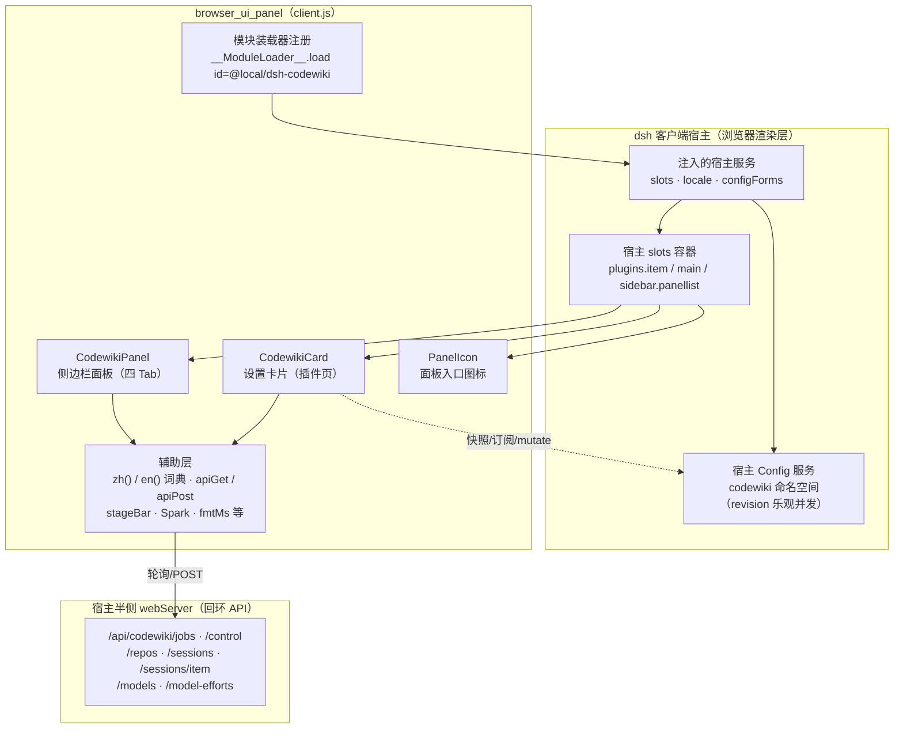
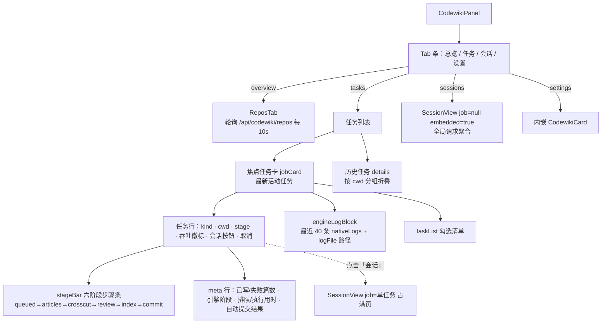
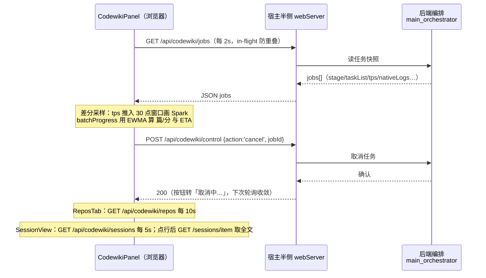
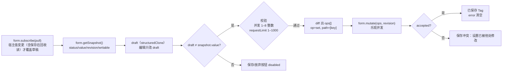
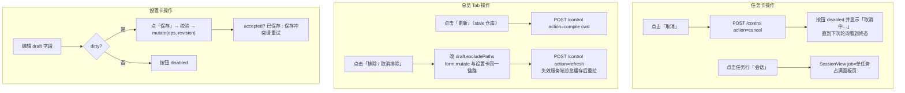
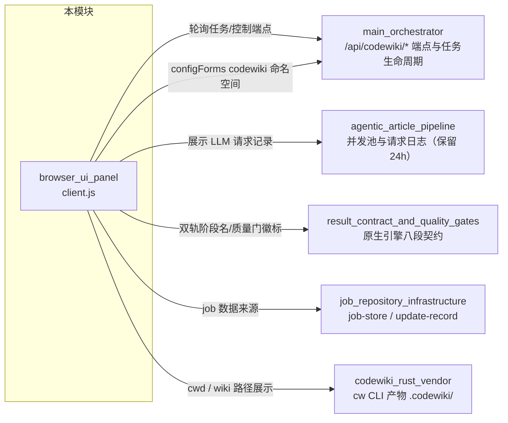

# CodeWiki 浏览器侧 UI 面板（browser_ui_panel）

## 简介

`browser_ui_panel` 是插件 `@local/dsh-codewiki`（见 [package.json](../repo/package.json)）的**客户端半侧**，全部代码位于单个文件 `client.js`，运行在 DeepSeek Harness（dsh）客户端进程的浏览器渲染层。它本身不执行任何编译逻辑，只做三件事：

1. **设置表单**——在宿主「插件」页（`plugins.item` slot）渲染 CodeWiki 设置卡片，经宿主 Config 服务的 `codewiki` 命名空间热读写编译流水线的全部参数；
2. **进度面板**——在侧边栏（`main` + `sidebar.panellist` slot）渲染编译任务面板，以 2 秒轮询展示流水线进度、吞吐、引擎日志，并可取消任务；
3. **仓库总览与会话记录**——面板内三个 Tab（总览 / 任务 / 会话）+ 设置 Tab，覆盖仓库 wiki 状态总览、自动更新调度、LLM 请求记录查看。

所有数据来自宿主半侧 webServer 端点 `GET /api/codewiki/jobs`、`POST /api/codewiki/control`（仅回环）等，由后端编排模块提供——见 [main_orchestrator](main_orchestrator.md)。本模块是纯展示与控制端，不直接触碰文件系统、LLM 或 git。

---

## 架构总览

关键点：

- **两个挂载点**（文件头注释明确）：插件页 `plugins.item`（id = `codewiki`，与 profile patch 条目一致，见 [cordis.patch.yml](../repo/cordis.patch.yml)）与侧边栏面板 `main`（key = `codewiki`）+ `sidebar.panellist`（同 id，order = 52，排在 dsh-hindsight-on-demand 之后）。
- **注册 id 校验**：`window.__ModuleLoader__.load` 的 `id` 必须等于 `package.json` 的 `name`（`@local/dsh-codewiki`），client-modules 按 nearestPackage 的 name 校验注册者。
- **词典值必须是字符串**：`zh()` / `en()` 返回纯字符串词典，挂在 locale 命名空间 `codewiki` 下（词典值若为函数，`t()` 会回退返回键名）。
- **样式去重**：注入的 `<style>` 以 `data-plugin="@local/dsh-codewiki"` 标记，HMR 或重复加载时不堆叠重复样式表。

---

## 组件清单与职责

| 组件 | 挂载位置 | 职责 |
|---|---|---|
| `CodewikiCard` | `plugins.item` | 设置表单：`view='summary'` 一行简介，`view='page'` 完整配置页 |
| `CodewikiPanel` | `main` | 侧边栏面板主体：四个 Tab（总览/任务/会话/设置），任务轮询与渲染 |
| `PanelIcon` | `sidebar.panellist` | 摊开书本造型 SVG 图标，面板出入口 |
| `ReposTab` | Panel 内「总览」Tab | 全部已编译仓库的 wiki 状态、自动调度摘要、排除/立即编译操作 |
| `SessionView` | Panel 内「会话」Tab 或任务行按钮 | LLM 请求记录列表与单条 prompt/输出全文查看 |
| `Spark` | 任务卡徽标内 | 纯 SVG 微趋势线（tps 滚动窗口） |
| `mount` | `apply()` 内 | 插件页挂载，经 `configForms.whileServed([NS], …)` 门控：宿主服务该命名空间期间才显形 |
| `save` / `discard` | CodewikiCard 内 | 保存草稿（diff 成 ops，带 revision）/ 放弃更改回读快照 |
| `zh` / `en` | 模块顶层 | 中/英 i18n 词典工厂 |
| `byUpdated` | CodewikiPanel 内 | 按 `updatedAt` 排序任务，选出焦点任务 |
| `line`（日志行渲染） | `engineLogBlock` 内 | 把引擎日志条目格式化成等宽单行 |

### CodewikiPanel 内部结构

---

## 数据流：轮询驱动的只读展示

面板没有 WebSocket，全部状态来自定时拉取；客户端只做展示侧的二次加工（采样、平滑、分组）。

各端点与轮询频率：

| 端点 | 频率 | 消费组件 | 用途 |
|---|---|---|---|
| `GET /api/codewiki/jobs` | 2s（`POLL_MS`） | CodewikiPanel | 任务列表、进度、阶段、日志 |
| `GET /api/codewiki/repos` | 10s（`REPOS_POLL_MS`） | ReposTab | 仓库状态 + 调度摘要 |
| `GET /api/codewiki/sessions` | 5s | SessionView | 并发池 LLM 请求列表（jobId 或全局聚合） |
| `GET /api/codewiki/sessions/item` | 按需（选中行） | SessionView | 单条请求 prompt / 输出全文 |
| `GET /api/codewiki/models` | 挂载一次 | CodewikiCard | 提供商/模型目录（LLM 服务注册的） |
| `GET /api/codewiki/model-efforts?provider&model` | 按 (provider,model) 变化 | CodewikiCard | 该模型声明的 reasoning efforts |
| `POST /api/codewiki/control` | 按需 | CodewikiPanel / ReposTab | `cancel` 任务 · `compile` 指定 cwd · `refresh` 失效总览缓存 |

防重叠细节：每个轮询组件都有 `inFlightRef` / `alive` 标志——上次请求未回包（服务卡顿）时不重叠拉取；组件卸载后异步回包不再 `setState`。

---

## 设置卡片：配置读写链路

CodewikiCard 通过 `ctx.configForms.get('codewiki')` 获得宿主 Config 服务的命名空间句柄，读写全走宿主，不碰网络：

表单分区（与词典节标题对应）：

1. **运行**——`enabled`、`updateReminder`、`autoCommit`、`workspaceOnly`、`maxConcurrency`、`moduleConcurrency`、`serialProjects`、`parallelProjects`（串行开启时禁用）、`articleLanguage`、`binaryPath`；
2. **编译模型**——`modelTrio` 渲染的「提供商 / 模型 / 思考程度」三联动（换提供商清空模型与档位），外加 `sessionTier`、`requestLimit`；
3. **大档模型**——`bigEnabled` 总开关收起/展开整组（取值保留，重开不重填）；大档提供商允许空选项（`bigProviderOff`）表示未启用；
4. **调度与排除**——`autoUpdate`、`autoUpdateMin`、`excludePaths`（多行文本）。

目录降级形态：模型目录拉不到（`catalogError`）时整个三联动退回手填 `Input`，不阻断保存；目录里没有的已配置 provider/model 会以 `__custom` 选项保留，避免静默丢失配置；模型未声明档位时给通用档位 `GENERIC_EFFORTS = ['off','low','medium','high','xhigh','max']` 手动指定（选了不支持的值由后端 llmChat 兜底剥档重试）。

---

## 进度呈现约定

- **六阶段步骤条**：`ACTIVE_STAGES = ['queued','articles','crosscut','review','index','commit']`。终态任务（done/partial）全绿；只有 failed/cancelled 才在最后计时的阶段标红/黄（`lastTimedStage` 过滤掉旧任务残留的已删阶段键，避免 `indexOf` 得 -1）。
- **总进度百分比**：`STAGE_WEIGHTS` 定权（articles 0.66 / crosscut 0.11 / review 0.16 / index 0.05 / commit 0.02），阶段内按 taskList 完成数折算，封顶 99，done/partial 才 100。
- **原生引擎阶段双轨**：面板步骤条是粗粒度六步；原生引擎自报的八段契约阶段（env/graph/cluster/articles/validate/index/baseline/commit，经 `NATIVE_STAGE_KEYS` 映射）另起一行显示，**不混进步骤条**——两者粒度不同，混着会让人误以为步骤条错了。相关后端实现见 [result_contract_and_quality_gates](result_contract_and_quality_gates.md) 与 [fsoft_engine_js_core](fsoft_engine_js_core.md)。
- **排队可见性**：queued 任务显示「在谁后面排队」（`job.queueAhead`）；用时拆成「排队 / 执行」两段（`stageTimings.queued`），不让 2 小时排队被看成「编译跑了 2 小时」。
- **焦点任务选择**：活动任务按 `byUpdated` 取最新一个自报 cwd；其余按 cwd 分组收进「历史任务」折叠区。

---

## 组件交互流程

---

## 与系统其他模块的关系

- 本模块不持有任何流水线状态；job、仓库状态、会话记录全部由后端编排（[main_orchestrator](main_orchestrator.md)）在 webServer 端点里聚合后投喂。
- 设置经宿主 Config 服务 `codewiki` 命名空间热生效（注释明确「无需重启」），与后端 [main_orchestrator](main_orchestrator.md) 的 Config schema 同命名空间，profile 覆盖方式见 [cordis.patch.yml](../repo/cordis.patch.yml)。
- 原生引擎通道相关字段（`nativeStage`、`nativeResult.gate/apply.outcome`、`nativeLogs`）的语义定义见 [fsoft_engine_js_core](fsoft_engine_js_core.md) 及其子模块。

---

## 运行与挂载契约（速查）

| 契约 | 值 |
|---|---|
| 模块注册 id | `@local/dsh-codewiki`（须等于 package.json name） |
| locale 命名空间 | `codewiki`（`NS`） |
| 面板 slot key / panellist id | `codewiki`（`KEY`） |
| panellist order | 52 |
| 插件页 item order | 30 |
| 轮询频率 | jobs 2s · repos 10s · sessions 5s |
| 注入服务 | `slots`、`locale`、`configForms` |
| UI 依赖 | React、`@deepseek-ai/dsh-client-ui-primitives`（Switch / Button / Input / Tag） |
| 设计令牌 | `--dsw-alias-*`（宿主主题，明暗自适应） |
| 样式表标记 | `<style data-plugin="@local/dsh-codewiki">`（HMR 去重） |
