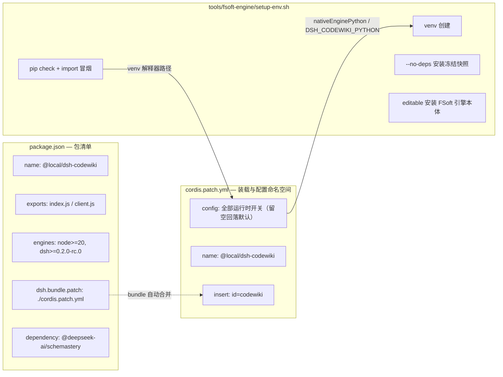
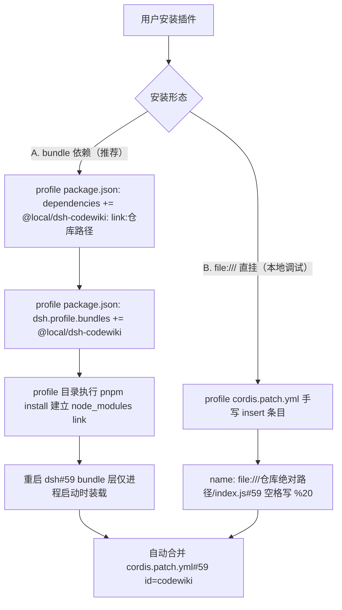
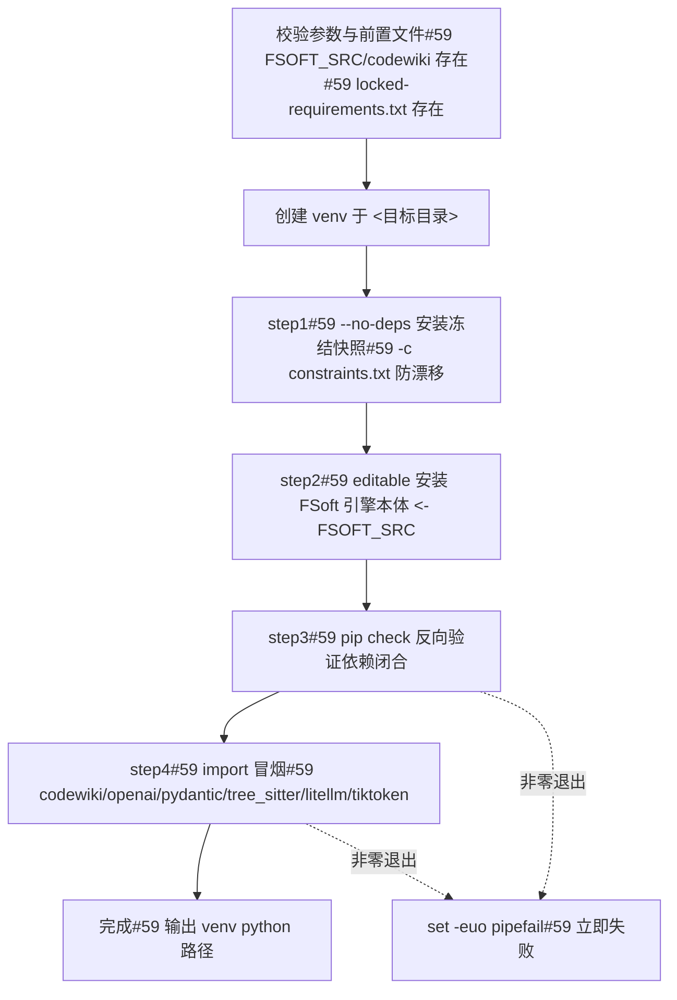
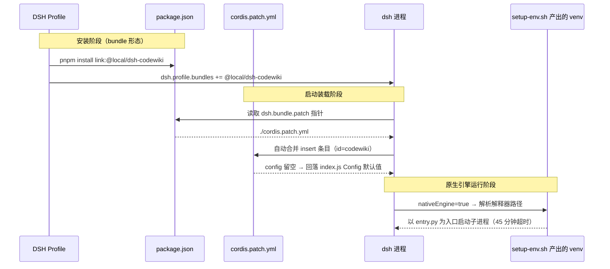

# 构建与部署配置（build_deployment_config）

## 简介

`build_deployment_config` 模块承担 `@local/dsh-codewiki` 插件的**打包清单、运行时配置与原生引擎环境搭建**职责，不包含业务逻辑代码。它由三份制品构成：

| 文件 | 角色 |
| --- | --- |
| `package.json` | npm 包清单：插件元数据、入口导出、引擎与依赖约束、DSH bundle 声明 |
| `cordis.patch.yml` | Cordis profile 补丁：定义 `codewiki` 插件的装载方式与全部运行时配置命名空间 |
| `tools/fsoft-engine/setup-env.sh` | 原生引擎 venv 环境引导脚本：按冻结快照构造依赖闭合的 Python 环境 |

三者串起「打包 → 装载 → 运行」链路：`package.json` 声明 bundle 指向 `cordis.patch.yml`；`cordis.patch.yml` 把插件 id 与配置注入 DSH profile；`setup-env.sh` 为默认通道（原生 Python 引擎）准备运行环境。

---

## 架构总览



---

## 包清单：`package.json`

`package.json`（仓库根）是插件对外的身份与打包声明。关键字段：

- **身份**：`name` 为 `@local/dsh-codewiki`，当前版本 `version: 0.17.13`，`private: true`，不在公共 npm 发布；`type: module` 使用 ESM。
- **入口导出**：`main: index.js`，`exports` 暴露 `.`（宿主端逻辑）与 `./client`（Web 端 [vscode_extension_client](vscode_extension_client.md) 面板）两个子路径。
- **引擎约束**：`engines.node >= 20`、`engines.dsh >= 0.2.0-rc.0`——低于该版本的 DSH 无法装载本插件。
- **运行依赖**：仅 `@deepseek-ai/schemastery`（用于把 `Config` schema 注册进 DSH 模型设置体系）。
- **DSH 集成声明**（`dsh` 字段）：
  - `dsh.client.platform: "web"`——客户端半边以 Web 形态注入宿主会话；
  - `dsh.bundle.patch: "./cordis.patch.yml"`——声明本包自带一份 Cordis 补丁，profile 装载 bundle 时自动合并。

> `description` 字段同时是重要的版本演进档案：自 `0.16.0` 起默认通道切到原生 Python 引擎，内置 Node 流水线降级为兼容通道；Node 侧 FSoft 算法重写已在 `0.16.0` phase 7 删除；默认模型在 `0.16.13` 切换为 `volces-ark/glm-5.3-flash`（512k 上下文）。这些决策直接决定了下方原生引擎配置项的存在与否。

---

## 装载方式与配置：`cordis.patch.yml`

`cordis.patch.yml`（仓库根）是插件随包分发的 Cordis profile 补丁。DSH profile 装载 bundle 时会自动把其中 `- insert` 列表合并进运行时 profile，**无需用户手工往 profile 的 `cordis.patch.yml` 追加条目**。

### 两种安装形态



两种形态必须保持同一插件 id：`codewiki`。bundle 形态下 `name` 必须是裸 npm 包名（不带 `/dsh` 子路径），因为客户端半边的激活扫描只认裸包名行。

### 配置命名空间（`config`）

补丁内 `config: {}` 刻意留空——未填的键全部回落到插件 `Config` schema（`index.js`）里的默认值。用户若要覆盖，在 **profile 自己的** `cordis.patch.yml` 里写同 id 覆盖条目（整对象替换，未写键仍回落默认），例如 `config: { batchModel: doubao-seed-2.1-lite }`。

| 分组 | 键 | 含义 |
| --- | --- | --- |
| 二进制 | `binaryPath` | `cw` 可执行文件路径；留空依次尝试 PATH 中的 `cw`、插件自带 `bin/cw.exe` |
| 模型 | `batchProvider` | 编译模型提供商（须已在模型设置注册；默认 `volces-ark`，留空=提交失败） |
| 模型 | `batchModel` | 编译模型 id（默认 `glm-5.3-flash`，512k） |
| 模型 | `batchReasoningEffort` | 思考程度档位（留空=模型默认档） |
| 并发 | `maxConcurrency` | 默认档并发上限（1–8，默认 2） |
| 并发 | `bigConcurrency` | 大档并发上限（1–8，默认 0=跟随默认档） |
| 原生通道 | `requestLimit` | 单模块写作请求上限（透传给上游写作 agent 的硬预算，1–1000，默认 100=引擎默认值；大模块撞满会抛错把整轮判成 partial） |
| 调度 | `serialProjects` | 单项目串行（默认开） |
| 产物 | `articleLanguage` | 文章语言（默认中文） |
| 规划 | `planMode` | `auto`=AST 符号 + LLM 语义聚类（默认）；`dirs`=顶层目录分组（旧行为） |
| 写作 | `agenticArticles` | 文章写作走 agentic 工具循环（默认开） |
| 写作 | `agenticMaxSteps` | agentic 单篇步数上限（默认 30，1–100） |
| 增量 | `symbolIncremental` | AST 符号级增量判定（默认开） |
| 会话 | `updateReminder` | 会话系统提示注入 wiki 维护提醒（默认开） |
| 产物 | `autoCommit` | 编译完成后自动提交 wiki 产物（默认开） |
| 原生通道 | `nativeEngine` | `true`（默认）= 交给上游 FSoft Python 引擎；`false`= 内置 Node 兼容通道 |
| 原生通道 | `nativeEnginePython` | venv 解释器绝对路径；留空 → 环境变量 `DSH_CODEWIKI_PYTHON` → `'python'` |
| 原生通道 | `nativeEngineEntry` | 入口脚本路径（默认 `lib/engine/python/entry.py`） |
| 原生通道 | `nativeEngineTimeoutMs` | 单次引擎调用上限（默认 2700000 ms = 45 分钟） |

**两条通道并存、互不回退**：原生通道环境不闭合时以 `engine-deps` 明确失败，不会悄悄回退到 Node 通道。这一契约由引擎客户端（见 [Code_Engine_Processing_Pipeline](Code_Engine_Processing_Pipeline.md)）强制执行。

---

## 原生引擎环境引导：`tools/fsoft-engine/setup-env.sh`

自 `0.16.0` 起默认 `nativeEngine: true`，编译工作交给上游 `FSoft-AI4Code/CodeWiki` Python 引擎子进程运行。但 FSoft 依赖树中 `openai` / `pydantic-ai-slim` / `pydantic` 的版本约束互相打架，正常 `pip install -r freeze.txt` 解析必然 `ResolutionImpossible`。该脚本因此改用**冻结快照直接落盘**策略构造可信 venv。

### 执行流程



### 关键设计

- **不重解析**：冻结清单本身是已解析完成的完整环境快照，`--no-deps` 等价于精确复制已验证组合；`constraints.txt` 防止未钉死的间接依赖被 pip 升级跑偏。
- **editable 必装**：`pip freeze` 快照里不会出现 `codewiki` 自身（editable 安装在 freeze 中只体现为依赖清单），故 step2 显式 `-e` 装入源码树。
- **验收兜底**：`--no-deps` 装出的环境靠 `pip check` + import 冒烟双重验收，任一失败非零退出。
- **隔离边界**：脚本只在插件仓库**之外**建环境（venv 不进 git），也不触碰 DSH 进程自身的 Python 环境。

### 用法

```bash
bash tools/fsoft-engine/setup-env.sh <目标目录> <FSoft 源码根> [python 可执行文件]
# 例：
bash tools/fsoft-engine/setup-env.sh ../.probe-fsoft/venv ../.probe-fsoft/src
```

装好之后，把 venv 解释器绝对路径写入配置 `nativeEnginePython`（或设置环境变量 `DSH_CODEWIKI_PYTHON`）。脚本刻意**不做**「找一个能用的解释器」的启发式猜测——猜错会把环境不闭合伪装成引擎故障。

---

## 端到端部署数据流



---

## 与其他模块的关系

- **运行时消费方**：`cordis.patch.yml` 中声明的 `nativeEngine*`、`batch*`、`agentic*` 等配置项，最终由 [Extension_Host_Execution_Orchestration](Extension_Host_Execution_Orchestration.md)（宿主端 `index.js` 装载与调度）与 [Code_Engine_Processing_Pipeline](Code_Engine_Processing_Pipeline.md)（引擎子进程驱动、质量门禁、工作区快照）读取并强制执行。
- **客户端激活**：`package.json` 的 `exports["./client"]` 与 `dsh.client.platform: web` 支撑 [vscode_extension_client](vscode_extension_client.md) 侧边栏面板的注入；bundle 形态下裸包名行是客户端激活扫描的识别依据。
- **环境验收参照**：[Testing___Probing_Tooling](Testing___Probing_Tooling.md) 中的 `probe-no-llm-graph.py` 等探测工具，复用本脚本构造的同一 venv 做无 LLM 图生成验证。
- **二进制侧**：`cw` CLI 由 [codewiki_vendor_binary](codewiki_vendor_binary.md)（Rust 源码）编译产出，`binaryPath` 配置项指向该可执行文件。

---

## 运维要点速查

1. **改配置**：永远在 profile 自己的 `cordis.patch.yml` 里写同 id 覆盖条目，不要直接改本仓库的 `cordis.patch.yml`（随包升级会被覆盖）。
2. **升级插件**：`package.json` 的 `engines.dsh` 是硬约束，DSH 版本过低时 bundle 装载直接失败。
3. **原生引擎坏了**：先跑一遍 `pip check` + import 冒烟（即 setup 脚本 step3/step4）；确认是 venv 漂移而非引擎代码问题，再重建环境。
4. **不要回退通道**：`nativeEngine: false` 只是功能受限的兼容通道（顶层目录分组 + 文件级 source_files 归属，无新特性），不能用来掩盖 venv 不闭合。
