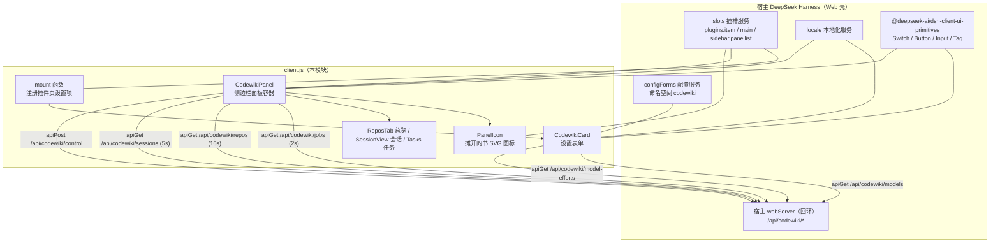
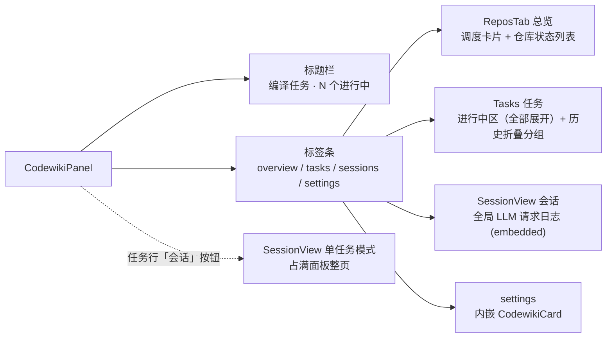
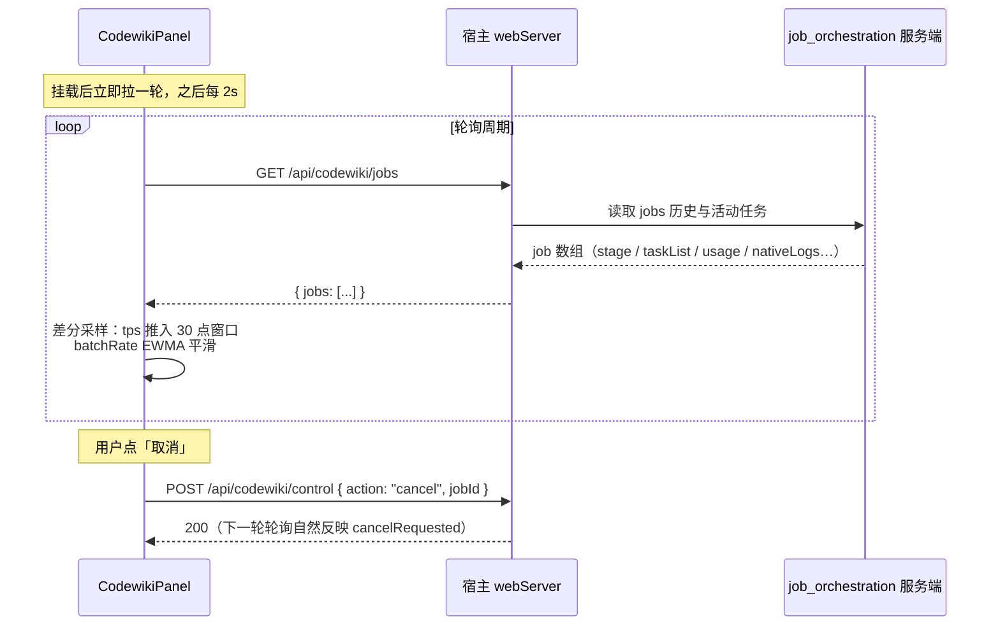
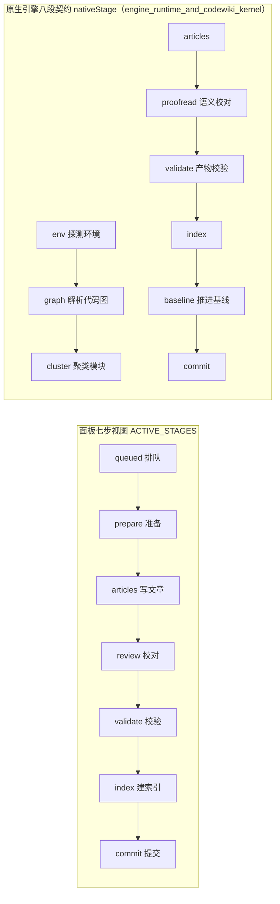
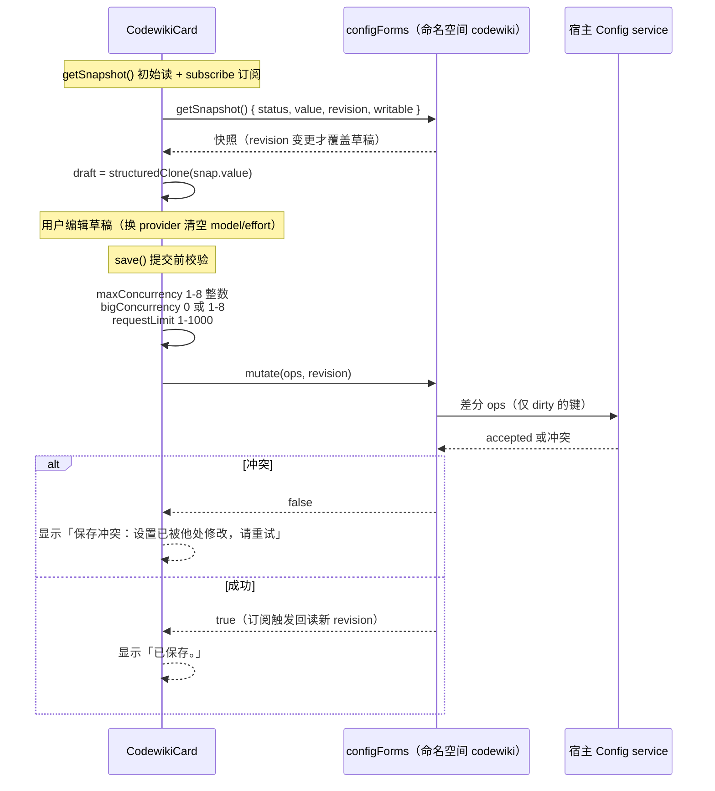

# client_panel_ui —— CodeWiki 插件客户端半侧（浏览器 UI）

## 简介

`client_panel_ui` 是插件 `@local/dsh-codewiki`（见 `package.json`）的**浏览器半侧**，全部代码集中在 `client.js` 一个文件内，由宿主 DeepSeek Harness（dsh）的模块加载器 `window.__ModuleLoader__` 在 Web 端激活。它在界面上承担两类职责：

1. **设置表单**：挂在宿主「插件」页的 `plugins.item` 插槽（id = `codewiki`，与 `cordis.patch.yml` 的 profile patch 条目一致），通过宿主 `configForms` 服务读写命名空间 `codewiki` 的配置，热生效、无需重启。
2. **侧边栏面板**：挂在宿主 `main` 插槽（渲染面板主体）与 `sidebar.panellist` 插槽（面板出入口图标，`order = 52`，排在 `dsh-hindsight-on-demand` 之后），实时展示编译任务进度、取消任务、总览各仓库 wiki 状态、查看 LLM 请求会话记录。

所有运行数据不来自本地计算，而是**轮询宿主半侧 webServer 端点**（`/api/codewiki/*`）取得——真正的任务调度、引擎驱动、状态持久化都在服务端完成（见 [job_orchestration_and_agentic_article_pipeline](job_orchestration_and_agentic_article_pipeline.md)）。

---

## 架构总览

`apply(ctx)` 是模块入口，声明依赖注入 `inject: ['slots', 'locale', 'configForms']`，并完成三件事：

1. 调用 `ctx.locale.register(NS, { zh: zh(), en: en() })` 注册中英文词典；
2. 用 `mount` 注册插件页设置项（优先通过 `configForms.whileServed` 等宿主服务该命名空间时才挂载）；
3. 用两个 `ctx.effect` 分别注册 `main` 面板与 `sidebar.panellist` 图标，卸载时回收。

---

## 组件构成

### 组件清单

| 组件 | 类型 | 职责 |
| --- | --- | --- |
| `CodewikiCard` | React 组件 | 设置表单：`view='summary'` 时渲染一行简介；`view='page'` 时渲染完整表单（运行 / 原生引擎 / 编译模型 / 大档模型 / 调度与排除五个 section + 保存条） |
| `CodewikiPanel` | React 组件 | 侧边栏面板容器：四个标签页（总览 / 任务 / 会话 / 设置），jobs 轮询与差分统计，进行中任务全部展开（无进行中时留最近一个当门面）+ 历史折叠区，取消任务、复制 wiki 路径 |
| `ReposTab` | React 组件 | 「总览」标签页：所有已编译仓库的 wiki 状态卡片 + 自动更新调度信息，支持排除 / 取消排除、确认首次编译、手动「更新」 |
| `SessionView` | React 组件 | 「会话」视图：并发池里每一次 LLM 请求的列表（5s 轮询）+ 点开看 prompt / 模型输出全文；支持 job 级单任务视图与 `job=null` 全局聚合视图，`embedded=true` 时嵌在面板标签页内不套 page 容器 |
| `PanelIcon` | React 组件 | 16×16 摊开的书 SVG，供 `sidebar.panellist` 渲染出入口 |
| `Spark` | React 组件 | 纯 SVG polyline 微趋势线（默认 56×16），用于吞吐徽标里的 tok/s 趋势 |
| `byUpdated` | 函数 | 任务排序比较器（按 `updatedAt ?? createdAt` 倒序）：进行中任务按它排序全部展开；无进行中任务时由它挑最近更新的一张当门面卡 |
| `save` / `discard` | 函数（位于 `CodewikiCard` 内） | 设置草稿的保存（校验 + `form.mutate` 差分 ops）与放弃（回滚草稿） |
| `line` | 函数（位于 `engineLogBlock` 内） | 引擎日志条目渲染器：把 NDJSON 事件拼成 `[phase] kind detail` 单行 |
| `zh` / `en` | 函数 | 中 / 英词典工厂（值必须为字符串，否则 `t()` 回退返回键名） |
| `mount` | 函数 | `plugins.item` 插槽的注册闭包 |

### 面板标签页结构

### 任务卡片（`jobCard`）渲染要素

- **头部行**：类型标签（全量 / 增量 / 续查）、所属仓库（`repoName` 取父目录/目录名两段）、阶段状态、吞吐徽标、「会话」按钮、（活动任务的）「取消」按钮——动作集中在右侧 `data-dscw-p-actions` 容器内；仓库名只在「进行中区的卡片」（`showCwd=true`）上显示，历史卡由分组头报目录，不重复；
- **总进度读数** `overallPct`：按 `STAGE_WEIGHTS` 定权，逐行累加各阶段 `frac × 权重`（进行中阶段的 frac 取 `taskList` 完成占比，原生通道取引擎自报的 `nativePercent`），封顶 99%、终态（`done` / `partial`）才 100%；进度不可知时整段不渲染，不编数字；
- **进度行 + 进度条**：左侧大数字百分比 + 右侧当前阶段读数（当前步骤名 + 该步已用时；原生通道再附「引擎阶段名 + 引擎自报百分比」，以 ` · ` 连接）；其下是 `data-dscw-p-bar` 总进度条（填充宽度 = 百分比，`data-tone` 随阶段着色）；
- **分阶段百分比** `stageBreakdown`：七行阶段名 + 行内小进度条 + 百分比，**只在活动卡片展开**——终态任务七行全是 100%，纯噪声；

- **元信息行**：已写 / 失败篇数、原生引擎阶段（`nativeStage` + 百分比）、质量门 / 落地结果、批次进度、排队 / 执行用时拆分、自动提交结果（短 sha 或失败原因）；
- **排队可见性**：`queueAhead` 列出「在等谁」；
- **用量行** `usageLine`：输入 / 输出 token（`fmtTok` 缩写）、请求数（批量 + 实时拆分）、超单请求预算的请求数红字警示；
- **活动流 / 引擎日志** `engineLogBlock`：折叠区，引擎日志只渲染内存里最近 40 条（完整文件可能上 MB，2s 轮询不直接读大文件）；
- **任务清单**、wiki 路径 + 「复制路径」按钮。

---

## 与服务端的交互：端点与轮询

所有请求经 `apiGet` / `apiPost` 两个薄封装（JSON、非 2xx 抛错），端点均为宿主半侧实现：

| 常量 | 方法 | 路径 | 周期 / 触发 | 消费组件 |
| --- | --- | --- | --- | --- |
| `JOBS_PATH` | GET | `/api/codewiki/jobs` | 2s（`POLL_MS`） | `CodewikiPanel` |
| `REPOS_PATH` | GET | `/api/codewiki/repos` | 10s（`REPOS_POLL_MS`） | `ReposTab` |
| `SESSIONS_PATH` | GET | `/api/codewiki/sessions`（可带 `?jobId=`） | 5s | `SessionView` |
| `SESSIONS_ITEM_PATH` | GET | `/api/codewiki/sessions/item?jobId=&n=` | 选中行时 | `SessionView` |
| `MODELS_PATH` | GET | `/api/codewiki/models` | 挂载时一次 | `CodewikiCard` |
| `EFFORTS_PATH` | GET | `/api/codewiki/model-efforts?provider=&model=` | 提供商/模型变化时 | `useEfforts`（普通档与大档各一份） |
| `CONTROL_PATH` | POST | `/api/codewiki/control`（回环） | 取消 / 确认编译 / 手动更新 / 排除后刷新 | `CodewikiPanel`、`ReposTab` |

防重叠保护：每个轮询组件都持有 `inFlightRef`，上次请求未回包时跳过本轮，避免服务卡顿叠加请求；组件卸载后统一置 `mountedRef.current = false`，晚到的回包不再 `setState`。

---

## 阶段模型：七步视图 vs 原生引擎八段契约

面板的七步视图（`ACTIVE_STAGES`）与引擎自报的细粒度阶段是两套体系；七步同时是词典里 `step*` 短名、进度权重与分阶段百分比（`stageBreakdown`）行结构的来源：

- **退役阶段名映射**：`LEGACY_STAGE = { plan: 'prepare', crosscut: 'articles' }`——历史任务里残留旧阶段名时，`stageOf(job)` 先映射再查七步，否则失败 / 取消时分阶段百分比会找不到当前行；阶段耗时 `stageTimings` 同样经 `timingsOf` 归一。
- **细粒度展示**：同名的 `articles / index / commit` 直接映射回七步行标签，其余阶段经 `NATIVE_STAGE_KEYS`（env / graph / cluster / proofread / validate / baseline）以「引擎阶段：xxx」另起一行显示，不混入七步行序号。
- **总进度权重** `STAGE_WEIGHTS = { prepare: 0.24, articles: 0.46, review: 0.14, validate: 0.07, index: 0.05, commit: 0.04 }`：准备阶段（环境 + 代码图 + 聚类）在大仓库最耗时，给到最高权重 0.24，避免百分比在相邻步骤间凭空跳点。`overallPct` 对 `stageRows(job)` 的每行（已完成阶段 frac=1、进行中阶段 frac 按 `taskList` / `nativePercent` 折算）求 `frac × 权重` 之和。
- **终态语义**：`done` 七行全 100%；`partial`（部分完成）也按 100% 显示——活干完了，由终态标签 + `blockers` 悬停说明「为什么没算完整成功」；只有 `failed / cancelled` 才在最后计时段标红 / 标黄（`lastTimedStage`）。

---

## 设置表单：读写模型与保存流程

要点：

- **草稿隔离**：`snapshot`（服务端值）与 `draft`（编辑态）分离，`dirty` 由两者 `JSON.stringify` 比对得出，只有 dirty 时「放弃 / 保存」按钮才可点；
- **乐观并发**：`mutate(ops, snapshot.revision)` 携带 revision，他处改过则返回 false 报冲突，不强制覆盖；
- **差分提交**：只把 `draft[key] !== base[key]` 的键生成 `{ op: 'set', path: [key], value }` 操作，覆盖 enabled / 并发 / 模型 / 大档 / 原生引擎 / 调度 / 排除清单等 27 个键（此前只能改配置文件的 `nativeEngine` / `nativeEnginePython` / `nativeEngineEntry` / `nativeEngineTimeoutMs` 四项已纳入表单，原「兜底档位 `sessionTier`」输入框已移除）；
- **模型目录联动**：拉不到 `/api/codewiki/models` 时（`catalogError`）整体退回「手填 provider / model id」形态，不阻断保存；已配置但目录里消失的 provider 保留为 `__custom` 选项，避免静默丢配置；换 provider 时自动清空 model 与 effort；
- **思考程度档位**：优先取 `/api/codewiki/model-efforts` 返回的 `efforts` 列表；目录未声明时退回通用档位 `GENERIC_EFFORTS = ['off','low','medium','high','xhigh','max']`，选了模型不支持的值由服务端 `llmChat` 兜底剥档重试。

---

## 关键常量

| 常量 | 值 | 含义 |
| --- | --- | --- |
| `NS` | `'codewiki'` | 词典与 configForms 命名空间（= profile patch 条目 id） |
| `KEY` | `'codewiki'` | 面板 key / `sidebar.panellist` 的 id（两者必须一致） |
| `PANEL_ORDER` | `52` | 面板在侧边栏列表的排序（50 = dsh-hindsight-on-demand） |
| `POLL_MS` | `2000` | jobs 轮询周期 |
| `REPOS_POLL_MS` | `10000` | repos 轮询周期 |
| `GENERIC_EFFORTS` | 6 档 | 模型目录未声明时的通用思考档位 |

样式为运行时注入的 `<style data-plugin="@local/dsh-codewiki">` 表（一套 `[data-dscw-*]` 属性选择器），HMR / 重复加载时通过 `document.head.querySelector` 去重，不堆叠。

---

## 与其他模块的关系

- **[job_orchestration_and_agentic_article_pipeline](job_orchestration_and_agentic_article_pipeline.md)**：服务端半侧，实现 `/api/codewiki/jobs`、`/api/codewiki/control`、`/api/codewiki/repos`、`/api/codewiki/sessions(/item)`、`/api/codewiki/models`、`/api/codewiki/model-efforts` 全部端点；`jobSummary`、`runPool`、`tick*` 等函数产出本面板渲染的 job 字段（`stage` / `taskList` / `usage` / `queueAhead` / `nativeLogs` / `batchProgress` / `autoCommit` 等）。本模块不重复实现这些字段的含义。
- **[engine_runtime_and_codewiki_kernel](engine_runtime_and_codewiki_kernel.md)**：原生引擎的八段契约（`nativeStage` 的 env / graph / cluster / proofread / baseline 以及质量门 `gateLabel`、落地 `applyLabel` 结果）由该模块产出，本模块只做标签映射与展示。
- **[build_configuration_and_test_verification_tooling](build_configuration_and_test_verification_tooling.md)**：`package.json` 声明 `@local/dsh-codewiki`（exports `./client` 即本文件）与 `dsh.client.platform = 'web'` 的客户端属性；`cordis.patch.yml` 给出插件安装方式（bundle 依赖 / file:// 直挂）与 `codewiki` 配置命名空间的键说明，客户端设置表单的字段集合与之对应。
