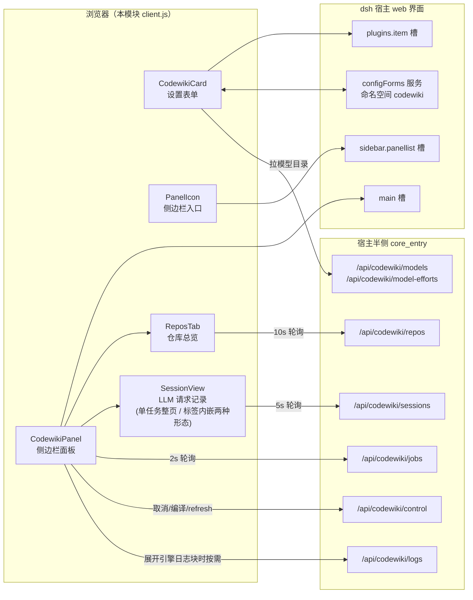
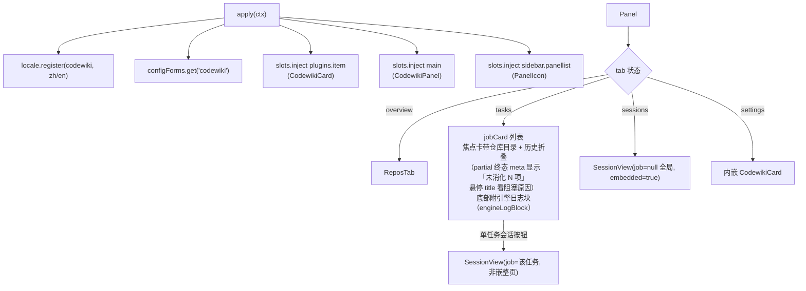
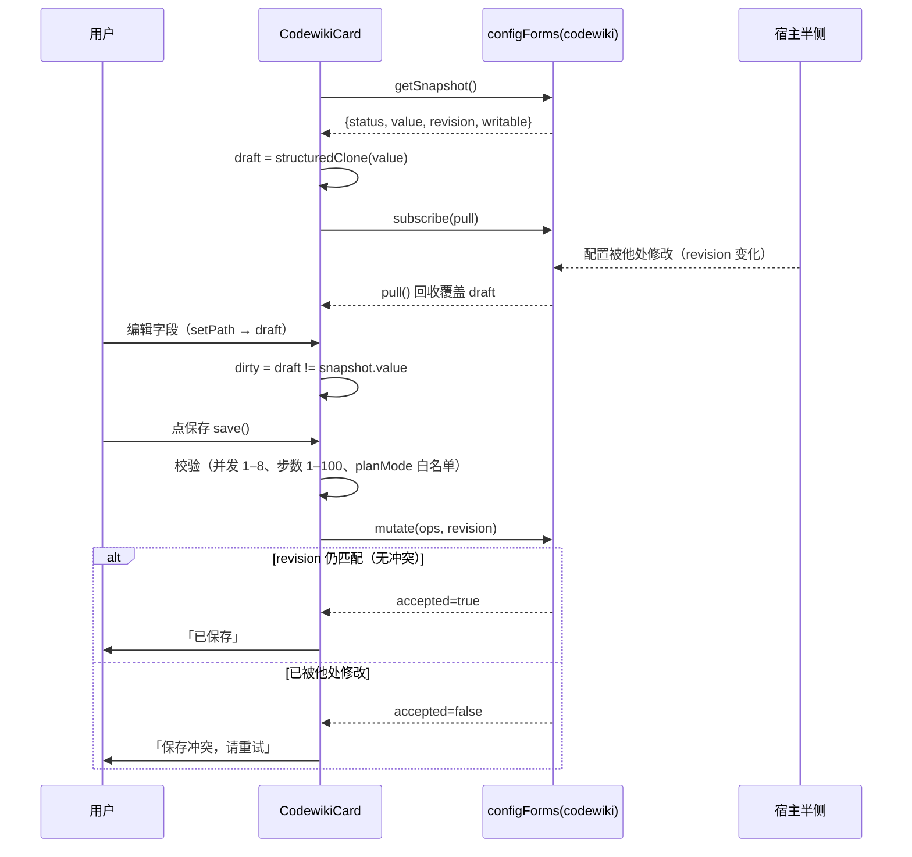
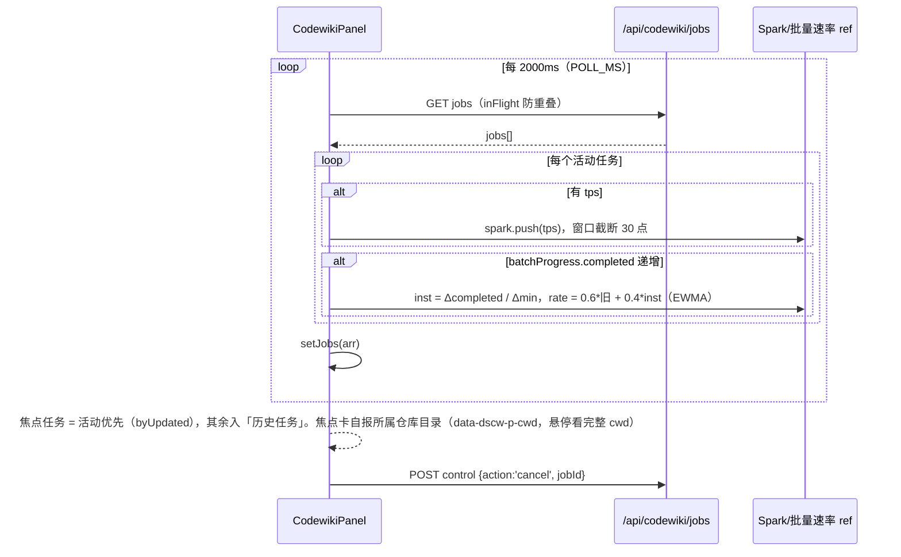
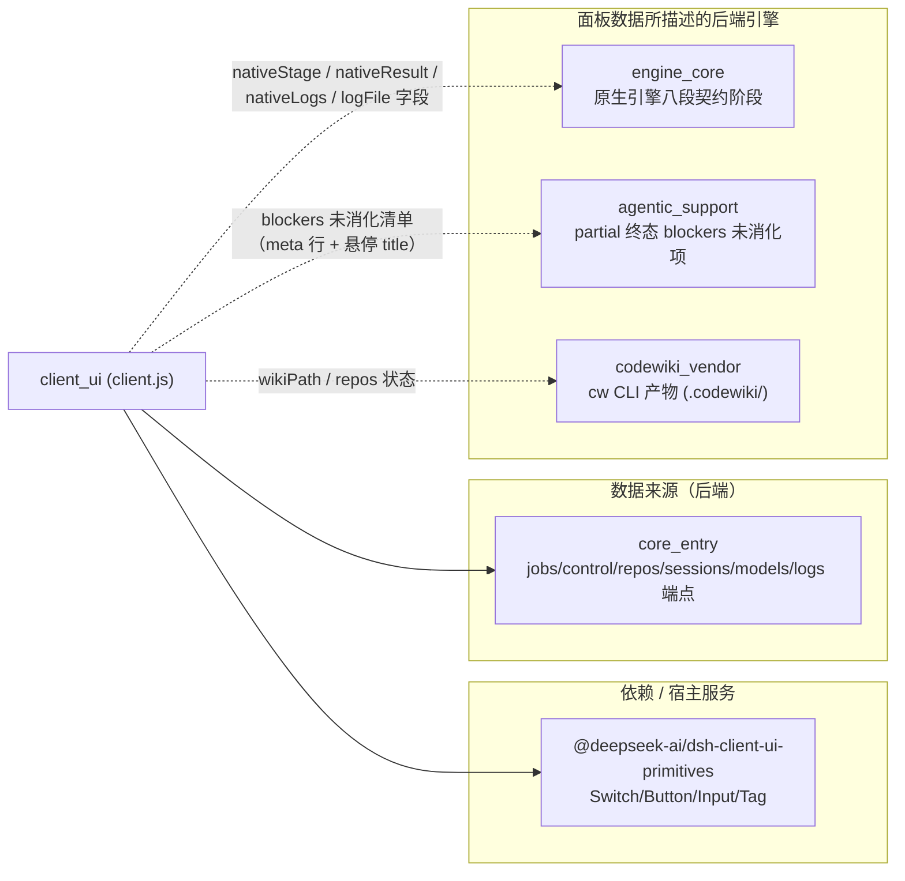

# client_ui —— dsh-codewiki 客户端半侧（浏览器）

## 简介

`client_ui` 是插件 `@local/dsh-codewiki`（见 [package_manifest](Build___Dependency_Configuration_Layer/package_manifest.md)）的**浏览器端模块**，全部实现集中在单个文件 `client.js`（v0.4.1）。它在 DeepSeek Harness（dsh）宿主的 web 界面上挂载两个入口：

1. **插件设置页** —— 注入宿主 `plugins.item` 槽位（`id = codewiki`，与 profile patch 条目一致），提供完整的编译运行设置表单；
2. **侧边栏面板** —— 注入 `main` 槽位（key = `codewiki`）渲染任务面板，同时在 `sidebar.panellist` 注册面板入口（`PanelIcon`），用于实时观察编译任务进度（焦点任务行标注所属仓库目录）、取消任务、查看仓库 wiki 总览、打开 LLM 请求会话视图（全局视图以嵌入形态留在标签页内）。

所有数据交换走宿主后端（core_entry 半侧）暴露的一组 JSON 端点：设置读写经宿主 `configForms` 服务的 `codewiki` 命名空间热生效，任务/仓库/会话数据经 `GET/POST /api/codewiki/*` 轮询获取。

## 模块结构与核心组件

`client.js` 以 `window.__ModuleLoader__.load({ id: '@local/dsh-codewiki', factory })` 形式注册，`apply(ctx)` 中依赖注入 `['slots', 'locale', 'configForms']` 三个宿主服务。组件清单：

| 组件 | 职责 |
| --- | --- |
| `mount` | 挂载编排：注册词典、插件页 `plugins.item`、侧边栏 `main` + `sidebar.panellist` 三处槽位 |
| `zh` / `en` | 中文 / 英文 UI 词典工厂（`locale.register(NS, {...})`），所有文案集中维护 |
| `CodewikiCard` | 设置页卡片：配置快照订阅、草稿编辑、模型目录联动（provider → model → reasoning effort 三段下拉）、校验与保存（`save` / `discard`） |
| `CodewikiPanel` | 侧边栏主面板：任务列表、四标签页导航（总览/任务/会话/设置）、轮询差分采样（tps spark 窗口、批量速率 EWMA）、焦点任务与历史折叠（焦点卡自报所属仓库目录）；`jobCard` 内对 `partial` 终态在 meta 行显示「未消化 N 项」、阻塞原因前 3 条放任务行悬停 title；`jobCard` 底部渲染 `engineLogBlock(job)`（引擎日志） |
| `engineLogBlock` / `line` | 引擎日志块（0.17.1）：把 `job.nativeLogs`（最近 40 条）渲染成可展开的 `
` 视图，行内逐条经 `line(e, i)` 格式化为「时间 [phase] kind detail」（HTTP 请求行另拼 `method path status ms`）；`job.logError` 一并显形，完整 NDJSON 日志经 `job.logFile` 路径引导到端点（避免面板轮询变成大文件下载），无日志且无 `logError` 时整块返回 null |
| `PanelIcon` | 侧边栏入口的摊开书本 SVG 图标 |
| `ReposTab` | 「总览」标签页：所有工作区 wiki 状态、自动更新调度信息、排除/取消排除、手动触发编译 |
| `SessionView` | 「会话」视图：并发池每次 LLM 请求的列表与 prompt/输出全文（单任务或全局两种模式；`embedded=true` 时以无内边距 `sesswrap` 容器嵌入「会话」标签页，只留精简返回条，不重复大标题） |
| `Spark` | 纯 SVG polyline 的 tps 微趋势线 |
| `byUpdated` | 任务按 `updatedAt` 倒序排序器（焦点任务选取） |
| `save` / `discard` | 设置草稿的提交（`form.mutate(ops, revision)` 乐观并发）与回滚 |

## 数据流

### 设置读写（configForms 快照 + 草稿 + 乐观并发）

要点：
- 仅当 `revision` 变化时才用服务端值覆盖草稿，避免输入过程中被回收打断；
- 保存只提交「draft 与基线有差异」的键（逐键 `set` op 列表）；
- `mount` 用 `configForms.whileServed([NS], ...)` 保证插件页仅在宿主服务该配置命名空间期间显形。

### 任务面板轮询与差分采样

面板侧所有派生数据（步骤条、总进度百分比重、吞吐徽标、排队/执行用时拆分）均由 `jobs[]` 快照即时计算，不在客户端持久化。

## 关键设计约定

1. **常量即契约**：`NS='codewiki'`（配置命名空间 / profile patch id）、`KEY='codewiki'`（面板 key，须与 `sidebar.panellist` 的 id 一致）、`PANEL_ORDER=52`（排在 dsh-hindsight-on-demand 的 50 之后）、`ACTIVE_STAGES=['queued','articles','crosscut','compose','review','index','commit']`（六段粗粒度步骤条 + 排队）。
2. **阶段双通道**：原生引擎（见 [engine_core](engine_core.md)）自报八段契约阶段（env/graph/cluster/validate/baseline 等），经 `NATIVE_STAGE_KEYS` 映射后**另起一行**展示，不改写粗粒度七步步骤条——两者粒度不同，混用会让步骤条错位。
3. **模型目录三段联动**：选 provider → 拉 `/api/codewiki/models` → 联动清空旧 model 与旧 effort → 按 (provider, model) 二次拉 `/api/codewiki/model-efforts`。目录不可用时整体退回「手填」形态（`Input` 直填 id），不阻断保存；目录未声明档位时用 `GENERIC_EFFORTS` 通用档位，模型不支持由 llmChat 兜底剥档。
4. **样式隔离**：所有 CSS 写在一条 `[data-plugin='@local/dsh-codewiki']` 样式表里（属性前缀 `data-dscw-*`，新增 `data-dscw-p-cwd` / `data-dscw-p-sesswrap` / `data-dscw-p-sessbar` / `data-dscw-p-engine-log` / `data-dscw-p-logline`），HMR/重复加载时先查存在性再注入，避免样式堆叠；主题色全部引用宿主 CSS 变量（`--dsw-alias-*`）。
5. **卸载安全**：轮询回包、剪贴板写入等异步回调均经 `alive` / `mountedRef` 守卫，组件卸载后不再 `setState`。
6. **焦点卡自报归属**：焦点任务（正在进行 / 最近一个）被排除在「历史任务」的仓库分组之外，没有分组头可读，因此 `jobCard` 在焦点卡行内附 `data-dscw-p-cwd` 徽标（`repoName(cwd)` 短名，悬停显示完整 `cwd`），其余任务不重复标注。
7. **会话视图的两种宿主形态**：单任务「会话」按钮让 `SessionView` 占满整页（`data-dscw-p-page` 容器 + 完整标题栏与 ✕ 关闭）；「会话」标签页内的全局视图传 `embedded=true`，改用无内边距的 `data-dscw-p-sesswrap` 容器并只留 `data-dscw-p-sessbar` 精简返回条——外层面板本身已是滚动容器，避免套两层 page 布局。
8. **partial 终态的阻塞原因展示**：`partial` 表示「写成了部分文章，但有变化没被消化」。`jobCard` 在 meta 行显示「未消化 N 项」，把前 3 条阻塞原因（`blockers[].detail ?? kind`，以「；」连接）放进任务行的 `title` 悬停查看——原因是几十字的中文句子，塞进 meta 会撑爆一行、把阶段/用时挤出可视区。
9. **引擎日志块（0.17.1）**：此前 `job.nativeLogs` 既不进 `jobSummary` 也不渲染，一次 99 分钟的编译在界面上完全不可解释。`jobCard` 在活动流折叠区之后、`job.error` 之前挂 `engineLogBlock(job)`：可展开的「引擎日志（N）」视图（`data-dscw-p-engine-log`，行容器 `data-dscw-p-logline`），逐条按「时间 [phase] kind detail」格式化（HTTP 请求行另拼 `method path status ms`）；`job.logError` 一并显形，完整 NDJSON 经 `job.logFile` 给出端点路径引导——只渲染「最近 40 条」进轮询快照，避免把面板轮询变成大文件下载。

## 与其他模块的关系

- **core_entry**：所有 `/api/codewiki/*` 端点（含 0.17.1 新增的 `/api/codewiki/logs`）的提供方；任务对象的字段（`stage`、`taskList`、`batchProgress`、`tps`、`usage`、`autoCommit`、`queueAhead`、`notes`、`nativeStage`、`nativeLogs`、`logError`、`logFile` 等）由其定义，本模块仅消费与渲染。详见 [core_entry](core_entry.md)。
- **engine_core**：原生引擎通道的八段阶段名与质量门（`gate`）/落地（`apply`）结果是面板「引擎阶段」「质量门」「落地」行的数据来源；任务的 `nativeLogs`（最近 40 条内存 NDJSON 记录）由 [core_entry](core_entry.md) 的 `recordNativeLog` 收口、经 `jobSummary` 透出，完整 NDJSON 经 `/api/codewiki/logs` 翻全量——是「引擎日志」折叠块的数据来源。详见 [engine_core](engine_core.md)。
- **agentic_support**：`partial` 终态下 `blockers`（未消化项）的前 3 条阻塞原因放任务行悬停标题（`title`）中展示——原因是几十字的中文句子，塞进 meta 行会撑爆一行。详见 [agentic_support](agentic_support.md)。
- **codewiki_vendor**：ReposTab 展示的各仓库 wiki 状态（clean/stale/error）与 `wikiPath` 均指向 `cw` CLI 维护的 `<repo>/.codewiki/` 产物。详见 [codewiki_vendor](codewiki_vendor.md)。
- **构建与依赖配置**：`client.js` 经 `package.json` 的 `exports['./client']` 暴露，宿主按 `dsh.client.platform='web'` 判定为客户端模块；`cordis.patch.yml` 以 `id: codewiki` 注册插件（与本模块 `NS` 一致）。详见 [Build___Dependency_Configuration_Layer](Build___Dependency_Configuration_Layer.md)。

## 端点一览

| 端点 | 方法 | 用途 | 轮询周期 |
| --- | --- | --- | --- |
| `/api/codewiki/jobs` | GET | 全部编译任务快照（`nativeLogs` 仅最近 40 条；完整 NDJSON 见 `job.logFile` 指向的日志端点） | 2000ms |
| `/api/codewiki/control` | POST | `cancel`（取消任务）/ `compile`（手动触发编译）/ `refresh`（失效总览缓存） | 事件驱动 |
| `/api/codewiki/repos` | GET | 各工作区 wiki 状态 + 调度器信息 | 10000ms |
| `/api/codewiki/sessions` | GET | LLM 请求列表（可带 `?jobId=` 单任务过滤） | 5000ms |
| `/api/codewiki/sessions/item` | GET | 单条请求的 prompt/输出全文（`?jobId=&n=`） | 选中时拉取 |
| `/api/codewiki/models` | GET | 模型提供商 + 模型目录 | 设置页挂载时 |
| `/api/codewiki/model-efforts` | GET | 指定 (provider, model) 的 reasoning 档位（`?provider=&model=`） | provider/model 变化时 |
| `/api/codewiki/logs` | GET | 按 `?jobId=&limit=` 翻仓库外 NDJSON 全量引擎事件日志（返回 `stage` / `channel` / `logError` / `stats` + `entries` 尾段） | 展开日志块时按需 |
