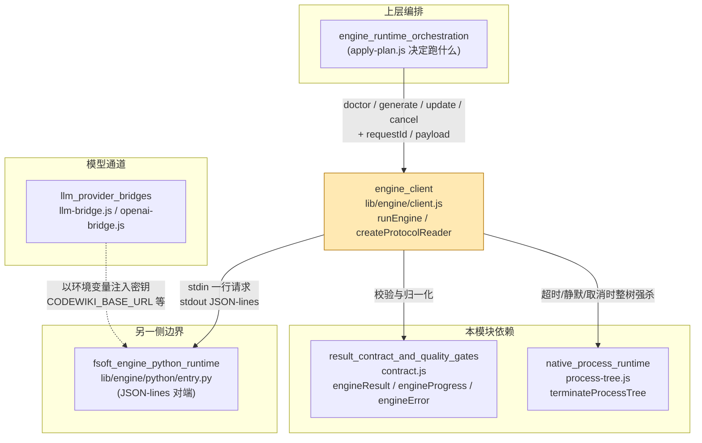
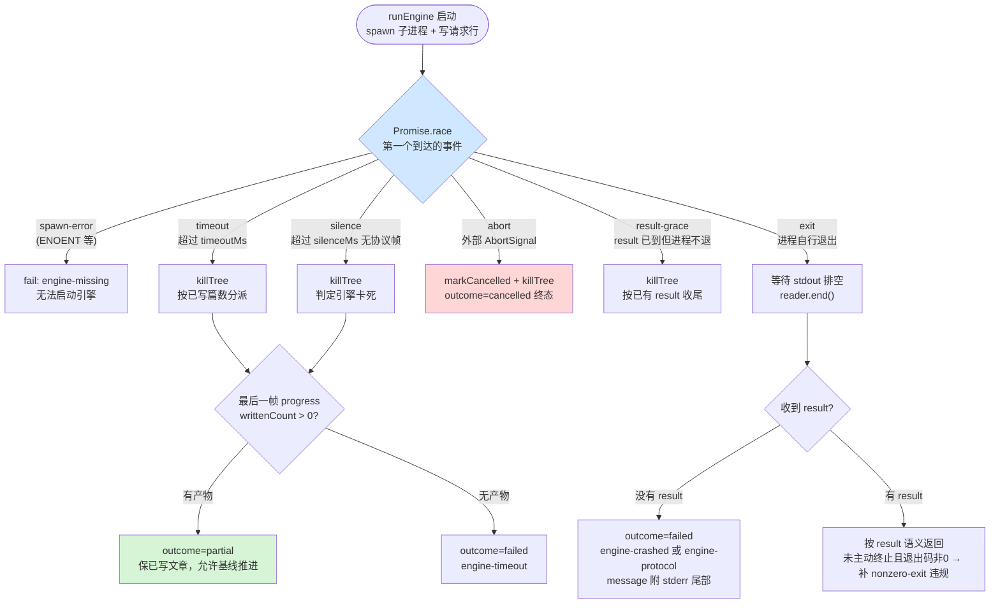

# engine_client：Node ↔ Python 引擎进程薄适配层

## 简介

`engine_client`（`lib/engine/client.js`）是整个 FSoft 原生引擎架构中**唯一的跨语言边界**。它不实现任何编译算法——依赖图、聚类、文章写作全部在 Python 侧引擎里完成——只负责三件刻意收窄的事：

1. **起受管子进程**：按调用方给出的 `engine` 描述 spawn 一次 Python 引擎，写一行请求 JSON 到 stdin，从 stdout 读回 JSON-lines；
2. **翻译协议帧**：把引擎吐出的 `hello / progress / error / result` 行翻译成 [result_contract_and_quality_gates](result_contract_and_quality_gates.md) 定义的 `EngineResult / EngineProgress / EngineError`；
3. **机读失败**：超时、取消、崩溃、协议破坏、静默卡死全部归一成结构化的失败事实（`outcome: failed / partial / cancelled` + `protocolViolations`），而不是抛一个模糊异常让上层猜。

它故意**不做**的事（文件头注释明确写下，防止它长成第二个编译器）：

- 不实现聚类 / 图 diff / 文章写作；
- 不读凭证、不连模型——模型通道由 [llm_provider_bridges](llm_provider_bridges.md)（`llm-bridge.js`）单独提供，密钥只经进程环境变量传入；
- 不写 `.codewiki/`——产物落盘与模块映射归 [workspace_state_and_integrity](workspace_state_and_integrity.md)（`output.js` / `mapping.js`）与 [native_apply_plan](native_apply_plan.md)。

## 架构位置



**与兄弟模块的分工**：

| 模块 | 关系 | 职责分界 |
| --- | --- | --- |
| [native_apply_plan](native_apply_plan.md) | 上层 | 决定「用哪个引擎命令、什么参数、payload 里带什么 scope」，再调用 `runEngine` |
| [native_process_runtime](native_process_runtime.md) | 底层依赖 | 只管「怎么把一棵进程树干净地杀掉」（Windows `taskkill /T`、POSIX 进程组），不碰协议 |
| [result_contract_and_quality_gates](result_contract_and_quality_gates.md) | 底层依赖 | 只做纯数据校验与归一化，本模块每条消息都过它的 `engineProgress/engineError/engineResult` 构造器 |
| [fsoft_engine_python_runtime](fsoft_engine_python_runtime.md) | 协议对端 | `entry.py` 实现协议的另一半：接管 stdout、UTF-8 钉码、60s 心跳、把 FSoft 进度转成八段契约帧 |

## 核心组件

### 导出总览

| 导出 | 类型 | 职责 |
| --- | --- | --- |
| `ENGINE_PROTOCOL_VERSION` | 常量（=1） | 协议行格式版本。与结果契约版本独立：前者管「行怎么长」，后者管「结果字段」（`contract.js` 的 `ENGINE_CONTRACT_VERSION = 2`） |
| `createProtocolReader({ requestId, maxLineBytes })` | 工厂函数 | 增量式 JSON-lines 读取器。纯逻辑、不碰进程，因此可以被逐字节喂 chunk（模拟管道任意切分），便于单测 |
| `runEngine(options)` | async 函数 | 跑一次引擎动作并归一成 `EngineResult`，本模块主入口 |

### 1. `createProtocolReader` — 增量 JSON-lines 读取器

内部按字节缓冲 stdout chunk，保证多字节 UTF-8 跨 chunk 不被切坏；按换行切行后逐条 `handleLine`。每条行返回归类（`hello / progress / error / result / violation`），供 `runEngine` 实时推送进度。

关键内建机制：

- **单行上限**（默认 4 MiB `DEFAULT_MAX_LINE_BYTES`）：引擎失控吐超长行时，整条记 `line-too-long` 违规并跳过，防止吃内存；
- **requestId 严格匹配**：所有非 `hello` 消息必须携带与本次请求一致的 `requestId`，否则记 `unknown-request`，**绝不参与本次结果**；
- **取消终态**：`markCancelled()` 之后到达的 `result` 一律记 `late-result` 并丢弃——取消是终态，不能被迟到的成功洗白；
- **重复 result**：先到的赢，后到的记 `duplicate-result`（视作引擎 bug，不是我们的）；
- **`end()` 幂等收尾**：缓冲里的残半行截断 JSON 记 `not-json` 违规，返回汇总 `{ result, progress, errors, violations, cancelled, endedWithResult }`。

### 2. `runEngine(options)` — 一次引擎动作的完整生命周期

入参要点：

- `engine`：`{ command, args?, env?, cwd? }` 进程描述（`spawnPlan` 统一规范；缺 `command` 直接抛错）；
- `requestId`：必填，协议关联键；
- `action`：仅允许 `doctor | generate | update | cancel`；
- `timeoutMs` 默认 600000ms；另有 `silenceMs`（默认 10 分钟，可被 `DSH_CODEWIKI_ENGINE_SILENCE_MS` 覆盖）、`resultGraceMs`（默认 2000ms）、`graceMs`（杀树宽限，默认 3000ms）、`maxLineBytes`；
- `signal: AbortSignal` 用于外部取消；`onProgress(p)` 实时增量回调、`onLog(e)` 收 stderr 与终止日志。

返回值始终是一个**已归一的结果对象**：在引擎 `result` 之上补 `contractVersion / requestId / action / protocolViolations / exitCode / exitSignal / terminated / stderrTail / durationMs / startedAt / finishedAt`。

## 协议不变量

文件头注释逐条声明了协议不变量（对应 `test-engine-client.mjs` 的断言），这是理解整个模块行为的钥匙：

| # | 不变量 | 违反时的表现 |
| --- | --- | --- |
| 1 | stdout **只**是 JSON-lines；非 JSON 行记 `not-json`，但**不丢弃**已收结果 | 引擎日志误写 stdout 是最常见破坏，记违规继续解析 |
| 2 | 每条消息带匹配 `requestId`；不匹配记 `unknown-request` | 绝不混入本次结果 |
| 3 | 没有 `result` 消息 = 协议破坏，即使退出码 0 也判失败 | 走 `engine-protocol`（正常退出无果）或 `engine-crashed`（退出码非 0），message 附 stderr 尾部 |
| 4 | 退出码只表达**进程层**结果，语义以 `result` 为准 | 退出 0 + 语义 failed 仍是失败；语义 done + 非 0 退出码保留 done 并记 `nonzero-exit` 违规 |
| 5 | 取消后到达的 result 记 `late-result` 并丢弃 | 取消终态不可被迟到成功覆盖 |
| 6 | 重复 result 先到的赢 | 后到的记 `duplicate-result` |

## 运行时事件竞争：五扇门

`runEngine` 用 `Promise.race` 在六个可能的「第一个终结事件」上分派分支，这是本模块最核心的控制流：



### 为什么需要「静默检测」和「结果宽限」这两条额外机制

注释里记录了两起真机事故，是理解这些分支设计意图的关键：

- **静默检测（silence）的来历（0.16.9 事故）**：默认 `timeoutMs` 长达 180 分钟，而僵死引擎会把这 180 分钟全部占满，锁死调度闸门（parallelLimit 默认 1），其它仓库全部排队。判据因此改为「多久没收到任何协议帧」。Python 侧 `entry.py` 有 60s 心跳线程补帧，正常在跑的引擎绝不会静默；Node 侧默认阈值 10 分钟（刻意留 10 倍余量，区分「慢」与「死」）。静默超限时与超时分支同口径：有产物 → `partial`，无产物 → `failed`，错误码统一 `engine-timeout`。
- **结果宽限（resultGraceMs）的来历**：引擎发出 `result(done)` 后若卡在收尾（僵死线程、没关的 pipe），过去会被 10 分钟静默或 180 分钟超时**改判**成卡死/超时——明明产物早写完了。所以 result 一到就给进程一个 2 秒的自行收场窗口，超时即按已有 result 杀掉收尾，绝不把已确定的语义结果改判。

## 端到端时序

```mermaid
sequenceDiagram
    participant CALLER as 调用方<br/>(native_apply_plan)
    participant EC as engine_client
    participant PT as process-tree
    child as Python 引擎<br/>entry.py

    CALLER->>EC: runEngine({action, requestId, payload, signal})
    EC->>child: spawn(detached 进程组)
    EC->>child: stdin 写入一行 JSON 请求 + EOF
    child-->>EC: hello (protocolVersion)
    Note over EC: 版本不符 → protocol-version 违规#59;不匹配继续
    child-->>EC: progress 帧 ×N (含 60s 心跳)
    EC->>CALLER: onProgress(增量快照)
    child-->>EC: error 帧 (语义失败，可能后面还有 result)

    alt 正常完成
        child-->>EC: result 帧
        EC->>EC: armResultGrace(2s)
        child-->>EC: exit (0)
        EC->>CALLER: 归一化 EngineResult (done/partial/failed)
    else result 已到但进程不退
        child--xEC: (卡住不退)
        EC->>PT: terminateProcessTree (result-grace)
        EC->>CALLER: 按已有 result 收尾
    else 静默卡死
        EC->>EC: silenceTimer 判定
        EC->>PT: terminateProcessTree (silence)
        EC->>CALLER: partial(已写>0) 或 failed
    else 外部取消
        CALLER-->>EC: AbortSignal
        EC->>EC: reader.markCancelled()
        EC->>PT: terminateProcessTree (abort)
        EC->>CALLER: outcome=cancelled#59;迟到 result 记 late-result
    end
```

## 关键配置与环境变量

| 旋钮 | 默认 | 位置 / 覆盖方式 | 说明 |
| --- | --- | --- | --- |
| `timeoutMs` | 600000ms | `runEngine` 入参 | 整体超时；超时但已写文章 → `partial` 交付 |
| `silenceMs` | 10 分钟 | `DSH_CODEWIKI_ENGINE_SILENCE_MS` 环境变量 / 入参 | 无任何协议帧即判卡死；必须显著大于 entry.py 的 60s 心跳 |
| `resultGraceMs` | 2000ms | 入参 | result 到达后等进程自行退出的宽限 |
| `graceMs` | 3000ms | 入参 | 杀进程树前 SIGTERM 宽限（见 [native_process_runtime](native_process_runtime.md)） |
| `maxLineBytes` | 4 MiB | 入参 | 单行协议帧上限，防失控吃内存 |
| `DEFAULT_STDERR_TAIL` | 4000 字符 | 常量 | stderr 只保留尾部进结果，供排障 |

## 排障线索（结果对象里看什么）

当一轮编译失败时，消费方应按顺序读归一结果上的这几个字段：

1. `outcome` + `error.code`：决定重试语义（`engine-missing` 是环境问题、`engine-timeout` 直接重跑通常能过、`engine-crashed` / `engine-protocol` 需要人工看现场）；
2. `protocolViolations`：每条 `{kind, detail}` 解释了协议层发生了什么（`not-json` / `unknown-request` / `late-result` / `nonzero-exit` / `line-too-long` …）；
3. `stderrTail`：引擎崩溃现场只在 stderr 里吐得出来，本模块强制把尾部塞进 message，避免可机读失败退化成翻日志。

## 相关模块

- 上层调用方：[native_apply_plan](native_apply_plan.md)（`apply-plan.js` 组装引擎命令并消费 `EngineResult`）
- 进程终止实现：[native_process_runtime](native_process_runtime.md)（`process-tree.js`）
- 结果契约与归一：[result_contract_and_quality_gates](result_contract_and_quality_gates.md)（`contract.js` / `quality-gate.js`）
- 协议对端：[fsoft_engine_python_runtime](fsoft_engine_python_runtime.md)（`entry.py` 的 stdout 守卫、心跳、UTF-8 钉码）
- 模型通道：[llm_provider_bridges](llm_provider_bridges.md)（密钥经环境变量注入引擎进程，本模块不接触）
