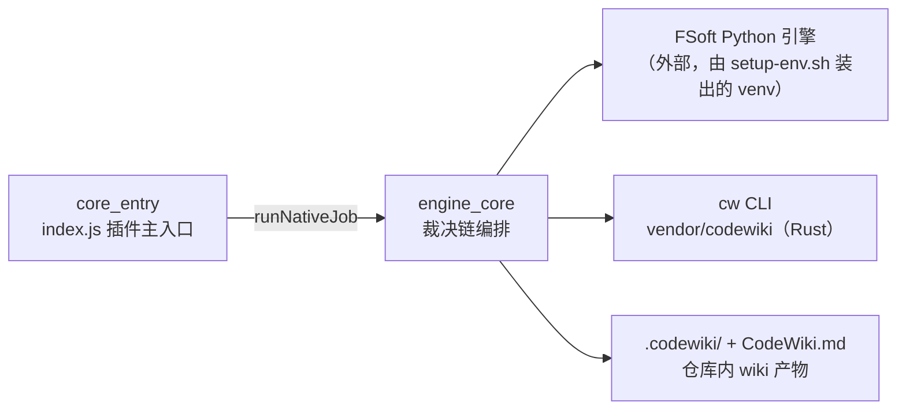
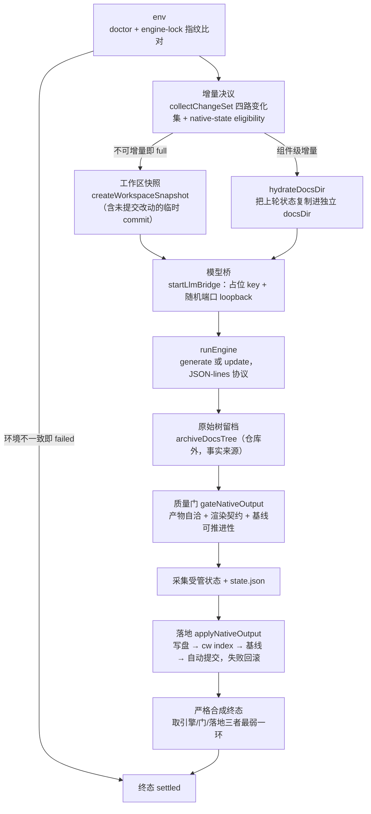
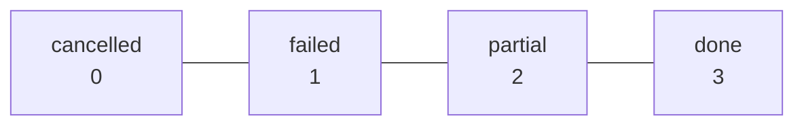

# engine_core：原生引擎编译核心层

## 模块定位

`engine_core`（`lib/engine/`）是本插件 **0.16.0 起的默认编译通道**——它把上游
FSoft-AI4Code/CodeWiki Python 引擎作为受管子进程驱动，取代了插件早期在 Node 侧
自行重写聚类、图 diff、增量算法的实现（该实现已于 0.16.0 阶段 7 删除）。
按 `package.json` 的说明，`nativeEngine: true` 时一切依赖图构建、模块聚类、文章写作、
增量 diff 都发生在 Python 侧；Node 侧只负责：

- **跨语言边界的协议翻译**（JSON-lines 薄入口 + 进程适配）；
- **模型通道代理**（OpenAI-compatible loopback 桥，凭证不出宿主）；
- **环境可信性**（引擎版本 / Python 版本 / 上游 commit 指纹锁定）；
- **产物的采用裁决**（质量门）与**入库落地**（原子写盘 → 索引 → 基线 → 自动提交）；
- **增量的跨轮受管状态**（把引擎下一轮做组件级增量所依赖的图/树/文章持久化）。

一句话概括本层与上下游的关系：



宿主插件入口见 [core_entry.md](core_entry.md)；cw CLI 本体（`cw index` / `cw meta update`
在本层被调用）见 [codewiki_vendor.md](codewiki_vendor.md)；负责把环境装出来的
`tools/fsoft-engine/setup-env.sh` 见 [Ecosystem_Tooling___Validation_Layer.md](Ecosystem_Tooling___Validation_Layer.md)。

## 架构总览：一条不可洗白的裁决链

本层的全部设计都围绕一个教训展开：**0.14.0 时「1 篇成功 + 19 篇失败也报 done」**。
为此 `native-run.js::runNativeJob` 把一次完整编译固定成一条直线，每一步的结论都
不允许被下一步提升：



### 终态强弱规则（native-run.js 的 RANK）



合成终态 = `weakest(weakest(engineOutcome, gateOutcome), applyOutcome)`——
**最弱的一环说了算**。同时由 `contract.js` 的硬不变量保证：

- `done` 不许带 blockers（带了即自相矛盾，强制降级为 partial）；
- `partial` 必须带至少一条 blockers（否则等于伪装成功）；
- `failed` 必须带 error；
- 取消是终态，迟到的成功结果（`late-result`）不能洗白它。

### 八段契约阶段（`ENGINE_STAGES`）

面板步骤条、`job.stage` 映射、取消检查点全部按这八个阶段对齐，顺序即推进顺序：

```mermaid
flowchart LR
    env["env"] --> graph["graph"] --> cluster["cluster"] --> articles["articles"] --> validate["validate"] --> index["index"] --> baseline["baseline"] --> commit["commit"]
```

其中 Python 入口 `entry.py` 只覆盖前四段（经 `stage_map.py` 从 FSoft 的五段进度
翻成八段），`index` / `baseline` / `commit` 由 Node 侧的落地器执行——这就是
进度上限刻意压在 90% 的原因（剩下 10% 留给 Node 收尾，避免「引擎说 100% 但 wiki
还没索引」的假完成）。

进度帧的百分比有两种算法：常规阶段按 `percent_of(stage, stage_progress)` 算，
而**增量轮与阶段 3** 按 `articles_percent(written, expected_total(written))` 算——
因为这两段的 `stage_progress` 恒为 0（FSoft 把该阶段的 `update_stage` 全门控在
verbose 里）。增量轮还有一个语义修正：FSoft 借用「模块聚类」的槽位
（`start_stage(2, "Incremental Update")`）跑整轮文章写作，阶段号会把它谎报成
`cluster`，因此按 description 识别出增量轮（`is_incremental`）后，后续帧一律按
`articles` 槽位上报，跑完即复位。分母（本轮预期篇数）取本轮开始时 docs 里
已有的 `.md` 篇数（与 `written` 同源比对），`written` 超过基线篇数（新建页）时以
`written` 为准，保证百分比单调不倒退；`articles_ceiling()` 返回 articles 槽位的
百分比上限（阶段 3 完成时的值）。

## 子模块划分

`engine_core` 体量很大，按职责拆成三份文档：

### 1. [协议与模型通道层](engine_core/engine_core_contract.md)

跨语言边界上的薄适配，是整个迁移里唯一的「行怎么长、结果字段怎么定」的边界：

| 组件 | 职责 |
| --- | --- |
| `contract.js` | `EngineResult` / `EngineProgress` / `EngineError` 的版本化契约、四态语义硬不变量、`validateEngineResult` / `normalizeBlocker` / `describeEngineResult` |
| `python/entry.py` | Python 侧薄入口：stdout 协议守卫（`_ProtocolOnly`）、UTF-8 补丁（`_popen_init_utf8`）、`main` 主循环，把 FSoft 调用翻成 JSON-lines 结果 |
| `client.js::runEngine` | Node 侧进程适配：spawn 子进程、JSON-lines 读取、超时/静默/取消/协议破坏的机读失败；result 到达后启「结果宽限」（`resultGraceMs`），进程不自行退出则按已收到的 result 收尾，不再等僵死收尾拖到超时 |
| `llm-bridge.js::startLlmBridge` + `openai-bridge.js` | OpenAI-compatible loopback 桥：占位 key 校验、`isPlaceholderKey`、请求/响应双向纯转换；可选 `onRequestStart` 会话记录钩子——原生通道的每个模型请求都只经过这里，回调契约与 batch 通道一致（`onDelta` / `onError` / `onDone`） |

关键设计：凭证边界——桥**不读**任何凭证文件，引擎侧只拿到
`http://127.0.0.1:<随机端口>/v1` 和一个随机占位 key（`dsh-bridge-...`），
真实凭证只存在于宿主 provider 内部。会话记录同样遵守这条边界：`onRequestStart`
只记 messages 文本（超长截断）与模型输出，绝不把 Authorization 请求头或占位 key
写进面板「会话」视图的记录。

### 2. [编译编排与受管状态层](engine_core/engine_core_compilation.md)

把一次编译的裁决链固定成直线的编排器，以及增量能成立的持久化底座：

| 组件 | 职责 |
| --- | --- |
| `native-run.js::runNativeJob`（导出符号仅 `noop`） | 阶段 4 生产通道编排：env → 增量决议 → 快照 → 模型桥 → 引擎 → 留档 → 质量门 → 落地 → 合成终态；全部依赖注入，测试可换假实现 |
| `manifest.js::doctor` / `writeLock` | 环境指纹（引擎版本 + Python 版本 + 上游 commit）、`engine-lock.json` 落盘与漂移判定 |
| `native-state.js::stateDocFiles` | 跨轮受管状态：`.codewiki/_native-state/` 下的图/模块树/文章副本、水合（hydrate）、采集（capture）、`unconsumed` 未消化账目的合并 |
| `workspace-snapshot.js` | `createWorkspaceSnapshot`：用独立 index 文件把未提交改动合成不挂 ref 的临时 commit，让引擎的记账（commit_id）与内容对齐；`shortSha` / `snapshotExists` |

关键设计：**增量不是调用方说的，是证据说的**——`collectChangeSet`（见
[core_entry.md](core_entry.md) 依赖的 `lib/change-set.js`）采集四路变化集，
`isUpdateEligible` 核对受管状态齐全度 / 引擎版本兼容 / 基线可达，任一不成立
就显式退全量并记 `incremental-fallback`，绝不假装 clean。

### 3. [采用门与原子落地层](engine_core/engine_core_artifact_gate.md)

引擎交出产物之后、真正写进仓库之前的两道关卡：

| 组件 | 职责 |
| --- | --- |
| `quality-gate.js::gateNativeOutput` | 采用门：产物自洽（复用 `output.js`）→ 渲染成 wiki 文章（frontmatter 合成）→ 逐篇契约检查 → 基线可推进性裁决；三类问题（defect / degradation / stale）机读分流。基线许可 `baselineEligible` 只有一种来源：本轮三类问题全空（outcome=done）——不再允许 partial 偷偷推进；`canAdvanceBaseline` 是兼容字段，语义与 `baselineEligible` 一致。空骨架基线（`cw init` 刚建、`last_compiled_commit` 为 null）按 `baseline-absent` 记，首次编译可以走成 done |
| `quality-gate.js::toQualityIssues` | 把门的 blockers 翻成 update-record 的 `qualityIssues` |
| `apply-plan.js::applyNativeOutput` | 落地器：写集白名单校验 → pre-image 快照 → 写盘 → `cw index` → 链接规范化 → 索引收录核对 → `cw meta update` 基线 → 自动提交；索引/基线失败整批回滚，提交失败不回滚产物。输出把「基线许可」与「基线落地事实」分开记账：`baselineAdvanced` 是 `cw meta update` 真的成功（落地事实），`canAdvanceBaseline` 兼容字段取 `applied && baselineAdvanced` |
| `apply-plan.js::defaultRunCw` | 默认 cw 调用通道（同步 spawn）；`runCw` / `commit` 均可由调用方注入 |
| `apply-plan.js::findOrphanPages` | 扫描存量模块页，找出 `source_files` 全部已失效的孤儿页，随本批删除 |

关键设计：**三条硬不变量**——写集封闭（只许写 `.codewiki/` 与根 `CodeWiki.md`）、
索引/基线失败即回滚、提交失败不回滚有价值的产物。

关键设计：**基线三件事分开记账**——`native-run.js::settle` 的输出把同一件「基线」
拆成三个互不冒充的字段：`baselineEligible`（质量门许可：本轮三类问题全空，才允许
推进）、`baselineAdvanced`（落地器事实：`cw meta update` 真的成功）、以及兼容字段
`canAdvanceBaseline`（老调用方只认这个名字，语义取落地事实）。受管状态采集不完整
（缺图/树/metadata 或采集异常）时置 `stateIncomplete`：保留上一轮旧状态、不裁剪、
不推进基线，并合成一条 `quality-gate` blocker——下一轮已经无法增量，本轮没有资格
替下一轮记账。


## 数据落点速查

| 路径 | 内容 | 写入方 |
| --- | --- | --- |
| `.codewiki/` | wiki 文章树、`_index.md`、`_meta.yaml` 基线 | 落地器（`cw index` / `cw meta update`） |
| `CodeWiki.md` | 仓库根入口页（overview 剥 frontmatter） | 落地器 |
| `.codewiki/engine-lock.json` | 引擎环境指纹（版本/Python/上游 commit） | `manifest.js`，随首批产物同事务提交 |
| `.codewiki/_native-state/` | 跨轮受管状态：图/模块树/metadata/上轮文章副本/`state.json` | `native-state.js` 采集，随写集同事务 |
| 仓库外临时目录（按 jobId） | 引擎原始 docs 树留档（事实来源） | `archiveDocsTree` |
| 进程环境变量 `CODEWIKI_BASE_URL/API_KEY/MAIN_MODEL` | 模型通道（占位 key） | `native-run.js` 注入，引擎入口 `entry.py` 读取 |

## 与其它模块的关系

- **[core_entry.md](core_entry.md)**：插件主入口 `index.js` 通过
  `runNativeJob`（`native-run.js`）起一次原生编译，按 `EngineResult` 的终态
  更新 job 状态、驱动面板进度；本层不反向 import 它（依赖注入方向单向）。
- **[codewiki_vendor.md](codewiki_vendor.md)**：`cw index` / `cw meta update` /
  `cw init` 由落地器与 `manifest.js` 调用；`cw index` 对 frontmatter 解析失败
  **静默跳过且退出码为 0** 的行为，直接催生了落地器里「索引必须真的收录本次写的
  文章」的核对步骤（`findArticlesMissingFromIndex`）。
- **[Ecosystem_Tooling___Validation_Layer.md](Ecosystem_Tooling___Validation_Layer.md)**：
  `tools/fsoft-engine/setup-env.sh` 负责在仓库外 venv 里按冻结清单 `--no-deps`
  落盘 FSoft 依赖并 `pip check` 验收；`manifest.js` 的 doctor 在运行时复核同一
  条「依赖闭合」结论，不一致即 failed，绝不绕过。
- **[agentic_support.md](agentic_support.md)**：旧 Node 通道（`nativeEngine: false`）
  的文章写作与更新记录逻辑；原生通道的 `describeEngineResult` 文案口径与其
  `describeOutcome` 保持一致（四态可一眼分清）。
