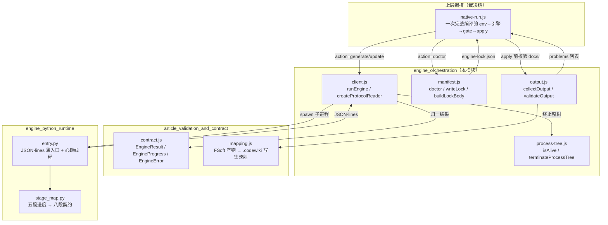
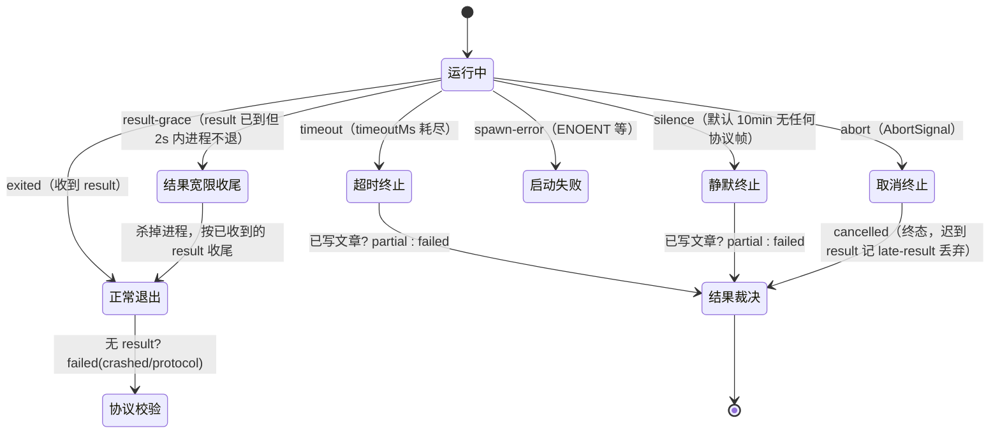
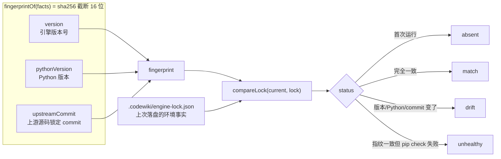
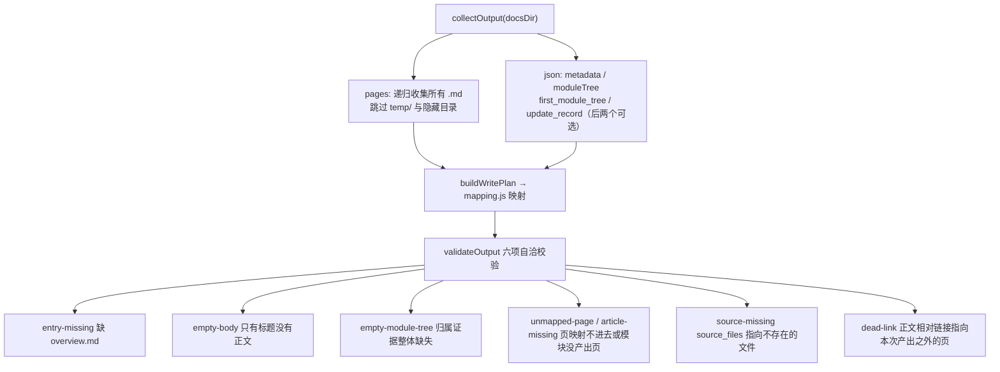
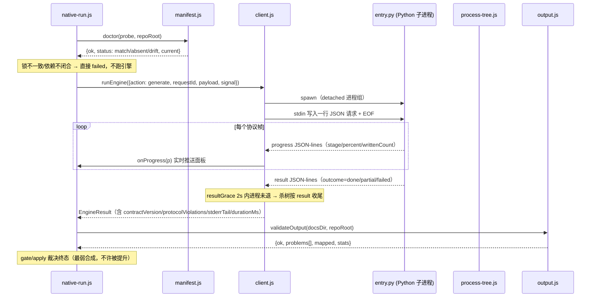

# 引擎编排（engine_orchestration）

## 简介

`engine_orchestration` 是 CodeWiki 原生引擎（FSoft Python 引擎）的**进程级编排层**，位于 Node 侧与 Python 侧之间的唯一跨语言边界上。它本身**不实现任何文档生成算法**——聚类、图 diff、文章写作全部由 Python 引擎完成；本层只负责四件事：

1. **起进程**：以受管子进程方式拉起 Python 引擎入口 `lib/engine/python/entry.py`，写入一行 JSON 请求、读回 JSON-lines 响应（[client.js](lib/engine/client.js)）；
2. **管进程**：超时、静默卡死检测、用户取消、进程树整树终止（[client.js](lib/engine/client.js) + [process-tree.js](lib/engine/process-tree.js)）；
3. **锁环境**：对引擎版本、Python 版本、上游源码 commit 计算指纹并落盘锁定，环境漂移时明确报出（[manifest.js](lib/engine/manifest.js)）；
4. **验产物**：把引擎产出的 `docs/` 目录读成结构化事实，校验产物自洽性（缺页、空正文、死链、来源文件缺失），为上层裁决链提供可机读的 problems 列表（[output.js](lib/engine/output.js)）。

本层的设计原则是**边界刻意窄**：协议破坏、取消迟到的成功、超时已写出的文章等真机事故都在本层被收敛成「可机读的失败/部分完成」，而不是模糊异常。它是 [native_apply_and_quality_gate](native_apply_and_quality_gate.md) 中 `native-run.js` 裁决链（`env → 增量决议 → 引擎 → 质量门 → 落地`）的地基。

---

## 架构定位

**职责边界（写下来防止这里长成第二个编译器）**：

| 本层负责 | 本层不做 |
| --- | --- |
| 起/管/杀子进程、JSON-lines 协议收发 | 聚类、图 diff、文章写作（Python 引擎的活） |
| 把引擎消息翻译成 `EngineResult/EngineProgress/EngineError` | 读凭证、连模型（由 [llm_bridge_integration](llm_bridge_integration.md) 单独提供） |
| 环境指纹计算、lock 落盘与漂移比对 | 装依赖、修环境、联网（`doctor` 只读诊断；修复由 `tools/fsoft-engine/setup-env.sh` 完成） |
| 读 `docs/` 产物、判自洽性（页在不在、正文空不空、链接死不死） | 重新映射格式规则（只调 [article_validation_and_contract](article_validation_and_contract.md) 的 `mapping.js`） |

---

## 核心组件

### 1. `client.js` — Node ↔ Python 薄适配层

#### `runEngine(options)`

跑一次引擎动作（`doctor | generate | update | cancel`）并归一成 `EngineResult`。调用方须提供：

- `engine: {command, args, env, cwd}` —— 引擎命令描述（由上层的 native-run 派生，通常指向 venv 里的 Python + `entry.py`）；
- `requestId` —— 唯一关联键，协议层用它过滤消息（缺失/不匹配的消息一律记违规，绝不参与结果）；
- `action` + `payload` —— 动作与附加字段（scope/language/model/compareTo…）；
- `timeoutMs`（默认 600000；生产通道由 native-run 覆盖为 **180 分钟**——真机实测一轮 articles 66min + crosscut 10min + review 69min ≈ 174 分钟，45 分钟预算必然砍在 54%）；
- `signal: AbortSignal` —— 用户取消；
- `onProgress / onLog` —— 实时进度与 stderr/终止日志回调。

**进程监管的六道闸门**（`Promise.race` 决定第一事件，随后按分支收尾）：

关键判据：

- **静默检测**：默认 `DSH_CODEWIKI_ENGINE_SILENCE_MS` 未设时取 `max(30s, 10min)`。为什么必须显著大于 `entry.py` 的心跳间隔（`_HEARTBEAT_SEC = 60s`）——正常在跑的引擎由心跳补帧，10 分钟无帧即判定卡死（真机事故：引擎主线程停在 asyncio 空转，产物三次采样恒为 3 篇，job 却挂着「写文章中 54%」）；
- **超时/静默的口径一致**：已写出文章（`writtenCount > 0`）→ `partial` 交付（保住成果、允许基线推进打破死循环），一篇没写 → `failed`；
- **结果宽限**（`DEFAULT_RESULT_GRACE_MS = 2000`）：`result` 到达后进程若卡在收尾僵死，给 2 秒自行退场窗口，超时杀掉**但不改判已确定的语义结果**——这是为了防止「明明产物早写完了」被 10 分钟静默改判成卡死/超时；
- **取消是终态**：`reader.markCancelled()` 之后到达的任何 `result` 记 `late-result` 违规并丢弃——迟到的成功不能洗白取消。

#### `createProtocolReader({requestId, maxLineBytes})`

增量式 JSON-lines 读取器（纯逻辑、不碰进程，可逐字节喂入模拟管道任意切分）。单行上限默认 **4MB**（防引擎失控吐超长行吃内存，未终结的残行超限直接丢弃）。

**六条协议不变量**（由 `test-engine-client.mjs` 钉死）：

1. stdout **只**是 JSON-lines；非 JSON 行记 `not-json` 违规但**不丢弃**已收结果；
2. 每条消息必须带匹配的 `requestId`；不匹配记 `unknown-request`；
3. 没有 `result` 消息 = 协议破坏，**即使退出码是 0 也判失败**；
4. 退出码只表达进程层结果，语义以 `result` 为准（退出码 0 + 语义 failed 仍是失败；语义 done + 退出码非 0 保留 done 并记 `nonzero-exit` 违规——但被我们主动终止过的进程除外，其退出码是终止方式的产物，不记违规）；
5. 取消后的 result 记 `late-result` 并丢弃；
6. 重复 result 先到的赢（后到的是引擎 bug）。

消息类型：`hello`（协议版本握手，`ENGINE_PROTOCOL_VERSION = 1`，与结果契约 `ENGINE_CONTRACT_VERSION = 2` 相互独立）、`progress`、`error`、`result`。

### 2. `manifest.js` — 引擎环境指纹与锁定

回答「**现在跑的是哪个引擎、哪个环境**」。FSoft 是外部引擎，版本与依赖不由本仓库控制；没有清单的话，同一份 wiki 在不同机器产出不同结果，而错误会表现为「模型不听话」——最难查的一类问题。

**关键设计决策**：

- `UPSTREAM_COMMIT = '1b4af43d6d20c8dbd758fe1d5f888cc6947ed11d'` 是**显式常量**，不从运行时探测。原因：引擎自报的 `engine.commit` 取自**被编译仓库的 HEAD**（`_git_commit(repo_path)`），不是 FSoft 源码自己的 commit；把它当上游锁会让「换了上游源码」永远不进指纹，而「本仓库提交了一次」反而像换了引擎。且 `codewiki 2.0.0` 这个版本号在 pyproject 里写死、不随源码 commit 变——上游换 commit 而版本号不动时，只有把 commit 算进指纹才能发现漂移；
- `pip check` 的 ok **不参与**指纹——依赖闭合是「能不能跑」的闸门，不是「产物会是什么」的输入；但不闭合时状态报 `unhealthy`（能跑但不可信）；
- `buildLockBody(current)` 把锁正文拆成纯函数：「落锁」时机必须与产物同批——native-run 把这份正文当成 apply 写集里的一项，与文章/状态共享同一份 pre-image，失败一起回滚；若由 `writeLock` 在 apply 之后直接写盘，那份文件落在提交之外，下一轮会凭空产生一个 commit；
- `doctor({probe, repoRoot, engineRoot})` 是**只读诊断**：probe 由调用方注入（本层不 spawn，保持纯、可单测），probe 抛错变成 `ok:false` 的 `probe-failed`，**永不抛异常**。不装依赖、不修环境——修复指引是 `bash tools/fsoft-engine/setup-env.sh <目标目录> <FSoft 源码根> [python]`（见下文「环境与配置」）。

### 3. `output.js` — 产物读取与自洽校验

把引擎产出的 `docs/` 目录（`overview.md` + 递归收集的模块页 + 四个 JSON）读成结构化事实，坏文件变成 problem 而不是异常：

**十一种稳定的问题类别**（`OUTPUT_PROBLEM_KINDS`，上层按 `kind` 机读分派，不靠 message 文本匹配）：`missing-docs-dir`、`missing-metadata`、`missing-module-tree`、`empty-module-tree`、`bad-json`、`entry-missing`、`empty-body`、`article-missing`、`unmapped-page`、`source-missing`、`dead-link`。

**命名别名的容错（`pageAliases`）**：引擎页名与正文写法有三条固定约定不一致——带扩展名的模块页（`X.ts.md` vs 正文写 `X.md`）、子模块父前缀（`<dir>/<dir>_Y.md` vs `<dir>/Y.md`）、kebab-case 落地名（`llama-and-llm-management.md` vs 正文写下划线原名）。别名只在**唯一命中**时给出：同时存在 `X.ts.md` 与 `X.js.md` 时不猜——猜错把「链接断了」静默改写成「连到另一篇」，比报死链更糟。根页别名（`README.md` / `overview.md` → `CodeWiki.md`）同理只豁免根目录。

**硬边界**：本层只判「产物自身是否自洽」，**不重新聚类、不做图 diff、不改写正文**；frontmatter/锚点等目标格式闸门属于 [native_apply_and_quality_gate](native_apply_and_quality_gate.md) 的质量门。同时**不静默降级**——缺页就是缺页，上层据此判 partial。

### 4. `process-tree.js` — 受管子进程树终止

只做「终止」一件事。为什么需要单独一层：FSoft 的 Python 进程自己也会派生子进程（flake8、find、某些后端会 fork claude/codex）；只 kill 直接子进程的 pid，孙进程变成孤儿继续跑——在 DSH 里表现为「任务已取消，但机器上还挂着一个 python 在烧 token」。

| 平台 | 做法 |
| --- | --- |
| Windows | `taskkill /T /F /PID`（`/T` 递归整棵树，`/F` 强制——无控制台进程不加 `/F` 不响应），随后 1s 回收窗口复查 |
| POSIX | 子进程以 `detached: true` 起自成进程组：先 `SIGTERM -pid` 打整组 → 宽限（默认 `graceMs=3000`）→ 不退则 `SIGKILL -pid` → 复查。非 detached 退化成只打自身 |

`isAlive(pid)` 用 `process.kill(pid, 0)` 探测（不发信号）：ESRCH = 已退出，EPERM = 存在但无权限（仍算活着）。返回值 `{ok, rootAlive, method}`——`ok=false` 表示根进程超时后仍活着，调用方应当据此报错，**而不是假装取消成功**。

---

## 运行时数据流（一次 generate/update）

**关键不变量**：终态由整条裁决链的最弱环节决定（`RANK = cancelled:0 < failed:1 < partial:2 < done:3`）——引擎 done 不能替代质量门，质量门过了不能替代落地器（apply），落地器说 partial 终态就不许是 done。这正是本层输出的 `protocolViolations`、`problems` 列表存在的意义：任何一环的事实都带证据进入终态，不被下一步洗白。

---

## 环境与配置

- **Node 侧**：`package.json` 声明 `engines.node >= 20`、`type: module`；自 0.16.0 起 `nativeEngine: true` 是默认通道（驱动上游 FSoft Python 引擎为子进程），Node 侧的旧兼容通道仅保留文件级 source_files 归属，不再加新特性；Node 侧 FSoft 算法重写（symbols/cluster/graph-diff）已于 0.16.0 阶段 7 删除。
- **Python 环境**：`tools/fsoft-engine/setup-env.sh` 在插件仓库**之外**造可信 venv——因 FSoft 依赖树版本约束互相打架，正常 `pip install -r` 必然 `ResolutionImpossible`，脚本按冻结快照 `--no-deps` 落盘 → 引擎本体 editable 安装 → `pip check` 反向验证依赖闭合 → import 冒烟。venv 不进 git、不碰 DSH 进程的 Python。
- **锁文件**：`.codewiki/engine-lock.json`（`ENGINE_LOCK_REL`），原子写（临时文件 + rename），记录 fingerprint/version/pythonVersion/upstreamCommit/engineRoot/pipCheckOk/recordedAt。
- **可覆盖的调试旋钮**：`DSH_CODEWIKI_ENGINE_SILENCE_MS`（静默阈值，测试用）、`runEngine` 的 `timeoutMs / silenceMs / resultGraceMs / graceMs / maxLineBytes` 参数。

---

## 与其他模块的关系

| 模块 | 关系 |
| --- | --- |
| [article_validation_and_contract](article_validation_and_contract.md) | 契约层：`contract.js` 的 `engineResult/engineProgress/engineError` 是本层归一输出的目标类型；`mapping.js` 的四条硬映射规则由 `output.js` 委托执行（本层不重复实现） |
| [native_apply_and_quality_gate](native_apply_and_quality_gate.md) | 上层裁决链：`native-run.js` 依赖本层全部四个文件（runEngine / doctor / validateOutput / terminateProcessTree）；`quality-gate.js` 与 `apply-plan.js` 消费本层产出的 problems 与产物树 |
| [engine_python_runtime](engine_python_runtime.md) | 协议对端：`entry.py` 是本层 spawn 的子进程，`stage_map.py` 把引擎五段进度翻译成契约八段（env/graph/cluster/articles/proofread/validate/index/baseline/commit） |
| [llm_bridge_integration](llm_bridge_integration.md) | 模型通道：本层**不连模型**；引擎通过 loopback 桥拿密钥（密钥只存在于进程环境变量，不落盘） |
| [build_configuration_and_test_verification_tooling](build_configuration_and_test_verification_tooling.md) | 环境构建：`setup-env.sh` 是 `doctor` 报 `unhealthy` 时指定的修复路径；fixture 目录覆盖中文空格路径的编码边界 |
