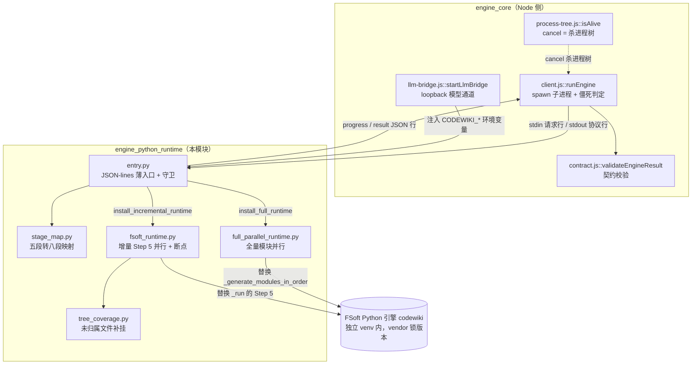
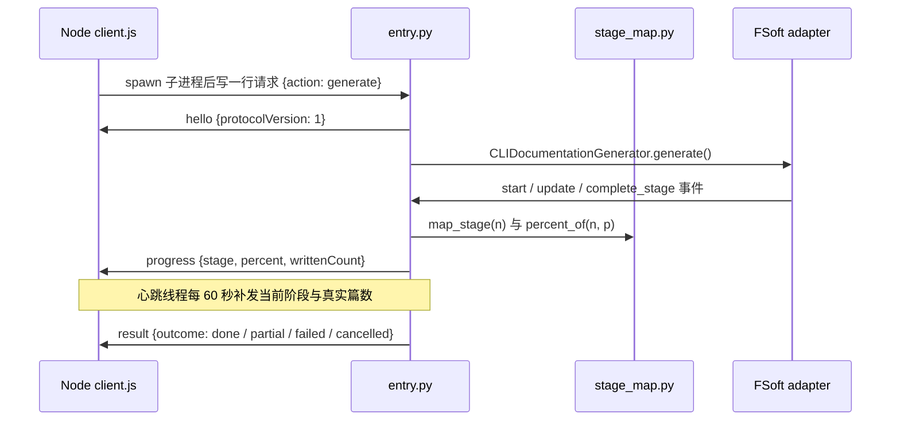
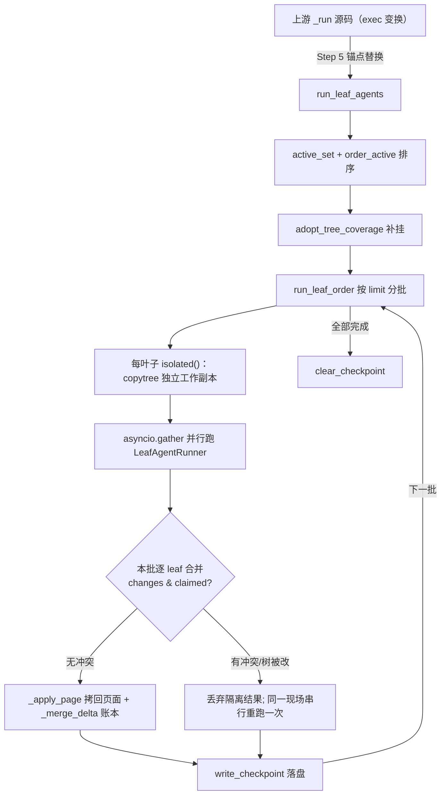

# engine_python_runtime：FSoft 原生引擎 Python 运行时层

## 模块定位

`engine_python_runtime` 是 dsh-codewiki 插件驱动上游 **FSoft-AI4Code/CodeWiki Python 引擎**（下文简称 FSoft）的薄运行时层，位于 `lib/engine/python/`。按 `entry.py` 模块 docstring 的自我定位：**「这不是算法实现」**——依赖图构建、模块聚类、文章写作、增量 diff 全部由 FSoft 自己的 `CLIDocumentationGenerator` 完成；本层只做四件事：

1. **协议转换**：把 stdin 的一行 JSON 变成一次 FSoft 调用（`doctor` / `generate` / `update` / `cancel`），再把进度与终态以 JSON 行推回 Node；
2. **阶段翻译**：把 FSoft 的五段进度翻译成引擎八段契约（`stage_map.py`），并把整体进度刻意封顶在 90%，留给 Node 侧收尾的 10%；
3. **运行时适配**：在不改 vendor 源码（锁版本）的前提下，给全量生成与增量更新装上受控并行（`full_parallel_runtime.py` / `fsoft_runtime.py`）；
4. **红线守护**：不读本机凭证库（密钥只活在进程环境变量里）、不让 FSoft 的人类可读打印污染协议流。

它是 [engine_core](engine_core.md)（Node 侧）与 Python FSoft 子进程之间的**唯一边界**。

## 架构总览

一次生成/更新调用的协议时序：

## 协议契约要点

- **三种消息**：`hello` / `progress` / `result`，全部经 `emit()` 在 `_EMIT_LOCK` 锁内整行写出（心跳线程与主线程并发写，半行 JSON 会让 Node 侧解析器丢帧）。
- **版本常量**：`PROTOCOL_VERSION = 1`、`CONTRACT_VERSION = 2`，必须与 `lib/engine/contract.js` 的 `ENGINE_CONTRACT_VERSION` 同步（单独抽常量正是为了避免升版本时漏改某处）。
- **退出码语义**：进程退出码只表达**进程层**结果，语义以最后一条 `result` 行为准；协议破坏一律用 `0 退出 + failed result` 表达，让 Node 侧拿到结构化失败原因。
- **阶段枚举**：`ENGINE_STAGES = [env, graph, cluster, articles, proofread, validate, index, baseline, commit]`，与 Node 侧由测试双向对账；FSoft 只覆盖前四段，`index / baseline / commit` 由 Node 侧后续执行。
- **出参平铺**：请求按 `{requestId, action, ...payload}` 平铺收发（兼容旧式嵌套 `payload` 对象），`cancel` 的出参是 `{cancelled: true}` 而不是一份 EngineResult。

## 文件职责一览

| 文件 | 核心职责 |
|---|---|
| `lib/engine/python/entry.py` | JSON-lines 薄入口：stdout 守卫、UTF-8 流钉装、Popen 补丁、doctor 探测、进度桥接、心跳、模块详情探针、源码排除面、异常分类与 partial 自救 |
| `lib/engine/python/stage_map.py` | 纯函数映射：FSoft 五段（含权重）→ 八段契约、百分比封顶 90%、增量轮按 description 识别 |
| `lib/engine/python/full_parallel_runtime.py` | 全量生成并行：按拓扑层调度、父模块等子模块、`module_tree.json` 读-改-写合并串行化（`_SharedTreeIO`） |
| `lib/engine/python/fsoft_runtime.py` | 增量 Step 5 隔离并行：每叶子独立工作副本、写冲突串行重跑、叶子级断点续跑（`run_leaf_agents`） |
| `lib/engine/python/tree_coverage.py` | 历史遗留未归属文件按「同文件 → 同目录 → 邻居多数 → 目录最近邻」补挂到已有叶子（`file_owner`） |

---

## 详细组件说明

### entry.py：协议薄入口与运行时守卫

#### 启动期的三条守卫（必须在 import codewiki 之前装好）

- **`_popen_init_utf8(self, *args, **kwargs)`**：只在 `text=True`（或 `universal_newlines=True`）且调用方未显式给 `encoding`/`errors` 时补 `encoding="utf-8", errors="replace"`；二进制调用保持原样，避免把 bytes 改成 str 破坏他人。
- **`_ProtocolOnly`**：`sys.stdout` 替身。`write`/`flush` 全部改道 stderr；`isatty()` 返回 False；`fileno()` 给 stderr 句柄；`encoding` 属性报 `"utf-8"`。连 `flush` 也要转道，否则 FSoft 进度条的 flush 会把半行日志挤进协议流中间。

#### main() 主循环与 handle_request(msg)

- `main()` 先 `emit_hello()`，再只读**一行** stdin（单请求单进程模型），JSON 解析失败也回一条可机读的 `engine-protocol` failed result，退出码恒为 0。
- `handle_request` 两种请求形状都认：顶层平铺优先（`{requestId, action, ...payload}`），其次嵌套 `payload` 对象——只认嵌套形状曾导致真引擎的 `repoPath`/`docsDir`/`commitId` 全部读不到（假引擎按平铺测，测不出来）。
- `cancel` 动作立即回 `{cancelled: true}`；真取消由 Node 侧杀进程树（`process-tree.js`）完成，入口不做实际工作。

#### action_doctor：环境可信性探测

依次上报三条检查并把结果折成 `checks[]`：`import`（能否导入 `codewiki`）、`python`（解释器版本）、`pip`（跑一次 `pip check` 验证依赖闭合）。装到一半的 venv 会在生成中途才因缺包崩掉、白烧一整轮模型调用，所以 doctor 是那套门禁的**运行时版本**。任一不过即返回 `engine-missing` / `engine-deps` failed 终态。

#### action_generate：config 组装与适配安装

核心组装顺序（每一项都对应一次真机事故）：

| config 字段 | 取值 | 为什么 |
|---|---|---|
| `request_limit` | `min(max(1, payload.requestLimit), 1000)`，缺省 100 | 上游默认 100 但 `doc_guard` 每次提醒续发独立 agent.run，各自吃满预算；大模块撞上限会从 done 掉成 partial、已写 31 篇白写 |
| `module_concurrency` | `max(1, min(payload.moduleConcurrency, 8))`，缺省 1 | 上游严格串行：一篇约 12 分钟，16 节点串跑 180 分钟预算耗尽只写出 18 篇 |
| `agent_instructions.exclude_patterns` | `source_exclude_patterns(repo_path)` | wiki 产物（`.codewiki`、`CodeWiki.md`）与孤立 gitlink 必须排除出依赖分析面 |
| `agent_instructions.language` | payload 里有则写入 | 上游从 `agent_instructions.language` 读；此前整条链路没带下来，引擎静默按英文写 |
| `commit_id` | payload.commitId 或 HEAD | 本轮「已消费到哪个 commit」的记账，落进 metadata.json 成为下一轮的 old_commit |
| `update_options` | payload.updateOptions 原样透传 | rung 3 = 组件级方法（图 diff），rung 0 = 旧按文件失效 |

组装完成后按轮次安装适配器：全量轮 `install_full_runtime(concurrency)`；增量轮再叠 `install_incremental_runtime()`，随后构造 `CLIDocumentationGenerator`、`bridge_progress`、`adapter.generate()`。

#### bridge_progress(adapter, request_id, on_stage, docs_dir)

用**方法替换**（而非继承）接管 `tracker.start_stage / update_stage / complete_stage`，因为 FSoft 在 `__init__` 里直接构造 `ProgressTracker(total_stages=5)`，没有注入点；替换是旁路观察，不改 FSoft 行为。要点：

- **增量轮识别**：`start_stage(2, "Incremental Update")` 借聚类槽位跑整轮文章写作，按 description（`is_incremental`）识别，后续帧一律按 `articles` 报，否则 90 分钟的写作被显示成「聚合类模块」并钉死在 36%。
- **`written_now(force)`**：对 `_doc_fingerprints(docs_dir)`（`{相对路径: (size, mtime_ns)}`）与进场基线做差，新增/改写/删除都计入；普通 update 按 `_WRITTEN_RECOUNT_SEC = 2.0` 节流，阶段切换与阶段完成 `force=True` 必算（那是 partial 判定的关键帧）。
- **心跳线程**：挂在 `adapter.generate` 上包一层 `generate_with_heartbeat`——`finally` 里停表，保证「任务结束即停表」不漏帧；拿不到 `generate` 的探针调用方只装桥不装心跳。
- **详情探针**：`attach_detail_tap()` 临时把 `codewiki.src.be` 降到 INFO、同时把已有 handler 压到 WARNING（否则 INFO 灌进 stderr 被 Node 当日志收走），`_DetailHandler` 从 11 条正则（`_DETAIL_PATTERNS`）里抽「正在写/聚类/归并哪个模块」，`release_detail_tap` 摘 handler 还原 level。

#### 终态构造与异常分类

- **`_done_result(...)`**：折入 `_counts_of(adapter)`（kept/removed/unmapped，取自 `_last_update_record`）、`_usage_of(job)`（input/output/cached tokens + requests，每条出口都必须调用，partial 分支曾直接 return 导致用量恒 0）、`_state_files(docs_dir)`（磁盘上真实存在的跨轮状态文件）与 `updateOutcome`（incremental/no_change/full_fallback/detector_failure）。
- **`_classify_exception`**：按异常**类型**（不按消息文本）分类——`IncompleteGenerationError` / `RuntimeError("Documentation failed for modules: ...")` → partial + article-missing blockers；`APIError` 族 / `ConfigurationError` → `engine-model`；`RepositoryError` → `engine-missing`；`KeyboardInterrupt` → cancelled；其余 → `engine-crashed`。
- **`_salvage(...)`**：崩溃/模型失败时已写出文章就降 partial 交付（blocker 注明「编译在 X 阶段中断（已写 N 篇）」），空产物才判 failed。

### stage_map.py：五段 → 八段映射（纯函数）

| FSoft 阶段号 | FSoft 阶段名 | 权重 | 映射到引擎阶段 |
|---|---|---|---|
| 1 | Dependency Analysis | 0.40 | `graph` |
| 2 | Module Clustering | 0.20 | `cluster` |
| 3 | Documentation Generation | 0.30 | `articles` |
| 4 | HTML Generation | 0.05 | `validate`（HTML 不做，属收口） |
| 5 | Finalization | 0.05 | `validate` |

- `percent_of(n, p)`：已完成阶段权重之和 + 当前阶段权重 × p，再乘 `FSOFT_PROGRESS_CEILING = 90` 并夹到 [0,100]。引擎自身 90% 封顶，剩 10% 留给 Node 侧的 `index / baseline / commit`，避免「引擎说 100% 但 wiki 还没索引」的假完成。
- `articles_percent(written, total)` / `articles_ceiling()`：阶段 3 的 `stage_progress` 被 verbose 门控恒为 0，所以 articles 槽位内按「已写篇数 / 预期篇数」线性插值（lo = `percent_of(3, 0.0)`，hi = `percent_of(3, 1.0)`）。
- 未知阶段不抛错，归 `DEFAULT_ENGINE_STAGE = "articles"`——进度上报是旁路，任何时刻不该因为版本差异把编译打断。

### full_parallel_runtime.py：全量生成的受控并行

- **调度模型 `_walk` / `_run_module`**：按初始树递归——某父节点的全部子节点先 `asyncio.gather`（受 `asyncio.Semaphore(concurrency)` 限流），子节点写完后再生成父页。父节点此时没占槽位，不存在「父等待时自锁」。每个模块开始前**从磁盘重读 module_tree**（兄弟分支可能刚写入新子模块），用磁盘形态判定叶子/父类，而不是内存快照。
- **`_SharedTreeIO` 与 `_install_shared_tree_io`**：并行分支各自 `from codewiki.src.utils import file_manager` 拿到同一个类对象，因此必须在**类方法**上串行化 `save_json` / `load_json`。`save_json` 对 `module_tree.json` 走锁内「读-改-写」并 `_merge_tree` 合并：父模块的 components 取并集，叶子模块两边都有对方没有的组件才判真冲突抛错（子集关系取并集）；其它 basename 的文件不拦截、直接透传。
- **`write_tree_exclusive(filepath, mutate)`**：当调用方已基于磁盘最新状态算出**完整目标树**（如 tree_coverage 的补挂）时，跳过合并直接覆盖写——否则旧值是新值真子集会被误判成叶子组件冲突、整轮中断。
- **`install_full_runtime(concurrency)`**：幂等；发现 `_generate_modules_in_order` 已被其它适配器替换就抛错拒绝重复安装；替换后 `_run_parallel` 收尾仍保留三件事——`validate_module_file_coverage` 覆盖校验、`organize_docs` 页面归位、有 failures 就 `raise RuntimeError("Documentation failed for modules: ...")` 上抛（与上游 1b4af43 的显式失败语义一致）。小仓库整仓单页分支（module_tree 为空）完全沿用上游路径。

### fsoft_runtime.py：增量 Step 5 的隔离并行与断点

- **隔离执行**：每个叶子在 `tempfile.mkdtemp` 出的独立工作副本里跑 `LeafAgentRunner`，跑完算 `_page_changes`（工作副本基线 vs 终态的页面哈希差）；模型调用的异常只记 `task_record.errors`，不拖垮同批其它叶子。
- **冲突串行重跑**：按批顺序逐 leaf 合并——隔离分支改到了已被前序 leaf 认领的页面（`changes & claimed`）、或该 leaf 运行期间 module_tree 被 mutate，就丢弃隔离分支的页面结果（模型调用仍计入账本），在主 docsDir 现场**串行重跑一次**该 leaf。这样既保留串行语义，又不必把 overview 这类保守写集共同页当成全局串行锁。
- **断点续跑**：`write_checkpoint` 把 `{version, signature, completed}` 原子落盘（tmp + `os.replace`）；`_signature` 覆盖 adapter 版本、record revision、options、新旧树、order。`_load_completed` 在 `opts.extra.resume` 开启时：签名一致就逐 leaf 把 delta 账本 `_merge_delta` 回去并跳过；签名变化则要求 `resumeBaselineDocsDir` 可恢复——从基线重灌 docsDir、保留 checkpoint 文件、重跑全部叶子，拒绝混用旧现场。
- **`install_incremental_runtime()`**：只替换 `IncrementalUpdater._run` 的 Step 5 段（源码锚点 `_STEP5_START` / `_STEP5_END` 注释标记），其余主流程仍是上游原文；锚点不匹配直接抛错。whole-repo 模式把多个 active unit 塌缩成单个 overview 运行。

### tree_coverage.py：未归属文件的叶子补挂

- **问题**：上游 `validate_module_file_coverage` 要求依赖图里每个文件都被某个叶子认领，而 Step 2 的 `repair_tree` 只处理**本轮 diff.added**。历史上某轮没写进树的文件永远不进树，之后每轮增量都在校验处抛 `Invalid module file coverage: missing=[...]` 且不自愈。
- **`file_owner(tree, components, relative_path)`**：该文件当前被哪个叶子认领（斜杠分隔路径），无人认领返回 None——纯查询，供调用方与测试使用。
- **`adopt_unowned_files(tree, components, opts)`**：算出 `expected - owned` 的 missing 文件；对每个文件先按上游规则 `route_by_rules` 尝试路由，路由不出就 `_nearest_leaf` 按「目录公共前缀深度 → 认领文件数少者 → 路径字典序」选最近叶子，最后 `T.add_component` 把该文件的组件全部挂上去。由 `fsoft_runtime.adopt_tree_coverage` 在每次增量 Step 5 之前调用，基于磁盘最新树做补挂（失败只记 `detector_notes`，绝不崩整轮）。

## 关键设计决策

### stdout 守卫（`_ProtocolOnly`）
FSoft 大量使用 `print` / `click.secho` 写人类文案，且 click 会**缓存** text stdout 包装器——事后替换 `sys.stdout` 拦不住已缓存的引用。因此入口在**导入任何 codewiki 模块之前**就把 `sys.stdout` 换成守卫对象：普通 `write`/`flush` 全部改道 stderr（变成日志），协议行走保存下来的真实 stdout 句柄。

### UTF-8 三条流 + Popen 补丁（`_popen_init_utf8`）
Windows 下 Python 的 stdin/stdout 默认按 locale（cp936/gbk）编码，而 Node 侧一律按 UTF-8 收发。入口自行把三条流钉成 UTF-8（stdout/stderr 用 `errors="replace"`，stdin 用 strict——非法字节应当场报错而不是变乱码路径），并给 `subprocess.Popen.__init__` 打补丁：text 模式且未显式给 encoding 的调用一律走 UTF-8，兜底 FSoft 内部 `subprocess.run(..., text=True)` 读 git 输出时的中文路径解码崩溃。

### 凭证边界：不读 ConfigManager
`ConfigManager` 会读 `~/.codewiki/config.json` 或系统 keyring。迁移后模型通道由 Node 侧 [llm-bridge](engine_core.md) 以 loopback 桥注入，密钥只存在于进程环境变量（`CODEWIKI_BASE_URL` / `CODEWIKI_API_KEY` / `CODEWIKI_MAIN_MODEL` / `CODEWIKI_CLUSTER_MODEL`）。入口直接构造 config dict 交给 adapter，绕开整套凭证解析；错误信息也只说「环境变量未设置」，绝不打印值。

### 心跳与模块详情探针
FSoft 阶段 3 的所有 `update_stage` 都被 `if self.verbose:` 门控，而入口传 `verbose=False`——整段 40 分钟以上的写作零进度帧，面板上与「进程已挂」无法区分。桥接层因此：
- 挂一条 60 秒心跳线程（严格短于 Node 侧 10 分钟僵死阈值），只重发当前阶段与真实篇数，不谎报进展；
- 用只读 logging handler 从 `codewiki.src.be` 的日志文本里抽「正在写/聚类哪个模块」，拼进进度帧 message（观测失败一律吞掉，绝不能弄崩编译）。

### 进度事实来源：产物指纹而不是计数器
`writtenCount` 靠对 docsDir 递归清点 `.md` 的 `(size, mtime_ns)` 指纹差算（进场基线 vs 当前），并按 2 秒节流；阶段切换/阶段完成强制重算——那是 Node 侧「超时但有进度 → partial」自救的唯一依据。只比篇数净差会把「原地重写 20 篇」的增量轮记成零进展。

### 源码排除面
`.codewiki/` 与 `CodeWiki.md` 是每轮都改写的 wiki 产物，不排除就会被引擎当成「永远有变化的源码」；被提交进索引但没有 `.gitmodules` 登记的**孤立 gitlink**（checkout 不出来的嵌套仓库）是 tracked 的，`use_gitignore` 拦不住，实测曾把 18MB 无关子仓库喂进分析面耗尽 45 分钟预算。两者都通过 `agent_instructions.exclude_patterns` 挡在依赖分析之外。

### 崩溃自救（`_salvage`）
原生引擎一轮动辄上百分钟，失败点通常在写作中途。已写出文章时降成 `partial` 交付而不是整轮 `failed`——否则下一轮增量因为没有持久化状态退回全量，再跑一遍同样的时间再撞同样的墙；一篇都没写出来时仍然是 `failed`。

### 适配安装的 fail-fast
两个并行适配器都按**上游源码锚点**工作（`IncrementalUpdater._run` 的 Step 5 注释标记、`DocumentationGenerator._generate_modules_in_order` 方法对象）。锚点不匹配时**直接抛错拒绝安装**，绝不静默退回另一套算法；已被其它适配器替换时同样拒绝重复安装。

## 与其他模块的关系

- **[engine_core](engine_core.md)**：本模块的协议对端。`client.js::runEngine` spawn 本入口并做僵死判定；`contract.js` 持有同一份 `ENGINE_STAGES` 与契约版本；`process-tree.js` 负责通过杀进程树实现 `cancel`；`llm-bridge.js` / `openai-bridge.js` 注入模型通道环境变量。本模块不重复描述这些职责。
- **[build_configuration_and_test_verification_tooling](build_configuration_and_test_verification_tooling.md)**：FSoft 运行环境由 `tools/fsoft-engine/setup-env.sh` 在插件仓库**之外**的独立 venv 里按冻结快照落盘（`--no-deps` + `pip check` + import 冒烟），本入口的 `doctor` 动作是这套门禁的运行时版本。
- **vendored_codewiki（Rust `cw` CLI）**：注意区分——vendor 里的 `codewiki` 是本仓库自带的 Rust CLI（索引/基线/提交），与本入口 import 的 Python `codewiki`（FSoft 引擎，装在外部 venv）是两个同名不同物的组件。
