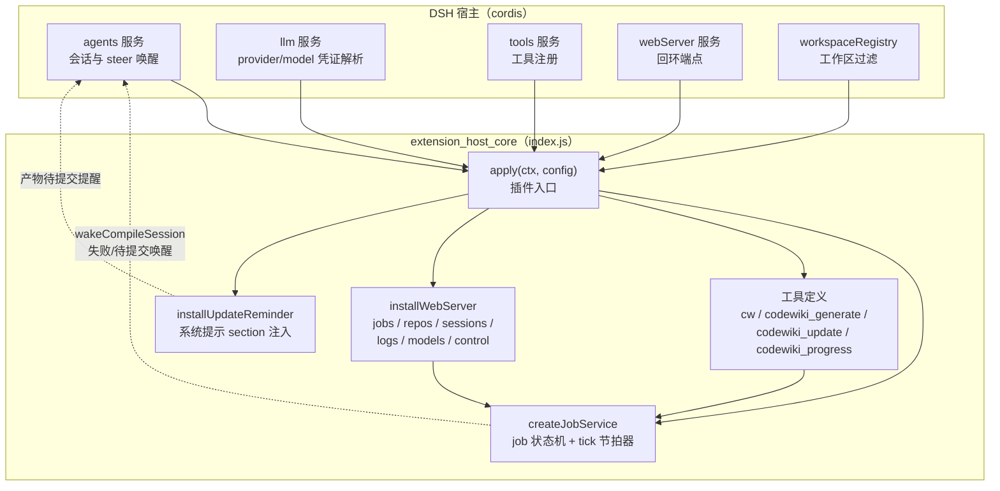
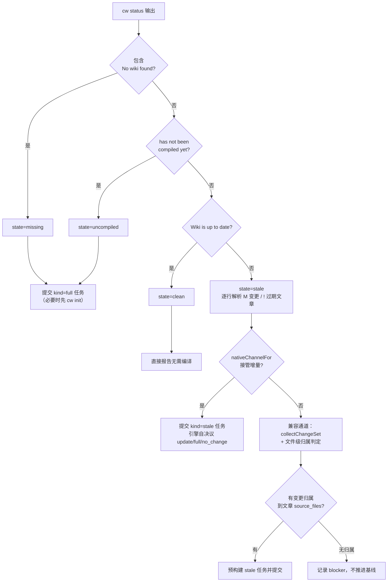
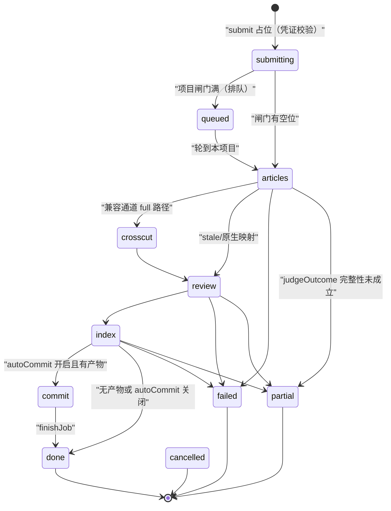
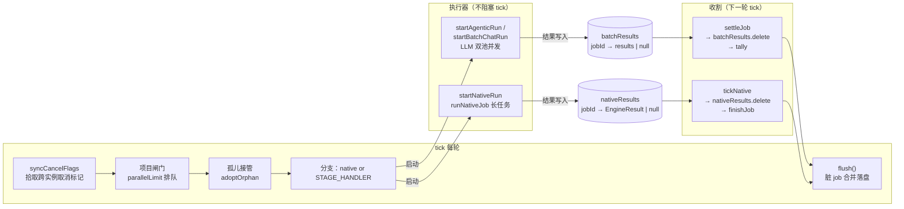
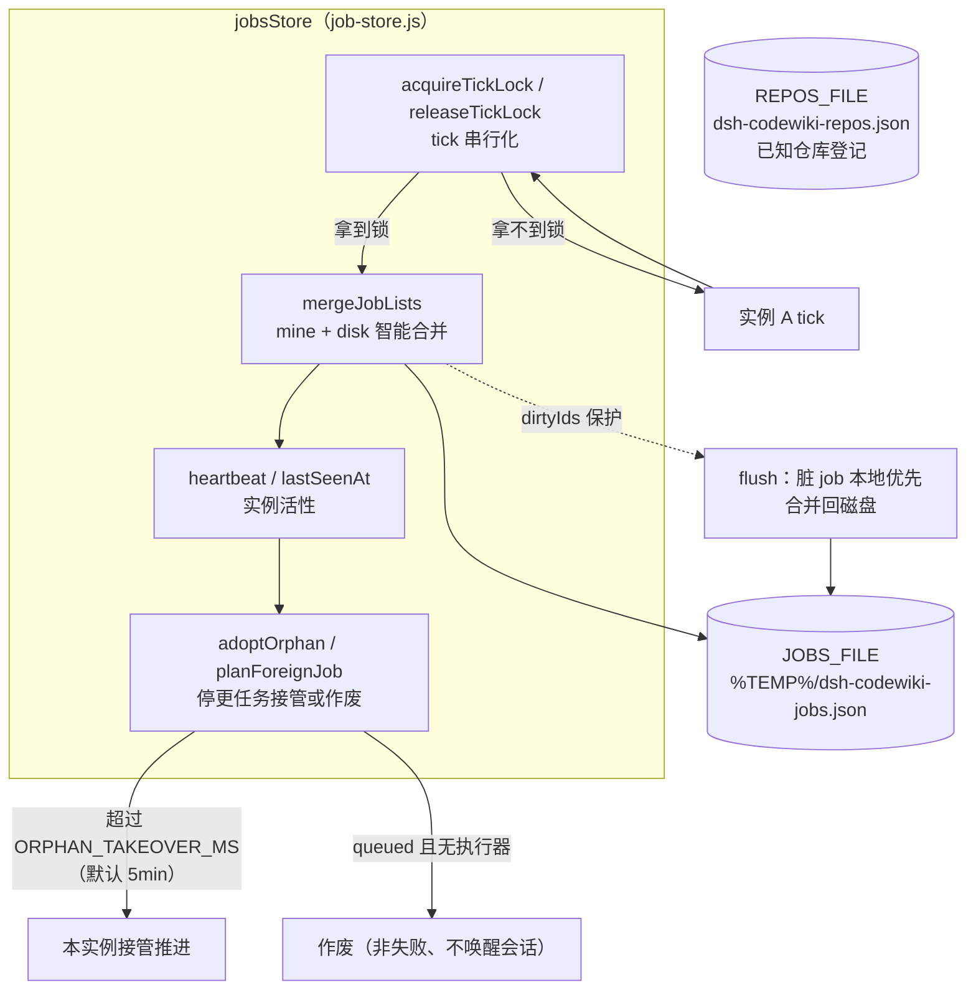
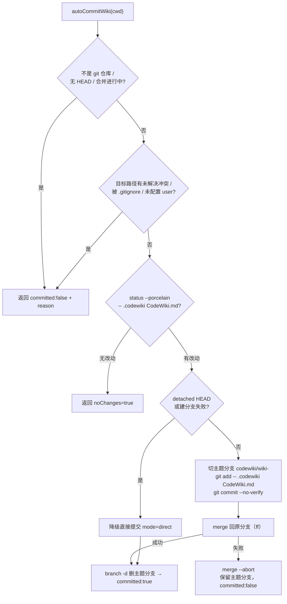
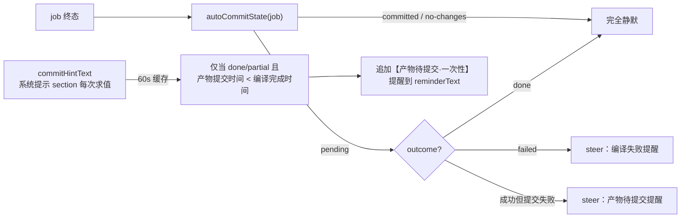
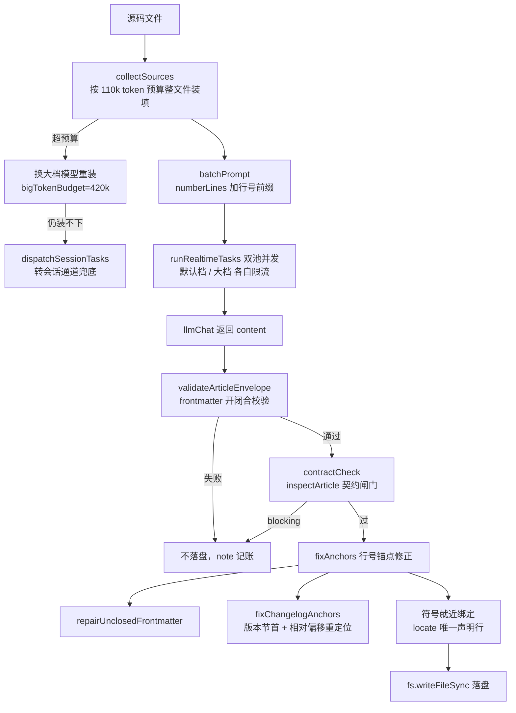
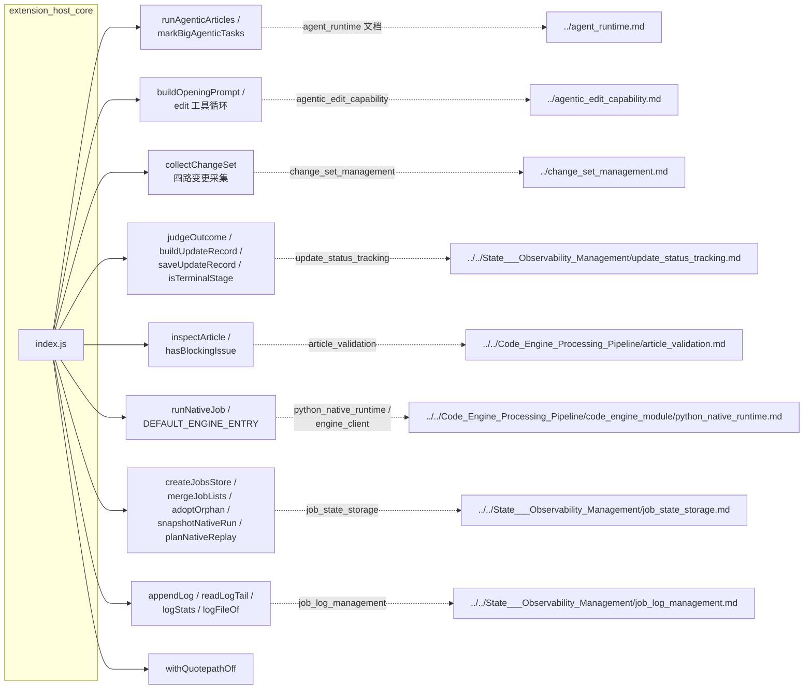
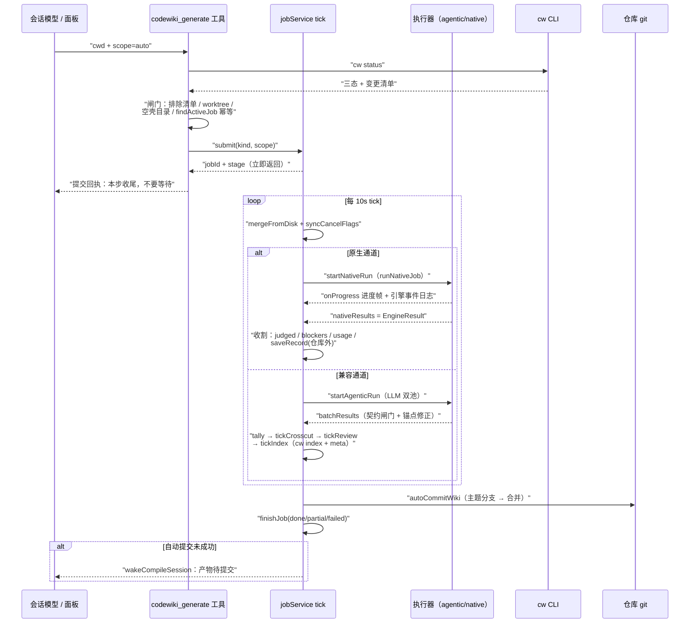

# extension_host_core：宿主侧编译执行编排核心

`extension_host_core` 是 dsh-codewiki 插件（`@local/dsh-codewiki`，见 `package.json`）的宿主侧核心，文件为 `index.js`。它把 `cw`（CodeWiki Rust CLI）与编译流水线接进 DeepSeek Harness（DSH），对外提供四个工具（`cw`、`codewiki_generate`、`codewiki_update`、`codewiki_progress`）、一个常驻编排服务（job 状态机）、一组回环 HTTP 面板端点（`/api/codewiki/*`），以及会话系统提示的 wiki 维护提醒注入。

## 1. 模块定位

该模块处在两条下游通道的上游：
- **原生引擎通道（默认）**：编译任务经 `nativeChannelFor` / `runNativeJob` 交给 Python 引擎，详见 [code_engine_module](code_engine_module.md) 与其下的 [engine_client](engine_client.md)、[python_native_runtime](python_native_runtime.md)、[plan_application](plan_application.md)、[quality_gates](quality_gates.md)。
- **内置 Node 兼容通道**：`nativeEngine=false` 时走插件内流水线（articles → crosscut → review → index → commit）。

## 2. 对外接口面

### 2.1 工具注册（`apply`）

`apply(ctx, config)` 是插件入口，通过 cordis 的 `ctx.inject` 取到 `agents`、`llm`、`tools`、`webServer`、`workspaceRegistry` 等服务后：

1. `createJobService(config, wakeCompileSession)` 创建并启动常驻服务（`service.start()` 起 10s 节拍定时器，`ctx.effect` 注册停止钩子）。
2. 构造四个工具定义并经 `tools.register` 注册，单工具注册失败不影响其余工具。
3. `installWebServer` 注册回环端点，`installUpdateReminder` 注入会话提示。
4. 启动自动更新调度器 `autoScan`（60s 心跳，按 `autoUpdateMin` 间隔对已知仓库做 scope=auto 判态）。

### 2.2 四个工具

| 工具 | 入口 | 职责 |
| --- | --- | --- |
| `cw` | `cwToolDefinition` | 薄封装 CLI：`init/status/index/meta/path/projects/setup/uninstall`，120s 超时，超时发 SIGKILL |
| `codewiki_generate` | `generateToolDefinition` | 提交制编译：`cw status` 判三态（missing/uncompiled/clean/stale）→ 提交 job 立即返回，不等编译 |
| `codewiki_update` | `updateToolDefinition` | 固定 scope=auto 的快捷入口，引导模型「提交即收尾、不要轮询」 |
| `codewiki_progress` | `progressToolDefinition` | 只读查进度：按 `cwd` 或 `jobId` 过滤，数据与面板同源（`jobSummary` + `progressView`） |

`codewiki_generate` 的判态逻辑（`parseStatus` 解析 `cw status` 输出）：

关键点：cw status 的三态判定不区分已提交与工作区未提交变更；因此原生通道即使收到 `clean` 也照常接管，把「四路变更采集 + 增量决议」的权力完全交给引擎（见 [change_set_management](change_set_management.md) 与 [engine_client](engine_client.md)）。

### 2.3 回环 HTTP 端点（`installWebServer`）

所有端点由 `isLoopbackRequest` 守卫（仅 127.0.0.1 / ::1），供侧边栏面板（[vscode_extension_client](vscode_extension_client.md)）轮询：

| 端点 | 数据来源 |
| --- | --- |
| `GET /api/codewiki/jobs` | `service.list()`（即 `jobSummary` 逐个映射），按 `workspaceOnly`、`isDeadCompileTarget` 过滤，queued 任务附 `queueAhead`「在等谁」 |
| `GET /api/codewiki/repos` | 已知仓库清单 + job 历史的 wiki 状态总览（30s 缓存）；`lastJob` 由 `pickOverviewJob` 从该仓全部候选任务中选取 |
| `GET /api/codewiki/sessions` | LLM 请求会话记录（`listSessionRecords` / `listAllSessionRecords` / `activeSessionJobs`） |
| `GET /api/codewiki/sessions/item` | 单条会话全文（prompt/output） |
| `GET /api/codewiki/logs` | 引擎事件 NDJSON 日志（`readLogTail` / `logStats`） |
| `GET /api/codewiki/models`、`/api/codewiki/model-efforts` | 模型目录（`listModelCatalog` / `resolveModelEfforts`，30s/60s 缓存） |
| `POST /api/codewiki/control` | `{action:"cancel"|"compile"|"refresh"}` |

`GET /api/codewiki/repos` 的仓库归并与「代表任务」选取：展示路径按 `normKey` 归一（同一仓库的多种写法只保留先出现的展示形态——job 历史优先，`loadKnownRepos()` 补缺），每个展示 cwd 把该仓**全部**候选任务累积进 `jobsByCwd`，再交给 `pickOverviewJob` 选出一条 `lastJob`：**优先非终态任务**（正在排队/编译的那条），全是终态时按 `updatedAt`（缺失则退化到 `finishedAt` / `createdAt`）取最新一条。`knownRepos` 只补登记仓库、不贡献候选任务（`putCwd(dir, undefined)`）。旧实现每个 cwd 只保留「先到的那条任务 + 首个非空兜底」，同仓挂着多条历史记录时面板可能显示陈旧任务而不是正在编译的那条。

## 3. 编译任务状态机（`createJobService`）

这是本模块的核心运行时。服务以 `TICK_MS`（默认 10s）节拍调用 `tick()`，对每条 job 推进一步；执行器（LLM 并发池 / 原生引擎）是长任务，结果以 `batchResults` / `nativeResults` Map 暂存，由下一轮 tick 收割，tick 永不阻塞。

### 3.1 阶段机

阶段处理器挂在 `STAGE_HANDLER`：

| 处理器 | 职责 |
| --- | --- |
| `tickArticles` | 兼容通道的写文章阶段：本地规划（`localPlan` 顶层目录分组）→ `markBigAgenticTasks` 打大档标记 → `startAgenticRun` 执行；收割走 `settleJob` / `progressSessionTasks` |
| `tickCrosscut` | 组装 `_architecture.md` / `_patterns.md` / 概念文章（`packArticles` 装填全文，超预算换大档模型），`keepInMemory=true` 不落盘 |
| `tickReview` | 本地核对（`localReview`）+ 批量校对（`batchProofreadBatchPrompt`，按预算贪心合并成 `@@@article/@@@end` 分节输出，`settleProofread` 拆回逐篇） |
| `tickIndex` | 存量文章体检（`auditExistingArticles`）→ 完整性判定（`judgeOutcome`）→ 孤儿文章清理（`pruneOrphanModules`）→ `cw index` → 完整性成立才 `cw meta update` 推进基线 → `ensureWikiEntry` → `saveRecord` |
| `tickCommit` | `autoCommitWiki` 提交产物（主题分支提交后合并回原分支），随后 `finishJob` 置终态 |

**原生通道的分支**：job 一旦在 `articles` 起始时被 `nativeChannelFor` 锁定为 `channel='native'`，之后所有 tick 都只走 `tickNative`——绝不落入 `STAGE_HANDLER` 的同名 handler，避免两套实现重复写同一批产物。

**已退役的阶段**：`compose`（「拆观察批 → 合成」路径的合成阶段）已随观察→合成分割通道在 0.17.5 删除，本模块不再有该阶段——横切只做「单批直出」：`packArticles` 保证装得下（超预算的文章只截头部并标注），总量超普通预算就把任务标成大档换大上下文模型。因此 `codewiki_progress` 的 `stage` 取值与本节阶段机图一致：`articles`/`crosscut`/`review`/`index`/`commit` 加终态 `done`/`partial`/`failed`/`cancelled`，不会出现 `compose`。

### 3.2 双执行器与收割约定

- 约定：执行器整体失败时写入 `null`（已自行 `fail()`）；收割方只看「Map 里有没有结果」，不猜执行器死活。
- `settleJob` 还承担宿主重启恢复：执行器随连接消失时，按 `job.tasks` 持久化的 `batchPrompt` 快照（或 `agentic:true` 任务的 mission）整批重跑当前阶段。
- 取消（`cancelRequested`）：tick 开头识别 → abort 在飞请求（`batchAborters` / `nativeAborters`）→ 置 `cancelled` 终态、`canAdvanceBaseline=false`；若取消到达时原生结果已落地，则按真实结果收割而非丢弃产物。

### 3.3 多实例并存的持久化协议

关键不变量：
- 只有状态变更过的 job 才整写（`dirty` + `dirtyIds`），无事可做的旧实例不会用过期快照覆盖活动 job。
- `submit` 幂等：`findActiveJob` 按归一化路径 key 判重，同仓库并发提交直接返回现有任务。
- 项目闸门：默认 `serialProjects=true`（parallelLimit=1），忙碌项目占满时新任务进 `queued`，排队期间不占执行机器。

## 4. 编译产物的入库与唤醒

### 4.1 `autoCommitWiki`（自动提交）

把「等编译完成 → 提交 .codewiki/」从会话模型手里收回插件侧：

安全边界：只认 `WIKI_PATHS = ['.codewiki', 'CodeWiki.md']` 两个 pathspec，绝不 `-A`；不 amend、不 push、不改写历史。

### 4.2 会话唤醒（`wakeCompileSession` / `commitHintText`）

`installUpdateReminder` 在每个 agent 的 `systemPrompt` 注册 `codewiki:update-reminder` section：仅当会话仓库根存在 `CodeWiki.md` 入口时才出现维护提醒，开关关闭/项目切换/删除 wiki 无需重启即生效。

## 5. 输入装填、契约闸门与锚点修正

兼容通道的质量防线集中在本模块（原生通道对应能力在 [quality_gates](quality_gates.md)）：

要点：
- `estimateTokens` 粗算（CJK ≈ 1 token/字，ASCII ≈ 3.5 字符/token），只为装填预算服务。
- `allowedLinkTargets`（现存 wiki 文章 + 本轮计划产出）供契约闸门校验内部死链。
- `applyTaskResult` 统一落盘点：`keepInMemory` 任务（横切/校对）只回内存，`writeValidated` 是它们唯一的写盘点。
- `symbolsOnLine` / `fixAnchors` 的符号提取规则与仓库测试 `test-wiki-anchors.mjs` 同源（修正器与校验器共用一套归属语义，否则会振荡）。

## 6. 依赖关系

依赖清单（全部位于父模块 `Extension_Host_Execution_Orchestration` 与其平级模块下）：

| 依赖 | 用途 |
| --- | --- |
| [agent_runtime](agent_runtime.md)（`lib/articles-agentic.js`） | agentic 写作执行器 `runAgenticArticles`、大档标记 `markBigAgenticTasks` |
| [agentic_edit_capability](agentic_edit_capability.md)（`lib/agentic.js`） | agentic 工具循环的 prompt 构造与 `edit` 能力 |
| [change_set_management](change_set_management.md)（`lib/change-set.js`） | 基线..HEAD + 工作区四路变更采集 |
| [update_status_tracking](update_status_tracking.md) | `judgeOutcome` 完整性判定、终态集合 `TERMINAL`、update-record 落盘 |
| [article_validation](article_validation.md) | `inspectArticle` 文章契约闸门（blocking/warnings） |
| [native_runtime_support](native_runtime_support.md) / [python_native_runtime](python_native_runtime.md) | `runNativeJob` 子进程驱动与 Python 引擎入口 |
| [job_state_storage](job_state_storage.md) | jobs 持久化、幂等合并、孤儿接管、tick 锁 |
| [job_log_management](job_log_management.md) | 引擎事件 NDJSON 日志的追加与翻页 |
| [job_log_management](job_log_management.md)（`lib/git-paths.js`） | `withQuotepathOff` 关闭 git 中文路径八进制转义 |

上游消费方：面板前端 [vscode_extension_client](vscode_extension_client.md) 通过 `/api/codewiki/*` 端点读取 `jobSummary` / repos / sessions / logs 渲染侧边栏。

## 7. 配置面（`Config` + `liveConfig`）

配置 schema 由 `@deepseek-ai/schemastery` 定义（`package.json` 唯一运行依赖），全部标 `volatile`（改设置无需重启插件）。`liveConfig(config)` 在每轮使用前把 volatile 值收口成内部运行参数，关键收口规则：

| 配置键 | 默认 | 收口逻辑 |
| --- | --- | --- |
| `batchProvider` / `batchModel` | `volces-ark` / `glm-5.3-flash` | 编译唯一模型通道；空则提交报错 |
| `bigEnabled` | `true` | 关闭时 `liveConfig` 直接清空 `bigProvider`（下游五六处换模型判定不再逐处判断），模型 id 与预算保留以便重开 |
| `maxConcurrency` / `bigConcurrency` / `moduleConcurrency` | 2 / 0 / 0 | 硬顶 8；`bigConcurrency=0` 跟随默认档；`moduleConcurrency` 控制引擎同层模块并行度（0 跟随默认档） |
| `requestLimit` | 100 | 单模块写作请求上限，透传给原生引擎（`runNativeJob` → 请求行 `requestLimit`）；原生入口非正值/未下发时退回引擎侧默认 300 而非上游的 100，硬顶 1000；大模块撞满会抛错把整轮判成 `partial` |
| `serialProjects` / `parallelProjects` | true / 2 | 派生 `parallelLimit`（串行=1，关闭后上限 4） |
| `nativeEngine` | `true`（0.16.0 起） | 原生通道开关；关闭后内置 Node 流水线为兼容通道 |
| `nativeEnginePython` | `''` | 解析顺序：配置 → `DSH_CODEWIKI_PYTHON` 环境变量 → `python`（不做「找一个能用的」启发式） |
| `autoCommit` / `autoUpdate` | true / false | 产物自动入库 / 定时增量扫描（间隔 `autoUpdateMin`，最小 5 分钟） |
| `workspaceOnly` | `true` | 任务页只显示宿主工作区内的仓库 |

bundle 装配见 `cordis.patch.yml`（插件 id `codewiki`，配置命名空间 `codewiki`，同 id 覆盖条目为整对象替换）。

## 8. 关键运行时数据与生命周期

| 数据 | 位置 | 生命周期 |
| --- | --- | --- |
| `JOBS_FILE` | `%TEMP%/dsh-codewiki-jobs.json`（测试用 `DSH_CODEWIKI_JOBS_FILE` 隔离） | 最多保留 `MAX_JOBS_KEPT=30` 条；启动时清理 Temp 终态与「死编译对象」（worktree / 空壳目录）任务 |
| `REPOS_FILE` | 由 `reposFileFor(JOBS_FILE)` 派生（`-jobs` → `-repos`） | 提交过即永久登记，`forgetRepo` 反登记 |
| 会话记录 | `<tmp>/dsh-codewiki-sessions/<jobId>/`（meta + full 对） | 保留 24h，每 10 分钟剪枝 |
| 会话通道任务文件 | `<tmp>/dsh-codewiki-session-tasks/` | 兜底超预算文章；30 分钟超时按失败 |
| 原生记录 / 原始产物 | `dsh-codewiki-native-records` / `dsh-codewiki-native-raw` | 仓库外，避免污染 git 状态；工作副本随 `.finally()` 清理，原始树留档保留 |
| `worktreeCache` / `sourceProbeCache` | 进程内 Map | 60s / 10min（空判定仅 1min）TTL，避免 2s 轮询打爆 git |

## 9. 从提交到终态的完整数据流

## 10. 设计要点小结

1. **提交制**：工具调用只做判态与提交，编译全程在插件内后台推进；会话模型不等待、不轮询、不跑 git——这是它与旧式「同步编译工具」的根本区别。
2. **双通道并存、互不回退**：原生通道（默认）环境不闭合时以 `engine-deps` 明确失败，绝不悄悄降级 Node 通道冒充成功；通道一旦锁定跟随 job 走。
3. **三态终态**：`done`（完整成功）/ `partial`（部分完成、基线不推进）/ `failed`（无成果）+ `cancelled`；基线只代表「所有变化已被消化」，任何 blocker 都不得前移。
4. **多实例安全**：tick 锁、脏 job 合并、心跳超时接管、跨实例取消拾取——插件重载或宿主重启不会双提交、不会丢现场。
5. **可观测性**：jobSummary（面板与 progress 同源）、引擎 NDJSON 日志、LLM 请求会话记录、update-record 仓库外记账，四条观测链各自独立。
