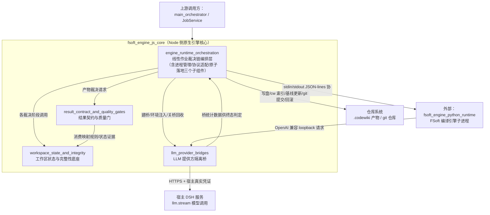

# fsoft_engine_js_core 模块概述

## 模块定位与核心目的
`fsoft_engine_js_core` 是原生编译通道的 Node 侧执行核心，自 0.16.0 起成为系统默认编译通道的执行主体。它的设计初衷是从根本上修复 0.14.0 版本暴露的「引擎声称完成就算成功、产物未入库也报通过」的历史缺陷，将原本散落在上层 JobService 中的编译执行细节收敛为独立、可单测的纯执行层，保证从环境校验、增量决议、引擎执行、质量门检到最终产物提交的全链路中，任何一步的失败都不会被后续步骤洗白，最终交付的终态永远由全链路最弱的一环决定。

模块统一承担六类核心职责：
1.  固定单条原生编译作业的线性裁决链，避免上层调度逻辑被编译实现细节污染
2.  可靠管理跨语言的 Python 引擎子进程，覆盖超时、静默、崩溃、取消等所有异常路径的结构化回收与失败上报
3.  实现模型凭证的安全隔离：严格遵循「插件不存储、不传递任何原始 API 密钥」的约束，通过进程内 loopback 桥为引擎提供模型调用通道
4.  钉死跨进程结果契约与质量门规则，杜绝「部分失败却报完整成功」的假交付
5.  保证通过校验的产物原子落地到仓库，实现索引、基线、提交与文章写盘的同事务执行，不留下半完成的脏仓库状态
6.  维护跨轮编译的工作区状态完整性，实现环境版本锁定、产物归属映射、未消化变化携带与未提交改动快照，确保增量编译过程中无变化静默丢失。

## 模块整体架构
模块的内部组成与上下游交互关系如下图所示：

全模块贯穿统一的核心设计原则——**终态不被洗白**：环境锁不一致直接拒跑引擎、引擎返回 done 不能替代质量门判断、产物落地失败终态不许报成功、未完整消化的变更一律不推进基线、用户取消是不可被迟到结果覆盖的终态。这些不变量从模块设计之初就写入各组件的验收标准，杜绝所有历史上出现过的假交付路径。

## 核心组件文档
模块由四个可独立测试的核心子层组成，各层的详细设计、执行流程与不变量见对应文档：
- [engine_runtime_orchestration](engine_runtime_orchestration.md)：原生引擎运行时的执行主干，固定单条编译作业的线性裁决链，负责跨语言 Python 子进程的全生命周期管理（超时/静默/崩溃/取消的结构化回收）、跨语言协议适配、以及质量门通过后的产物原子落地，将上层调度逻辑与编译实现细节完全解耦。
- [workspace_state_and_integrity](workspace_state_and_integrity.md)：编译过程的状态与完整性底座，提供环境版本指纹锁定、FSoft 产物到 CodeWiki 写集的归属映射、跨轮增量状态的持久化与水合、工作区未提交改动的临时 commit 快照能力，确保增量编译过程中无产物归属混乱、无变化静默丢失。
- [result_contract_and_quality_gates](result_contract_and_quality_gates.md)：引擎与 Node 消费方之间的结果边界，将编译终态、产物自洽性、基线可推进性固化为可机读的硬校验规则，从根本上杜绝「1 篇成功 +19 篇失败也报完整 done」的历史缺陷，将产品缺陷、能力降级、wiki 陈旧状态三类问题分类处置。
- [llm_provider_bridges](llm_provider_bridges.md)：模型凭证安全隔离桥，作为本地 loopback HTTP 服务，将 Python 引擎发出的 OpenAI 兼容请求翻译为宿主 llm 服务调用，全程不接触、不存储、不记录真实模型密钥，通过三层安全防护实现引擎模型调用与插件安全约束的兼容。