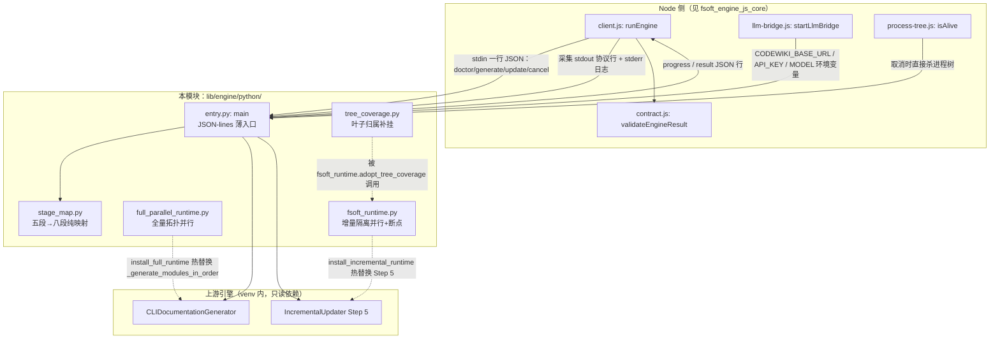
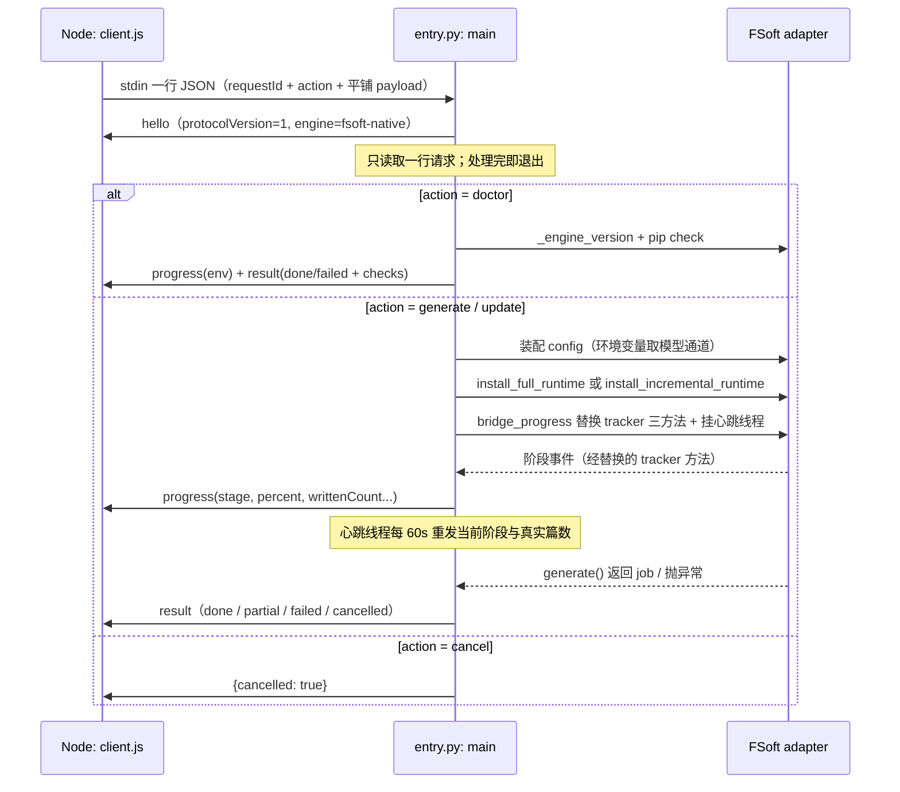
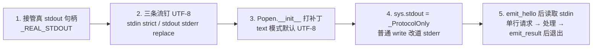

# FSoft 引擎 Python 运行时

## 模块定位与目的

`fsoft_engine_python_runtime` 是 dsh-codewiki 插件中**驱动上游 FSoft/CodeWiki Python 引擎（`codewiki` 包）的子进程运行时层**。自 0.16.0 起，插件的默认编译通道就是原生引擎通道（见 `package.json` 中 `"nativeEngine": true` 的描述）：Node 侧不再自己实现依赖图、聚类、文章写作与增量 diff 算法，而是把这些全部委托给安装在独立 venv 里的 FSoft 引擎，本模块只负责**进程边界、协议翻译与受控并行**。

本模块的五个文件承担三件互相正交的事：

1. **协议边界**（`entry.py` + `stage_map.py`）：把 stdin 的一行 JSON 请求变成一次 FSoft 调用，把 FSoft 的五段进度翻译成引擎八段契约，把成功/失败/取消翻译成结构化 `EngineResult`；
2. **受控并行适配**（`full_parallel_runtime.py` + `fsoft_runtime.py`）：通过源码锚点替换（AST/exec 级热补丁），把上游严格串行的全量生成与增量叶子执行改造成按拓扑层并行、带断点续跑的执行模型；
3. **覆盖完整性兜底**（`tree_coverage.py`）：把历史上未收录进 `module_tree.json` 的文件补挂到已有叶子，避免增量校验永远失败。

## 架构概览

### 运行时拓扑

- Node 侧按 UTF-8 通过管道收发协议行；`entry.py` 在**导入任何 codewiki 模块之前**就把 `sys.stdout` 换成 `_ProtocolOnly` 守卫对象——FSoft 内部的 `print` / `click.secho` / 进度条全部改道 stderr，协议流只允许经 `emit()` 写出整行 JSON。这是因为 click 会缓存 text stdout 包装器，事后替换拦不住已缓存的引用。
- 模型通道**不落盘**：`ConfigManager`（会读 `~/.codewiki/config.json` 与系统 keyring）被刻意绕开，密钥只以进程环境变量 `CODEWIKI_BASE_URL` / `CODEWIKI_API_KEY` / `CODEWIKI_MAIN_MODEL` / `CODEWIKI_CLUSTER_MODEL` 存在，由 Node 侧 loopback 桥（`llm-bridge.js`）注入。
- 取消语义：本进程内的 `cancel` action 只是立即应答 `{cancelled: true}`；真正的取消由 Node 侧 `process-tree.js` 直接杀进程树完成，进程退出码只表达进程层结果，语义以最后一条 `result` 行为准。

## 请求/响应协议

关键常量口径（与 Node 侧 `contract.js` 双向对账，由测试断言两边一致）：

| 常量 | 值 | 说明 |
| --- | --- | --- |
| `PROTOCOL_VERSION` | 1 | 管道协议行格式版本 |
| `CONTRACT_VERSION` | 2 | `EngineResult` 契约版本，必须与 `ENGINE_CONTRACT_VERSION` 同步 |
| 引擎八段阶段 | `env / graph / cluster / articles / validate / index / baseline / commit` | Python 只负责前四段 + env；后三段由 Node 侧收尾 |
| 进度上限 | 90% | 引擎只占 0–90%，留 10% 给 Node 侧 index/baseline/commit，避免「假完成」 |
| 心跳间隔 | 60s | 显著小于 Node 侧 10 分钟的僵死判定阈值 |

## 文件级详解

> 说明：本模块五个文件规模不大且高度耦合，未拆分为独立子页面，详细内容直接记录在本页。

### `entry.py` — JSON-lines 薄入口

**核心职责**：一行请求进、一行结果出；本身不含任何算法实现（依赖图/聚类/写作/diff 全部由 FSoft 完成）。

**启动序列（顺序敏感，前两步必须在 import codewiki 之前）**：

- `_ProtocolOnly`（`entry.py::_ProtocolOnly`）：stdout 守卫。`write` / `flush` 全部改道 stderr（连 flush 也转——FSoft 进度条会 flush，打到真 stdout 会把半行日志挤进协议流中间），`isatty()` 返回 False，`fileno()` 借 stderr 句柄避免某些库判终端时抛错。
- `_popen_init_utf8`（`entry.py::_popen_init_utf8`）：给 `subprocess.Popen.__init__` 打的默认编码补丁。只补 `text=True` 且调用方未显式给 `encoding`/`errors` 的分支——堵住 Windows 中文路径下 FSoft 内部 `git rev-parse --show-toplevel` 按 gbk 解码抛 `UnicodeDecodeError` 的坑。二进制调用保持原样，避免把 bytes 改成 str。
- `main`（`entry.py::main`）：主循环只处理**一行**请求后退出（与 Node 侧「一次编译一个进程」的约定一致）；非法 JSON / 缺 requestId / 未登记 action 一律回结构化 `engine-protocol` 失败；`KeyboardInterrupt` 时仍尽力回一条 `cancelled`，让 Node 侧拿到语义终态而不是只看到 exit code。

**进度桥（`bridge_progress`）**：替换 `adapter.progress_tracker` 的 `start_stage / update_stage / complete_stage` 三个方法（旁路观察，不改 FSoft 行为），关键设计：

| 机制 | 解决的问题 |
| --- | --- |
| 进场指纹表 `_doc_fingerprints` | `writtenCount` 按「本轮真实改动篇数」（路径比 (size, mtime_ns)）上报，而不是 docsDir 绝对篇数——增量轮通常不改篇数，只重写已有文章 |
| `_WRITTEN_RECOUNT_SEC = 2.0` 节流 | 数百篇递归清点每秒被调几次会啃掉编译预算；阶段切换/完成帧 `force=True` 必算（超时判 partial 的关键帧） |
| `mode["incremental"]` 识别 | 增量轮借用阶段 2（Module Clustering）槽位跑整轮写作，按 description 认语义后一律按 `articles` 上报 |
| 心跳线程（60s） | FSoft 阶段 3 的 `update_stage` 全被 `verbose=False` 门控，40 分钟零帧；心跳只重发当前阶段与真实篇数，不谎报进展 |
| `_DetailHandler` 日志探针 | 旁路把 `codewiki.src.be` 临时降到 INFO，从「Processing leaf module: X」等文本抽出当前模块名拼进 message；观测失败全部吞掉 |

**终态构造**：

- `failure(code, message, stage, request_id)`：统一 `EngineResult` 骨架；message 截断 4000 字符，绝不拼凭证内容。
- `_classify_exception`：按异常**类型**分类（文本随版本漂移）：`IncompleteGenerationError` / `RuntimeError("Documentation failed for modules:")` → partial + blockers；`APIError` / `ConfigurationError` → `engine-model`；`RepositoryError` → `engine-missing`；其余 → `engine-crashed` + traceback 截断。
- `_salvage`：崩溃/模型失败时若 docsDir 已写出文章，降 partial 交付（保住已写产物与引擎记账，打破「failed → 下一轮退回全量 → 再撞同一堵墙」的循环）；一篇没写才 failed。
- `_done_result`：产物面事实（`writtenCount` 递归清点、`keptCount/removedCount/unmappedCount` 取自 `UpdateRecord`、`usage` 取自 `job.statistics`、`stateFiles` 只报磁盘真实存在的状态文件）。

**源码面排除（`source_exclude_patterns` / `dangling_gitlink_patterns`）**：把 `.codewiki/`、`CodeWiki.md` 等本插件 wiki 产物挡在 FSoft 依赖分析之外（否则「源码零改动」轮永远自报 incremental）；并排除「被提交进索引但没有 `.gitmodules` 登记」的孤立 gitlink（mode 160000 的嵌套仓库指针 checkout 不出来，实测曾让 18MB 无关子仓库吃掉整轮 45 分钟预算）。

### `stage_map.py` — 五段 → 八段纯映射

- `articles_ceiling`（`stage_map.py::articles_ceiling`）：返回 articles 槽位的百分比上限（阶段 3 完成时 = 90% 口径下的 63%）。
- 纯函数无副作用，是 Node 与 Python 唯一共享的**枚举口径**：`ENGINE_STAGES` 八段与 `lib/engine/contract.js:21-30` 双向对账（测试断言两边集合一致）。FSoft 的五段（权重 0.40/0.20/0.30/0.05/0.05）映射为：1→graph、2→cluster、3→articles、4/5→validate；未知阶段归到 `articles`（进度上报是旁路，绝不能因版本差异打断编译）。
- `articles_percent(written, total)`：articles 槽位内按真实篇数算百分比（因为阶段 3 的 `stage_progress` 恒为 0）；`percent_of` 与 FSoft `ProgressTracker.get_overall_progress` 同构，整体乘 `FSOFT_PROGRESS_CEILING=90` 并夹紧 [0,100]。

### `full_parallel_runtime.py` — 全量生成拓扑并行

- `_SharedTreeIO`（`full_parallel_runtime.py::_SharedTreeIO`）：包在 `file_manager` 的 `save_json`/`load_json` 外面，对 `module_tree.json` 的每次读写都在 `_TREE_LOCK`（RLock）内串行化。
- `_merge_tree`：并行分支各自写回的树做 read-merge-write 合并——父模块 `components` 取并集（信息互补）；叶子模块的 `components` 就是它的组件归属，**两边各有对方没有的组件才是真矛盾，显式抛错**（静默取一个会丢内容且无法回溯）。但「一边是另一边的真子集」不是矛盾：树里记着 3 个组件、某个分支看到 4 个，说明另一分支还没见到本轮新出现的符号（0.17.17 的补挂写盘撞过同一形态，真机 job-mw0rkcel-0 因此整轮 articles 中断），子集关系下照样取并集、不报错。
- `install_full_runtime(concurrency)`：幂等地把 `DocumentationGenerator._generate_modules_in_order` 换成 `_run_parallel`——按初始树递归 `_walk`：兄弟模块受信号量（上限 8）限流并发，父模块必须等所有子模块结束后再生成父页（拓扑顺序不被破坏）；每个模块进信号量后**从磁盘重读 module_tree**（兄弟分支可能刚写入新子节点）。收尾三件事保留上游原语义：`validate_module_file_coverage` 覆盖校验、`organize_docs` 页面归位、有模块失败时 `raise RuntimeError`（显式失败不能被并行化吃掉）。
- 安装前检查原方法未被其它适配器替换，否则抛错拒绝重复安装。

### `fsoft_runtime.py` — 增量 Step 5 隔离并行 + 断点

- `run_leaf_agents`（`fsoft_runtime.py::run_leaf_agents`）：增量执行的核心。每个 active 叶子在 `tempfile.mkdtemp` 的**独立工作副本**里并行跑 `LeafAgentRunner`，按拓扑批次（同批并发上限 8）推进；合并时按原顺序比对页面哈希：
  - **无冲突**：把工作副本里变化的页面 `_apply_page` 拷回主 docsDir，账本 delta 合并进主 `UpdateRecord`；
  - **与已合并页面冲突 / 模块树被改动**：丢弃隔离分支的页面结果（模型调用仍计账），在主现场**串行重跑**该叶子——保留「同一页被多叶子修改时后序叶子在已合并现场执行」的串行语义，且不必把 overview 当全局串行锁。
- 断点续跑：每个叶子完成后 `write_checkpoint`（写临时文件 + fsync + `os.replace` 原子落盘 `dsh_leaf_checkpoint.json`）；`_signature` 对 revision/options/tree/graph/order 做 canonical JSON + sha256。签名不变则恢复已完成叶子并重放其账本 delta；签名变了且给了 `resumeBaselineDocsDir` 就恢复受管基线、删旧现场全部重跑，**拒绝混用旧现场**（抛 RuntimeError）。
- `install_incremental_runtime()`：用 `inspect.getsource` 取 `IncrementalUpdater._run` 源码文本，按 `_STEP5_START` / `_STEP5_END` 两个注释锚点切出 Step 5 段落，替换成一行 `await _dsh_run_leaf_agents(...)` 后 `exec` 成新方法；锚点不匹配直接抛错——上游漂移时安装失败，不会静默退回另一套算法。
- `adopt_tree_coverage`：执行前基于**磁盘最新树**（而非 Step 4 快照）把未归属文件补挂到已有叶子（见下），结果经 `write_tree_exclusive` 覆盖写（跳过合并，避免被误判成叶子组件冲突）。

### `tree_coverage.py` — 叶子归属补挂

- `file_owner`（`tree_coverage.py::file_owner`）：返回某相对路径被哪个叶子认领（`module_file_owners` 的第一个 owner），无人认领返回 None。
- `adopt_unowned_files`：上游 `validate_module_file_coverage` 要求依赖图里每个文件都被某叶子认领，而 Step 2 的 repair 只处理本轮 diff.added——历史遗留文件永远不进树，之后每轮增量都在校验处抛 `Invalid module file coverage` 且不自愈。补挂顺序：先按上游规则（`route_by_rules`：同文件 → 合法叶子类型），失败则按 `_nearest_leaf`（同目录共享前缀最近、同叶子文件数少者优先的确定性 tie-break）补挂。补挂只登记组件归属，不改任何已写页面；空树（整仓单页模式）不动。

## 与其他模块的关系

- **[fsoft_engine_js_core](fsoft_engine_js_core.md)**：本模块的直接调用方。`client.js`（`runEngine`）负责拉起本进程并解析协议行；`contract.js` 的 `validateEngineResult` / `ENGINE_STAGES` 是本模块输出结果的校验侧；`llm-bridge.js` 注入模型通道环境变量；`process-tree.js` 负责取消时杀进程树；`apply-plan.js` 消费本模块产出的 docsDir 与 `stateFiles`。契约细节以 JS 侧文档为准，本模块不重复。
- **环境构建**：本模块运行所依赖的 venv 由 `tools/fsoft-engine/setup-env.sh` 离线落盘（`--no-deps` 按冻结快照安装 + `pip check` 验收 + import 冒烟），与本模块 `action_doctor` 中的 `pip check` 探测互为运行时/构建时两道门禁。
- **上游 vendor**：FSoft 引擎本体以 editable 方式装进 venv（`codewiki` 包），本模块对其**只做运行时适配、不改源码**；所有热替换都以源码锚点匹配为前提，锚点漂移时安装直接抛错（拒绝静默退回串行）。

## 设计红线（排障速查）

1. **不读本机凭证库**：任何环境变量缺失都返回 `engine-model` 失败，绝不回退 `ConfigManager`。
2. **不让 FSoft 的打印污染协议流**：所有 stdout 协议行必须经 `emit()`（带锁整行写出）。
3. **观测失败绝不能弄崩编译**：心跳线程、`_DetailHandler`、进度清点、指纹遍历中的异常一律吞掉。
4. **崩溃降级 partial**：`_salvage` 规则——只要 docsDir 里已写出文章，崩溃/模型失败就降为 `partial` 交付而非 `failed`，避免「已写 31 篇白跑」的循环；一篇没写才判 `failed`。
5. **Windows 编码自洽**：入口自行把 stdin/stdout/stderr 钉成 UTF-8，并给 `subprocess.Popen` 打默认 UTF-8 编码补丁（堵住中文路径下 `text=True` 按 locale 解码的坑）。
