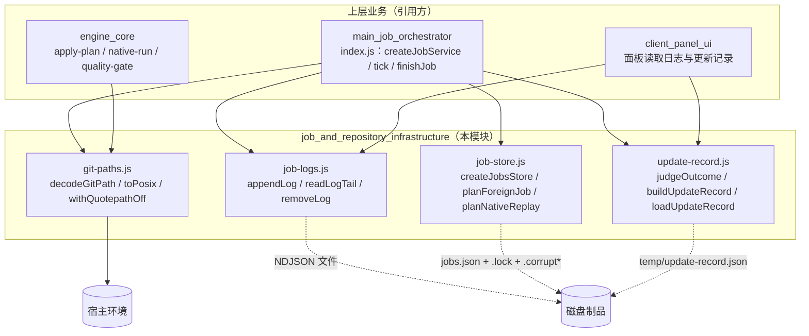
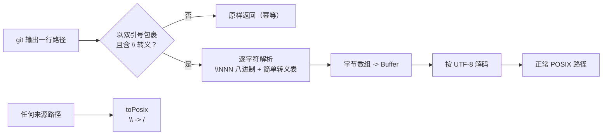
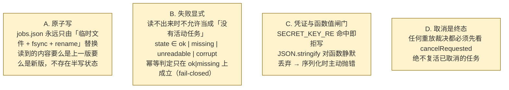
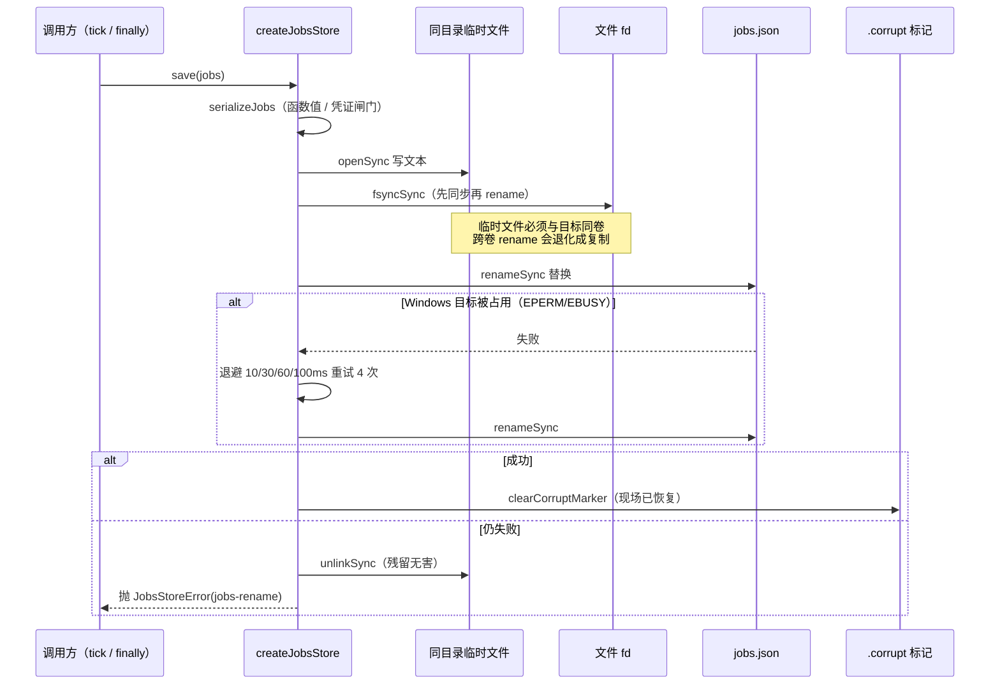
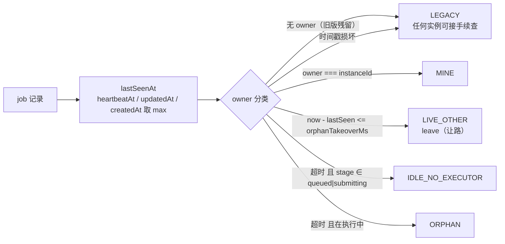
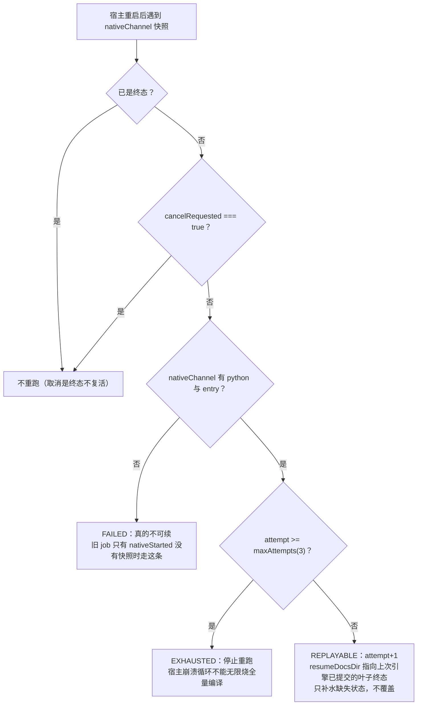
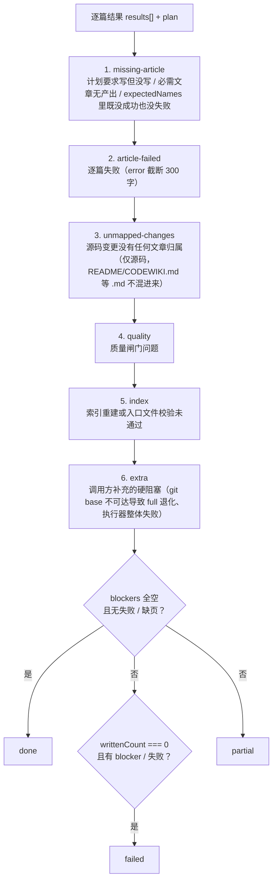

# 作业与仓库基础设施（job_and_repository_infrastructure）

## 简介

本模块是编译流水线的**持久化与路径基建层**，本身不推进任何业务阶段，而是为上层
[main_job_orchestrator](main_job_orchestrator.md) 的 tick 业务提供四件「必须做对一次、
做错就要重复执行同一仓库」的底层能力：

1. **Git 路径归一**（`lib/git-paths.js`）——铲平 `core.quotepath` 八进制转义与
   Windows 反斜杠两层路径落差，保证任何按路径比较的代码（白名单、`startsWith`、
   同仓幂等）在非 ASCII 仓库上不失配；
2. **引擎事件日志**（`lib/job-logs.js`）——把引擎每次编译的完整事件流落成 NDJSON
   文件，进程死掉后仍可追查「为什么慢、为什么 partial」；
3. **作业持久化存储**（`lib/job-store.js`）——`jobs.json` 的原子读写、损坏隔离、
   跨进程 tick 锁、多实例所有权判定与宿主重启后的原生通道重放裁决；
4. **更新记录**（`lib/update-record.js`）——把一次编译的 ChangeSet / UpdatePlan /
   逐篇结果收成版本化 JSON，判定 done / partial / failed 三态并回答「能否推进基线」。

设计上的共同取向：**纯函数与 IO 助手分离、失败显式不静默、观测（日志）永远不能打断
编译**。本模块全部导出在 `package.json` 的 `exports` 之外（`lib/*.js`），被插件主
入口与引擎内部模块引用。

---

## 1. Git 路径归一（`lib/git-paths.js`）

### 1.1 要解决的两层落差

Git 的路径输出与「同一件事」存在两层不一致，任何一层没铲平，按字面量比较路径的
代码都会当场失配：

| 落差 | 来源 | 表现 |
| --- | --- | --- |
| 转义 | `core.quotepath`（默认 true） | 非 ASCII 路径在 `--name-only` / `--name-status` 输出中被写成 `"a/\344\270\255.md"`——八进制字节转义 + 双引号包裹 |
| 分隔符 | 平台差异 | Windows 上 `\` 与 POSIX `/` 混用，同一路径在两份报告里字符串不等 |

关键点：转义是按**字节**做的，所以「解开转义」不能逐字符还原，必须把字节重新拼成
`Buffer` 再按 UTF-8 解码——一个中文字符是三个 `\NNN` 序列。

### 1.2 双管齐下的策略

模块同时提供两条独立成立的防线：

- `GIT_QUOTEPATH_OFF = ['-c', 'core.quotepath=false']` 与
  `withQuotepathOff(args)`：让**新发起**的 git 调用不再转义（首选，省一次解码）；
- `decodeGitPath(p)`：兜住「已经被转义」的输入（旧记录、外部传入的清单、调用方
  自己的 git 调用没带参数），**幂等**——非转义串原样返回。

为什么两件都要：只加参数挡不住已经写进历史记录的清单；只解码则每次都要多绕一层，
且 `--name-status` 的 `R100` 行按 tab 切分时引号包裹的路径仍可能带内嵌转义。

`decodeGitPaths(list)` 对整份路径清单整体解码，保持顺序、丢弃空行；解不开的一律
保守地原样返回——宁可让上层看见一个陌生字面量，也不吐出半个路径。

### 1.3 `toPosix`：归一语义的唯一实现

`toPosix(p)` 把反斜杠替换为 `/`。收口在这里而非各模块各写一份，是因为同一行
`replace(/\\/g, '/')` 曾在 apply-plan / manifest / mapping / native-state / output /
quality-gate 六个模块里各抄一份，任何一处漏改都会让「文件名看起来一样却判不等」。

**刻意只换分隔符**：不 trim、不去 `./`、不做 `path.posix.normalize`（后者会改变
`.` / `..` 的语义，而「上跳」是安全判据，必须由调用方显式判定后再动）。

---

## 2. 引擎事件日志（`lib/job-logs.js`）

### 2.1 为什么必须落盘

引擎日志此前只留在 `job.nativeLogs` 的最近 20 条（纯内存、不序列化、不进
`jobSummary`）。一次 99 分钟的编译结束后，能查到的只有最后 3 分钟（20 条桥请求），
前面 96 分钟完全无从追查；宿主重启或任务被截断（`MAX_JOBS_KEPT`）时更是全部消失。

因此本模块把每个任务写成一份 NDJSON 文件（一个任务一个文件），放在**仓库外**：

- 默认根目录 `os.tmpdir()/dsh-codewiki-logs`，可用环境变量
  `DSH_CODEWIKI_LOG_DIR` 覆盖；
- 单任务上限 `MAX_LOG_BYTES`（默认 2MB，可用 `DSH_CODEWIKI_LOG_MAX_BYTES`
  覆盖），超过就**丢掉前一半**保留最近现场；
- 放仓库外的理由与原生更新记录同源——`.codewiki/` 里多一个日志文件就会变成
  「提交之后产生的未跟踪文件」，每轮都脏工作区。

### 2.2 关键不变量

| 不变量 | 实现方式 |
| --- | --- |
| 日志是观测，不能打断编译 | `appendLog` 写失败返回 `false` 而不抛错；调用方再用 `job.logError` 如实上报 |
| 字段形状固定 | 每条事件统一 `{ at, jobId, phase, kind, ...entry }`，避免同一文件出现多种形状后无人能解析 |
| 读得多少算多少 | `readLogTail` 按行 JSON.parse，坏行跳过；外部改动或不完整写入时不抛错 |

导出的函数：

- `logFileOf(jobId)` —— 任务 id → 文件路径（非法字符替换为 `_`）；
- `appendLog(jobId, entry)` —— 追加一条并按需截断；
- `readLogTail(jobId, limit=200)` —— 读回最近 N 条（limit 夹在 1..5000），供面板与端点使用；
- `logStats(jobId)` —— 返回 `{ path, bytes, updatedAt }`；
- `removeLog(jobId)` —— 任务终态清理时删除日志文件（删不掉就留着，不影响任何判定）。

---

## 3. 作业持久化存储（`lib/job-store.js`）

这是从 `index.js` 抽出来的可测部分——JobService 的**磁盘层、现场合并、原生通道
重放**三件事。之所以单独一层：作业状态是**跨进程**的现场（同一台机器两个宿主窗口
各跑一个 JobService，共享一份 `jobs.json`），若与 tick 业务推进缠在一起，任何一条
语义都只能靠「起两个真宿主」来验证。

### 3.1 四条硬不变量

旧实现的对应事故：

- 旧实现直接 `writeFileSync` 覆盖，写一半崩溃得到截断的 JSON，而 `loadJobs` 的
  catch 把它读成「没有任务」——于是同一仓库被重复提交、两个引擎同时往同一个仓库写；
- 旧实现读损坏文件时静默返回 `[]`，幂等判定 fail-open；
- `llm` 这类执行期依赖以函数值进入快照时，`JSON.stringify` 静默丢弃字段，新宿主
  拿到一个「看起来正常」但缺执行器的 job。

### 3.2 磁盘层：原子写流程

`createJobsStore({ file, maxKept=30, instanceTag='svc' })` 返回 `{ load,
loadForIdempotency, save, writeAtomic, acquireTickLock, releaseTickLock }`。

读取侧的状态机：

| state | 含义 | 幂等判定（safe） |
| --- | --- | --- |
| `ok` | 读到完整现场 | ✅ 安全 |
| `missing` | 文件本就不存在 | ✅ 安全（全新机器） |
| `unreadable` | 权限或 I/O 问题 | ❌ fail-closed |
| `corrupt` | JSON 非法 / jobs 字段缺失 / 上一版损坏已隔离 | ❌ fail-closed |

损坏文件不直接删掉，而是 rename 成 `jobs.json.corrupt-<ts>` 保留证据，并写
`.corrupt` 标记；主文件 ENOENT 时先查标记——若有标记则返回 `corrupt`，防止「损坏
被隔离的那一刻起，后来者只看到 ENOENT 就当 missing」这条 fail-open 缝隙。一次成功
写入后才清掉标记。

### 3.3 跨进程 tick 锁

锁文件 `jobs.json.lock`，内容为带 `instanceTag` 的 token（`pid|tag|ts`）：

- 以 `flag: 'wx'` 创建，已存在则读 mtime：`now - mtime <= staleMs`（默认 60s）视为
  活锁，本轮让路；
- 崩溃进程不会自己删锁——超时强删后重抢一次，抢不到说明别的实例已接管；
- **释放时校验归属**：只在锁内容等于自己的 token 时 unlink，绝不删掉「已被别的
  实例接管」的锁（旧实现无条件 unlink，两实例交错时会把对方锁删掉，两边同时推进
  同一 job）。

存活判定只用真实时钟（文件系统 mtime），不接受调用方合成的 `now` 去减，避免两个
时钟混用把崩溃锁读成「活的」。

### 3.4 现场合并与所有权

时间线与所有权分类：

`planForeignJob` 对「别的实例拥有的非终态任务」做处置裁决：

| stage | 来源 | 动作 |
| --- | --- | --- |
| `submitting` | 任何 | **VOID**——提交未完成，没有可续状态 |
| `queued` 且 `auto === true` | 自动调度遗留 | **VOID**——下一轮扫描会重新提交，避免旧请求永久卡闸 |
| `queued`（手动）/ 其他 | 用户提交 | **ADOPT**——按 FIFO 继续排队 / 接管执行 |

`queued` / `submitting` 被定义为 `NO_EXECUTOR_STAGES`：这两个阶段不持有任何在飞
请求，超时只意味着没人替它推进，绝不意味着「原生引擎执行器丢失」。旧实现把这类
job 也按孤儿接管，会把一条正常排队任务写成「原实例停更 X 分钟，本实例接管推进」，
并在原生通道上直接判失败。

其他工具函数：

- `heartbeat(job, { instanceId, everyMs=30000 })` —— 节流心跳，慢宿主不被误判孤儿；
- `adoptOrphan(job, { instanceId })` —— 接管后改写 owner / heartbeat；
- `findActiveJob(jobs, cwd)` —— 同仓幂等查找，返回**最新**一条非终态记录（历史
  遗留可能让同一仓库挂多条）；
- `reassignSession(job, sessionId)` —— 完成唤醒必须发到**新的**会话，旧会话可能早已
  关闭；归属历史保留最近 10 条供面板解释「唤醒去了谁」；
- `mergeJobLists({ mine, disk, dirtyIds })` —— 磁盘版本覆盖内存版本的条件只有两条：
  本实例没改过它（dirtyIds），且磁盘版本更新；否则慢 tick 会用过期快照洗掉对方的
  note/batchRef。

### 3.5 原生通道：可重放快照与重放裁决

`snapshotNativeRun(job, {...})` 只收「下次还能原样再下发的执行配置」：
`python / entry / timeoutMs / scope / kind / language / moduleConcurrency /
rawTreeRoot / docsDir / attempt`。**明确不收** `llm` 服务、bridge（随机端口 + 占位
key）、`onProgress/onLog` 回调、任何 provider 凭证——它们属于「当前宿主」，重启后
必须由新宿主重建，持久化只会留下过期指针（桥端口已死）或泄密面。

`planNativeReplay(job, { maxAttempts=3 })` 的裁决流程（这是旧行为的修正：旧实现把
`nativeStarted === true` 且内存里没执行器直接判 failed，把「执行器丢了」误当成
「这轮编译不可续」）：

相关常量：`JOBS_SCHEMA = 2`、`NATIVE_SNAPSHOT_VERSION = 1`、
`NATIVE_MAX_ATTEMPTS_DEFAULT = 3`、`TERMINAL_STAGES = done|partial|failed|cancelled`。

---

## 4. 更新记录（`lib/update-record.js`）

### 4.1 解决的背景缺陷

编译结束只留 `writtenCount` / `failedCount` 两个数字，job 文件里塞的是整张图与任务
快照。于是「为什么这篇没重写」「哪几个变更没人管」事后无法复盘，面板只能显示一句
「完成」——而实际上可能 1 篇成功、19 篇失败。

本模块把 ChangeSet + UpdatePlan + 逐篇结果收成一份版本化记录，落盘在 wiki 目录下的
`temp/update-record.json`（`UPDATE_RECORD_REL`）。job 里只存路径与摘要，不塞整图。

### 4.2 三态语义

| outcome | 含义 | canAdvanceBaseline |
| --- | --- | --- |
| `done` | 完整成功：计划内必需文章全部写好、变更全部有归属、质量闸门全过 | ✅ |
| `partial` | 部分完成：已成功的文章可以入库，但「全部已消化」不成立 | ❌ |
| `failed` | 没有可交付成果（0 篇成功，或硬性前置条件缺失） | ❌ |
| `cancelled` | 任务被取消 | ❌ |

### 4.3 `judgeOutcome` 的六类 blocker

两个值得记录的语义决策：

- **未归属变更只算源码**：非源码文件（README / CodeWiki.md / CHANGELOG）没有被任何
  文章引用是常态，混进来会让正常增量永远落 partial，等于把「诚实终态」退化成
  「永远不完整」。
- `canAdvanceBaseline: outcome === 'done' || (outcome === 'partial' && writtenCount > 0
  && blockers.length === 0)`。代码注释明确说明：实测探针（2026-10-30）显示六类降级
  来源每一个都会 push blocker，所以 partial 分支当前不可达——写全是为了把「done-only」
  与「有成果且无硬缺陷」两种不同语义显式分开，将来若放宽 blocker 规则会自动按后者
  生效，而不是靠 `done` 别名悄悄失效。兼容通道（`tickIndex`）刻意保持更严：一旦放宽
  「未消化」语义，下一轮这些变化就不再触发文章更新，wiki 会静默落后于代码。

### 4.4 组装与读写

- `buildUpdateRecord({ jobId, scope, changeSet, plan, results, qualityIssues, ... })`
  —— 组装可序列化记录：每个 action 都带 `reason`（这是「可复盘」的最低要求），
  `changeSet` / `plan` / `results` / `qualityIssues` 各自只保留必要字段与计数，
  notes 截断最近 20 条；
- `saveUpdateRecord(wikiPath, record)` / `loadUpdateRecord(wikiPath)` —— version 不
  匹配（`UPDATE_RECORD_VERSION = 1`）时返回 `null`；
- `describeOutcome(outcome, blockers)` —— 面板/工具文案，三态一眼可分，如
  `部分完成（N 项未满足：…）`。

---

## 5. 与其他模块的关系

| 模块 | 关系 |
| --- | --- |
| [main_job_orchestrator](main_job_orchestrator.md) | 最大引用方：`createJobsStore` 驱动跨进程协调、`planNativeReplay` 在宿主重启裁决、`finishJob` 用 `judgeOutcome` / `describeOutcome` 定终态、`git-paths` 喂给全部 git 调用 |
| [agentic_article_workflow](agentic_article_workflow.md) | `change-set.js` 的 `collect` 产物作为 `buildUpdateRecord` 的 `changeSet` 入参；article 逐篇结果 `[{ name, ok, error }]` 直接进 `judgeOutcome` |
| [engine_core](engine_core.md) | 原生通道（`native-run` / `apply-plan` / `quality-gate`）的产物与质量问题进入更新记录；`workspace-snapshot` 的 `docsDir` 路径经 `snapshotNativeRun` 持久化 |
| [client_panel_ui](client_panel_ui.md) | 面板通过 `readLogTail` 展示引擎事件流、通过 `loadUpdateRecord` / `describeOutcome` 展示编译三态与 blockers |
| [build_configuration_and_test_verification_tooling](build_configuration_and_test_verification_tooling.md) | 环境变量 `DSH_CODEWIKI_LOG_DIR` / `DSH_CODEWIKI_LOG_MAX_BYTES`、`MAX_JOBS_KEPT`、Python venv 由 [tools/fsoft-engine/setup-env.sh](../tools/fsoft-engine/setup-env.sh) 与 [package.json](../package.json) 定义 |

---

## 6. 运维与配置速查

| 配置 | 默认值 | 作用 |
| --- | --- | --- |
| `DSH_CODEWIKI_LOG_DIR` | `<tmpdir>/dsh-codewiki-logs` | NDJSON 日志根目录（仓库外） |
| `DSH_CODEWIKI_LOG_MAX_BYTES` | 2 MB | 单任务日志上限，超限丢前一半 |
| `JOBS_SCHEMA` | 2 | `jobs.json` 格式版本 |
| `NATIVE_MAX_ATTEMPTS_DEFAULT` | 3 | 原生通道重放尝试上限 |
| `HEARTBEAT_MS` | 30 s | job 心跳节流间隔 |
| orphan takeover 默认 stale | 60 s | tick 锁存活窗口 |
| `maxKept` | 30 | `save` 时 job 列表保留最近 N 条 |
| `.corrupt` 标记 | — | 损坏文件隔离证据，成功写入后清除 |

**故障排查入口**：

1. 同一仓库被重复执行 → 检查 `jobs.json` 读取 state 是否 fail-closed、tick 锁
   `.lock` 是否被崩溃进程遗留；
2. 面板「为什么慢」→ 读 `<LOG_ROOT>/<jobId>.ndjson` 尾部；
3. 编译显示「完成」但文章没更新 → 读 `temp/update-record.json` 的 `blockers` 与
   `canAdvanceBaseline`；
4. 非 ASCII 路径在白名单里失配 → 确认 git 调用前置了 `withQuotepathOff`，且落盘
   前经 `decodeGitPaths` 解码。
