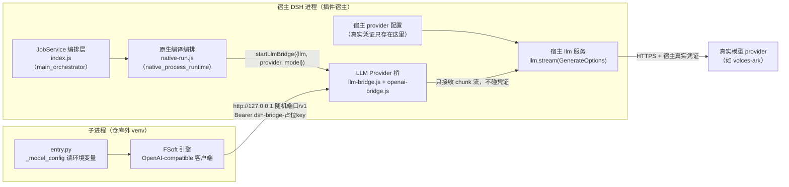
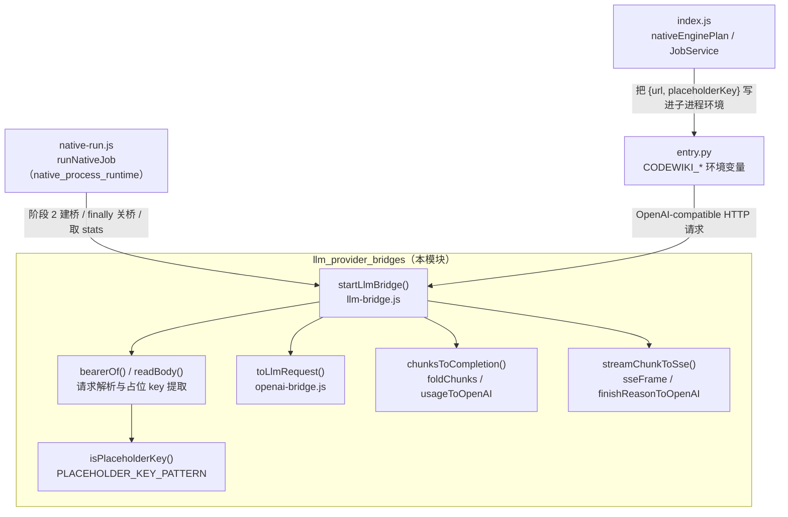
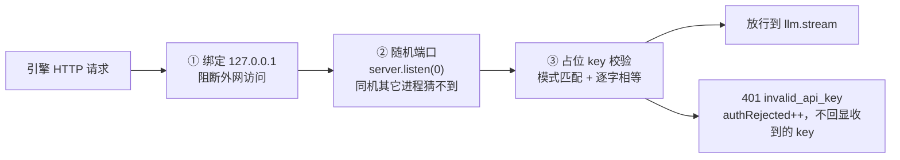
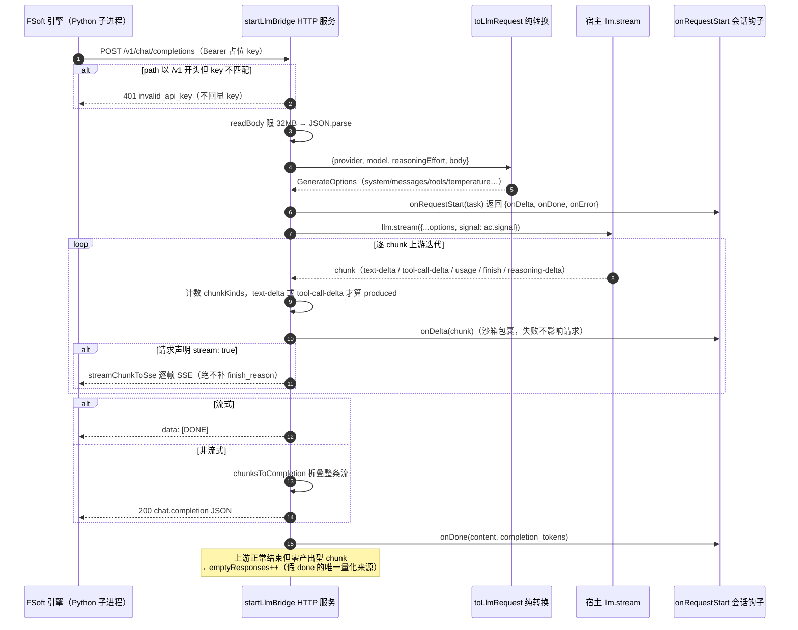
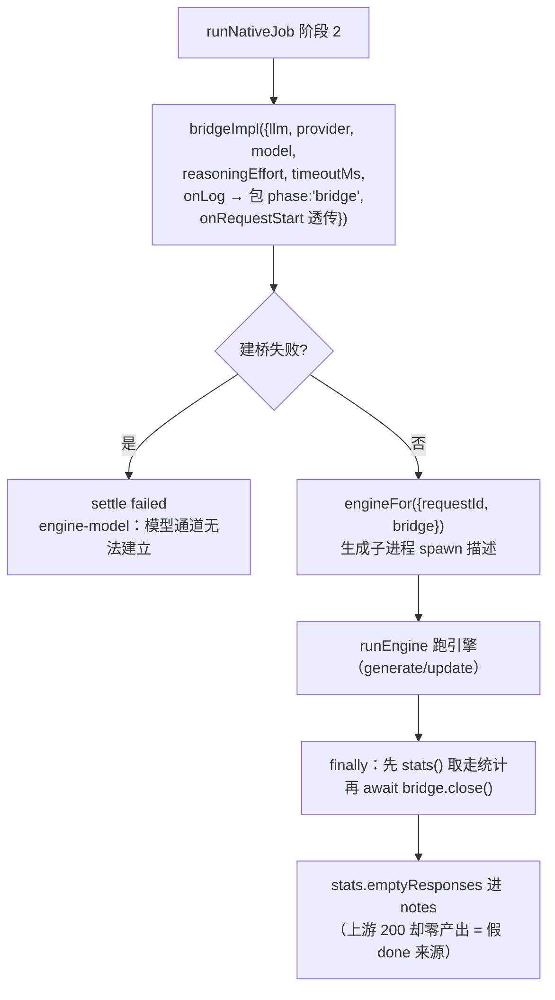

# LLM Provider 桥接层（llm_provider_bridges）

## 简介

`llm_provider_bridges` 是原生引擎通道的**模型凭证隔离桥**。它解决一个结构性矛盾：

- FSoft 原生引擎（Python 子进程，见 [fsoft_engine_python_runtime](fsoft_engine_python_runtime.md)）只会说 OpenAI-compatible 的 HTTP 协议（`base_url` + `api_key`）；
- 而插件的真实模型凭证只存在于宿主 DSH（DeepSeek Harness）的 provider 配置里，插件**从 0.10.1 起硬约束自己不保存、不传递任何密钥**。

本模块因此是一个跑在 `127.0.0.1` 上的进程内 loopback HTTP 端点：引擎拿着占位 key 打过来，桥把 OpenAI 请求翻译成宿主的 `llm.stream(GenerateOptions)`，用**宿主自己的凭证**去调真实 provider，再把 chunk 流翻译回 OpenAI 响应。桥本身从头到尾看不见真实密钥——它只是「用宿主凭证换一次模型调用」的受控开关。

模块由两个文件组成，职责严格分层：

| 文件 | 层 | 职责 |
| --- | --- | --- |
| `lib/engine/openai-bridge.js` | 纯转换层（无 I/O、无网络、无密钥） | OpenAI 请求体 ⇄ DSH `GenerateOptions` / `StreamChunk` 流 |
| `lib/engine/llm-bridge.js` | 宿主 loopback HTTP 服务层 | 路由、占位 key 闸门、超时/取消、会话记录钩子、统计与日志 |

---

## 架构与系统位置

### 系统上下文图

### 模块内组件依赖图

---

## 安全边界（本模块最不能破的不变量）

桥等于「用宿主凭证换任意模型调用」的开关，因此三层防护缺一不可：

凭证红线（见 `llm-bridge.js` 与 `openai-bridge.js` 文件头注释）：

- 桥**不读**任何凭证文件、**不接收**真实 api_key、**不转发** Authorization 头；`bearerOf()` 只把 token 取出用于校验，取完即弃——绝不写日志、绝不放进请求对象、绝不传给 `llm`。
- 占位 key 每次启动随机生成（`dsh-bridge-` + `randomBytes(32)` hex）：不复用、不落盘、不进日志。
- `toLlmRequest` 的返回值里永远没有 `apiKey` 字段。
- 访问/错误日志只记 method / path / 状态 / 耗时 / chunk 类型计数 / usage，**不记** Authorization、不记请求体（可能含源码与文章内容）。
- 会话记录只记 messages 拼出的 prompt 文本（截断到 200k 字符并显式标注截断）与模型输出，**不含** Authorization 与占位 key。
- 401 错误体不回显收到的 key——避免把用户误配的真实 key 写进日志。
- 子进程侧由 `CODEWIKI_NO_KEYRING=1`（见 `nativeEnginePlan`）显式关闭引擎自己翻本机凭证库的能力；`entry.py` 的 `_model_config()` 缺任一环境变量就如实报 `engine-model`，绝不回退读本机配置。

---

## 请求生命周期（一次 chat/completions 的完整流程）

### 取消与超时语义

- 客户端（引擎）断连：`res.on('close')` → `ac.abort()` 立即中止上游调用——省 token，也让引擎的取消语义真正生效。
- 单次调用超时：缺省 `DEFAULT_TIMEOUT_MS = 10 分钟`（调用方 `native-run.js` 再用 `Math.min(timeoutMs, 10min)` 兜一层）；超时同样走 `ac.abort()`。
- 上游异常分两个出口：**流未开始**（headers 未发）→ 502 `upstream_error`；**流已开始** → 只能写一条 error SSE 事件 + `[DONE]` 终止（OpenAI 的做法）。
- 会话钩子与 `onLog` 全部 try/catch 包裹：**记录失败绝不影响正在跑的模型请求**。

---

## 请求方向的转换语义（openai-bridge.js）

`toLlmRequest({provider, model, reasoningEffort, body})` 把 OpenAI 请求体翻成 DSH `GenerateOptions`：

| OpenAI 输入 | DSH 输出 | 关键不变量 |
| --- | --- | --- |
| `system` / `developer` 消息 | 抽到 `system` 槽（one-shot 语义，多条合并） | 宿主要求 system 独立成槽，不混进 messages |
| `user` 消息 | `ContentBlock[]`（text 块） | `content` 为 string 或 parts 数组都摊平；`image_url` 等非文本部分**显式跳过**（引擎只发文本） |
| `assistant` 带 `tool_calls` | text + `tool-call` 块 | `arguments` **保持原始 JSON 字符串**——DSH `ToolCallBlock` 就是这么定义的，提前 parse 会破坏增量拼接 |
| `tool` 消息 | `ToolResultMessage`（`toolCallId`） | callId 必须对上，否则工具循环断链；`is_error` 透传 |
| `tools[].function` | `ToolSchema[]` | 缺这一步 agentic 工具循环退化成空谈 |
| `temperature` / `max_tokens` / `stop` | 同名/驼峰字段 | 可选，缺省不透传 |
| — | `assistant` 消息必须带 `source: {kind:'model', provider, model}` | 宿主 `LlmRuntime.forAdapter()` 会**无条件**读 `message.source.replayState`；缺 source 直接抛 `Cannot read properties of undefined (reading 'replayState')`，整轮调用判 error。桥不伪造 replayState |

校验规则：`provider` / `model` 缺失、`messages` 非非空数组、除 system 外没有任何消息 → 直接抛错（桥层翻译成 400）。

## 响应方向的转换语义

`foldChunks`（私有折叠器）是非流式与流式两条路径的**共同语义源头**，保证行为同源：

- `text-delta` → 累加正文；`reasoning-delta` / `block-start` / `block-end` **全部丢弃**（思考内容不该出现在文章正文里）。
- `tool-call-delta` → 按 `index` 拼接 arguments；**只保留带 name 的调用**（无 name 的调用引擎无法执行，混进去只会制造噪音）；缺 id 时桥侧兜底生成 `call_xxxx`。
- `usage` → token 计数；`finish` → `finish_reason`（`tool-calls`/`length`/`error`/`aborted`/`stop` 映射表）。
- Token 口径换算：DSH `inputTokens` 是**不含缓存**的互斥净计数，OpenAI `prompt_tokens` 含缓存，故 `prompt_tokens = inputTokens + cacheRead + cacheWrite`，缓存单列进 `prompt_tokens_details.cached_tokens`。
- 纯工具调用时 `content` 为 `null` 而非空串（OpenAI 语义）。

### 逐帧 vs 折叠：流式最容易踩的坑

`streamChunkToSse` 与 `chunksToCompletion` 的分工必须分清（代码注释里钉死的真机事故）：

- `chunksToCompletion` / 折叠语义的入参是**一整条已经结束的流**，缺 finish 时会自己补结束帧；
- 逐帧中转时，任何一个中间 chunk 后面都还没结束——如果对每个分片补 `finish_reason`，引擎会以为「这一轮到此为止」，工具调用没发完就被截断，最终报 pydantic-ai 的 `"Please return text or call a tool"` 并重试到上限。

因此桥在流式路径上**只用 `streamChunkToSse` 逐帧转发，绝不补 finish、绝不补 `[DONE]`**；`[DONE]` 只在整条上游流正常结束后由服务层写一次。

---

## 与上层的接线

### 建桥与关桥（native_process_runtime）

[native_process_runtime](native_process_runtime.md) 的 `runNativeJob` 在环境校验、增量决议、工作区快照之后、引擎启动之前（阶段 2）建桥：

两条硬接线细节（都踩过真机 bug）：

1. **必须先关引擎、后关桥**：先关桥会让还在读流的引擎拿到 502；关桥前先把 `stats()` 取走。
2. **桥的返回对象没有 `model` 字段**：桥只负责转发，不知道也不该知道模型选择。模型名由调用方显式传入（曾经写成 `bridge.model` 得到 `undefined` → `CODEWIKI_MAIN_MODEL` 变空串 → 每次原生编译都在 cluster 阶段以 `engine-model` 失败）。

### 子进程环境注入（main_orchestrator）

[index.js 的 nativeEnginePlan](main_orchestrator.md) 把桥的返回值翻译成引擎环境变量（真实凭证全程不出现）：

| 环境变量 | 值 | 引擎侧消费点 |
| --- | --- | --- |
| `CODEWIKI_BASE_URL` | `bridge.url`（`http://127.0.0.1:<port>/v1`） | `entry.py::_model_config()` |
| `CODEWIKI_API_KEY` | `bridge.placeholderKey` | 同上（仅用于桥的占位校验） |
| `CODEWIKI_MAIN_MODEL` | 调用方显式传入的模型 id | 同上 |
| `CODEWIKI_CLUSTER_MODEL` | 聚类模型（缺省回落主模型） | 同上 |
| `PYTHONIOENCODING` / `PYTHONUTF8` | `utf-8` / `1` | 防 Windows cp936 中文乱码 |
| `CODEWIKI_NO_KEYRING` | `1` | 关闭引擎本机凭证解析 |

`entry.py` 拿到这份 config 后以 `provider: "openai-compatible"` 直接构造 FSoft adapter，**绕开 ConfigManager 的整套凭证解析**——缺任一环境变量即报 `缺少模型通道（环境变量 … 未设置）`，错误信息只说变量名、不打印值（防误配的密钥被写进 job 日志）。

### 会话记录与统计（可观测性）

- `onRequestStart(task)`：每个 chat 请求开始时回调一次，`task` 形如 `{name: "原生请求 · <model>", model, provider, batchPrompt}`，返回的 `{onDelta, onDone, onError}` 句柄供面板「会话」视图落盘。原生通道的模型请求只经过这个钩子，不接它面板就永远是空列表。
- `stats()` 返回快照：`requests` / `streamRequests` / `authRejected` / `failures` / `emptyResponses` / `lastError`。其中 `emptyResponses`（上游 200 但一个产出型 chunk 都没有）是「引擎把这页记成无需改动、实际一篇文章没写」的**唯一可量化源头**——没有它，只能靠翻 chunk 日志数条数。
- `onLog` 结构化日志条目：`{at, method, path, status, ms, chunks?, chunkTotal?, usage?}`，按请求出口统一记。

---

## 协议面（只实现引擎真正用到的部分）

| 路由 | 方法 | 用途 |
| --- | --- | --- |
| `/healthz` | GET | 桥自身存活检查（响应只含 `{ok, provider, model}`，不含任何模型密钥信息） |
| `/v1/models` | GET | 引擎/探针的连通性检查；返回单条 `{id: model, object: 'model', owned_by: provider}` |
| `/v1/chat/completions` | POST | 非流式（`stream` 缺省/false → 折叠 JSON）与流式（`stream: true` → 逐帧 SSE） |

不假装完整 OpenAI：未登记路由一律 404 `unsupported route`；请求体超 32MB → 413；JSON 非法 → 400。

---

## 相关模块

- [native_process_runtime](native_process_runtime.md) — `runNativeJob` 是本模块的唯一生产调用方：建桥、注入环境、关桥、消费统计。
- [engine_client](engine_client.md) — 引擎子进程的进程/协议边界；桥是它的**模型通道**，与 JSON-lines 协议通道相互独立（`client.js` 自己明确「不读凭证、不连模型」）。
- [fsoft_engine_python_runtime](fsoft_engine_python_runtime.md) — `entry.py::_model_config()` 是桥的唯一请求方；绕开 ConfigManager、不读本机凭证。
- [main_orchestrator](main_orchestrator.md) — `nativeEnginePlan` 环境变量派生、`JobService` 传入宿主 `llm` 服务与会话记录钩子。
- [result_contract_and_quality_gates](result_contract_and_quality_gates.md) — 桥的 `failures` / `emptyResponses` 统计最终服务于「假 done」识别，与质量门的裁决链衔接。
- [workspace_state_and_integrity](workspace_state_and_integrity.md) — 引擎锁与受管状态在桥建立之前先行校验（环境不可信时根本不建桥、不跑引擎）。
- [build_packaging_configuration](build_packaging_configuration.md) — `tools/fsoft-engine/setup-env.sh` 负责造可信的 Python 引擎环境（含 openai / pydantic-ai-slim 依赖），桥所依赖的 OpenAI 兼容客户端就装在那个 venv 里。
