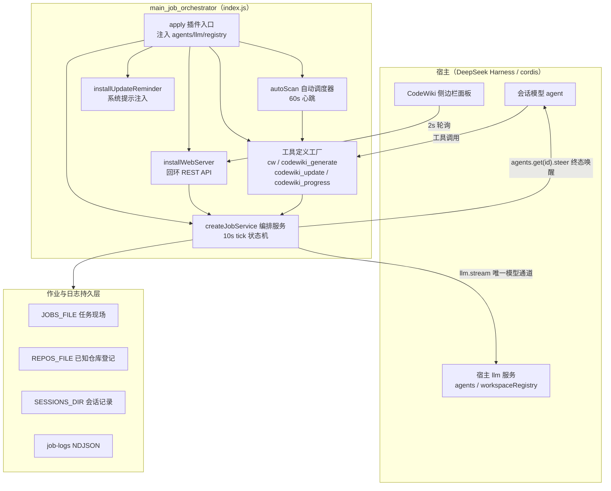
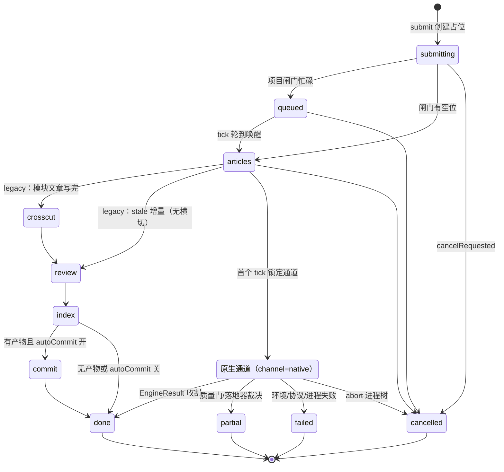
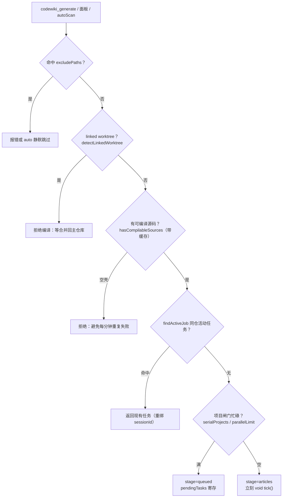
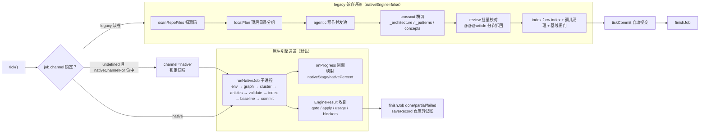
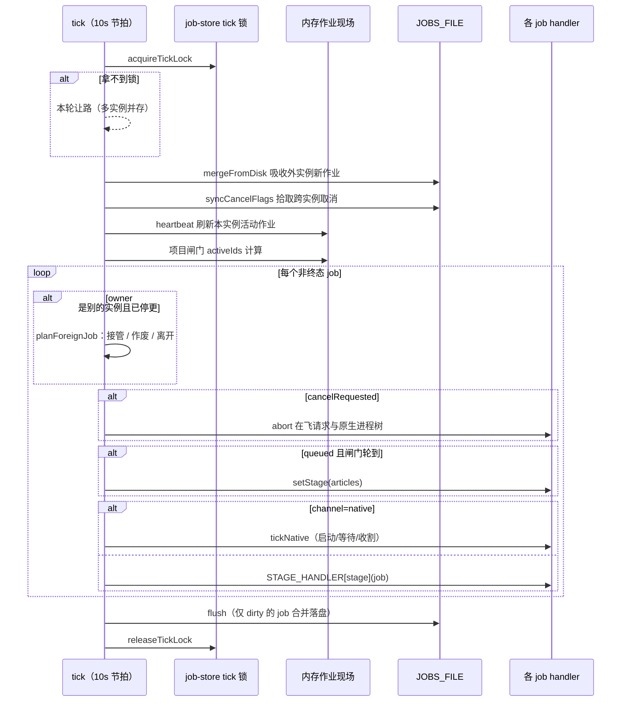

# 主作业编排器（main_job_orchestrator）

## 简介

`main_job_orchestrator` 是 `dsh-codewiki` 插件的控制平面，即插件入口文件 `index.js` 中 `apply()` 建立起来的整套后台编排服务。它把「CodeWiki 全仓 wiki 编译」从一次同步模型调用，改造为一个**提交制（submit-and-forget）的后台作业系统**：

- 对会话模型暴露四个工具：`cw`（CLI 薄封装）、`codewiki_generate`（编译入口）、`codewiki_update`（日常维护快捷入口）、`codewiki_progress`（只读进度查询）；
- 对侧边栏面板暴露一组只允许回环访问的 HTTP API（任务列表 / 仓库总览 / 会话记录 / 引擎日志 / 模型目录 / 控制动作）；
- 以 10 秒一拍的 tick 状态机推进每个编译作业，内部存在两条并列编译通道——**原生引擎通道**（0.16.0 起默认，驱动 upstream FSoft Python 引擎子进程）与**内置 Node 兼容通道**（agentic 写作 + 横切 + 校对 + 索引的单轮文本生成流水线）；
- 负责作业持久化、跨实例接管、取消、自动提交产物、自动增量调度与会话唤醒。

简言之：本模块是整个 CodeWiki 编译系统的「作业总线」——它不亲自写文章，而是决定**什么时候、由哪条通道、用什么模型、推进哪一篇**，并把全部可观测状态沉淀成面板与 `codewiki_progress` 都能消费的同一份 `jobSummary`。

---

## 1. 架构总览

**关键设计约束**：

- **凭证从不落地**：插件不保存任何 API key，全部模型请求经宿主 `llm` 服务按 provider 解析；原生通道的子进程环境只放桥生成的**占位 key**。
- **提交制**：工具调用立即返回 `{ jobId, stage }`，模型被明确引导「不要等待、不要轮询」；编译的长耗时（全量实测约 174 分钟）由后台服务消化。
- **双通道互斥**：一个作业一旦在首个 tick 被锁定为 `channel='native'`，其后全程只走 `tickNative`，绝不再落入 legacy 的同名阶段 handler——防止同一批产物被两套实现各写一遍。

---

## 2. 核心组件清单

| 组件 | 角色 | 说明 |
| --- | --- | --- |
| `apply` | 插件入口 | 注入 `agents`/`llm`/`workspaceRegistry` 服务引用；创建并启动编排服务；注册四个工具；安装 Web API、系统提示提醒与自动调度器；注册 cordis effect 清理 |
| `submit`（service） | 作业创建 | 统一提交入口：排除清单 / worktree / 空壳目录三道闸门 → 幂等判定 → 项目闸门（串行或并行上限）→ 写入 `submitting` 占位 job → 校验模型通道 → 落入 `queued` 或直接 `articles` |
| `cancel` | 取消请求 | 只置 `cancelRequested=true` 并标脏落盘；真正的中断在 tick 中发生（abort 在飞请求、终止原生进程树） |
| `list` / `jobSummary` | 读模型 | `jobSummary` 是面板、`codewiki_progress`、仓库总览**同源**的视图构造器；`progressView` 在其上追加完成百分比 |
| `tickArticles` / `tickCrosscut` / `tickReview` / `tickIndex` / `tickCommit` | legacy 通道阶段机 | 内置 Node 通道的五段流水线 handler（native 通道不使用它们） |
| `tickNative`（内部） | 原生通道驱动 | 启动一次长任务 → 每轮 tick 只等待结果 → 收割 `EngineResult` 并映射终态；承担重放（replay）与快照管理 |
| `runPool` / `worker`（`runRealtimeTasks` 内部） | 并发执行器 | 默认档 / 大档**双池**唯一 LLM 执行器；`signal` 驱动取消；`onRequestStart` 挂钩会话记录 |
| `wakeCompileSession` | 终态唤醒 | 仅在「失败」或「产物待提交（autoCommit 未成功）」时对发起会话 `steer` 一条消息；成功且已自动提交时完全静默 |
| `onAbort` | 取消传导 | `runCw` 的 abort 监听与 `batchAborters`/`nativeAborters` 的 AbortController；取消是终态但不是成功，基线绝不前移 |
| `allowedLinkTargets` / `makeLinkExists` | 链接校验输入 | 为文章契约闸门收集「现存 wiki 文章 + 本轮计划产出文章」的允许链接目标集 |
| `symbolsOnLine` | 锚点符号提取 | `fixAnchors` 行号校正的符号绑定规则（与测试校验器同源） |
| `currentCommit` | 环境感知 | `git rev-parse --short HEAD`，为快照记录「这份图对应哪个提交」 |
| `reposFileFor` | 持久化路径推导 | 让已知仓库登记文件跟随 `JOBS_FILE` 命名（测试隔离的关键），避免测试 fixture 污染宿主清单 |

---

## 3. 作业生命周期状态机

**终态语义（`job.outcome`，吸收自 FSoft updater 的不变量）**：

- `done`：计划内必需文章全部写好、变更全部有归属、质量闸门全过 → **允许推进编译基线**（`cw meta update`）；
- `partial`：写成的文章可以入库，但存在未消化/失败/质量问题的变化 → **基线绝不前移**，未消化的变化下一轮编译仍会被看见；
- `failed`：没有可交付成果；
- `cancelled`：取消是终态，半成品基线绝不前移（`canAdvanceBaseline` 恒 false）。

---

## 4. 提交流程：三道闸门与幂等

要点：

- **幂等**：同一仓库同时只能有一个活动作业；重复提交返回 `existed:true`，并把 `sessionId` 重绑给最近关心它的会话。
- **项目闸门**：默认 `serialProjects=true`（同一时刻只推进一个仓库）；关闭后按 `parallelLimit`（1–4）并行。排队中的任务在 tick 里按提交顺序被唤醒，面板可见 `queueAhead`（「在等谁」）。
- **占位先行**：先落 `submitting` 占位再做模型通道校验——校验失败也把失败写进 job 而不是悬空。
- **原生通道接管增量**：`scope=stale/auto` 且 wiki 已存在时，本层**不做**旧 planner 的全量/增量判定，直接以 `kind='stale'` 提交，把 update/full/no_change 的决议权整体交给 `runNativeJob`（旧 planner 已随 0.16.0 阶段 7 退役）。

---

## 5. 双通道执行模型

**原生通道的关键约定**（见 `tickNative` 与 `startNativeRun`）：

1. **只起一次**：`runNativeJob` 是一条长任务，不能塞进一步 tick；tick 只负责「启动 → 等结果 → 收割」三段分离，避免 10s 节拍重复提交。
2. **终态不在 tick 里重写**：引擎内部已走「环境→图→聚类→文章→校验→索引→基线→提交」原生流水线，终态由质量门 + 落地器严格裁决；本层只映射面板阶段与搬运字段。
3. **重放安全**：宿主重启后按持久化快照（`snapshotNativeRun` / `planNativeReplay`）重建，已落盘叶子按断点续跑。
4. **证据留档**：引擎原始 docs 树在被映射/裁剪之前拷到仓库外临时目录（`nativeRawTreeDir`），作为「事实来源」；工作副本 `docsDir` 在 `finally` 中清理。

**legacy 通道的兜底网络**：

- 单批输入超 110k 普通预算 → 大档模型（512k 上下文，`bigTier` 标记进独立并发池）；
- 单文件连大档预算都装不下 → `dispatchSessionTasks` 把完整写作指令写成任务文件，`steer` 给发起会话派子智能体，本服务轮询目标文件收割（30 分钟超时按失败处理，**不降级回插件内通道**）。

---

## 6. Tick 推进循环与跨实例协调

协调机制一览：

- **实例身份**：每个 `createJobService` 拿到随机 `instanceId`；tick 只推进本实例作业，外实例作业靠 `planForeignJob` 决定「接管（adoptOrphan）/ 作废（排队项从未真正开始）/ 离开」。
- **脏标记 + dirtyIds**：只有状态变更过的 job 才进落盘合并集合，防止无事可做的旧实例用过期快照覆盖新实例现场。
- **取消终态化**：取消到达时若原生结果已落地，按真实结果收尾而不丢弃产物；否则 abort 进程树并置 `cancelled`。
- **停止即失效**：`stop()` 后入口与 flush 双重让路，防止飞行中的旧 tick 把已终态任务「复活」。

---

## 7. 依赖关系（指向兄弟模块）

本模块只负责编排与裁决，重活全部委托给同树的下层模块：

- **[agentic_article_workflow.md](agentic_article_workflow.md)**：legacy 通道的写作执行器 `runAgenticArticles`、`edit` 文章编辑、文章契约闸门 `inspectArticle`/`hasBlockingIssue`/`issueSummary`、以及变更集采集 `collectChangeSet`（增量判定的输入）。
- **[job_and_repository_infrastructure.md](job_and_repository_infrastructure.md)**：作业现场的持久化原语 `createJobsStore`（含 tick 锁、幂等吸收、孤儿接管）、引擎事件日志 `job-logs`、终态判定 `judgeOutcome`/`isTerminalStage`/`TERMINAL`、以及 `git-paths` 的 quotepath 关闭包装。
- **[engine_core.md](engine_core.md)**（更细：[native_execution_and_workspace_infrastructure.md](native_execution_and_workspace_infrastructure.md)）：原生通道的执行外壳 `runNativeJob`、引擎子进程入口与超时、工作区快照与重放支持。本模块只通过 `nativeEnginePlan` 组装环境变量（占位 key、UTF-8、禁 keyring），不干涉引擎内部八段流水线。
- **[client_panel_ui.md](client_panel_ui.md)**：侧边栏面板是本模块 `/api/codewiki/*` 端点的唯一消费者——`jobSummary` 的字段形状（`taskList`/`nativeStage`/`nativeLogs`/`queueAhead` 等）即面板渲染契约，修改时需与该模块同步。

构建与运行环境方面：原生通道依赖 `tools/fsoft-engine/setup-env.sh` 闭合的 Python 3.10+ venv（见 [build_configuration_and_test_verification_tooling.md](build_configuration_and_test_verification_tooling.md)），环境不闭合时以 `engine-deps` 明确失败，绝不悄悄降级到 Node 通道。

---

## 8. 关键配置面（`liveConfig` 收口）

配置在插件设置页定义、由 `liveConfig(config)` 在运行时一次性归一——下游多处消费的字段（并发、模型、大档开关）都在这里收口，避免「逐个判断迟早漏一处」：

| 维度 | 代表字段 | 语义 |
| --- | --- | --- |
| 模型通道 | `batchProvider/batchModel`、`batchReasoningEffort` | 唯一模型通道；档位合法性提交前经 `resolveModelEfforts` 校验，静默空跑在提交入口就被拦下 |
| 大档 | `bigEnabled/bigProvider/bigModel/bigTokenBudget` | 大档由 `bigTierOf` 统一收口构造：`bigProvider` 与 `bigModel` **同时非空**才生效（模型不再在运行时回落内置默认值，只填 provider 不再触发大档）；关闭时 `bigProvider` 直接清空（模型 id 与预算保留，重开无需重填） |
| 并发 | `maxConcurrency`（硬顶 8）、`bigConcurrency`（0=跟随默认档）、`moduleConcurrency`（原生引擎模块并行度） | 默认档与大档**各自独立限流、同时推进** |
| 项目闸门 | `serialProjects`、`parallelProjects`（1–4） | 多仓库排队或并行 |
| 原生通道 | `nativeEngine`、`nativeEnginePython`、`nativeEngineEntry`、`nativeEngineTimeoutMs` | 默认开启；解释器解析顺序：配置 > `DSH_CODEWIKI_PYTHON` > PATH |
| 产物入库 | `autoCommit` | 主题分支 `codewiki/wiki-<jobId>` 提交 → 合并回原分支 → 删分支；冲突/非 git/未配 user 一律降级为「提醒会话提交」 |
| 自动调度 | `autoUpdate`、`autoUpdateMin`、`workspaceOnly`、`excludePaths` | 定时扫描已知仓库；从未编译过的新仓库只登记 `pendingConfirm` 等用户在面板确认，不擅自首次生成 wiki |

---

## 9. 可观测性出口

- **`codewiki_progress` / `GET /api/codewiki/jobs`**：同一 `jobSummary`，含阶段、百分比、篇数、`blockers`、`canAdvanceBaseline`、`usage`（token 用量）、`tps`、最近 notes。
- **`GET /api/codewiki/repos`**：仓库总览（30s 缓存 + 工作区清单签名失效），带调度器心跳与待确认清单。
- **`GET /api/codewiki/sessions[/*]`**：每个 LLM 请求的 prompt/流式输出落盘（24h TTL），面板「会话」视图可实时看到「codewiki 现在在跟模型说什么」。
- **`GET /api/codewiki/logs?jobId=`**：引擎事件完整 NDJSON（内存只留最近 40 条），是长编译任务唯一的黑匣子。
- **`POST /api/codewiki/control`**：`cancel` / `compile` / `confirm` / `refresh`，全部仅回环可写。
