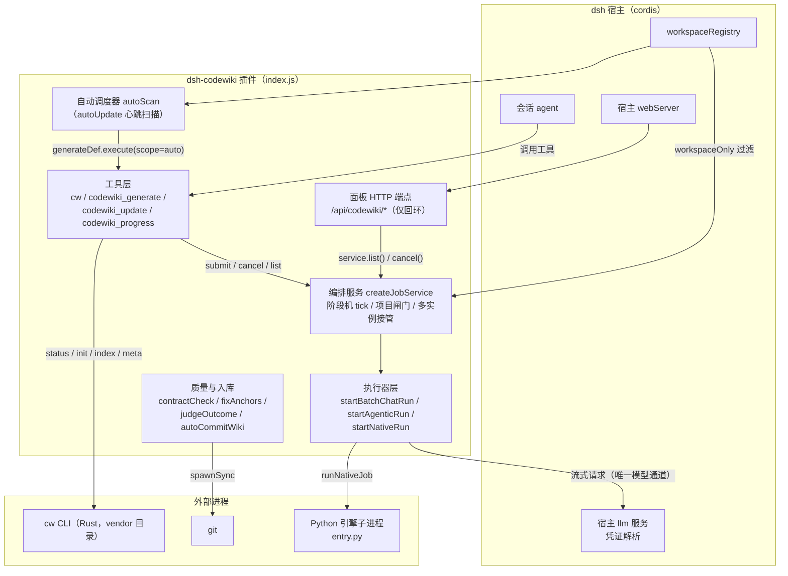
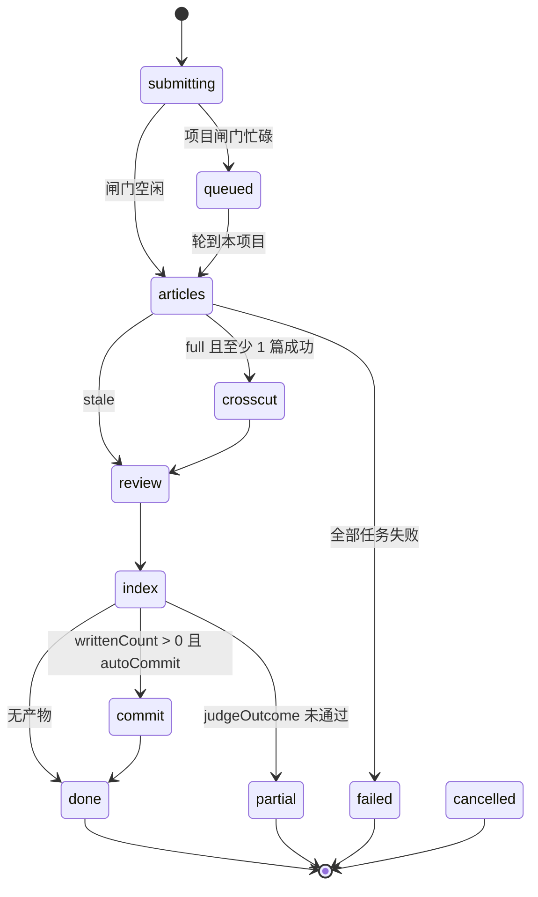
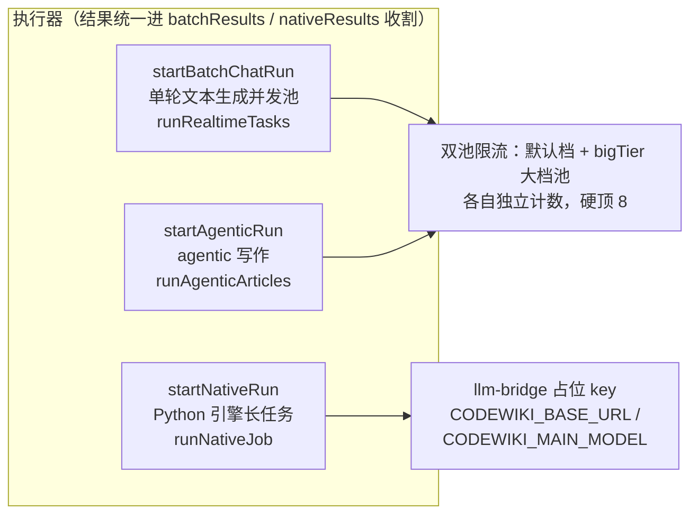
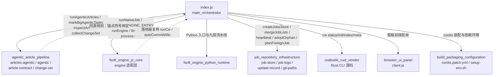
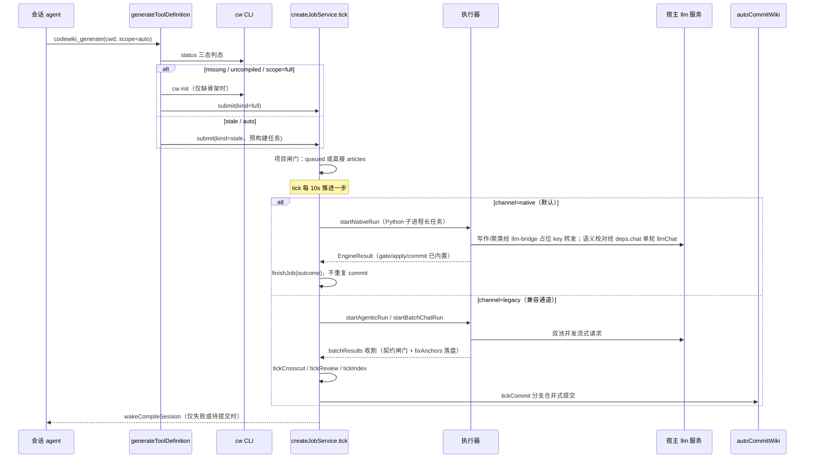

# 主编排器（main_orchestrator）

## 简介

`main_orchestrator` 是 `@local/dsh-codewiki` 插件（见 [build_packaging_configuration.md](build_packaging_configuration.md) 的 `package.json`）的主入口与中枢——即仓库根 `index.js`。它把 Rust CLI `cw` 与服务化的全仓库 wiki 编译流水线接入 DeepSeek Harness（dsh）宿主：

- 对外暴露 **4 个工具**：`cw`（CLI 薄封装）、`codewiki_generate`（提交制编译）、`codewiki_update`（`scope=auto` 快捷入口）、`codewiki_progress`（只读查进度）；
- 对内实现 **常驻编排服务**（`createJobService`）：以 10s tick 节拍驱动任务阶段机，负责判态、排队、并发池调度、终态裁决、自动提交与会话唤醒；
- 同时充当 **面板后端**：注册一组仅回环可访问的 `/api/codewiki/*` HTTP 端点，供侧边栏面板（见 [browser_ui_panel.md](browser_ui_panel.md)）轮询。

自 0.16.0 起，编译默认走**原生引擎通道**（驱动上游 FSoft Python 引擎子进程，见 [fsoft_engine_js_core.md](fsoft_engine_js_core.md) 与 [fsoft_engine_python_runtime.md](fsoft_engine_python_runtime.md)）；内置 Node 流水线降级为兼容通道（`nativeEngine: false`），不再接收新能力。两条通道在本模块会合于同一套 job 模型、终态裁决与产物入库逻辑。

## 总体架构

## 核心组件分层

### 1. 配置层：`Config` 与 `liveConfig`

- `Config`（schemastery 对象）声明全部可热更新（`volatile`）设置：编译模型档位（`batchProvider/batchModel/batchReasoningEffort`）、大档模型（`bigEnabled/bigProvider/bigModel/bigTokenBudget`）、并发（`maxConcurrency/bigConcurrency/moduleConcurrency`）、项目并发（`serialProjects/parallelProjects`）、自动更新（`autoUpdate/autoUpdateMin`）、自动提交（`autoCommit`）、排除清单（`excludePaths`）、原生通道开关（`nativeEngine/nativeEnginePython/nativeEngineEntry/nativeEngineTimeoutMs`）等。
- `liveConfig(config)` 是唯一的运行参数出口：归一化边界值（并发硬顶 8、请求上限硬顶 1000）、在大档关闭时**一次性清空** `bigProvider`（避免下游五六处逐一判空遗漏）、并把原生通道参数透传——注释明确要求「必须经 liveConfig 透出，否则开关看起来打开、实际走旧流水线，这种静默不生效比报错更难查」。

### 2. 工具层

| 工具 | 语义 | 关键行为 |
| --- | --- | --- |
| `cw` | CLI 薄封装 | 仅放行 `init/status/index/meta/path/projects/setup/uninstall` 子命令；`resolveBinary` 优先用 PATH 里的 `cw`，捆绑副本兜底 |
| `codewiki_generate` | 提交制编译 | `cw status` 三态判态（`parseStatus`）→ 幂等检查（同仓活动任务直接返回）→ 原生通道接管增量 → stale 逐篇更新（`runStaleUpdate` + 文件级归属判定）→ 全量编译提交。立即返回，绝不等待 |
| `codewiki_update` | 日常维护入口 | 固定 `scope=auto`，复用 `generateDef.execute`，返回文案明确「本步收尾、继续下一项」 |
| `codewiki_progress` | 只读查询 | 按 `cwd`/`jobId` 过滤任务列表，输出 `jobSummary + progressView`（taskList 换算完成百分比），与面板同源 |

提交前四道闸门（工具层与 `submit` 双重执行）：`excludePaths` 排除清单、linked worktree 检测（`detectLinkedWorktree`，60s 缓存）、空壳目录检测（`hasCompilableSources`，10min/1min 双 TTL 缓存）、编译模型档位校验（`effortError`：档位不在模型目录时拦下，防止 provider 200+空内容的静默空跑）。

### 3. 编排服务：`createJobService`

服务本体是一个以 `TICK_MS`（默认 10s）驱动的阶段机，状态落在 `JOBS_FILE`（系统临时目录 `dsh-codewiki-jobs.json`，测试可用 `DSH_CODEWIKI_JOBS_FILE` 隔离）。

**阶段机状态图**（legacy 通道）：

**原生通道（`job.channel === 'native'`）**：通道一旦在 articles 阶段锁定就**只走 `tickNative`**，不再经过 `STAGE_HANDLER`——防止同一批产物被新旧两套实现各写一遍。引擎自报的九段契约（`env/graph/cluster/articles/proofread/validate/index/baseline/commit`）经 `NATIVE_STAGE_TO_PANEL` 映射到面板粗粒度 stage：写作前三段（探测环境、解析代码图、聚类模块）合成步骤条的「准备」，`proofread` 落 review 格（校对真正发生的位置），`validate` 有独立的「校验」格、不再借用 review。终态完全由 `runNativeJob` 返回的 `EngineResult` 裁决（详见 [fsoft_engine_js_core.md](fsoft_engine_js_core.md) 的 `engine_runtime_orchestration` 子模块）。

**多实例与崩溃恢复**：

- 每个服务实例生成 `instanceId`，job 带 `owner` 与 `lastSeenAt` 心跳；tick 开头经 `job-store` 的 tick lock 抢锁，双实例并存时一轮只有一方推进（`mergeFromDisk` / `dirtyIds` 保证本地脏内存不被磁盘旧快照反向覆盖）。
- 宿主重启后执行器（`batchRuns`/`nativeRuns`）丢失：legacy 通道按 `job.tasks[].batchPrompt` 快照整批重跑（幂等，文章重写覆盖）；原生通道按 `snapshotNativeRun` 持久快照重跑，已落盘叶子按 `planNativeReplay` 续跑。
- 停更超过 `ORPHAN_TAKEOVER_MS`（默认 5 分钟）的他人任务由 `planForeignJob` 决议：排队项可作废（VOID）、进行中项可接管（`adoptOrphan`），并对在途会话通道任务 `resendSessionSteer`。

### 4. 执行器层（三条）

- **唯一模型通道**：所有 LLM 请求走宿主 `llm.stream`（`llmChat`），插件不持有任何密钥；档位不支持时剥掉 effort 重试一次。会话记录钩子 `onRequestStart`（`beginSessionRecord`）把每个请求的 prompt/流式输出落盘到 `SESSIONS_DIR`（24h TTL），供面板「会话」视图实时回看。
- **原生通道的语义校对通道**：`startNativeRun` 经 `deps.chat` 给 `runNativeJob` 注入一条单轮 `llmChat` 通道（用与写作同一个编译模型 `batchProvider/batchModel/batchReasoningEffort`，不再单独配一套模型）——校对发生在质量门之前，只改「链到不存在页面」的链接，改完重新判门；其余引擎模型请求仍只走 llm-bridge 占位 key 桥。
- **会话兜底通道**：单文件大到连大档预算（默认 420k token）都装不下时，`dispatchSessionTasks` 把完整写作指令写成任务文件、`steer` 给发起会话派子智能体；`classifySessionTask` 三态（wait/harvest/timeout）逐 tick 收割，超时 30 分钟按失败处理，**不降级回插件内通道**（避免半成品覆盖）。
- 文章 agentic 通道与变更集采集的细节分别见 [agentic_article_pipeline.md](agentic_article_pipeline.md)（`articles-agentic.js`、`agentic.js`、`change-set.js`、`article-contract.js`）。

### 5. 质量保障与产物入库

这一层是「坏文章绝不入库、半成品绝不推进基线」的不变量集合：

| 机制 | 职责 |
| --- | --- |
| `contractCheck` → `inspectArticle` | 统一契约闸门：重复 frontmatter、空章节、`source_files` 不存在、死链、正文空——error 级拒写，warning 级放行但记账（终态降 partial） |
| `validateArticleEnvelope` / `repairUnclosedFrontmatter` | 横切/校对 keepInMemory 结果落盘前的 frontmatter 开合校验 |
| `fixAnchors` + `fixChangelogAnchors` | 落盘前行号锚点确定性校正：符号就近绑定、唯一声明行定位、多锚点不拉平；CHANGELOG 按版本节首+相对偏移重定位（幂等收敛） |
| `auditExistingArticles` | index 阶段对**存量**坏文章体检，并入质量阻塞 |
| `pruneOrphanModules` | 全量编译时清理模块改名后的孤儿文章（只删 `modules/*.md`、只删计划清单外的、失败只记账不中断） |
| `judgeOutcome` | 完整性终态：`done`（全消化）/ `partial`（写成可入库但不推进基线）/ `failed`（无可交付） |
| `autoCommitWiki` | 分支合并式自动提交：主题分支 `codewiki/wiki-<jobId>` 只 add `.codewiki/` 与 `CodeWiki.md`（固定 pathspec），合并回原分支；冲突/被忽略/无 HEAD/合并进行中等一律降级为「提醒会话提交」，绝不强合 |
| `wakeCompileSession` / `commitHintText` | 只在「失败」或「产物待提交」两种情形打扰发起会话；`committed`/`no-changes` 完全静默 |

### 6. 面板 HTTP 后端（`installWebServer`）

全部端点仅响应回环请求（`isLoopbackRequest`，403 拒绝外网）：

| 端点 | 用途 |
| --- | --- |
| `GET /api/codewiki/jobs` | 任务列表（工作区过滤、`isDeadCompileTarget` 过滤、queued 任务标注「在等谁」`queueAhead`） |
| `GET /api/codewiki/repos` | 仓库总览（cw status 现算 + 30s 缓存 + 自动调度状态面板） |
| `GET /api/codewiki/sessions`、`/sessions/item` | 会话内容记录列表与单条全文（含 `activeSessionJobs` 进行中任务） |
| `GET /api/codewiki/logs` | 引擎事件 NDJSON 日志翻页（内存仅留 40 条，完整日志在仓库外，见 [job_repository_infrastructure.md](job_repository_infrastructure.md) 的 `job-logs.js`） |
| `GET /api/codewiki/models`、`/model-efforts` | 设置页级联下拉数据源（宿主模型目录，30s/60s 缓存） |
| `POST /api/codewiki/control` | `cancel` / `compile` / `refresh` 动作 |

## 依赖关系

说明：

- **`agentic_article_pipeline`**：agentic 写作执行器、批量请求 prompt 装配（`buildOpeningPrompt`/`TOOL_SCHEMAS`）、文章契约判定与四路变更集采集——本模块只做任务组装与结果收割，算法细节见该模块文档。
- **`fsoft_engine_js_core`**：原生通道的进程拉起、进度回调、占位 key 桥、质量门结果（`EngineResult.gate/articles`）与落地（`apply/commit`）——本模块按「起进程 / 收进度 / 按结果判终态」三段薄适配，**绝不在 tick 里重写裁决**。引擎工作目录刻意放在仓库外临时目录（`.codewiki` 提前建出会被落地器判为 `wiki-missing`），原始产物树另留档到 `nativeRawTreeDir()`。
- **`job_repository_infrastructure`**：任务现场持久化、跨实例合并、心跳与孤儿接管、引擎 NDJSON 日志、更新记录（`judgeOutcome`/`TERMINAL`/`isTerminalStage`）。本模块的 `jobSummary`/`progressView`/`reposFileFor` 是其消费侧。
- **`codewiki_rust_vendor`**：`cw` CLI 的本地 fork（行为基线上游 main 64323823），判态、索引重建与基线推进（`cw meta update`）都由它完成。
- **`browser_ui_panel`**：面板前端只消费上述端点，不反向调用编排逻辑。
- **`build_packaging_configuration`**：`cordis.patch.yml` 声明插件装配方式；原生通道依赖本机 Python 3.10+ 闭合 venv，由 `tools/fsoft-engine/setup-env.sh` 准备（环境不闭合时以 `engine-deps` 明确失败，绝不静默退回 Node 通道）。

## 编译数据流（一次 codewiki_generate 的完整路径）

## 关键不变量速查

1. **通道不中途切换**：`nativeChannelFor` 返回 `null` 即走旧路径；`job.channel` 锁定后跟随 job，原生任务绝不落进 legacy 的 `STAGE_HANDLER`。
2. **凭证零持有**：插件内存与子进程环境里都没有真实密钥；引擎只拿桥每次随机生成的占位 key。
3. **基线只在「全部变化已消化」时前移**：`judgeOutcome.canAdvanceBaseline` 为假时 `cw meta update` 跳过——partial/failed 的变化下次编译仍会被看见。
4. **提交边界**：自动提交永远只用 `WIKI_PATHS`（`.codewiki` + `CodeWiki.md`）两个 pathspec，绝不 `-A`；任何一步不满足安全条件就降级为提醒，不做半个提交。
5. **执行器与收割解耦**：执行器只调一次、结果写入 `batchResults`/`nativeResults`，tick 只看「有没有结果」，不猜执行器死活；这使得宿主重启重跑、取消、终态收割共用同一套约定。
6. **幂等优先**：同仓幂等提交（`findActiveJob`）、重跑合并记账（`tally` 的 `mergeByName`）、会话通道任务文件覆盖写、自动提交对已入库产物报 `noChanges`——崩溃恢复路径天然可重入。
