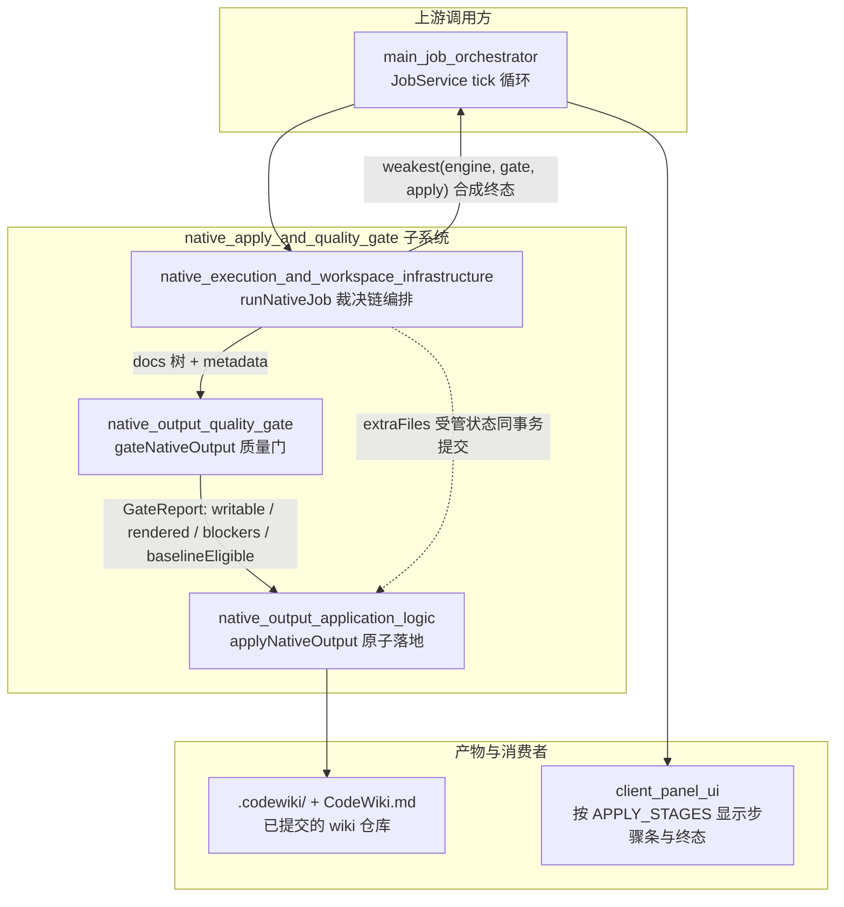
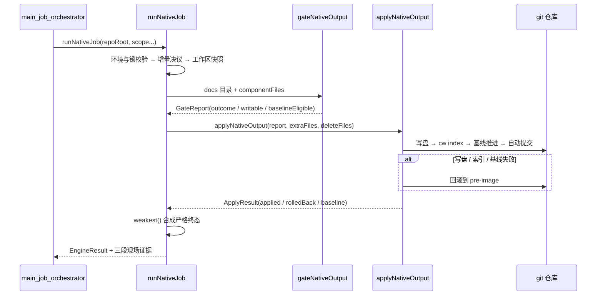

# 原生产物落地与质量门（native_apply_and_quality_gate）

## 模块定位

本模块是 CodeWiki **原生编译通道**（`nativeEngine: true`，自 0.16.0 起为默认通道）的中段裁决与入库子系统。它位于引擎把 docs 树生产出来之后、产物真正写进仓库之前，负责把一批引擎产出经过「执行编排 → 质量裁决 → 原子落地」三段流水线，变成 `.codewiki/` 与 `CodeWiki.md` 里的入库事实，并合成一个**严格终态**。

子系统由三个紧耦合的组件构成：

| 组件 | 一句话职责 |
| --- | --- |
| 原生执行与工作区基础设施 | 把一次完整编译固定成一条直线裁决链：环境校验 → 增量决议 → 工作区快照 → 引擎执行 → 校对 → 质量门 → 受管状态采集 → 落地 |
| 原生产物质量门 | 「这批产物能不能被 wiki 采用、能不能推进编译基线」的唯一仲裁点，输出机读 `GateReport` |
| 原生产物落地器 | 把「采用裁决」真正变成「入库事实」：写盘 → `cw index` → `cw meta update` → 自动 git 提交，任一步失败即回滚（索引后与 idle 短路轮各做一次存量坏页体检：不回滚、只降 partial 挡基线；非法裁剪根也记 `write-failed` 进终态） |

三段结论按「**最弱环说了算**」合成最终 outcome（`cancelled < failed < partial < done`），任何一步都不允许洗白下一步的结论——这是 0.14.0「引擎说 done 就 done、产物没入库也报完成」缺陷之后确立的核心验收标准。

## 架构总览

## 一次编译的数据流

## 核心组件文档

- [native_execution_and_workspace_infrastructure](native_execution_and_workspace_infrastructure.md)：原生通道的运行时底座。`native-run.js` 的裁决链编排与五条硬不变量、`native-state.js` 的跨轮受管状态（`.codewiki/_native-state/` 水合 / 采集 / 指纹 / 未消费变化携带）、`workspace-snapshot.js` 的临时 commit 快照（独立 index、不挂 ref）。
- [native_output_quality_gate](native_output_quality_gate.md)：采用门的完整裁决流程——六步纯组合裁决、defect / degradation / stale 三类问题分类（13 + 4 + 3 种冻结 kind）、基线取证（为什么必须读 `git show HEAD:.codewiki/_meta.yaml`）、`renderArticle` 链接重写与正文一字不动的契约。
- [native_output_application_logic](native_output_application_logic.md)：落地器的三条硬不变量（写集封闭 / 索引基线失败即回滚 / 提交失败不回滚）、四阶段事务流水线、四种 roundKind（normal / normalize / delete-only / idle）、pre-image 回滚机制、孤儿页与残留模块页扫描。

## 关键设计原则

- **最弱环终态**：三段结论取最弱值；`done` 仍带 blockers 则强制降级为 `partial`，`partial` 无 blockers 则补说明性 blocker，终态合法性由统一出口 `settle()` 保证。
- **问题三分**：质量门分类改变的是「谁来修、修什么」的定位，不是放宽闸门——只有三类问题皆空才是 `done`，`baselineEligible` 也只有这一种来源。
- **原子落地**：写集只允许 `.codewiki/` 与根 `CodeWiki.md`，越权即整批拒写；索引 / 基线失败逆序恢复 pre-image；自动提交失败只记 `commit-failed`，绝不删有价值的文章。
- **依赖注入**：落地器与执行层均通过 `deps` 注入外部能力（`runCw` / `commit` / `verifyCommit` / `runEngine` / `bridge`），单测不必拉起宿主服务与 webServer。