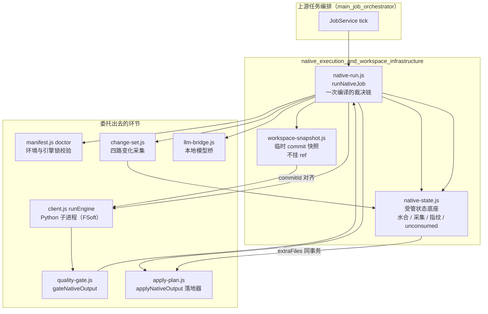
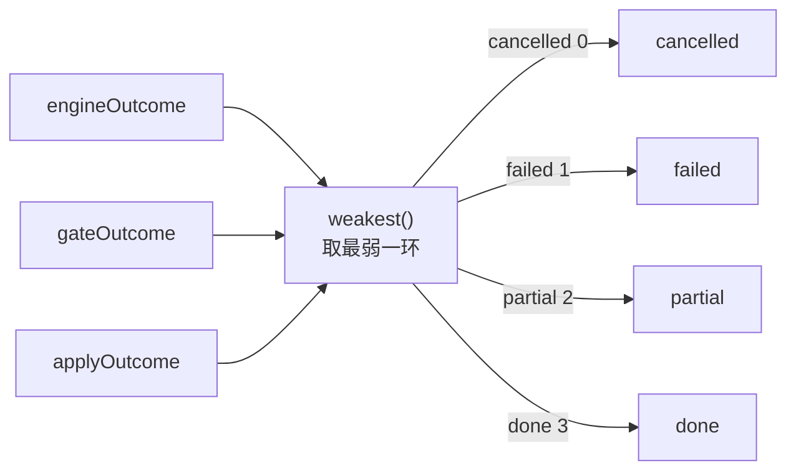
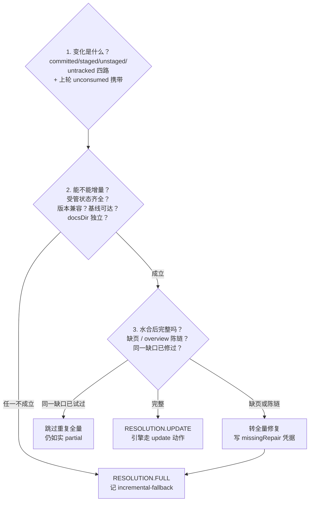
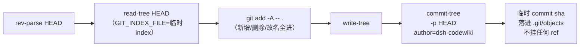
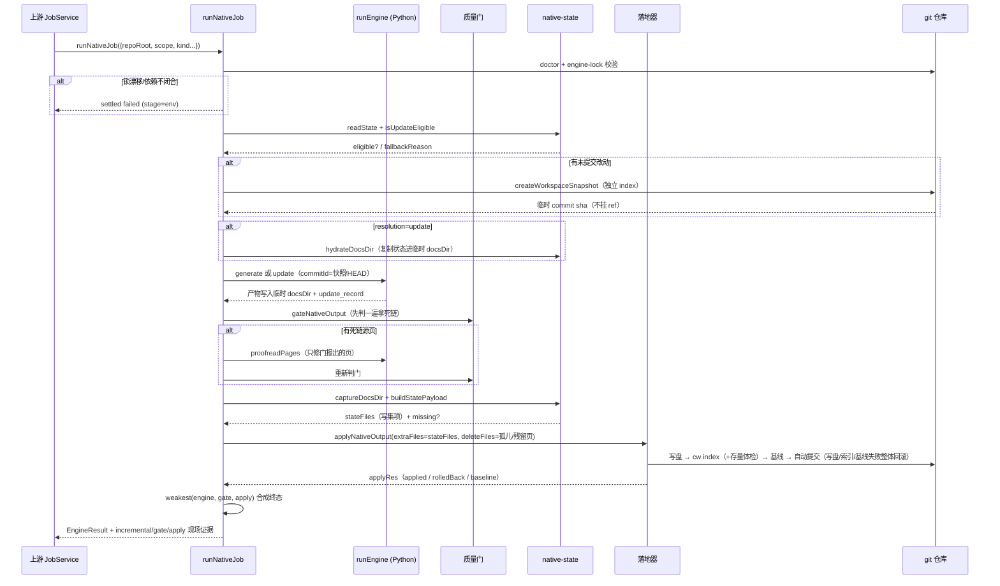

# 原生执行与工作区基础设施（native_execution_and_workspace_infrastructure）

## 模块定位

本模块是 CodeWiki **原生引擎通道**（`nativeEngine: true`，自 0.16.0 起为默认通道）的运行时底座，由三个紧密耦合的文件组成：

| 文件 | 职责 |
| --- | --- |
| `lib/engine/native-run.js` | 一次「完整编译」的裁决链编排：把 `环境校验 → 增量决议 → 引擎执行 → 校对 → 质量门 → 受管状态采集 → 落地` 固定成一条直线，并给出**严格终态** |
| `lib/engine/native-state.js` | 跨轮受管状态（`.codewiki/_native-state/`）的持久化底座：图/模块树/metadata/文章副本的水合、采集、指纹比对与未消费变化携带 |
| `lib/engine/workspace-snapshot.js` | 工作区快照：把未提交的四路改动合成一个**不挂 ref 的临时 commit**，让引擎的记账对象与产物内容对齐 |

它是 [native_output_application_logic](native_output_application_logic.md) 与 [native_output_quality_gate](native_output_quality_gate.md) 的直接上游：落地器（apply-plan.js）与质量门（quality-gate.js）只负责各自一段的裁决，本模块负责把三段结论压成一个「最弱环说了算」的最终 outcome，并且**不允许任何一步洗白下一步的结论**。

模块自身不直接写 wiki、不直接判产物质量——这些委托给：

- 编排依赖：[engine_orchestration](engine_orchestration.md)（`client.js` 的 `runEngine`、`manifest.js` 的 `doctor`/`buildLockBody`、`output.js`）；
- 契约校验：[article_validation_and_contract](article_validation_and_contract.md)（`contract.js`、`mapping.js`、`proofread.js`）；
- 模型通道：[llm_bridge_integration](llm_bridge_integration.md)（`llm-bridge.js`）；
- 落地与质量裁决：[native_output_application_logic](native_output_application_logic.md)、[native_output_quality_gate](native_output_quality_gate.md)。

构建侧，本模块依赖的 Python venv 由 [build_and_configuration](build_and_configuration.md) 中记录的 `tools/fsoft-engine/setup-env.sh` 按冻结快照落盘（`--no-deps` 安装 + `pip check` 兜底 + import 冒烟），Node 侧要求 `node >= 20`（见仓库 `package.json`）。

## 架构总览



## 核心组件详解

### 1. `runNativeJob`（native-run.js）——严格终态的裁决链

`runNativeJob` 是本模块的主入口（文件头注释中的 `noop` 仅为默认空回调）。它的存在理由在源码注释里说得很直白：JobService（`index.js`）已有 4800+ 行，若把 doctor/锁校验/模型桥/`runEngine`/gate/apply 全塞进 tick，「终态到底由谁裁决」会再次含糊——而 0.14.0 曾为此修过一轮缺陷（引擎说 done 就 done，产物没入库也报完成）。

**固定裁决链（每一步的结论都不能被下一步洗白）：**

```
env(doctor + engine-lock) → 增量决议(change-set + 受管状态) → 工作区快照
→ 水合 docs → 引擎(full|update) → 原始树留档 → 校对(死链修正) → 质量门
→ 受管状态采集 → 首次落锁 → 孤儿/残留页清理 → 落地器(写盘→index→基线→提交) → 合成终态
```

**五条硬不变量：**

1. **锁不一致 / 依赖不闭合 → 直接 failed，不跑引擎**：跑出来的产物不可信，「先跑再发现环境漂了」只会让用户看到一堆无意义的失败文章。
2. **引擎 done 不能替代质量门**：gate 说 partial，终态就是 partial。
3. **落地器说 partial/failed，终态不许是 done**：产物没入库就是没交付。
4. **failed/cancelled/partial 一律不推进基线**：未完整消化的变化留到下一轮；已写出的合格文章可保留，但整批变化不记为已消费。
5. **取消是终态，但取消不得抹掉已经发生的事实**：取消信号只终止引擎进程树（abort 在引擎阶段触发时不再 gate/apply）；落地器不接 signal，apply 一旦开始就跑完。走到合成终态这一步时若产物真的已落地（`applyRes.applied === true`），即使 signal 已 aborted 也按真实结果收尾，只把「取消来晚了」记进 notes——真正没落地（回滚或失败）时，取消才是那个该被报出来的事实（曾无条件报 cancelled，把已提交、已推进基线的一轮改写成「产物未落地、基线未推进」，下一轮从旧基线重新消费一批已消化的变化）。

**终态强弱合成（`RANK` + `weakest`）：**



强度排序：`cancelled(0) < failed(1) < partial(2) < done(3)`。三个环节（引擎 / 质量门 / 落地器）的结论取最弱值；`done` 若仍带 blockers 则强制降级为 `partial`，`partial` 若没有 blockers 则补一条说明性 blocker。

**关键常量：**

| 常量 | 值 | 说明 |
| --- | --- | --- |
| `DEFAULT_ENGINE_ENTRY` | `lib/engine/python/entry.py` | Python 引擎入口（[engine_python_runtime](engine_python_runtime.md)） |
| `DEFAULT_UPDATE_OPTIONS` | `{ rung: '3' }` | 显式要求组件级增量（图 diff 决定哪些模块重写）；不留空是为了防止上游默认值漂移导致增量语义静默变化 |
| `DEFAULT_ENGINE_TIMEOUT_MS` | `180 * 60 * 1000`（3 小时） | 按真机实测 174 分钟余量定的上限；超时靠引擎侧进程树终止兜底，不靠上层 tick |

**依赖注入设计：** 所有实现都可通过 `deps` 注入（`deps.doctor` / `deps.runEngine` / `deps.gate` / `deps.apply` / `deps.bridge` / `deps.collectChangeSet` / `deps.snapshot` …）。测试可以用假 `runEngine` + 真实 gate/apply，既覆盖接线又覆盖裁决。

**统一出口 `settle()`：** 所有分支（取消、环境失败、引擎失败、成功）都经过同一函数构造 `EngineResult`，保证 outcome 合法（done 不许带 blockers、partial 必须带 blockers、failed 必须有 error），并携带现场证据：`incremental`（决议现场）、`gate` / `apply` / `engineLock` / `artifacts`（含 `rawTree` 留档目录）、`notes`。三个基线与计数事实**分开记、各有来源**：`baselineEligible` 是质量门许可（`report.baselineEligible === true && !stateIncomplete`）；`baselineAdvanced` 是落地器事实（`applyRes.baseline.advanced === true`），兼容字段 `canAdvanceBaseline` 读它——此前没有任何业务分支传过 `baselineAdvanced`，JobService 落账的 `canAdvanceBaseline` 恒为 false，与「基线其实已经推进」的事实相反；`writtenCount` 只认落地器的实际写入数（0 就是 0），不再回退引擎自报值——曾写成 `written || 引擎自报值`，于是整批回滚的一轮在账上仍是「写入了 N 篇」，取消/失败的结果被引擎的意图数洗白。最后，若质量门报告了 `report.baseline.consumedInput`（产物 commit 与本轮合成快照一致、即「这轮把工作区未提交改动也写进了文章」），settle 前先把它压进 `notes`——基线推进过去靠「工作区必须干净」把关，现在改为认快照一致性，那「吞了哪些未提交改动」就必须让人看得见。

### 2. 增量决议（runNativeJob 1.5 段 + native-state.js）

「这一轮全量还是增量」必须由**证据**决定，而不是调用方的 `kind` 字面量。决议回答三个问题：



三个决议要点（源码注释强调）：

- **「变化集为空」不是跳过引擎的理由**：FSoft 的「有没有变」由**图 diff** 判定，不是 git 路径集合（重命名/跨文件重构能让路径集非空而图不变）。change-set 只决定「增量可不可信」，「变没变」留给引擎的 `update_record`。
- **水合后的缺页/陈链检测**：模块树里有从未写过页面的模块，或 overview 有指向已消失页面的陈链（聚类重构的残骸），必须转全量修复；但若同一棵树、同一批缺口上一轮已试过全量仍补不上（`missingRepair` 凭据比对 `baseCommit` + 缺口清单 + 无新变化），本轮不再重复全量浪费几十分钟，只如实报 partial。注意拿一棵解析不出来的 `module_tree.json` 去判缺页，判定结果必然不可信——因此 `module_tree.json` JSON 损坏（SyntaxError）时这一轮直接以 `failed`（stage=`graph`）收场，与 3.7 段孤儿页扫描「ENOENT 才吞、JSON 损坏必须抛」的口径一致；目录读不到、文件刚被别的进程挪走这类环境问题不阻塞增量，但**不能假装检查过**：notes 如实记「产物完整性检查未执行（带原始 errno）」而不是「检查失败」——「检查失败」与「没做检查」是两件事，后者必须让下游知道这一轮的增量决议未经缺页/陈页校验、少了一道证据。
- **只有「引擎真做了组件级增量（`updateOutcome=incremental`）且 gate/apply 全 done」才推进基线**；引擎自退全量（`full_fallback`）、检测器失败、gate 判 partial，一律不推进基线——下一轮 change-set 仍从旧基线算起，变化不会丢。推进基线的许可也不接受调用方硬开：`advanceBaseline` 只由裁决决定，受管状态不完整（`stateIncomplete`）**或引擎自报非 done（一批叶子失败）**时一律给 `false`——质量门只看产物质量、不知道引擎有一批叶子没写完，曾只传 `stateIncomplete`，于是引擎 partial + 门 done 时基线照常前移而终态却是 partial，那批没写完的变化从新基线算变化集时永久失明。

### 3. native-state.js ——跨轮受管状态底座

**为什么必须有这一层：** FSoft 的组件级增量（rung 3）要读上一轮留下的四样东西才能算出「改了什么」：

1. `module_tree.json` —— 模块树（缺失时 `_update_options()` 直接返回 None，增量退化为全量）；
2. `temp/dependency_graphs/<repo>_dependency_graph.json` —— 上一轮依赖图（做图 diff）；
3. `metadata.json` —— 其 `generation_info.commit_id` 是下一轮 updater 的 old_commit；
4. 上一轮的文章 —— updater 原地 patch，页面不在就走 missing_page 重建（等于白退全量）。

而引擎的 docs 输出目录是**每轮新建的临时目录**，轮间本来什么都不留。不持久化这些文件，第二轮必然退全量——这正是「每轮都在全量、又慢又贵，却一路绿到底」的根源。

**目录约定 `NATIVE_STATE_DIR = '.codewiki/_native-state'`：** 首段必须以 `_` 开头——`cw index` 会递归 WalkDir 整个 `.codewiki/` 收录所有 `.md`，只跳过路径以 `_` 开头的项。若把状态放进 `.codewiki/temp/native-state/`，持久化的原始文章会被收成**第二份**文章，索引里同一页出现两条链接。

**核心函数：**

| 函数 | 作用 |
| --- | --- |
| `stateDocFiles(stateDir)` | 列出受管状态的仓库相对路径清单（硬依赖文档 + 依赖图目录），供审计 |
| `isUpdateEligible({stateDir, repoRoot, baseCommit, engineVersion})` | 判断能否走真实增量：硬依赖齐全（含按 Unicode 仓库名对齐的图文件名）、引擎版本与状态记录一致、基线可对得上；每条不可行原因都写进 `reason`（「悄悄退全量」必须可见） |
| `hydrateDocsDir()` | 跑引擎前把受管状态**复制**（不是移动）进独立临时 docsDir；源在仓库受 git 管理，目标是引擎的就地改写工作区，一侧写坏不影响另一侧 |
| `captureDocsDir()` | 引擎写完后按白名单（所有 `.md` + 顶层 `.json` + temp 白名单）把状态**采集**成写集；缺硬依赖（图/树/metadata）时记进 `missing`，调用方据此判 `stateIncomplete` 并一票否决基线推进 |
| `buildStatePayload()` / `stateFileItem()` | 组装 `state.json`：只记「本轮开始时的已消费范围」与「本轮看见的变化」，**不记本轮结局**（基线是否推进的权威在 `_meta.yaml`，state.json 要在 apply 之前同 pre-image 落盘） |
| `stateFingerprint()` | 去掉 `updatedAt` 的实质内容指纹：无变化轮内容不变就沿用旧文本，不产生纯记账提交 |
| `mergeUnconsumed()` | 未消化变化合并：引擎读工作区文件（内容对），但基线只能推进到 HEAD——「已读进产物、还没进任何 commit」的路径每轮并入变化集，直到出现在 `git diff base..HEAD` 里（消费成立）才移出 |
| `archiveDocsTree()` | 把引擎产出的**整棵原始 docs 树**在被 gate/裁剪/落地器加工之前复制到仓库外留档（设计文档的「事实来源」）；留档是证据不是产物，失败只记 note |

**三条不变量：**

1. 只有「完整成功」才允许把本轮状态写成下一轮基线；partial/failed/cancelled 一律不推进。
2. 状态不完整（缺图/缺树/版本不符/基线不可达）→ 显式 full 并在 `state.json` 留 `fallbackReason`，绝不假装 clean。
3. 水合是复制不是移动。

状态文件与文章走**同一个 pre-image、同一次回滚、同一个自动提交**（apply 的 `extraFiles`）——「图/模块树/metadata/update_record 与文章同事务」不是约定，是结构。

### 4. workspace-snapshot.js ——工作区快照

**问题：** FSoft 只从 `<old_commit>..<new_commit>` 取 diff。它读的是工作区文件（内容对），但 `metadata.json` 的 `commit_id` 只能写 HEAD。于是「文章反映了工作区、账却指向 HEAD」——下一轮拿 HEAD 当 old_commit 就把未提交改动当成已消化，正是「变化悄悄丢」的入口。

**做法（独立 index 走 git 管道，全程不碰用户状态）：**



- 用户的分支、HEAD、工作区、真实 index **一个字节都不动**（`GIT_INDEX_FILE` 指向独立临时文件）；
- 得到的 sha 是真实可达 commit（`snapshotExists()` 用 `cat-file -t` 校验为 `commit`），引擎写进 `metadata.generation_info.commit_id` 后，下一轮能拿它做 old_commit；
- 它不挂在任何 ref 上，**不能当前移的基线**（gc 后自然消失）——这是对的，基线仍由 cw 记成 HEAD，未提交改动的连续性靠 native-state 的 `unconsumed` 携带，不靠基线自指；产物 commit 等于快照时，质量门不再把这批未提交改动判成 `uncommitted-input` 缺陷，而是记成 `report.baseline.consumedInput`（快照 commit + 路径清单），由 `runNativeJob` 在终态 notes 里如实报出「这轮吞了哪几个未提交源码改动」；
- `shortSha(sha)` 取前 12 位供日志/note 显示。

**失败语义：** 造不出快照**不算编译失败**（git 太旧/对象只读时退回用 HEAD 记账并记 note）——快照是对齐精度的改进，不是编译成立的前提。

## 一次编译的完整数据流



## 与其他模块的关系

- **被调用**：[main_job_orchestrator](main_job_orchestrator.md)（`job_orchestration_and_agentic_article_pipeline`）的 tick 循环按 `nativeEngine` 设置调用 `runNativeJob`，消费其 `outcome` / `blockers` / `writtenCount` / `gate.articles` 明细驱动面板展示。
- **委托裁决**：产物是否合格由 [native_output_quality_gate](native_output_quality_gate.md) 判定；产物如何入库存档（写盘、索引、基线、提交、回滚）由 [native_output_application_logic](native_output_application_logic.md) 执行——本模块只负责组装它们的结论。
- **运行时依赖**：Python 侧执行体见 [engine_python_runtime](engine_python_runtime.md)；引擎进程生命周期与进度协议见 [engine_orchestration](engine_orchestration.md)；结果契约（`engineResult` / `engineProgress`）见 [article_validation_and_contract](article_validation_and_contract.md)；模型请求通道见 [llm_bridge_integration](llm_bridge_integration.md)。
- **环境依赖**：Python venv 与引擎锁的落盘方式由 [build_and_configuration](build_and_configuration.md)（`tools/fsoft-engine/setup-env.sh`、`package.json` 的 `node >= 20` 要求）约束；cw CLI 对 `_` 前缀目录的跳过行为来自 [vendored_codewiki](vendored_codewiki.md)（`vendor/codewiki/src/main.rs` 的 WalkDir 索引逻辑）。

## 设计要点速查

| 主题 | 结论 |
| --- | --- |
| 终态由谁裁决 | 三段（引擎/门/落地器）最弱环，`runNativeJob` 统一 `settle()`，不允许任何一步被洗白 |
| 全量 vs 增量 | 证据决议：受管状态齐全 + 版本兼容 + 基线可达 + 独立 docsDir → `update`（rung 3），否则显式 `full` 并记 `incremental-fallback` |
| 未提交改动怎么对齐 | 临时 commit 快照（独立 index、不挂 ref）作 `commitId`；失败退回 HEAD 记账 |
| 吞了哪些未提交改动 | 产物 commit 与快照一致 → 门记 `baseline.consumedInput`，`runNativeJob` 在终态 notes 里报出路径清单与快照短 sha |
| 未提交改动的账 | `state.json` 的 `unconsumed` 每轮并入变化集，出现在 `git diff base..HEAD` 才移出 |
| 状态为什么放 `_native-state` | `cw index` 只跳过 `_` 前缀；否则持久化文章被收成第二份索引 |
| 无变化轮 | 不重写状态（指纹比对）、不裁旧状态、不推进基线/提交 |
| 原始产物可追溯 | `archiveDocsTree` 在被加工前整棵留档到仓库外（`rawTree` 字段），失败不影响终态 |
