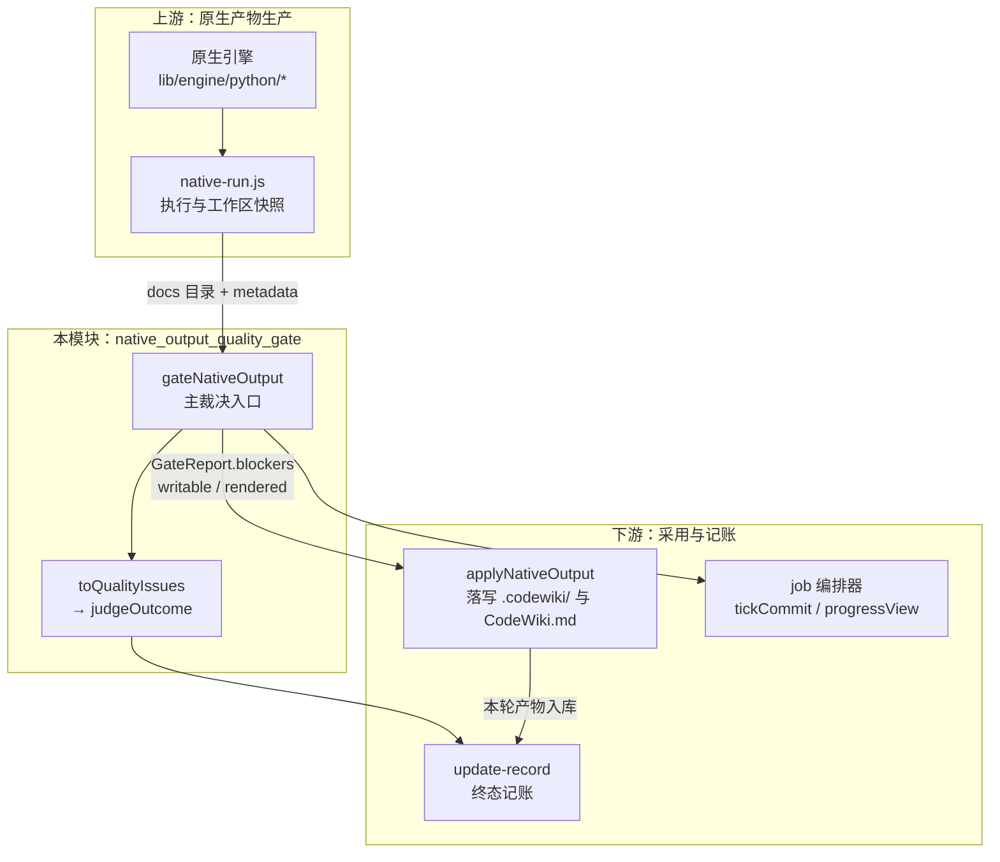
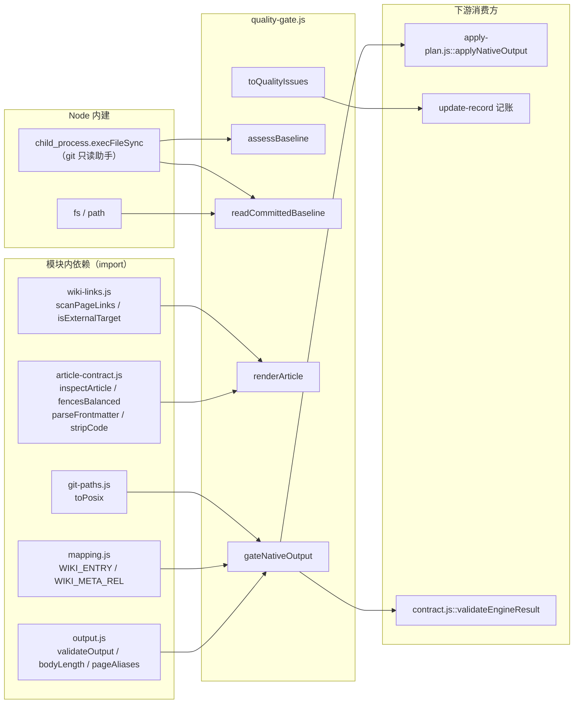
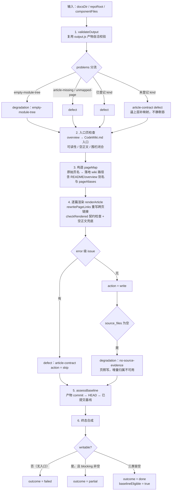
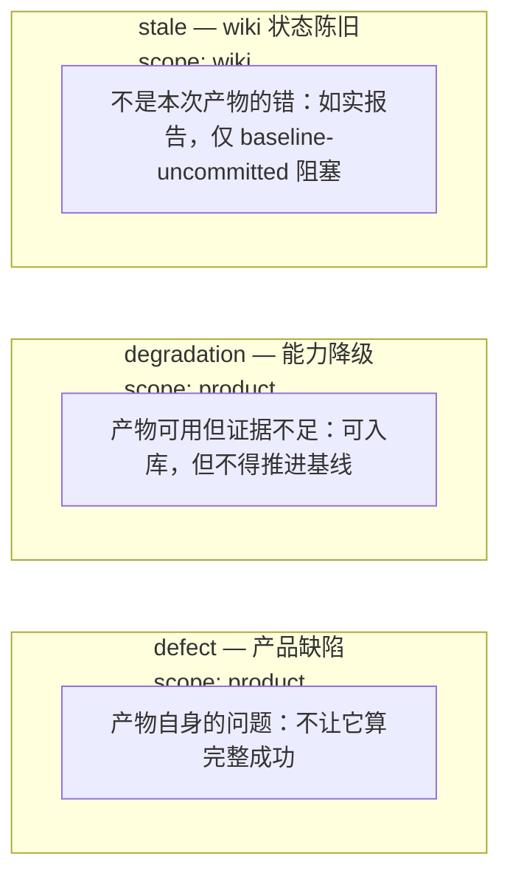
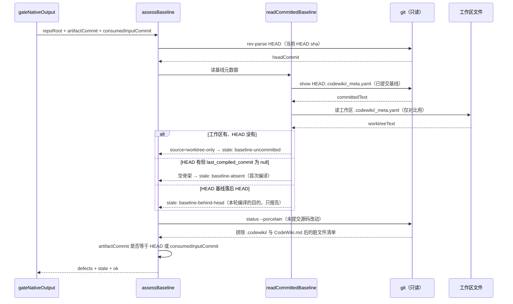

# 原生产物质量门（native_output_quality_gate）

## 简介

`native_output_quality_gate` 是原生编译管线的**阶段 3：采用门（quality gate）**，位于引擎把 `docs` 树交回来之后、把产物写进 `.codewiki/` 与 `CodeWiki.md` 之前。它是唯一的仲裁点：把「这批原生产物能不能被 wiki 采用、能不能推进编译基线」合成一个机读裁决。

核心实现集中在单文件 [lib/engine/quality-gate.js](../../../lib/engine/quality-gate.js)，对外导出两个入口函数：

- **`gateNativeOutput`**：主裁决入口，对一批原生产物做「读产物 → 渲染 → 契约 → 基线」的纯组合裁决，输出 `GateReport`。
- **`toQualityIssues`**：把裁决结论翻译给上层的 `judgeOutcome`（update-record）用，保证两条判定路径不会一严一松。

本模块存在的核心理由是**问题三分**：0.14.0 的教训是「1 篇成功 + 19 篇失败也报 done」；但反过来把一切塞进一个 blockers 数组同样有害——引擎会被归咎于不是它的问题，wiki 的陈旧状态会被当成产品缺陷。因此问题被分成 `defect` / `degradation` / `stale` 三类机读类别，分类改变的是「谁来修、修什么」的定位，**不是放宽闸门**——终态仍然严格：只有三类皆空才是 `done`。

---

## 架构定位

**管线位置**：本模块处于 [native_apply_and_quality_gate](native_apply_and_quality_gate.md) 子系统的中段，上接 [native_execution_and_workspace_infrastructure](native_execution_and_workspace_infrastructure.md)（`native-run.js` 产出的 docs 树与工作区快照），下接 [native_output_application_logic](native_output_application_logic.md)（`apply-plan.js` 的落地写盘）。整个引擎侧的总览见 [engine_core](engine_core.md)。

---

## 依赖关系

| 依赖来源 | 使用的符号 | 用途 |
| --- | --- | --- |
| `./output.js` | `validateOutput` / `bodyLength` / `pageAliases` | 阶段 1 的产物自洽校验复用，不重写任何判定 |
| `../article-contract.js` | `inspectArticle` / `fencesBalanced` / `parseFrontmatter` / `stripCode` | 渲染后文章的格式契约检查 |
| `./mapping.js` | `WIKI_ENTRY` / `WIKI_META_REL` | 落地入口名（`CodeWiki.md`）与基线元数据相对路径 |
| `../git-paths.js` | `toPosix` | 跨平台路径归一 |
| `./wiki-links.js` | `scanPageLinks` / `isExternalTarget` | 链接扫描规则与外链判定——与门、校对共用同一份，避免两边结论对不上 |
| Node 内建 | `fs` / `path` / `child_process` | 读产物文件；`git show/ status/ rev-parse` 只读取证 |

契约校验的完整判据（frontmatter 唯一闭合 / 围栏 / 死链 / `source_files` 证据 / 类型与位置匹配）由 [article_validation_and_contract](article_validation_and_contract.md) 定义，本模块只复用、不重写。

---

## 裁决流程

`gateNativeOutput` 是纯组合入口，固定执行六步：

**关键不变量**：

- **`baselineEligible` 只有一种来源**：本轮三类问题全空（`outcome === 'done'`）。0.16.1 曾允许 partial 也许可推进，用来打破「永远 partial ⇒ 基线永不推进 ⇒ 下一轮重复消费」的死循环；但那条例外把「没消化完」记成已消化。死循环的正确解法是让**首次编译**的空骨架基线能走成 done，而不是让 partial 偷偷推进。
- **`rendered` 收全部页的渲染结果**（包括有缺陷的页）。写不写由落地器按轮次决定：正常轮只写 `defects === 0` 的页，规范化轮全写（职责是让库与当前渲染规则对齐）。早先只收可写页，导致落地器永远看不见「有缺陷的旧落地页」，库内旧样式永久滞留。

---

## 三类问题分类（核心设计）

| 类别 | 稳定 kind 列表 | 含义 | 处置 |
| --- | --- | --- | --- |
| **defect**（13 种） | `missing-docs-dir` / `missing-metadata` / `missing-module-tree` / `bad-json` / `entry-missing` / `empty-body` / `article-missing` / `unmapped-page` / `source-missing` / `dead-link` / `article-contract` / `commit-mismatch` / `uncommitted-input` | 本次引擎产物自身的问题：缺入口、缺页、空正文、死链、`source_files` 指向不存在的文件、frontmatter 坏、围栏未闭合、产物 commit 不是 HEAD | 不算完整成功；对应页 `action = skip` |
| **degradation**（4 种） | `empty-module-tree` / `no-source-evidence` / `missing-section` / `empty-section-optional` | 页是真的、内容是真的，只是没法归属：whole-repository 模式 `module_tree` 为空、页映射不进 wiki、原生通道章节 warning | 可以入库，但**增量 ownership 不可信，不得推进基线** |
| **stale**（3 种） | `baseline-behind-head` / `baseline-uncommitted` / `baseline-absent` | 既有 wiki 的陈旧状态：基线落后 HEAD、基线只在工作区未提交、从未编译过 | 如实报告；只有 `baseline-uncommitted` 一条会阻塞推进（把未提交状态固化成已提交基线是不可逆的记账错误） |

分类对象是**稳定、可机读**的 kind 字符串：新增只允许追加（消费者按 kind 分派）；未登记的 output.js 问题一律归 `article-contract` defect，不静默吞掉。

---

## 数据流：基线取证

基线可推进性判据是本模块最容易被误解的部分，其数据流如下：

**为什么必须读「已提交」基线**（`git show HEAD:.codewiki/_meta.yaml`，而不是工作区文件）：本仓库的自动提交是插件侧异步做的，存在「已写入、未提交」窗口。把工作区的 `_meta.yaml` 当基线，等于把一堆未提交的产物宣布成「已消化」——下次编译的 base 会指向 git 里根本不存在的状态，变化要么重复消费、要么永久失明。

**为什么快照 commit 不算 `commit-mismatch`**：本轮若已把工作区改动合成临时 commit（native-run 的快照段，不挂 ref），产物对应那棵「含工作区内容」的树。它不等于 HEAD 不是「对不上代码」，而是「对上了比 HEAD 更完整的代码」；此时脏工作区不再判 `uncommitted-input` 缺陷，而是记成 `baseline.consumedInput`（快照 commit + 未提交路径清单）作为证据——「这轮吞了哪几个未提交改动」由 native-run 在终态 notes 里如实报出。基线仍不拿快照当账：cw 记 HEAD，未提交路径的连续性靠 native-state 的 `unconsumed` 携带，不靠基线自指。

---

## 核心 API

### `gateNativeOutput(options) → GateReport`

| 参数 | 类型 | 说明 |
| --- | --- | --- |
| `docsDir` | string | 引擎产出的 docs 目录 |
| `repoRoot` | string? | 仓库根（`source_files` 存在性、git 基线判定用） |
| `componentFiles` | object | 组件 id → 仓库相对文件（`source_files` 的唯一证据） |
| `overviewName` | string? | 概览页文件名，默认 `'overview.md'` |
| `baseline` | object? | `readCommittedBaseline` 的结果，不给则现读 |
| `requireCommittedInput` | boolean? | 是否要求产物对应干净的已提交 HEAD，默认 `true` |
| `consumedInputCommit` | string? | 本轮合成的工作区快照 commit（产物对它的即为「对得上」） |
| `includeContent` | boolean? | 返回值是否带渲染后正文，默认 `true` |

**返回的 `GateReport` 关键字段**：

| 字段 | 说明 |
| --- | --- |
| `outcome` | `done` / `partial` / `failed` 三态；`ok` 等价于 `outcome === 'done'` |
| `writable` | 是否有可用入口页（无入口则整批不可入库，直接 `failed`） |
| `baselineEligible` / `canAdvanceBaseline` | 是否允许推进编译基线（后者是兼容字段，语义完全一致） |
| `articles` / `rendered` | 逐篇裁决结果（`action: write/skip`、缺陷计数）与渲染全文 |
| `defects` / `degradations` / `stale` / `blockers` | 三类问题清单；`blockers` = defects + degradations + 阻塞性 stale（`baseline-uncommitted`） |
| `counts` / `baseline` | 页数、可写/跳过/未映射计数；headCommit 与 artifactCommit 对照，外加 `consumedInput`（产物 commit 等于本轮快照时的快照 commit 与被吞掉的未提交路径清单，否则为 null） |

### `toQualityIssues(report) → Array<{name, issue}>`

把 `GateReport` 翻成 update-record 的 `qualityIssues`（`judgeOutcome` 的输入之一）。**必须有这一条的原因**：`judgeOutcome` 只按「计划内文章写成了没有」判 done——一篇可写但 `source_files` 为空的页在它眼里就是「成功」；而空 `source_files` 正是「增量归属不可用」的证据降级，推进基线等于把归属不明的产物记成「已消化」。注意 `stale` 里只有 `baseline-uncommitted` 会喂进去——`baseline-behind-head` 正是本轮要消化的对象，混进去会让每次增量都落 partial。

### 其他导出（供上层复用）

| 函数 | 职责 |
| --- | --- |
| `renderArticle({article, body, pageMap})` | 合成 frontmatter（title / type / source_files / tags / `generated_by: fsoft-native` / `fsoft_page`）+ 原文 |
| `rewritePageLinks(text, pageMap, articleWikiPath, sourcePath)` | 正文跨页链接按落地路径重写；未命中的 `.md` 链接降级成纯文字 |
| `readCommittedBaseline({repoRoot})` | 读 `git show HEAD:.codewiki/_meta.yaml` 已提交基线 |
| `uncommittedSourceChanges({repoRoot})` | 工作区「非 wiki」未提交改动清单（排除 `.codewiki/` 与 `CodeWiki.md`） |
| `assessBaseline(...)` | 基线裁决纯函数（可注入 baseline，便于测试） |
| `toContractBlockers(report)` | 翻成 [article_validation_and_contract](article_validation_and_contract.md) 的 `BLOCKER_KINDS`；对不上的一律归 `quality-gate`（宁可粗不能漏） |
| `yamlScalar` / `titleOf` | YAML 标量安全序列化（serde_yaml 兼容）；正文 H1 提取为 frontmatter title |
| 常量 | `GATE_VERSION = 1`；`GATE_DEFECT_KINDS` / `GATE_DEGRADATION_KINDS` / `GATE_STALE_KINDS`（冻结数组） |

---

## 关键设计决策

1. **正文一字不动**。`renderArticle` 只做两类规范化：剥 BOM、把跨页链接改成落地路径。不删 H1、不改标题、不重写链接、不补章节——正文一旦被本层改写，「模型写了什么」就无法逐字复核。frontmatter 结束标记后不插空行（`parseFrontmatter` 会把空行算进 body，破坏「wiki 这篇 = 引擎那篇」的逐字比对不变量）。
2. **frontmatter 只填有证据的字段**。`source_files` 原样来自映射（空就是空），绝不按目录名猜；空列表显式写成 `source_files: []`，让 downstream 区分「声明为空」与「没声明」。`fsoft_page` 记住正文来自 FSoft 原始树的哪个文件，保证可回溯。
3. **链接重写的解析基准是引擎源页目录，不是落地目录**。层级布局下正文写 `x_sibling.md` / `../parent.md`，而落地时页被拍平到 `.codewiki/modules/` 单层；按落地目录解析 pageMap 一条都命不中（真机测得 420 条内部链接 412 条失效）。pageMap 还并入 `README.md` / `overview.md` → `CodeWiki.md` 别名与 `pageAliases` 别名表。
4. **代码区域不改写**。演示链接写法的行内代码/围栏块由 `stripCode` 等长掩蔽后再扫描，避免把语法示例改成真实路径。
5. **原生通道不沿用 agentic 通道的章节要求**。`checkRendered` 通过共享常量 `NATIVE_ARTICLE_OPTS`（`requiredSections` 置空）调用 `inspectArticle`：FSoft 正文结构由上游 prompt 决定，计划硬约束是「不改技术内容」；用别的通道的章节名去判，产出的每条都是不可修复的 warning。`NATIVE_ARTICLE_OPTS` 与落地器的存量体检（`auditExistingArticles`）共用同一套 `inspectArticle` 选项，避免两处各写一遍后漂移。章节非空性由 `checkRendered` 单独判「至少一个非空二级标题」。
6. **空壳页兜底**。`bodyLength` 只跳第一个标题行，直接喂全文会把合成的 8 行 frontmatter 当正文——`checkRendered` 先剥掉 frontmatter 再算空正文，兜住「只有标题的空壳页」。
7. **YAML 安全序列化用 `JSON.stringify`**。serde_yaml 是 JSON 的超集，真实页标题里的 `: `、` #`、反斜杠（Windows 路径）、`true`/`null` 等裸写都会被误解析；安全形态保持裸值，与既有文章观感一致。

---

## 与其他模块的关系

- **上游**：产物来自 [engine_python_runtime](engine_python_runtime.md)（FSoft 引擎子进程）与 [native_execution_and_workspace_infrastructure](native_execution_and_workspace_infrastructure.md)（`native-run.js` 执行、工作区快照、`native-state.js`）。
- **兄弟**：产物自洽校验复用 [article_validation_and_contract](article_validation_and_contract.md)（`output.js` / `article-contract.js` / `wiki-links.js` / `mapping.js`）；引擎编排侧的 `runEngine` / 进程树与输出记账见 [engine_orchestration](engine_orchestration.md)。
- **下游**：裁决结果驱动 [native_output_application_logic](native_output_application_logic.md) 的 `applyNativeOutput` 落写盘（只写 `action === 'write'` 的页）；`toQualityIssues` / `toContractBlockers` 分别喂给 update-record 终态记账与 [article_validation_and_contract](article_validation_and_contract.md) 的 `validateEngineResult`。
- **总览**：本模块所属子系统见 [native_apply_and_quality_gate](native_apply_and_quality_gate.md)，引擎整体见 [engine_core](engine_core.md)；上层 job 如何消费 GateReport（`tickCommit`、`progressView`）见 [main_job_orchestrator](main_job_orchestrator.md)。

构建与打包上下文：该插件以 ESM 发布（`"type": "module"`，Node ≥ 20），见 [build_configuration_and_test_verification_tooling](build_configuration_and_test_verification_tooling.md)。
